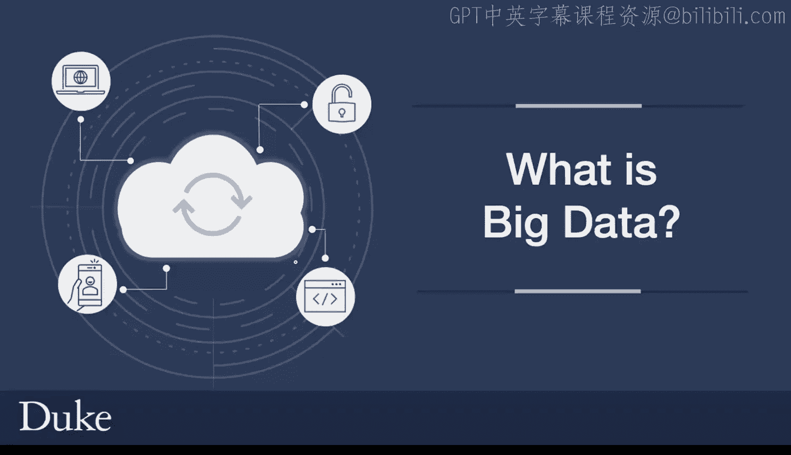

# 构建大规模云计算解决方案：3-4：什么是大数据

## 概述
在本节课中，我们将要学习“大数据”这一核心概念。我们将探讨大数据的定义、它与传统数据处理方式的区别，以及为什么需要专门的技术和工具来处理它。

---

## 什么是大数据
这是一个非常重要的问题。当你刚开始接触数据科学和数据工程时，需要明确一个关键点：如果你在个人笔记本电脑上工作，那么你处理的就不是大数据。因为根据定义，大数据无法完全存放在一台笔记本电脑上，也无法在单台笔记本电脑上进行有效操作。

其中一个原因是，你通常使用的工具（例如Python中的pandas库）是为学术环境或小型数据集设计的。pandas有一个内存使用要求：它需要**数据量10倍**的随机存取存储器（RAM）。例如，如果你处理一个10GB的数据集，而你的笔记本电脑只有16GB的RAM，那么理论上需要**100GB的RAM**才能处理该数据。这显然是不可行的。

因此，你必须采用不同的方法论和工具集。

---

## 大数据世界的工具
在大数据领域，你可以使用**Spark**、**Athena**或其他大数据工具集。这些工具能够将计算负载**分布到多台机器**上，从而处理单台机器无法胜任的数据量。

---

## 选择合适的工具：一个类比
理解如何选择工具，可以借助一个交通方式的类比。关键在于为手头的任务选择最合适的工具，没有一种工具能适用于所有情况。

以下是不同场景下的工具选择：
*   **场景一：校园内短距离移动**。如果你在大学里，需要去一英里外的下一堂课，**自行车**可能是最佳工具，因为校园内通常不允许汽车通行。
*   **场景二：郊区通勤**。如果你从郊区通勤20英里去上班，**汽车**或某种形式的**公共交通**可能是更好的选择。
*   **场景三：建造住宅区**。如果你要建造一个住宅区，需要移动数吨的泥土，那么**拖拉机**就是完成这项工作的正确工具。

数据处理也是如此。你必须为具体的任务选择正确的工具。

---

## 总结
本节课中，我们一起学习了“大数据”的概念。我们明确了大数据无法在单台笔记本电脑上处理的核心特征，并理解了这主要是由于传统工具（如pandas）的内存限制。为了解决这个问题，我们需要使用像Spark这样能够分布式处理数据的专门工具。最后，通过一个交通方式的类比，我们强调了根据具体的数据规模和处理需求来“选择合适的工具”这一重要原则。