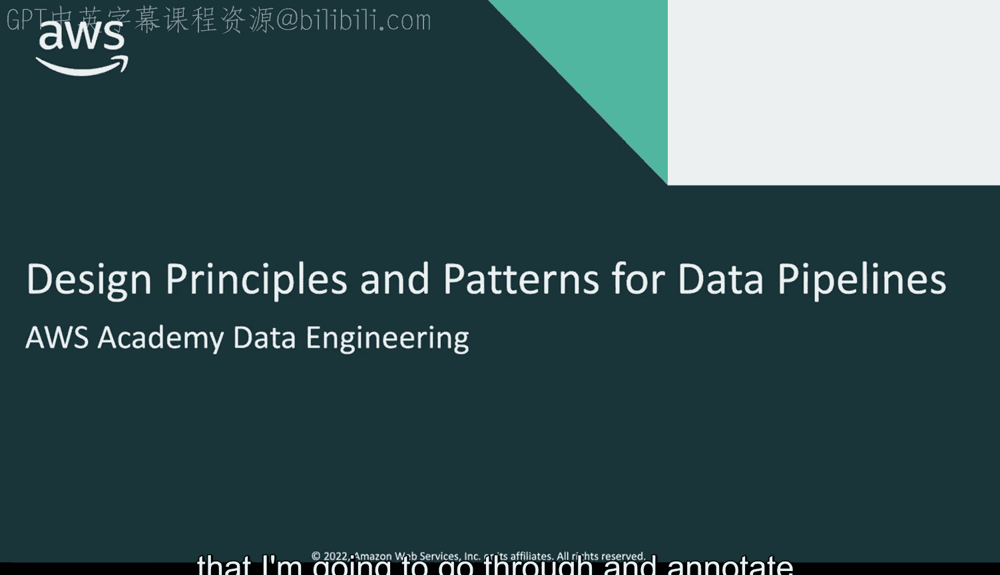
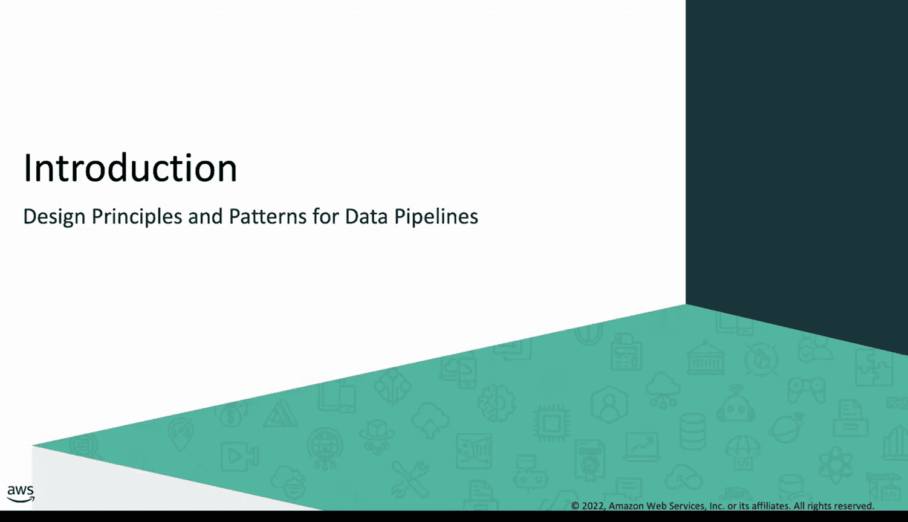
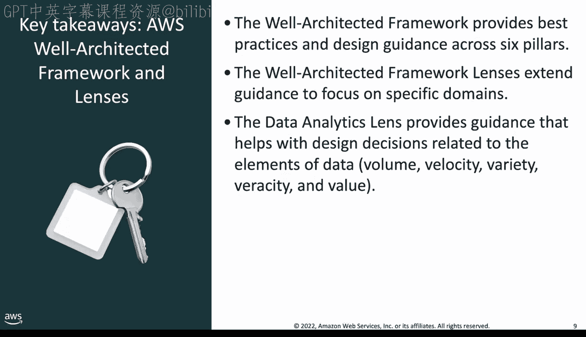
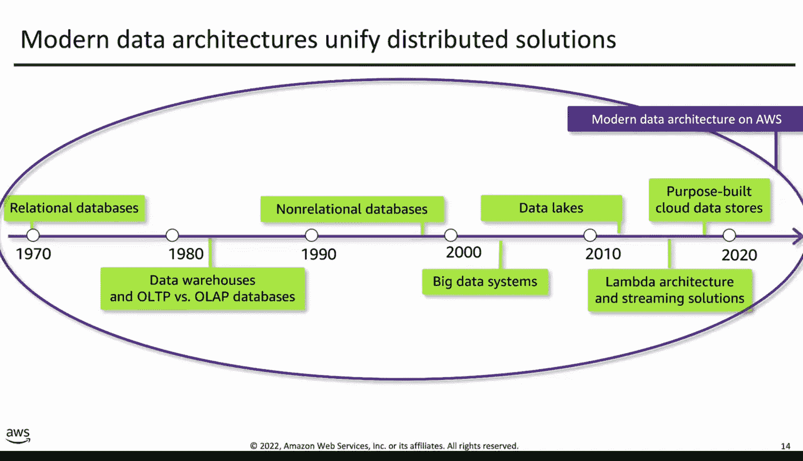
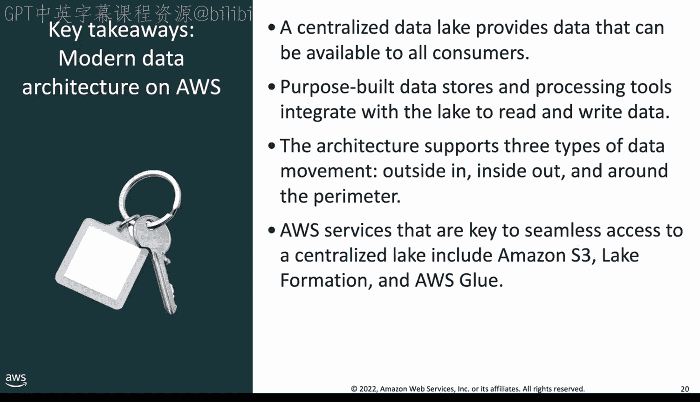
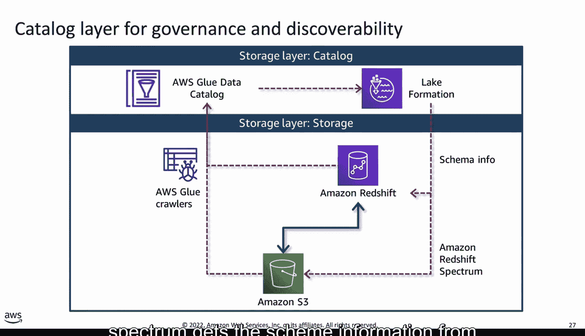
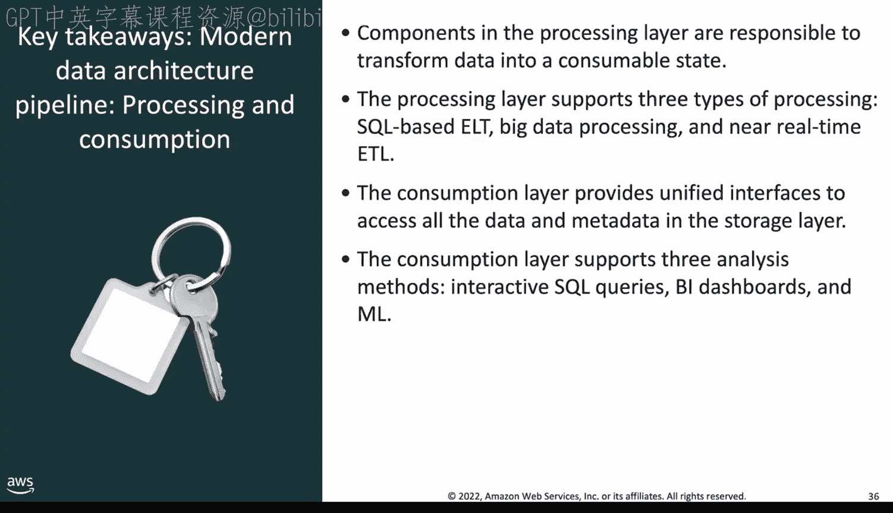
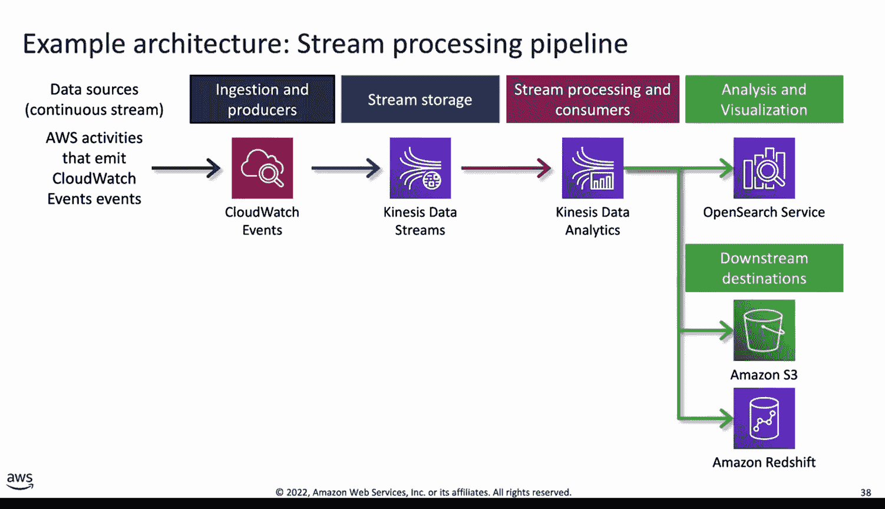
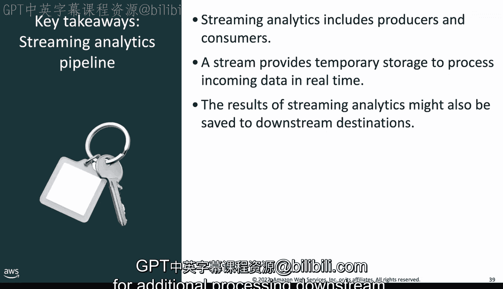

# 构建大规模云计算解决方案（数据工程、机器学习）：3：AWS数据工程设计原则导论 🚀

在本节课中，我们将学习AWS数据工程的设计原则与模式。我们将从AWS架构完善的框架入手，探讨数据架构的演进、现代数据架构的组成，并深入了解流式处理管道的设计考量与关键服务。

## AWS架构完善框架 🏛️

首先，我们介绍AWS架构完善的框架。这是构建任何AWS系统的基础，包含六个支柱：**卓越运营**、**安全性**、**可靠性**、**性能效率**、**成本优化**和**可持续性**。这个框架是思考系统设计的良好起点。

此外，该框架还提供了针对特定领域的“透镜”指导。例如，**数据分析透镜**专门针对分析型工作负载的架构设计，提供了大量相关信息。

总而言之，该框架的核心是上述六个支柱，并针对数据问题（如数据量、速度、多样性、准确性和价值）提供了具体指导。

## 数据架构的演进 📈

上一节我们介绍了设计框架，本节中我们来看看数据架构是如何演进的。过去50年左右，系统从大型机、客户端/服务器、互联网三层架构，发展到基于云的微服务。

数据存储也随之演变。最初，一切都围绕SQL数据库设计，结构非常僵化。在互联网时代，出现了非关系型数据库。大约在2010年的大数据时代，数据湖开始兴起，实现了计算与存储的分离。如今，我们看到了为特定目的构建的云原生系统，例如微服务。

数据架构的演进是为了应对数据量和速度的挑战。在20世纪80年代，数据库不堪重负。在21世纪初，关系型数据库并非为AI/ML设计。而大数据时代的系统又难以满足实时性需求。因此，我们需要进一步的演进和现代化，而AWS可能是解决这些问题的方案之一。

关键要点如下：
*   数据存储和架构的演进是为了适应数据量、多样性和速度的需求。
*   现代数据架构继续使用不同类型的数据。
*   目标是将这些不同来源的数据统一起来，维护单一事实来源。

## 现代数据架构 🏗️

了解了演进历程后，我们聚焦于现代数据架构在AWS上的实现。其关键设计特征包括：拥有一个**数据的集中存储位置**，可供所有消费者进行分析和运行AI/ML。但这并不意味着只有一个数据存储或单一事实来源。

数据湖提供了一个集中存储库，但数据既可以从湖中查询，也可以移动到其他为特定目的构建的系统中，例如NoSQL数据库。

现代数据架构有三种数据流动模式：
*   **由外向内**：组织将数据存储在为特定目的构建的数据存储（如数据仓库或数据库）中。
*   **由内向外**：组织将数据存储在数据湖中，然后将部分数据移动到为特定目的构建的数据存储中。
*   **周边流动**：组织将数据直接从与数据湖集成的其他数据存储组件移动，而无需访问数据湖本身。一个很好的例子是将产品目录复制到数据库中，以便更轻松地进行搜索。

现代数据架构旨在通过一个统一的架构解决上述诸多问题。

## AWS为特定目的构建的数据服务 🧩

现在，我们来具体看看AWS为特定目的构建的数据和分析服务。

以下是AWS数据架构中的关键服务：
*   **Amazon S3**：为结构化和非结构化数据提供存储，是在AWS上构建数据湖的首选存储服务。使用S3可以经济高效地构建和扩展任意规模的数据湖。
*   **Amazon Athena**：在数据湖上提供交互式查询。
*   **Amazon Redshift**：完全托管的数据仓库。
*   **Amazon OpenSearch**：为特定目的构建的数据存储。
*   **Amazon EMR**：用于大数据处理。
*   **Amazon Aurora**：为云构建的关系型数据库引擎。
*   **Amazon DynamoDB**：为运行高性能应用程序而设计的非关系型数据库。
*   **Amazon SageMaker**：使机器学习处理大众化的AI/ML服务。
*   **AWS Lake Formation**：旨在简化与加载、监控和管理数据湖相关的耗时任务。它有助于对数据进行编目、分类和安全保护，以控制不同类型的访问。

关键要点如下：
*   数据湖提供集中存储，并与为特定目的构建的数据存储和处理工具集成。
*   数据湖本质上具有无限容量。
*   数据流入数据湖是“由外向内”，从数据湖流出到其他存储是“由内向外”，也可能直接从为特定目的构建的存储“周边流动”。
*   Amazon S3提供数据湖，而Lake Formation和Glue提供无缝访问。

## 现代数据架构管道：摄取与存储 📥

接下来，我们深入探讨现代数据架构的管道，首先是**摄取与存储层**。

摄取层负责将数据从源头引入。您可以将AWS服务与源数据匹配，以便更轻松地引入不同类型的数据。这些服务也直接与存储层组件集成。

存储层包含两个子层：第一个是**存储层**，第二个是**编目层**，用于查看元数据和数据集。

以下是针对不同数据源的摄取服务：
*   **Amazon AppFlow**：从SaaS应用程序（如Salesforce或Zendesk）摄取数据。
*   **AWS Database Migration Service (DMS)**：从操作型数据库（如OLTP、ERP、CRM或业务线数据库）摄取数据。
*   **AWS DataSync**：从文件共享中摄取数据。
*   **Amazon Kinesis Data Streams** 和 **Kinesis Data Firehose**：从流数据源摄取数据。

存储层的数据存储部分提供持久性、可扩展性和经济高效的组件。在此架构中，Redshift和S3将提供统一且原生集成的存储层。

存储层中的编目层负责存储关于数据的业务和技术元数据。这对于数据治理至关重要。元数据支持定义、查找和查询存储在数据湖和数据仓库中的数据，而无需执行昂贵的操作来查找数据。在此架构中，Lake Formation和AWS Glue将协同工作，收集和存储此元数据，并在需要时提供。

数据仓库中的数据通常从高度结构化的源（如事务系统、关系型数据库）按固定节奏摄取。但Redshift也支持将半结构化数据摄取到暂存表中，以便进行某种分析。

数据湖中的数据通常用于驱动机器学习或数据科学。Amazon S3数据湖支持以结构化、半结构化甚至非结构化格式存储数据，并可在幕后自动扩展，实现“无限容量”。S3和Redshift之间的原生集成意味着您可以将数据摄取到S3中，并根据需要为数据仓库准备数据。

S3中的一个重要概念是**存储区**，包括**着陆区**、**原始区**、**可信区**和**精炼区**。数据在清洗、规范化、增强和转换的过程中会流经这些区域，然后存储在符合消费准备状态的区域中。

例如，摄取到Amazon S3数据湖中的数据首先到达着陆区，然后经过清洗并存储到原始区进行永久存储。 destined for a data warehouse的数据需要高度可信并符合模式，因此可能需要进行进一步处理。额外的转换可能包括应用模式、分区或重命名字段。然后，处理层通过建模和增强数据（称为“丰富”）为精炼区准备数据，以便与其他数据集连接，并以允许转换和验证的方式存储。精炼区的数据集已准备好被摄取到数据仓库中，以供低延迟访问或复杂的SQL查询。

在编目方面，**AWS Glue**服务可帮助您通过管道简化数据移动和转换。您可以使用Glue生成模式，也可以使用AWS Glue数据爬虫自动发现模式并生成元数据。查看数据湖的最佳方式可能是推断模式，然后将推断出的模式放入编目。在AWS Glue数据目录的情况下，它可以将数据和元数据发送到Lake Formation。然后，Lake Formation服务可以简化数据湖的访问设置和安全保护。对于数据湖而言，拥有适当的数据治理至关重要，以确保您了解谁有权访问数据的哪些部分，并且不会因以不符合组织法律需求的方式提供数据访问而导致数据泄露或违法。

您还可以使用**Amazon Redshift Spectrum**，它允许用户编写SQL查询，将数据湖和数据仓库中的数据结合起来。当用户发出查询请求时，Spectrum从Lake Formation目录获取模式信息，并用它来查询数据湖。

总而言之，关键要点如下：
*   AWS现代数据架构使用为特定目的构建的工具，根据数据的特性来摄取数据。
*   存储层包括两层：第一层是使用Redshift作为数据仓库、Amazon S3作为数据湖的存储层；第二层是使用AWS Glue和Lake Formation的编目层。
*   该编目可以维护元数据，并向最终用户提供模式。

## 现代数据架构管道：处理与消费 ⚙️

现在，我们讨论现代数据架构中的**处理与消费层**。处理层准备数据并使其可供消费者使用。消费层等同于数据管道的分析和可视化部分，也可称为消费层。

在处理方面，每个管道都会从存储层读取数据，根据需要利用临时存储进行处理，然后将结果写入存储层的适当位置。

处理可分为三种主要类型：
*   **基于SQL的处理**：使用像Redshift这样的数据仓库。
*   **大数据处理**：使用像Amazon EMR、AWS Glue或Databricks、Snowflake这样的工具。
*   **实时处理**：使用像Amazon Kinesis Data Analytics或Spark Streaming这样的流处理技术。

消费层负责使用可扩展且高性能的组件，通过统一接口访问存储层中的所有数据和元数据。该层将数据集的访问民主化，供组织内不同类型的用户使用，并支持不同的分析方法。每种方法都能够结合来自数据仓库（以传统模式存储）和来自数据湖（以开放格式存储）的数据。

通过交互式SQL消费数据，可以考虑使用面向业务分析师和数据科学家的工具，例如Redshift、Redshift Spectrum和Athena。强大之处在于，您可以将数据存储在一个地方，然后使用交互式SQL进行查询。即使SQL语言最初开发于20世纪70年代初，您也可以在复杂的无服务器大数据系统中使用相同的查询语言。

**Amazon QuickSight**是一个无服务器系统，可帮助您创建和发布交互式商业智能仪表板。组织可以使用QuickSight等BI工具来获取商业智能，并通过自动电子邮件洞察（如预测和异常检测）来丰富仪表板和可视化效果。

在消费数据以进行机器学习方面，此架构中的接口简化了数据准备步骤。数据科学家在准备数据后，可以通过将ML工具连接到存储层来开发、训练和部署模型。**SageMaker**将连接存储层以访问训练特征集。SageMaker是一项完全托管的服务，提供使用名为Amazon SageMaker Studio的集成开发环境（IDE）来构建、训练和部署模型的组件。在Studio中，您可以上传、创建新笔记本、训练和调整模型，甚至可以使用代码编辑器在SageMaker界面内进行构建。

总而言之，关键要点如下：
*   处理层是数据为某种消费类型进行转换的地方。现代数据架构支持三种通用类型的处理：基于SQL的ETL、大数据和近实时ETL。
*   消费层包括访问存储层中数据和元数据的组件，包括由处理层转换的数据。消费层支持三种分析方法：交互式SQL查询、BI仪表板和机器学习。

## 流式分析管道 🌊

最后，我们来讨论流式分析管道。简而言之，它遵循相同的一般规则，但有一些独特的考虑因素。

首先，数据源包括点击流日志、移动应用程序、现有应用程序数据库、物联网设备等任何需要实时分析或后续分析的数据。**生产者**将记录摄取到流中，生产者是从源收集数据并加载到流中的集成组件。**消费者**随后处理这些记录。

以物联网为例，生产者可能是不断发送数据包的传感器设备，而消费者将处理该记录。在典型的管道中，例如一个Amazon CloudWatch事件，生产者会将该事件放到流上，然后Kinesis Data Streams提供存储。

对于实时流分析，流上的记录通常按顺序、逐条地在滑动时间窗口内进行增量处理。在AWS上，一种思考管道的方式是**Kinesis Data Analytics**，它是流的消费者，处理用于自定义应用程序甚至标准SQL的流数据。您甚至可以将结果发送到OpenSearch服务，并立即使用OpenSearch仪表板可视化实时洞察。

关键要点如下：
*   流式分析包括将数据放入流的生产者和从流中获取数据的消费者。
*   流提供临时存储，以实时处理传入数据，并交付给实时应用程序（如实时仪表板）。
*   流式分析的结果也可能保存到更持久的存储系统中，以供下游进行额外处理。

## 总结 📝

在本节课中，我们一起学习了AWS数据工程的核心设计原则与模式。我们从AWS架构完善的框架出发，回顾了数据架构的演进历史，深入剖析了以数据湖为核心的现代数据架构及其在AWS上的实现。我们详细探讨了数据管道的各个层次：摄取与存储、处理与消费，并特别介绍了用于实时数据分析的流式处理管道。通过理解这些设计原则和AWS提供的丰富服务（如S3、Redshift、Glue、Lake Formation、Kinesis等），您可以为构建可扩展、高效且安全的大规模云数据解决方案奠定坚实的基础。