# 构建大规模云计算解决方案：3：使用AWS处理大数据

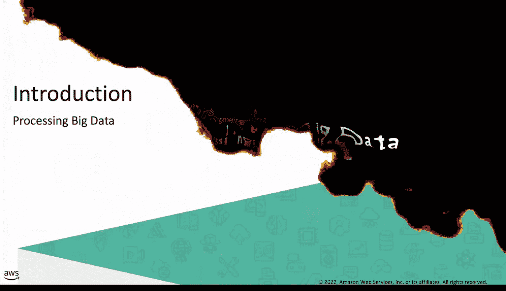

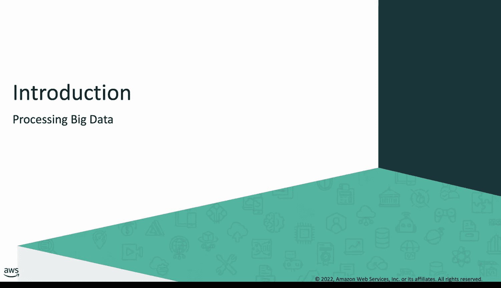

在本节课中，我们将要学习如何选择最适合您工作负载的大数据处理框架。我们将探讨Hadoop、Amazon EMR以及AWS上的数据处理服务，并介绍一些较新的产品，如Apache Hudi。

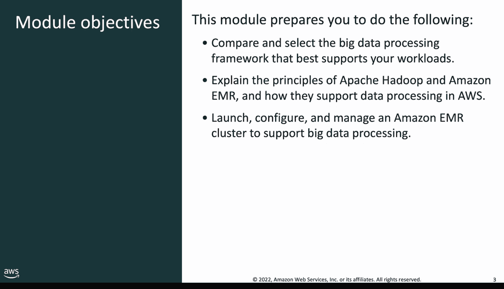

## 概述

大数据处理是一个重要且广泛的话题。我们将从核心概念入手，了解数据如何在处理与存储之间流动，以及原始数据如何被摄取、存储、转换和处理。数据通常以不同格式存在，这些格式用于分析和可视化。我们将讨论用于处理大数据的框架以及用于分析及机器学习流水线的服务。

## 数据处理架构

首先，我们可以考虑一种架构，即多个ETL或ELT流水线，它们为不同类型的准备和消费执行数据的迭代处理。每个流水线从存储层读取数据，根据需要利用临时存储进行处理，然后将结果写入其他存储层的适当位置。

接下来，我们来看看这种架构如何工作。

## 批处理与流处理

在批处理方面，这通常涉及查询海量数据，例如不常访问的冷数据。批处理可能需要数小时来分析数据以获取结果。一个很好的例子是K-Means聚类。通过K-Means聚类，您可能每周执行一次操作，以从大量客户数据中发现洞察。

批处理作业需要扫描所有新的输入数据，并且可以容忍部分结构化或非结构化的数据。您还可以有处理作业，从其他可用数据集（如深度分析数据集）计算结果，或者对相同数据集执行略有不同的查询。在这种场景下，像Hadoop或EMR这样的MapReduce系统是典型的例子。其他选择还包括AWS Batch服务。

另一方面是流数据处理，即处理连续的数据流。这些数据可能来自成千上万个数据源，数据量较小，但种类繁多，例如移动和Web应用、电子商务购买记录、游戏内分析、社交网络信息、金融交易数据、地理空间遥测数据，甚至是数据中心内的仪器数据（如CPU、磁盘I/O、延迟等指标）。这些数据会按记录或滑动窗口顺序且增量地进行处理，通常用于分析或模式识别、聚合、过滤和采样等任务。适用的场景包括网站点击、地理位置或实体商品追踪。

## 选择处理框架

在启动集群时，我们需要确定使用何种框架来进行批数据处理。需要考虑的因素包括Hadoop和Spark，它们是EMR中非常常见的框架。您也可以使用应用程序来处理，例如Databricks，或使用某种基于Rust的封装库。您还可以应用机器学习算法，甚至构建流处理或数据仓库类型的应用。

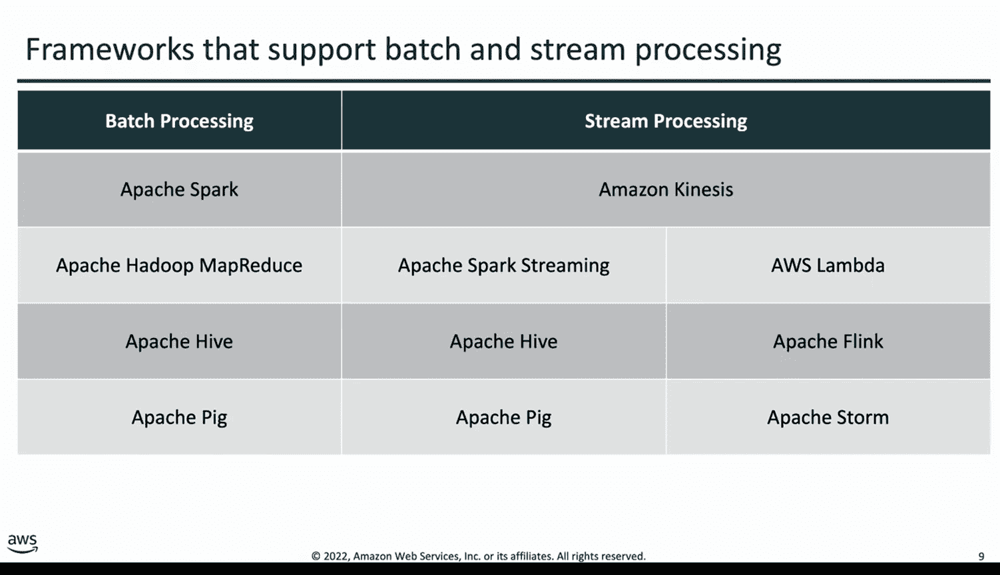

有许多可用于处理大数据的框架，并且新的框架和增强功能发布非常频繁。这带来了另一个问题：您的集群上是否安装了正确的软件和版本号？如果您自行管理集群，可能会出现一个节点版本较新而其他节点版本稍旧的情况，这可能导致问题。

## 大数据处理分类

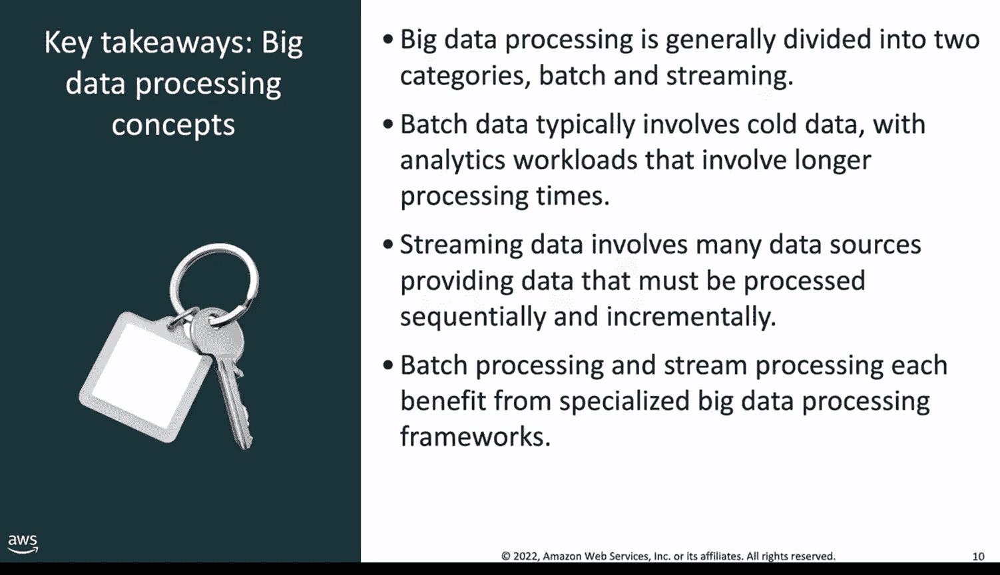

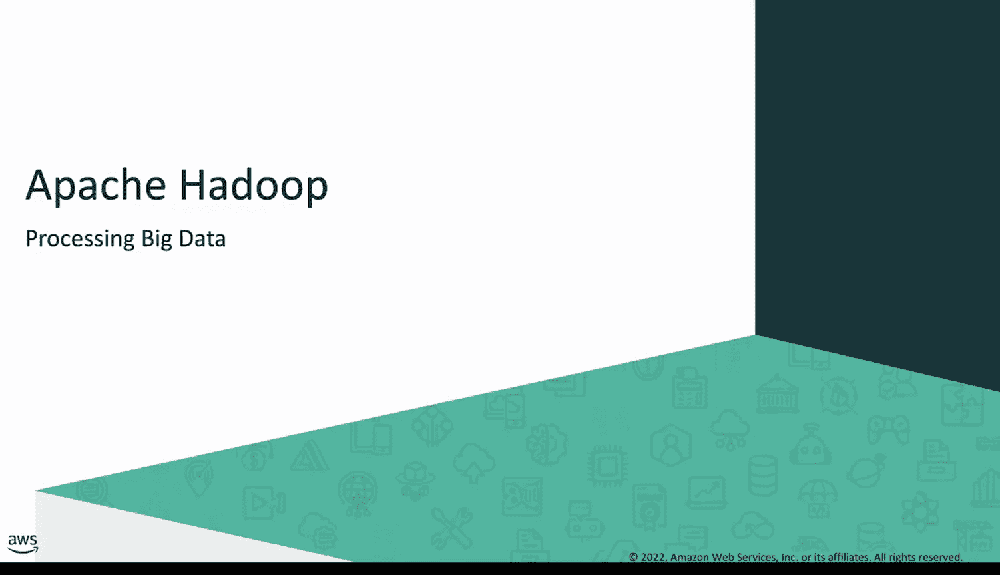

正如之前讨论的，大数据处理通常分为两类：批处理和流处理。批处理针对不常访问的冷数据，可能用于分析；而流处理针对需要频繁访问的热数据，必须顺序或增量处理。两者都受益于专门的数据处理框架。

## Hadoop框架详解

首先，我们来谈谈经典的Hadoop。Hadoop是开源的，它使用分布式处理架构。Hadoop将映射到一组商用服务器集群，并包含几个核心组件：HDFS（Hadoop分布式文件系统）、YARN（另一种资源协调器）、MapReduce以及Hadoop Common。Hadoop集群由一个主节点和多个工作节点组成。在这种架构中，主节点是协调者，而工作节点实际执行任务。

您可能关心Hadoop的原因包括：它可以处理近乎无限的数据；不需要预先处理数据；具有很高的灵活性；具备高容错性；基础设施可扩展（例如，可以添加更多节点用于数据处理和计算）；并且可以处理结构化、非结构化和半结构化数据。

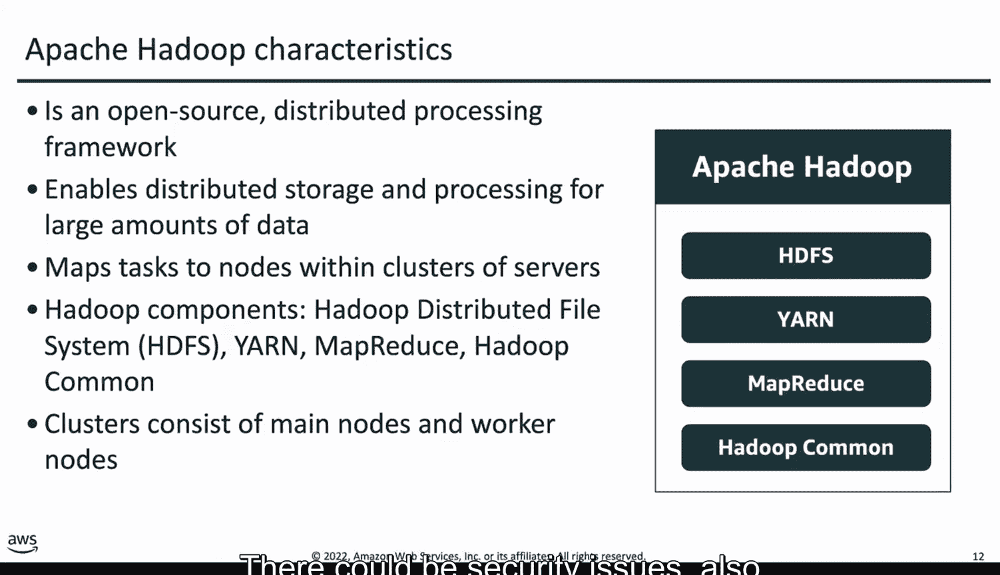

然而，也存在一些挑战：它是开源的，可能存在稳定性问题；可能面临只能运行最新版本与旧版本的兼容性挑战；Java作为一种语言可能不如现代语言高效，例如垃圾回收可能成为性能瓶颈；此外，还可能存在安全和身份验证加密方面的问题。

### HDFS

HDFS是Hadoop的分布式文件系统。您可以用它在整个文件系统中分发存储，并被拥有大型数据集的应用用于实现高聚合数据带宽。这种数据速度使您能够将数据分割成小块，然后在集群的多个节点间共享这些块。每个块尽可能驻留在不同的数据节点上。为了避免在集群节点故障时丢失数据，HDFS会将块复制多次到不同的节点，因此Hadoop架构内置了很高的容错性。

### YARN

YARN是一个有趣的组件，它包含几个主要部分。它是Hadoop内部使用的大规模分布式操作系统，确保存储在HDFS中的数据可供不同的处理计算单元访问，并动态协调资源的使用，充当调度器的角色。

以下是其核心资源：
*   **资源管理器**：这是控制中心，管理资源以及每个集群节点上启动的容器。它包含两个子组件：
    *   **调度器**：根据应用程序的资源需求，为正在运行的应用程序分配资源。
    *   **应用程序管理器**：接受作业提交，协商运行应用程序主程序的第一个容器，并提供在失败时重启应用程序主程序的服务。
*   **节点管理器**：控制单个Hadoop集群节点内的资源使用。
*   **应用程序主程序**：与资源管理器和节点管理器协作，为处理获取集群资源。
*   **容器**：是从单个集群节点分配的资源集合（如内存和计算能力），用于执行指定的处理活动。

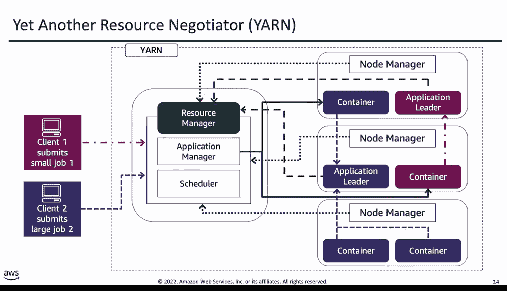

### MapReduce

MapReduce是一个框架，用于在集群上使用并行分布式算法处理大型数据集。它通过处理所有逻辑来简化编写并行分布式应用程序。这意味着您只需提供Map和Reduce函数。

*   **Map函数**：将数据映射为一组键值对，这是中间结果。
*   **Reduce函数**：组合中间结果（可能应用额外算法），然后产生最终输出。

其核心思想是，分布式计算发生在Map阶段。像Hive这样的可用框架可以自动生成Map和Reduce程序。MapReduce框架是Hadoop的核心，提供了可扩展性，并再次为容错而设计：每个工作节点会向主节点报告其状态，这样您就不会将作业发送到可能失败的节点；如果某个节点不工作，主节点可以重新分配工作。

当运行大数据作业时，进程以MapReduce将作业拆分为离散任务开始，然后这些任务可以并行运行。接着，Mapper阶段将其映射为键值对。Mapper阶段完成后，下一步是Shuffle，对数据进行排序。在此步骤中，相似的词（例如）会被重新洗牌、排序和分组。最后，Reducer阶段会计算单词的出现次数（例如，在进行网站统计时），然后生成输出文件。

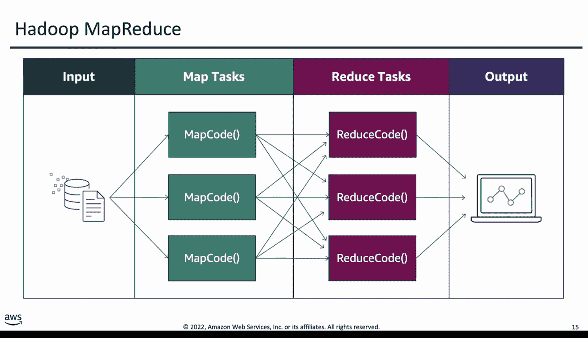

### 数据分割与调优

如果您使用HDFS存储数据，Hadoop会自动为您在HDFS内分割数据。如果您使用S3存储数据，Hadoop将通过读取文件系统的多个部分来分割数据，然后使用分割后的数据读写S3。EMR版本也是该系统的一个组成部分。

需要注意，大量任务可能具有与少量任务不同的特征，因此您必须了解这些调优特性。一个重要注意事项是，默认分割大小可能是128MB，然后8个Mapper进程可以处理数据。但由于大数据需要跟上数据的体量和速度，您可能需要使用500MB的分割。因此，根据数据大小需要进行一些调优。

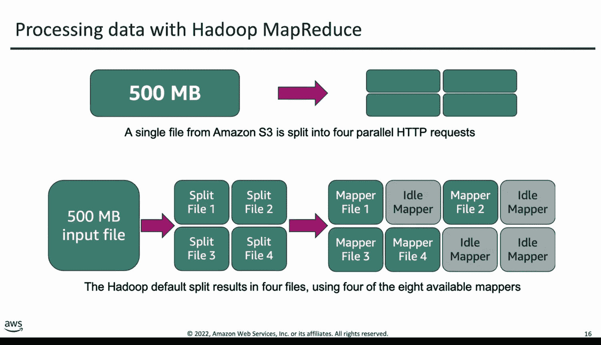

## 其他处理框架

除了Hadoop，还有其他框架。

*   **Apache Flink**：这是一个流数据流引擎，为大数据构建实时流处理。Flink会对Kinesis数据流、Apache Cassandra或数据库等数据执行转换。它使用数据流运行时引擎和流水线并行性来执行操作。该引擎本身可以同时处理批处理和流处理，甚至提供一些SQL支持。其操作类似于Hadoop或Spark中的分布式集合。Flink的API还将数据流和数据集合分类：数据集合是对分布式数据集或集合的转换；数据流是对流数据（如Amazon Kinesis）的转换。此外，EMR支持将Flink作为YARN应用程序进行管理。
*   **Apache Hive**：这是一个运行在Hadoop之上的开源类SQL数据库，也提供一些有限的数据仓库功能。使用Hive的原因是，您可以避免用Java等低级语言编写MapReduce的复杂性，转而使用SQL，这样数据科学家可以更快地构建原型。
*   **Presto**：这是一个开源的分布式内存SQL查询引擎。它与Hive类似，因为它们都是SQL或类SQL查询引擎。但Presto不在MapReduce上运行，而是在内存中运行。
*   **Apache Pig**：这是一种简单的高级文本数据流语言，使用并行处理对大型数据集执行分析。需要直观方式原型化和开发作业的脚本开发人员，可以将Pig作为一种可能的处理框架。

### Hadoop总结

总结一下Hadoop，当您将数据存储在HDFS时，Hadoop会使用MapReduce将数据分割成更小的数据块。然后，MapReduce使用并行分布式算法在集群上处理大型数据集。MapReduce将作业拆分为离散任务，以便这些作业任务可以并行运行。

## Apache Spark框架

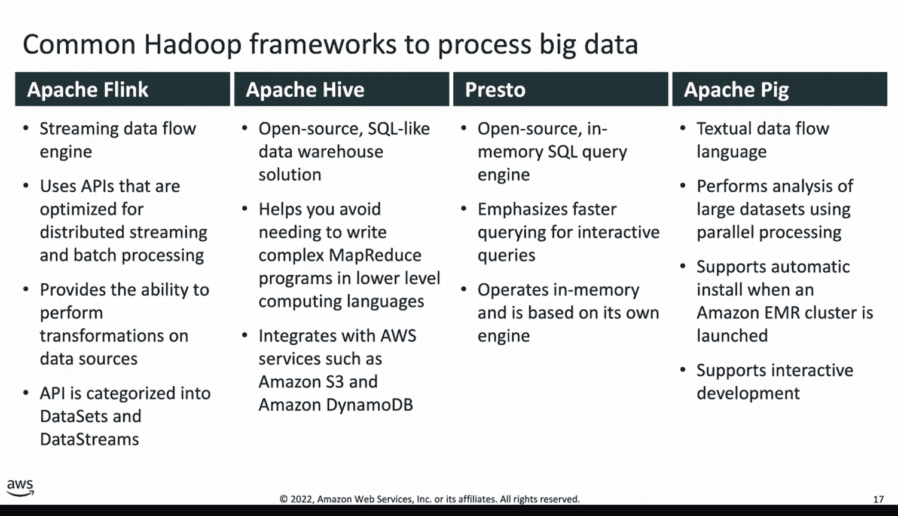

现在，让我们深入探讨Apache Spark。Spark是一个开源分布式处理框架，旨在解决MapReduce的局限性。

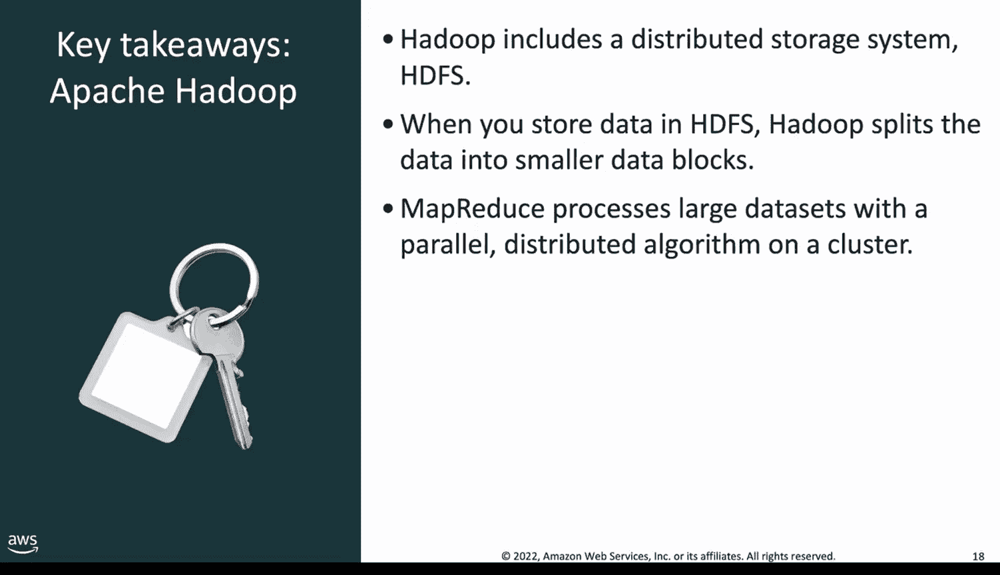

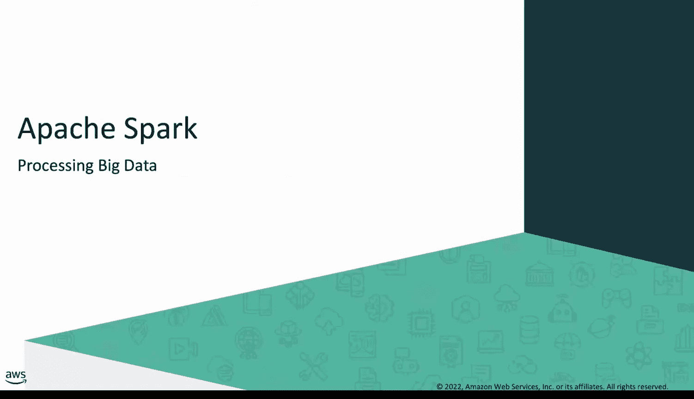

Spark将数据保存在内存中，减少了作业中的步骤数量，并在多个并行操作中重用数据。对于Spark，只需要一个步骤：基本上是将数据读入内存，然后执行操作，再写回。因此，处理速度要快得多。因为它是一个集群框架和用于处理大数据工作负载的编程模型，您可以在Amazon EMR上运行它，甚至可以使用EMR文件系统直接访问S3中的数据。Spark支持多个交互式查询模块，如SparkSQL。Spark还通过内存缓存重用数据，例如，当机器学习算法在同一数据集上重复调用时，这种缓存的好处就体现出来了。

数据重用通过创建数据帧来实现，数据帧是弹性分布式数据集（RDD）上的一种抽象。数据帧是缓存在内存中并可在多个Spark操作中重用的对象集合。这极大地降低了延迟，使Spark比MapReduce快很多倍，特别是在机器学习和交互式分析方面。

Spark应用程序在Spark集群中作为独立的进程集运行。Spark上下文对象驻留在驱动程序内，并协调这些进程。这个Spark上下文连接到集群管理器，从节点获取执行器。然后，这些执行器负责运行计算并为应用程序将数据存储在缓存中。Spark上下文对象直接与执行器通信，向它们发送要处理的任务。

### Spark核心组件

Spark核心是平台的基础，负责内存管理、故障恢复、调度、分发和监控作业，以及与存储系统交互。Spark核心通过为Java、Scala、Python和R构建的API暴露出来，甚至还有其他语言正在加入。这些API在简单而高级的操作背后隐藏了分布式处理的复杂性。

*   **SparkSQL**：这是一个分布式查询引擎，提供低延迟的交互式查询，速度可能比MapReduce快100倍。SparkSQL具有基于成本的优化器、列式存储和用于快速查询的代码生成，可扩展到数千个节点。
*   **Spark GraphX**：这是一个分布式图处理框架，是一个非常强大的新功能。
*   **Spark Streaming**：这是一个实时解决方案，使用Spark核心进行流处理。
*   **Spark MLlib**：这是一个用于大规模机器学习数据算法的库，例如聚类算法。

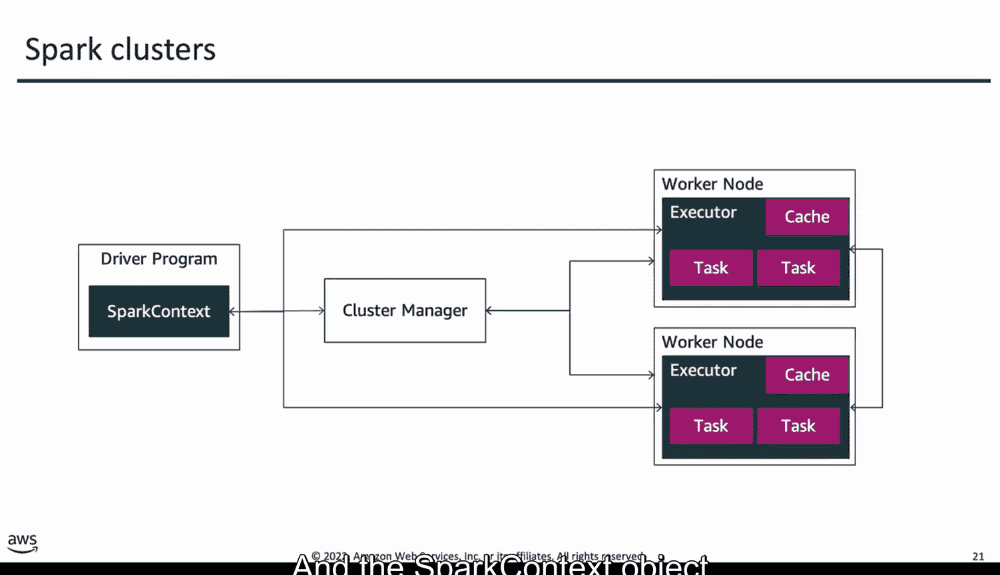

### Spark总结

Apache Spark通过内存计算、减少作业步骤数量以及在多个并行操作中重用数据，解决了Hadoop的一些局限性。缓存可以加速机器学习算法，例如聚类。

## Amazon EMR服务

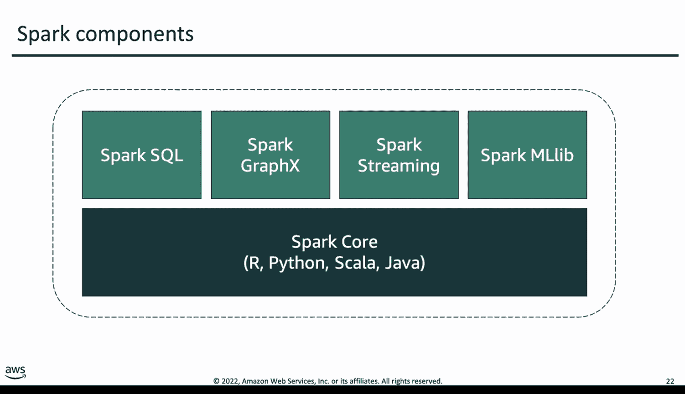

接下来，我们谈谈Amazon EMR。EMR是一个托管的集群平台，它简化了Spark等大数据框架，使AWS能够处理和分析海量数据。从某种意义上说，它类似于在RDS中运行MySQL数据库，这是Spark的托管版本。它使您能够在几分钟内启动集群、部署集群、调整其大小等，而无需您手动操作。

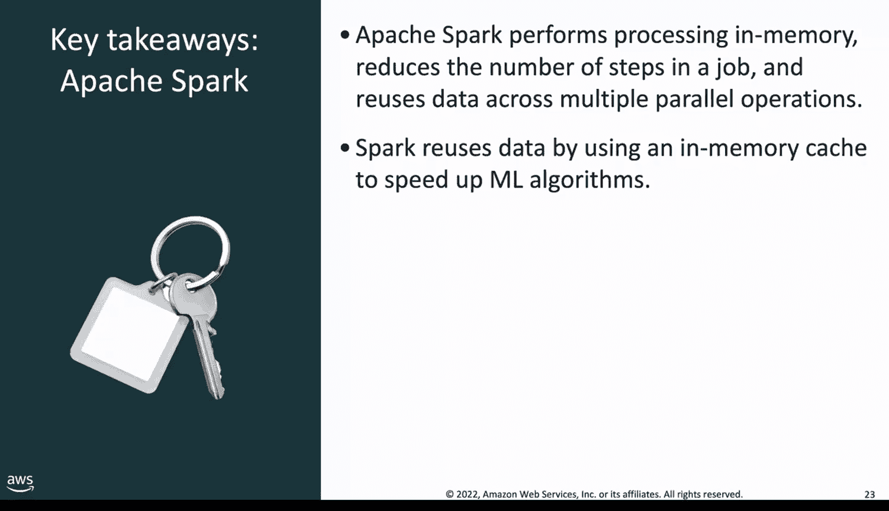

让我们深入了解Amazon EMR的主要组件：
*   **集群**：一组Amazon EC2计算节点的集合。
*   **主节点**：负责管理集群。每个集群都有一个主节点，您可以创建仅包含一个主节点的单节点集群。
*   **核心节点**：负责运行任务并将数据存储在HDFS中。
*   **任务节点**：这是可选的，仅运行任务。这些任务节点不会在HDFS中存储数据。您可以在集群启动时添加它们，甚至可以将它们添加到已运行的集群中。

在存储层方面，需要考虑HDFS和EMRFS。该层包括任何本地连接磁盘的本地文件系统。集群中的EC2实例具有预配置的块存储，称为实例存储，它将在实例存在期间持续存在。

集群资源管理层负责管理集群资源和调度数据处理作业。YARN是EMR使用的默认组件，但您实际上也可以使用其他框架。

在数据处理层，主要框架是Hadoop MapReduce和Spark。

应用程序和编程层是使用前面讨论的应用程序的地方，您可以在此处执行机器学习算法、流处理、数据仓库等操作。

### 启动与管理EMR集群

在启动集群时，您可以选择要安装的框架和应用程序以满足数据处理需求。要处理EMR集群中的数据，您可以将作业或查询直接提交给应用程序。需要考虑的事项包括：提交输入数据进行处理；使用PIG处理第一步的输出；可能使用Hive处理第二个输入数据；然后写入输出数据集。

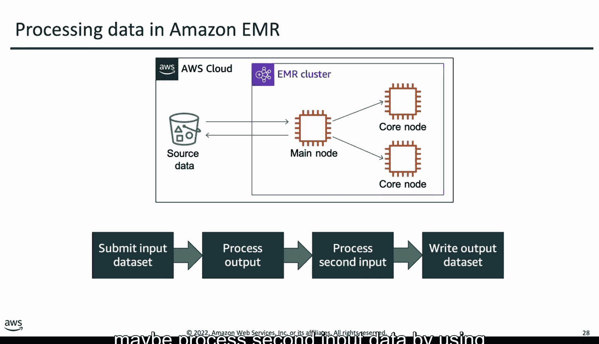

您可以使用EMR为甚至PB级的数据、交互式分析和机器学习项目执行自动化的集群安装。

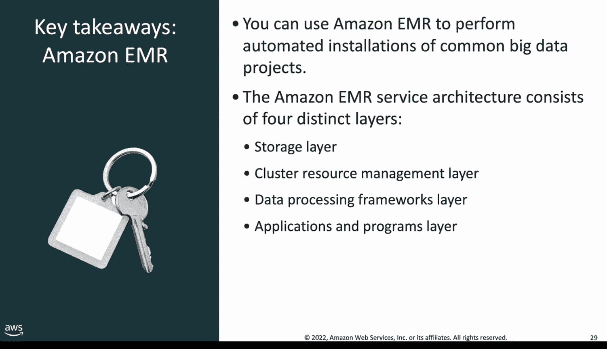

管理EMR时，您可以通过几种方式在控制台中创建EMR集群：一种是手动点击启动；另一种是通过命令行，这是一种非常强大的方式，您只需打开AWS CLI并启动集群；还有API模式，允许您以编程方式在事件触发时启动AWS EMR实例。

集群通常用于长时间运行的分析，这可能是持久性集群。默认情况下，集群是长时间运行的，以便持续接收工作。在大型组织中，您可能有一个24/7运行的集群，以便进行交互式分析。此外，还有临时集群，允许您在完成步骤函数或AWS Lambda调用后终止某些任务。这样做的好处是Amazon会为您管理它。

在EMR集群中，主节点是一个EC2实例，它协调运行任务和核心节点的EC2实例。该主节点会暴露一个公共DNS名称，您可以连接到它。默认情况下，EMR会为主节点、核心节点和任务节点创建安全组规则，这简化了可能非常复杂的集群设置。您只能在集群运行时连接到主节点；当集群终止时，充当主节点的EC2实例也会终止，并且不再可用。要连接到主节点，您需要对集群进行身份验证，可以使用Kerberos进行身份验证，甚至在启动集群时指定Amazon EC2密钥对的私钥。EC2密钥对的私钥在集群的安全和访问部分指定。默认情况下，Elastic MapReduce主安全组不允许入站SSH连接，因此如果您要通过SSH访问，可能需要添加端口22规则。

您还可以调整Amazon EMR可用的EC2实例数量。在扩展资源时，需要考虑一些事项：例如，在集群配置完成后，您无法扩展节点数量，但可以在集群内扩展核心节点和任务节点；另一个考虑因素是，您不能同时重新配置和调整实例大小，这意味着如果您启动调整大小操作（例如想要更大的节点），则必须等待重新配置完成。

### EMR总结

有三种可用方法启动EMR集群：交互模式、命令行模式和API模式。Amazon EMR集群默认是长时间运行的。最后，所有到EMR集群的外部连接都必须通过主节点进行。

## Apache Hudi简介

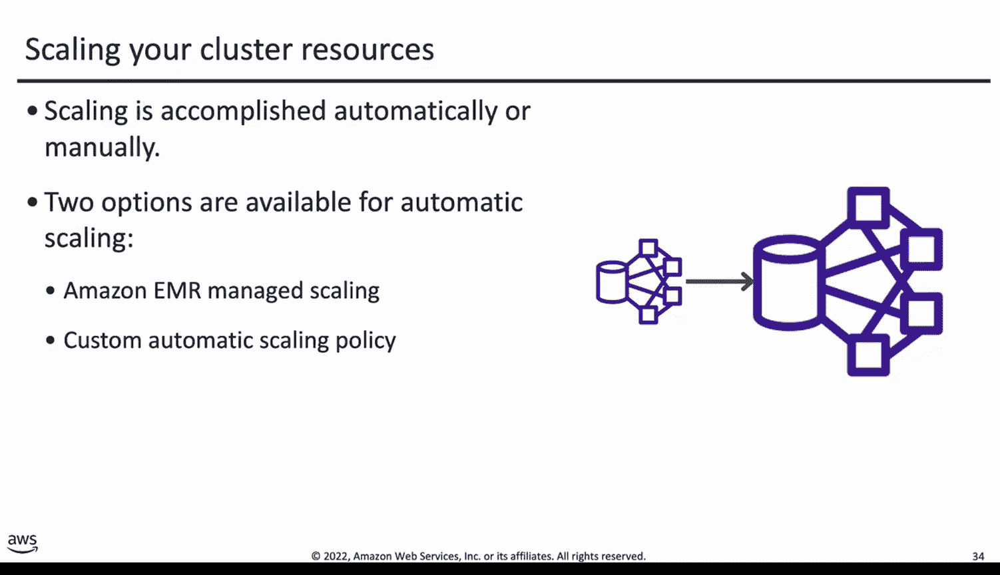

最后，我们来谈谈Apache Hudi。这是一个开源的数据管理框架，用于通过提供记录级别的插入、更新、更新插入和删除功能来简化增量数据处理和数据流水线开发。

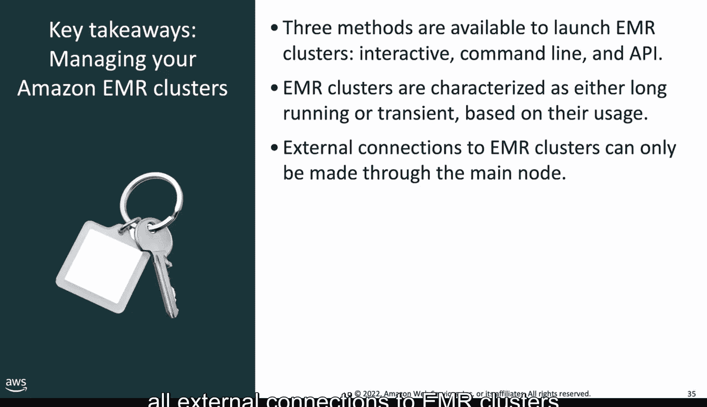

“更新插入”是指如果记录尚不存在，则将其插入现有数据集，如果存在则更新它们的能力。您甚至可以通过管理S3在近实时状态下执行此操作。它与Apache Spark、Hive、Presto集成，EMR甚至可以自动为您安装它。

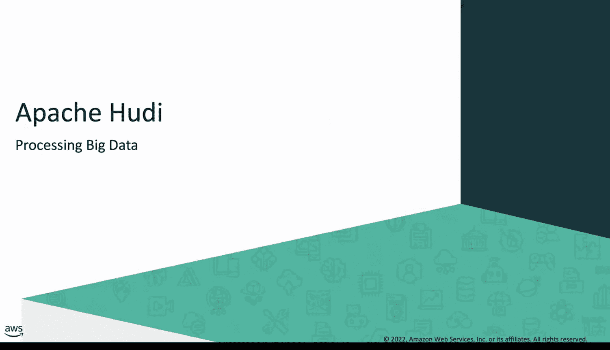

Hudi以列式格式存储数据，即Apache Parquet格式。每次数据更新都会在写入过程中创建文件的新版本。这是Hudi的默认存储类型，非常适合读密集型工作负载。它还提供三种逻辑视图来访问您的数据：读优化视图、增量视图和实时视图。

### Hudi总结

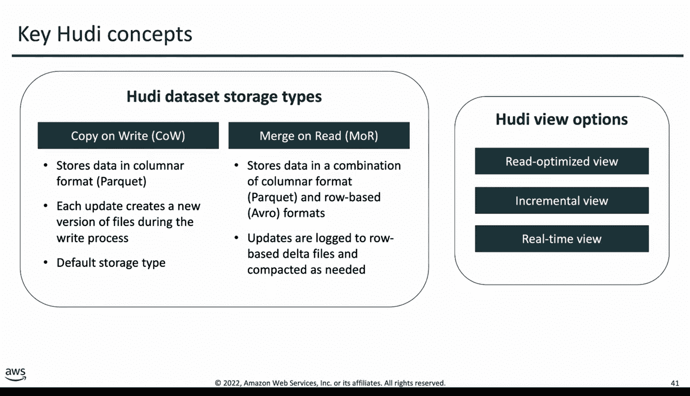

总而言之，它通过在S3上组织数据，提供了近实时摄取和更新数据的能力，并维护执行操作的元数据以确保操作的原子性和一致性。

## 课程总结

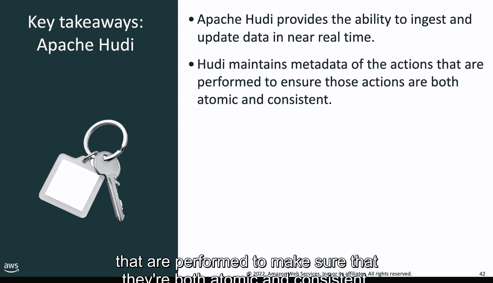

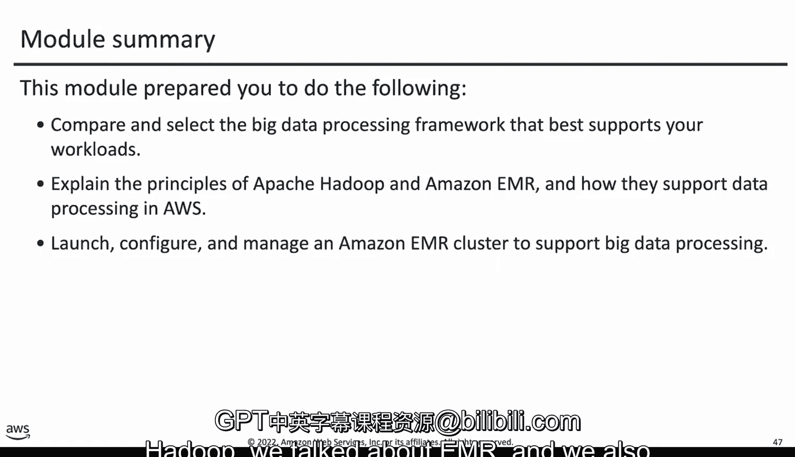

本节课中，我们一起学习了支持大数据的处理框架和AWS服务。我们讨论了如何比较不同的处理框架，深入探讨了Hadoop及其核心组件，介绍了Apache Spark如何解决Hadoop的局限性，详细说明了Amazon EMR作为托管服务的优势及其管理方式，并简要了解了Apache Hudi这一较新的数据管理框架。掌握这些工具和概念，将帮助您为特定的大数据工作负载选择最合适的处理方案。