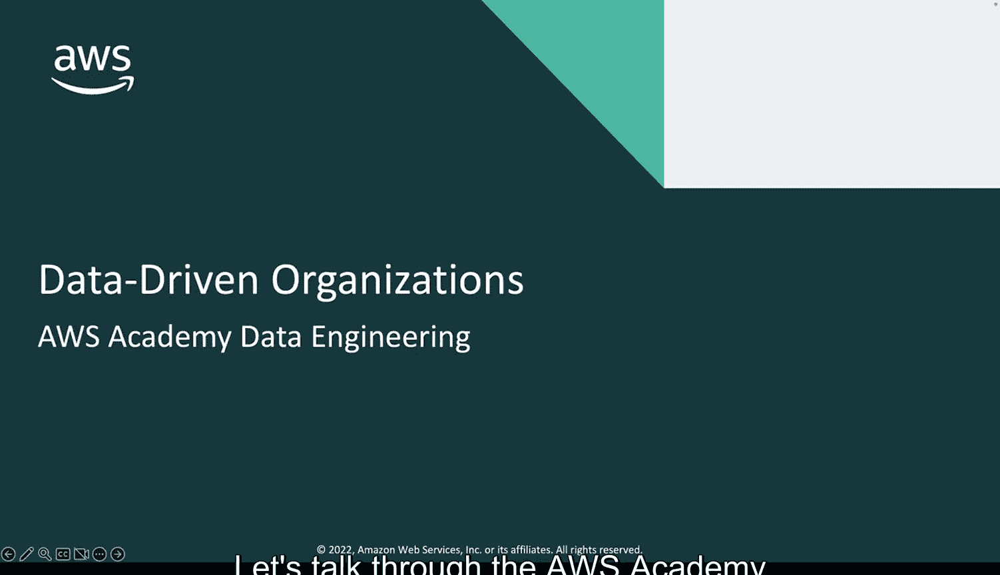
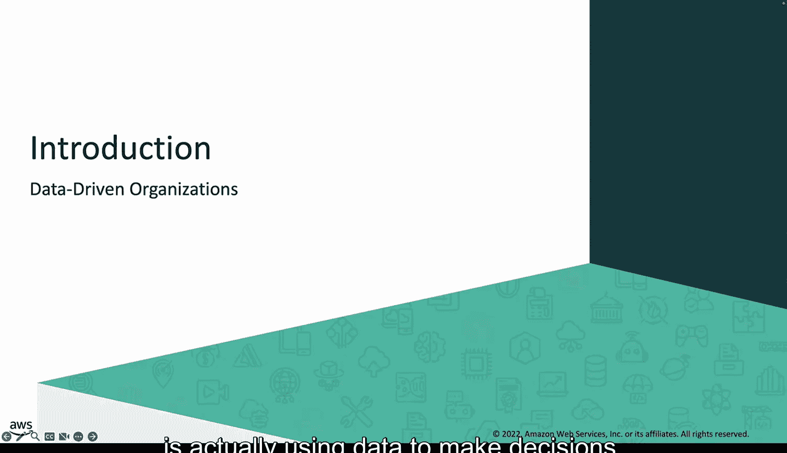
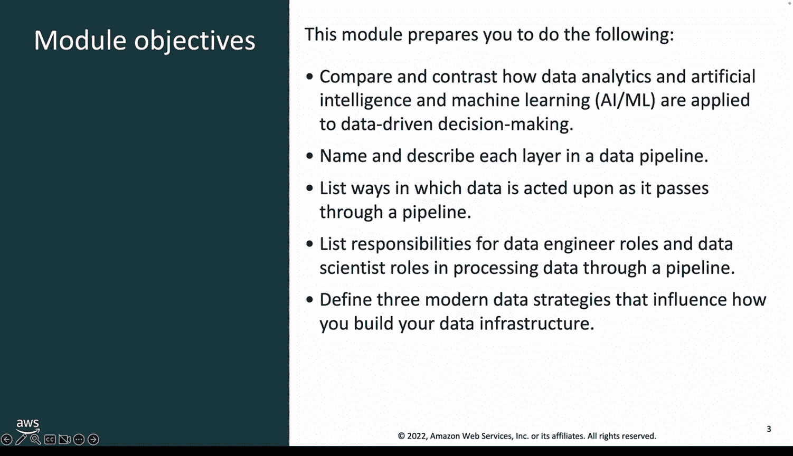
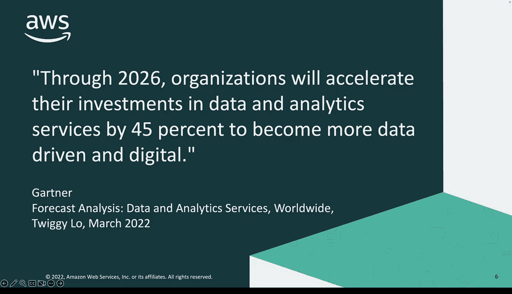
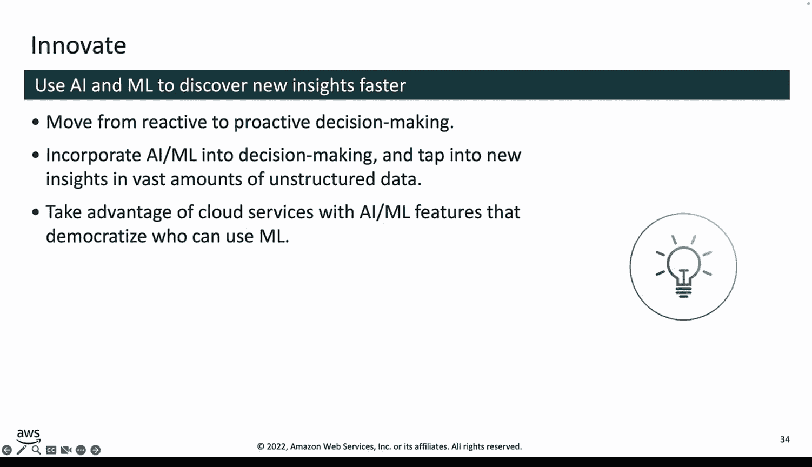
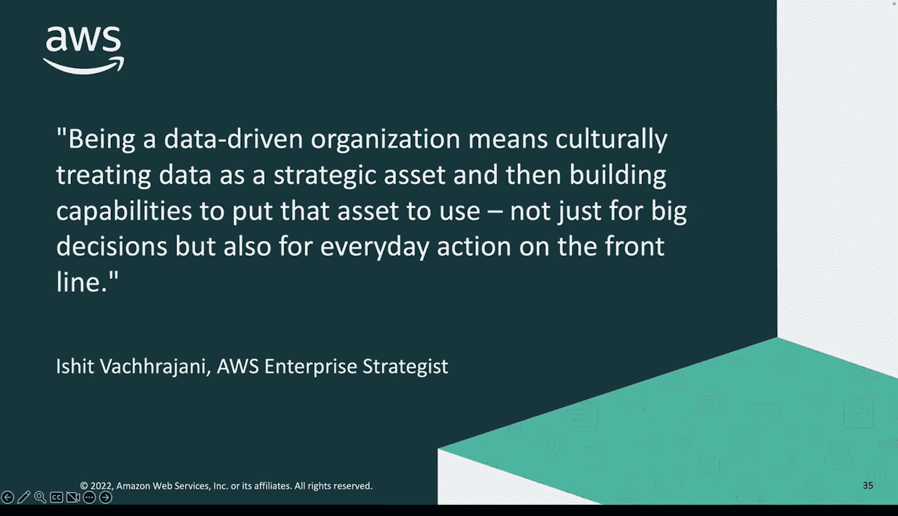
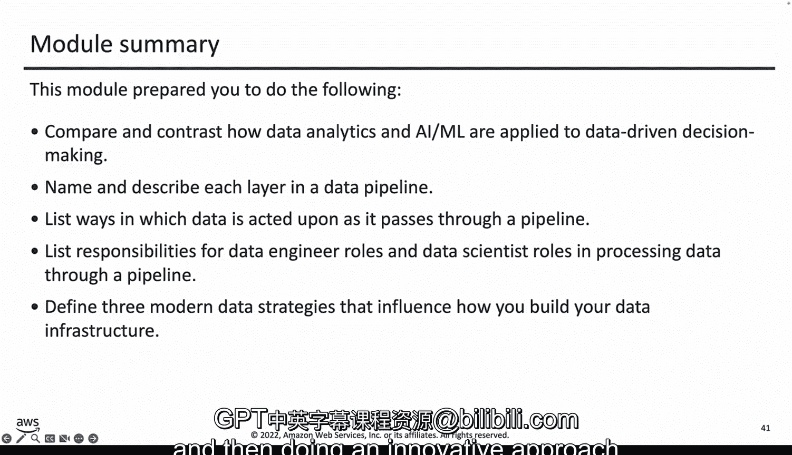

# 构建大规模云计算解决方案：3：数据驱动型组织 📊

在本节课中，我们将要学习数据驱动型组织的核心概念。我们将探讨数据分析与人工智能/机器学习的区别，理解数据管道的构成层次，并明确数据工程师的职责。课程还将介绍构建现代数据战略的关键要素。

---

## 什么是数据驱动型组织？ 🤔

数据驱动型组织是指那些利用数据来指导决策的组织。判断一个组织是否真正以数据驱动，关键在于它是否系统性地使用数据来支持决策过程。

根据Gartner在2022年的预测，到2026年，组织对数据和分析的投入将加速增长45%，以推动其数据驱动和数字化转型。这表明，未来数据的使用将更加频繁和深入。

---

## 数据分析 vs. 人工智能/机器学习 🔍

上一节我们介绍了数据驱动组织的概念，本节中我们来看看支撑其决策的两种核心技术路径：数据分析与人工智能/机器学习。理解它们的区别对于选择正确的工具至关重要。

以下是两者的核心对比：

*   **数据分析**：
    *   **本质**：对大型数据集的系统性分析，更像一个**编程问题**。通过编写逻辑规则来从数据中寻找答案。
    *   **适用场景**：适合处理**结构化数据**，且变量数量有限的情况。
    *   **示例**：创建一个网站，只展示狗的图片。使用传统数据分析方法，你需要编写逻辑代码来识别构成“狗”的特征（如耳朵形状、鼻子等）。

*   **人工智能/机器学习**：
    *   **本质**：使用数学模型进行预测，更像一个**学习问题**。通过让模型从数据中学习规律来回答问题。
    *   **适用场景**：擅长处理**非结构化数据**（如图像、文本）以及变量关系复杂的情况。
    *   **示例**：同样是想区分猫和狗的图片。使用机器学习方法，你需要用大量已标记为“狗”的图片来训练模型，模型学会后便能自动识别新的未标记图片是否为狗。

一个组织可以同时使用数据分析和AI/ML来辅助决策。例如，在AI方面使用文本摘要功能，在分析方面查看客户总数。

---

## 数据分析的价值层级 📈

随着分析目标的深入，其价值、所需的数据量、计算存储资源以及数据科学的复杂性都会增加。

以下是四种价值由低到高的分析类型：

1.  **描述性分析**：回答“发生了什么？”（例如，昨日销售额）。
2.  **诊断性分析**：回答“为什么会发生？”（例如，分析销售额下降的原因）。
3.  **预测性分析**：回答“未来可能会发生什么？”（例如，预测下季度销售额）。
4.  **规范性分析**：回答“我们应该怎么做？”（例如，建议采取何种促销策略以提升销售额）。

数据越多，决策的潜在障碍就越少。如今，更丰富的数据源、按需付费的云计算基础设施（降低了成本和复杂性）以及不断演进的云服务，使得利用大数据分析和AI/ML进行决策，尤其是做出预测，变得比以往更加容易。

---

## 数据时效性与决策价值 ⏱️

并非所有数据都具有同等价值，其价值随时间衰减。

*   **最具价值**：**近实时数据**。例如，标记欺诈性信用卡交易，需要在几秒内完成。
*   **具有行动价值**：分钟到小时级的数据。例如，对“昨天我们的销售情况如何？”做出反应性分析。
*   **价值较低**：历史数据。这并非没有价值，但通常用于长期趋势分析而非即时决策。

在构建数据系统时，需要在速度、准确性和成本之间进行权衡：
*   **速度 vs. 准确性**：你是否真的需要实时答案？能否为了速度牺牲一些准确性？
*   **准确性 vs. 成本**：预测需要达到多高的准确度？为了一点准确性的提升，值得投入多少额外成本？
*   **等待更好答案 vs. 快速获得答案**：你的组织更倾向于哪一种？

---

## 数据管道：核心基础设施 🚀

数据管道是所有数据工程的核心组件。简单来说，它是一个处理数据的流程。

一个最简单的数据管道可以概括为以下步骤：
`收集数据 -> 存储数据 -> 处理数据 -> 使用数据`
例如：收集日志 -> 存入数据库 -> 清洗并转换列名 -> 构建业务仪表盘。

设计管道的有效方法是**逆向工作**：首先明确你要解决的业务问题，然后围绕这个用例来构建管道。云计算的优势在于，你可以轻松地为不同的用例启动不同的基础设施进行尝试，而无需预先投入大量资金或绑定单一数据库。

---

## 数据管道的层次与迭代 🔄

数据管道的基础设施需要分层，以确保存储的数据能够被决策者有效访问。

一个典型的数据管道包含以下层次：
1.  **摄入层**：将数据从源头引入管道。
2.  **存储层**：安全可靠地保存数据。
3.  **处理层**：对数据进行清洗、转换、整合。
4.  **分析与可视化层**：从数据中提取洞察并呈现。

我们可以把数据想象成在管道中流动的水。管道必须支持对数据细节的探索。数据在流动过程中可能需要被“整理”：
*   **清洗/规范化**：修正错误、统一格式。
*   **转换**：修改格式、更改列名、创建数据目录。
*   **整合**：合并多个数据源。

这个过程通常遵循 **ETL（提取、转换、加载）** 模式。

**迭代能力**是构建数据管道的关键。你必须将管道设计成可修改的。如果你对数据有某种假设，就需要进行实验，这可能要求你改变数据的收集、存储或处理方式。如果一个管道是“硬编码”的、无法灵活调整，那么从一开始就会陷入困境。

**示例**：一个简单的管道。开发者将一个大型CSV文件压缩后上传到Amazon S3。数据科学团队可以直接使用SQL查询S3中的数据进行分析。

---

## 数据工程师的角色 🛠️

在数据驱动型组织中，数据工程师负责构建和维护数据管道。他们的工作始于提出正确的问题。

以下是数据工程师在构建管道时常需考虑的问题列表：

*   **关于数据源**：
    *   组织是否有满足需求的数据？
    *   数据存储在哪里？是什么格式？
    *   是否需要合并多个数据源的数据？（这可能涉及格式、列名、重复数据等复杂问题）
*   **关于数据质量与管理**：
    *   数据的类型和质量如何？
    *   什么是**单一可信数据源**？如果没有，会导致持续混乱。
*   **关于安全与性能**：
    *   谁需要访问数据？需要何种访问权限（读/写）？
    *   传输数据需要何种机制？
    *   数据被请求时，速度是否重要？
*   **关于数据科学侧**：
    *   数据能告诉我们什么？如何评估结果？
    *   需要何种可视化？分析人员使用什么工具和格式？
    *   是否需要使用Spark、Databricks或AWS Athena等大数据框架？
    *   何种AI/ML模型会有帮助？（例如，使用预训练模型进行摘要或情感分析）
    *   实现AI/ML的最简单方式是什么？（例如，能否使用零样本分类来打标签？）

数据科学家和数据工程师都围绕数据管道工作，但侧重点不同：
*   **数据工程师**：专注于**基础设施**的构建、维护和优化。
*   **数据科学家**：专注于在管道中**分析数据**、构建模型、获取洞察。
在某些组织中，这两个角色可能由同一人担任。

---

## 现代数据战略三支柱 🏗️

为了将数据作为战略资产，组织可以采取一个三支柱战略：现代化、统一化和创新。

以下是该战略的三个核心方向：

1.  **现代化**：
    *   **目标**：使组织能够快速响应业务变化并整合新功能。
    *   **方法**：利用云服务（如AWS）处理繁重工作，并选择与解决问题相匹配的数据存储方案。避免让分析查询拖慢生产系统。

2.  **统一化**：
    *   **目标**：打破数据孤岛，让更多人能够访问数据。
    *   **方法**：建立数据湖以高效运行查询，并实施**数据治理**。不能将所有数据暴露在互联网上，需考虑法律合规性（例如，防止他人用你的数据训练AI模型）。

3.  **创新**：
    *   **目标**：转向主动决策，寻找数据的新价值。
    *   **方法**：利用预训练模型，充分发挥内置了AI/ML能力的云服务的优势。

---

## 总结 🎯

本节课中我们一起学习了数据驱动型组织的构建要素。

*   我们比较了数据分析与AI/ML在决策过程中的不同：前者更像编程问题，后者则是学习问题。
*   我们了解了数据管道的四个主要层次：**摄入、存储、处理、分析与可视化**，以及其中涉及的数据清洗、转换等操作。
*   我们探讨了数据工程师与数据科学家的不同职责与协作关系。
*   最后，我们介绍了构建现代数据基础设施的战略框架：**现代化、统一化和创新**。

通过掌握这些核心概念，你将能够更好地理解如何利用数据和云技术来赋能组织，做出更明智、更快速的决策。