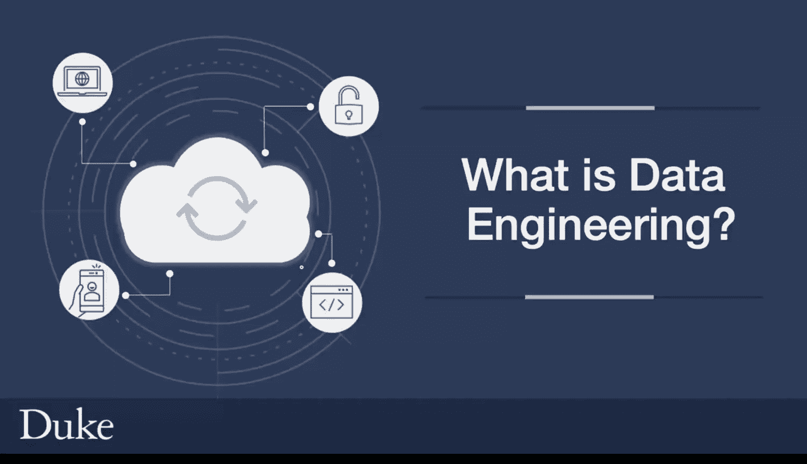
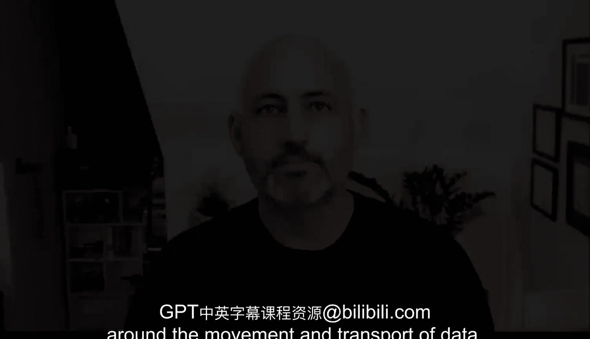

# 构建大规模云计算解决方案：3-4课：什么是数据工程 🛠️

在本节课中，我们将要学习数据工程的核心概念。我们将探讨数据工程的定义、主要职责以及它在现代技术栈中的具体应用。

## 概述

数据工程是构建和管理数据管道，以定期传输或转换数据的能力。它围绕数据展开软件工程实践。

## 数据工程的核心职责

上一节我们介绍了数据工程的基本定义，本节中我们来看看数据工程师具体负责哪些工作。数据工程师专注于围绕数据移动和传输的软件工程最佳实践。

以下是数据工程师可能承担的主要任务类型：

*   使用 **Spark** 等工具进行大数据操作。
*   使用 **AWS Lambda** 等服务构建事件驱动的基础设施。
*   处理周期性作业，例如收集分析数据并为管理团队生成销售预测的夜间作业。

## 总结

本节课中我们一起学习了数据工程。我们了解到，数据工程的核心是构建和维护数据管道，并应用软件工程的最佳实践来确保数据的可靠移动与处理。数据工程师的工作涵盖从大数据处理到自动化工作流管理的广泛领域。