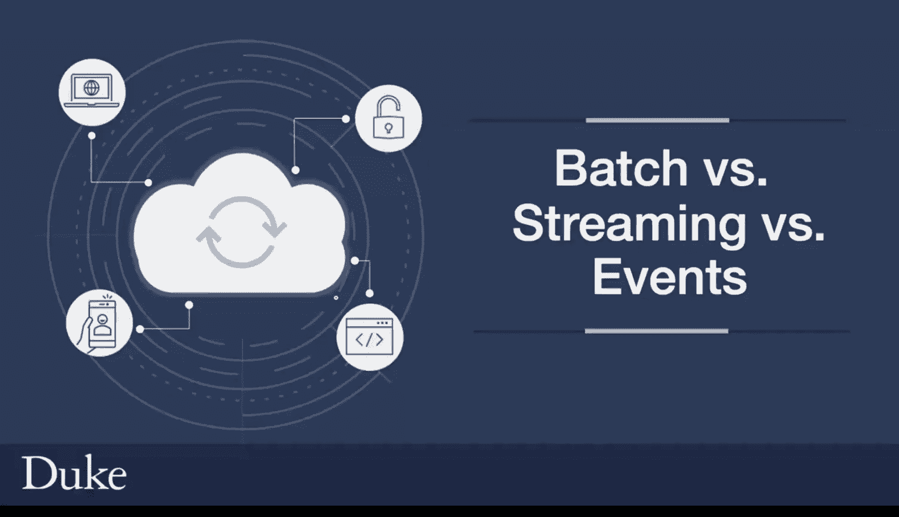
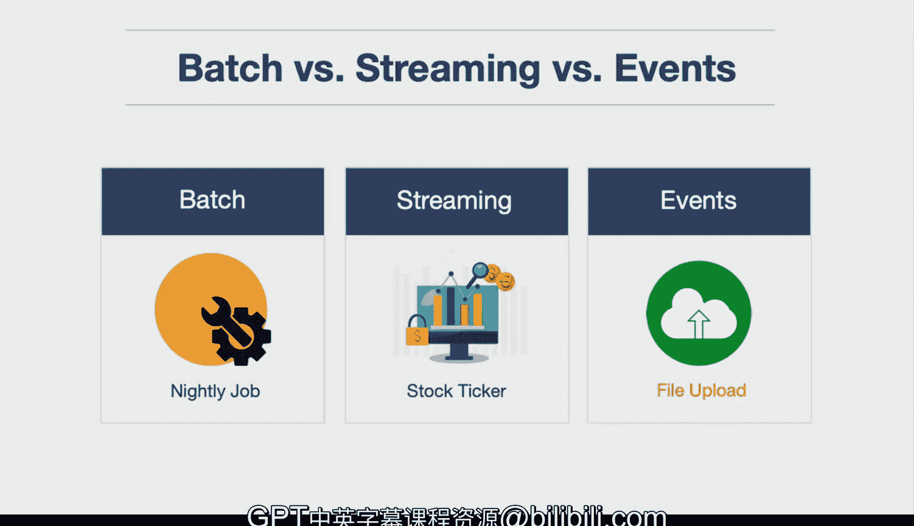

# 构建大规模云计算解决方案：3-4：批处理 vs 流处理 vs 事件处理

在本节课中，我们将要学习数据工程中的三种核心数据处理范式：批处理、流处理和事件处理。理解它们之间的区别对于设计和构建有效的云解决方案至关重要。

## 概述

数据工程中需要关注的一个核心概念是批处理数据、流处理数据和事件处理。在进行数据工程任务时，经常会遇到这三种完全不同的操作类型。

## 批处理

上一节我们介绍了三种数据处理范式，本节中我们首先来看看**批处理**。

批处理作业的一个典型例子是夜间作业。例如，在夜间，你从销售数据库中收集一些数据，并执行某种预测分析，这就是一个很好的批处理作业示例。批处理作业可能是最常见且最容易实现的。

## 流处理

了解了批处理之后，我们来看看**流处理**。流处理作业则有所不同，因为数据是持续不断更新的。

这使得决定如何处理这些数据变得更具挑战性。一个很好的例子是股票行情。例如，股票价格被不断地写入某个地方。然后你必须决定如何处理这些数据：是在数据流入时直接进行预测分析，还是将流数据发送到其他位置进行后续处理。

## 事件处理

最后，我们来探讨**事件处理**。在云计算中，事件通常是处理数据的首选方式，因为你可以编写代码来响应事件。

例如，假设你将一张图片上传到S3存储桶或某个存储桶。你可以有一段代码与该上传事件相关联，这段代码可以将图片从PNG格式转换为JPG格式，或者处理一部电影，从中寻找特定的音频并提取、翻译它。你可以处理这些事件，并将代码与之关联。

## 总结

本节课中，我们一起学习了数据工程中常见的三种范式。具体来说，批处理、流处理和事件处理通常是你必须从中做出选择的三种方案。理解每种范式的适用场景是设计高效数据管道的关键。