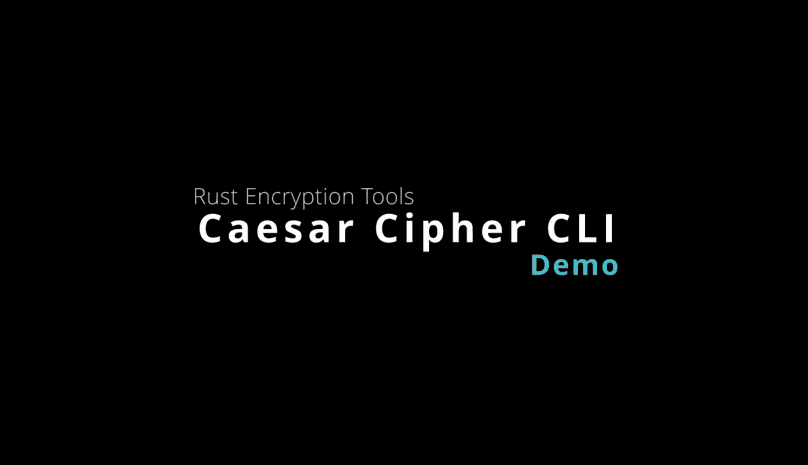
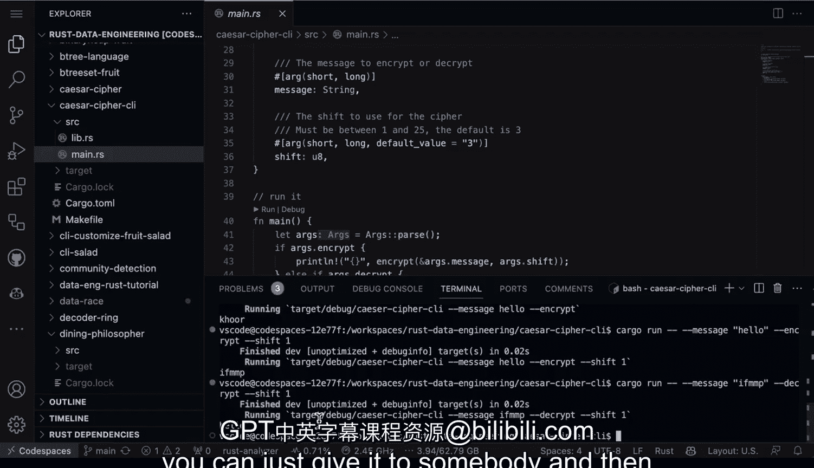

# 构建大规模云计算解决方案：3-4：凯撒密码命令行工具



## 概述
在本节课中，我们将学习如何构建一个基于凯撒密码的命令行工具。我们将了解凯撒密码的基本原理，并利用 Rust 语言和 `clap` 库来创建一个可以加密和解密消息的实用程序。通过这个过程，你将理解如何将核心算法封装成易于使用的命令行工具。

## 凯撒密码简介
凯撒密码是一种简单的替换密码，其原理是将字母表中的每个字母按照一个固定的数值进行移位。

例如，移位值为 3 时，字母 `A` 会被替换为 `D`，字母 `B` 会被替换为 `E`，依此类推。

其核心加密公式可以表示为：
`E(x) = (x + n) mod 26`
其中，`x` 是明文字母的索引（A=0, B=1...），`n` 是移位值，`mod 26` 确保结果在字母表范围内。

解密则是加密的逆过程，公式为：
`D(x) = (x - n) mod 26`

## 构建命令行工具
上一节我们介绍了凯撒密码的原理，本节中我们来看看如何将其实现为一个命令行工具。在构建实用程序时，命令行工具是一种极佳的方式，它可以让你方便地测试和迭代不同的概念。

在这个示例中，我们将使用 Rust 的 `clap` 库来解析命令行参数。工具的基本功能是：接收一条消息和一个移位值，然后根据用户选择进行加密或解密。

以下是实现该工具的主要步骤和代码结构：

1.  **导入依赖**：首先，我们需要导入加密（`encrypt`）和解密（`decrypt`）函数的核心逻辑。
    ```rust
    use caesar_cipher::{encrypt, decrypt};
    use clap::{Parser, Subcommand};
    ```

2.  **定义命令行参数**：使用 `clap` 的宏来定义工具的命令行接口。这主要是样板代码。
    ```rust
    #[derive(Parser)]
    #[command(name = "caesar")]
    #[command(about = "A CLI tool to encrypt and decrypt messages using the Caesar cipher.")]
    struct Cli {
        #[command(subcommand)]
        command: Commands,
        /// The message to process
        #[arg(short, long)]
        message: String,
        /// The shift value (default is 3)
        #[arg(short, long, default_value_t = 3)]
        shift: u8,
    }

    #[derive(Subcommand)]
    enum Commands {
        /// Encrypt a message
        Encrypt,
        /// Decrypt a message
        Decrypt,
    }
    ```
    我们定义了一个 `Cli` 结构体，其中包含一个子命令（加密或解密）、消息本身以及移位值（默认为3）。

3.  **处理参数并执行逻辑**：最后，将所有部分整合起来。解析参数，并根据用户的选择调用相应的函数。
    ```rust
    fn main() {
        let args = Cli::parse();

        let result = match args.command {
            Commands::Encrypt => encrypt(&args.message, args.shift),
            Commands::Decrypt => decrypt(&args.message, args.shift),
        };

        println!("{}", result);
    }
    ```
    代码逻辑很直接：使用 `Cli::parse()` 获取参数，然后通过模式匹配判断是执行加密还是解密，最后打印结果。

## 工具使用演示
现在，让我们运行这个工具。使用 `cargo run` 命令来执行程序，但需要注意参数传递的格式。

在开发环境中直接使用 `cargo run` 时，需要传递 `--` 来分隔 `cargo` 的参数和我们自己程序的参数。

首先，尝试加密消息 “Hello”，使用默认移位值 3：
```bash
cargo run -- encrypt --message "Hello"
```
程序会输出加密后的结果。

接下来，我们指定移位值为 1 进行加密：
```bash
cargo run -- encrypt --message "Hello" --shift 1
```
你可以直观地验证，`H` 的下一个字母是 `I`，`e` 的下一个字母是 `f`。

最后，对加密后的消息进行解密：
```bash
cargo run -- decrypt --message "Ifmmp" --shift 1
```
程序会输出原始的 “Hello” 消息。

## Rust 在构建工具上的优势
在我看来，构建能帮助你完成任务的小工具是 Rust 的优势之一。与脚本语言相比，Rust 具有明显的优势，因为它可以编译成独立的二进制文件进行部署，并且非常安全。

在许多方面，基于 Rust 的命令行工具能提供比其他脚本语言更优越的体验。一旦二进制文件构建完成，你可以直接将其分享给他人，他们无需安装 Rust 环境或任何依赖即可运行这个工具。



## 总结
本节课中，我们一起学习了凯撒密码的基本原理，并动手实践了如何使用 Rust 和 `clap` 库构建一个完整的加密解密命令行工具。我们涵盖了从算法核心到用户接口的完整流程，并演示了工具的使用方法。通过这个项目，你不仅理解了替换密码，也掌握了创建实用命令行程序的基本模式。