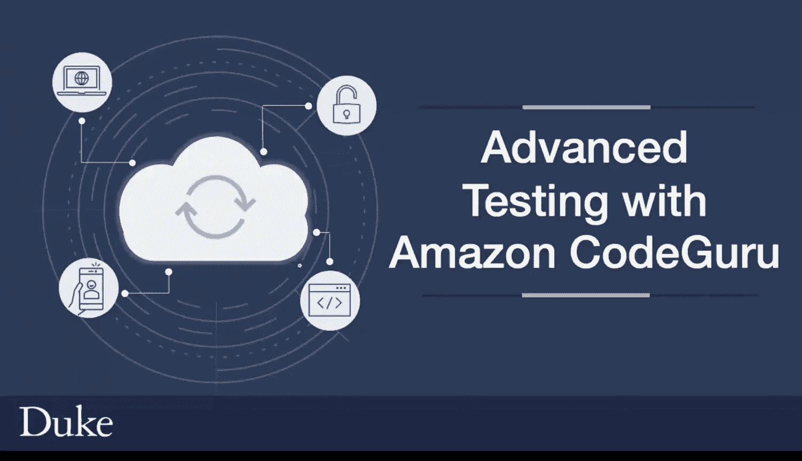
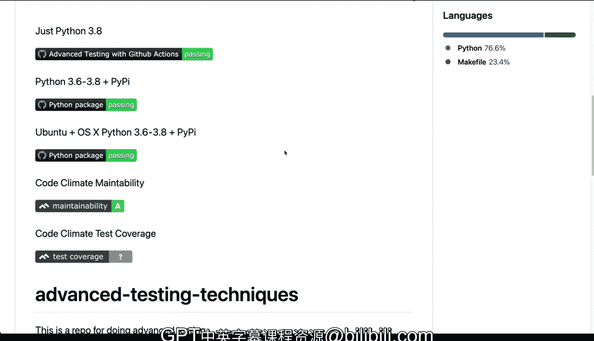

# 构建大规模云计算解决方案：3-4：使用Amazon CodeGuru进行高级测试 🧪

在本节课中，我们将学习如何利用Amazon CodeGuru等高级代码质量工具来提升项目质量。我们将介绍如何关联代码仓库、进行代码分析，并探讨如何将这些工具融入持续改进的开发流程中。

---

## 关联仓库与启动分析

上一节我们介绍了基础的测试概念，本节中我们来看看如何利用自动化工具进行更深入的代码质量检查。

首先，我们需要将CodeGuru与一个代码仓库关联起来。以下是具体步骤：

1.  访问CodeGuru服务。
2.  选择关联仓库的选项，例如GitHub或GitHub Enterprise Cloud。
3.  连接你的GitHub账户。
4.  选择你想要分析的仓库进行关联。

关联完成后，CodeGuru便可以对代码进行高级分析。

## 解读分析结果与发现潜在问题

关联仓库后，CodeGuru会自动对代码进行扫描。分析完成后，它会提供详细的审查报告。

例如，在一个已分析的项目中，CodeGuru检查了658行代码，并给出了两条建议：

*   **安全问题**：它发现代码中通过 `shell=True` 显式调用shell来构建命令字符串，这可能存在shell注入风险。建议使用 `shlex.quote()` 函数来正确转义空格和shell元字符。
    *   **代码示例**：`subprocess.run(command, shell=True)` 存在风险。
*   **资源管理问题**：分析指出某个资源可能没有正确关闭，建议使用 `contextlib` 模块来管理上下文。
    *   **代码示例**：打开文件后未确保关闭，应使用 `with open('file.txt') as f:`。

这些发现能帮助开发者提前识别并修复代码中的潜在缺陷。

## 融入持续改进（Kaizen）流程

这些代码分析工具的核心价值在于融入“持续改进”（Kaizen）的流程。Kaizen是一个日语词汇，意为通过持续的反馈循环来不断改善。

在软件开发中，这意味着通过多种方式持续提升代码质量，它们共同构成一个增强回路：

*   **设置持续集成（CI）**：例如使用GitHub Actions自动运行测试。
*   **进行代码测试**：编写并运行单元测试、集成测试等。
*   **引入代码检查（Linting）**：使用工具规范代码风格，提前发现语法错误。
*   **采用新兴AI工具**：如AWS CodeGuru，自动发现未知的bug和安全漏洞。
*   **监控源代码指标**：使用其他工具（如DevML）分析代码变更频率（Churn）、开发者活跃度等行为指标，从团队协作层面洞察潜在问题。
*   **实践持续交付（CD）**：将高质量的代码快速、安全地部署到生产环境。

没有单一的完美解决方案，关键在于建立一种“我希望让代码变得更好”的思维，并综合利用上述所有工具和实践。

## 探索其他代码质量工具

除了CodeGuru，还有许多类似的代码质量分析平台，例如Code Climate。

这些工具通常提供以下功能：

*   扫描代码并评估可维护性、测试覆盖率等。
*   生成可视化的报告和评分徽章（Badge）。
*   可以与GitHub等平台集成，将状态徽章嵌入项目README文件。

例如，在README中添加维护性和测试覆盖率的徽章，可以直观地向团队和社区展示项目的代码健康状态。

---

本节课中我们一起学习了如何利用Amazon CodeGuru进行高级代码质量分析，如何解读其发现的安全与资源管理问题，以及如何将此类工具融入更广泛的持续改进（Kaizen）开发文化中。通过结合持续集成、测试、代码检查、AI辅助分析和行为指标监控，我们可以构建一个强大的质量保障体系，持续提升软件的可维护性与可靠性。