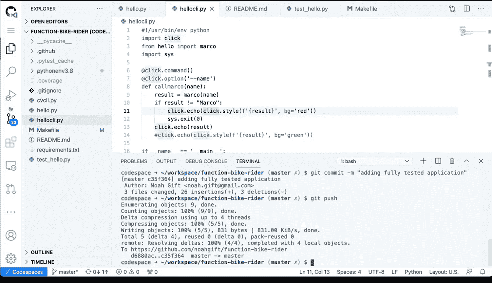
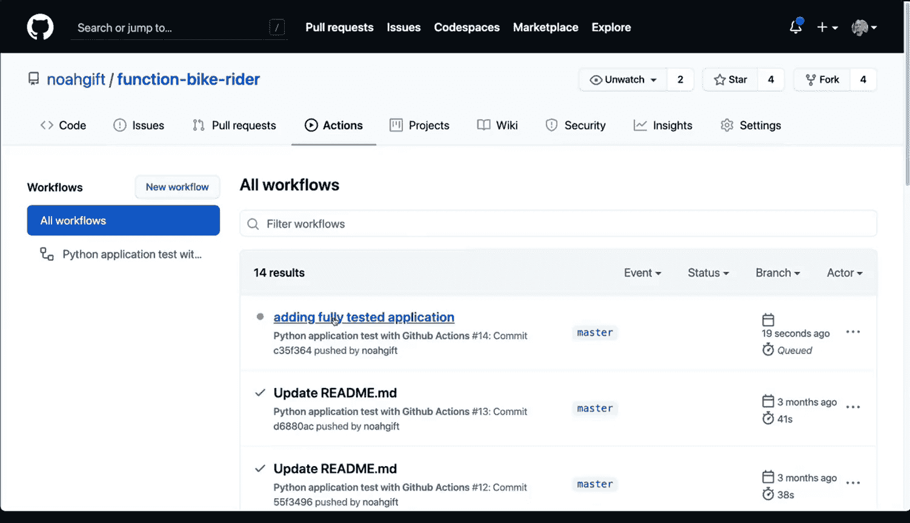
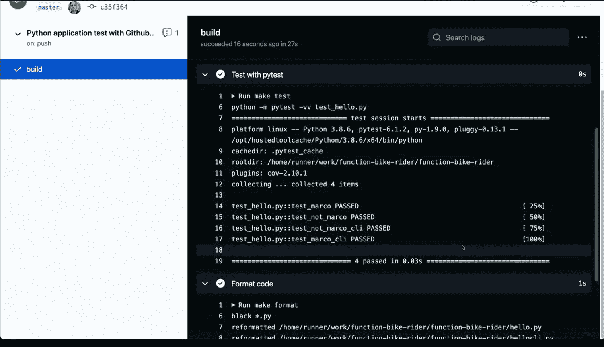
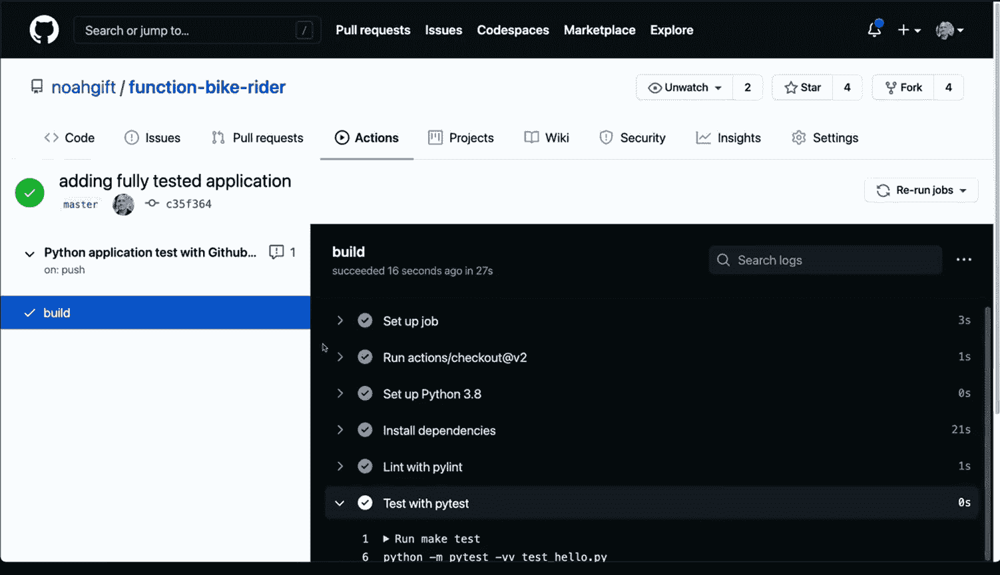
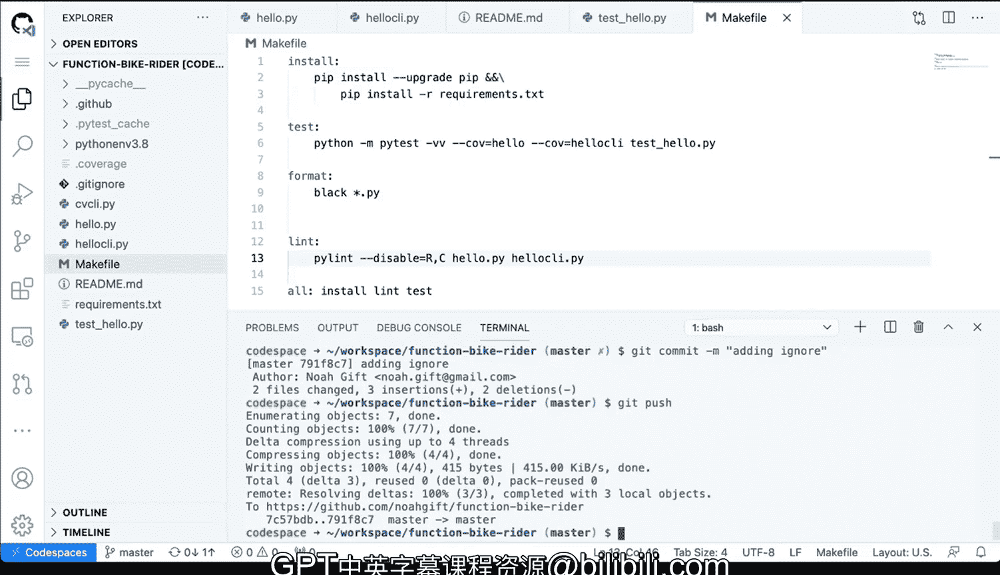

# 构建大规模云计算解决方案：3-4：函数映射到CLI（第一部分）🚀


## 概述
在本节课中，我们将学习如何将Python函数映射到命令行工具。我们将探讨函数在编程中的核心地位，并通过一个从零开始构建、测试到最终集成的完整工作流，演示如何创建一个健壮的命令行工具。

---

## 函数的中心地位与多场景应用
函数是编程的核心。它不仅是数学计算的基础，也是连接不同编程范式和工具的桥梁。

上一节我们介绍了函数的核心概念，本节中我们来看看函数在Python中的具体应用场景。

以下是函数的一些关键应用领域：

*   **数学计算**：函数与数学运算有直接对应关系。无论是计算 `x` 的平方 `x**2`，还是进行微积分求导，函数都是实现这些计算的载体。
*   **并行与分布式计算**：在并行计算场景中，函数被频繁使用。Python的 `multiprocessing` 模块允许你将函数映射到不同的进程。在网络并发编程中，函数也是常用的构建单元。
*   **装饰器**：Python装饰器是一种强大的语法，它允许你“包装”一个函数，在不修改其内部代码的情况下增加额外功能。
*   **数据科学**：在处理 `pandas` `DataFrame` 时，`apply` 方法是逐行或逐列应用处理逻辑的主要方式，这本质上就是应用一个函数。
*   **高性能计算与GPU编程**：例如，使用 `Numba` 库可以将Python函数编译成高效的机器码或GPU代码，以加速计算。
*   **命令行工具**：你可以将函数直接映射为命令行工具的一个命令。
*   **Web服务**：在构建微服务时，函数是将一段特定逻辑暴露为API接口最清晰的方式。

函数提供了一种直接的、一对一的映射关系来解决特定问题，而面向对象编程则更侧重于代码复用和抽象。在云计算和微服务架构中，掌握函数式思维尤为重要。

---

## 实战：从函数到命令行工具的工作流
理解了函数的广泛应用后，让我们通过一个具体例子，学习如何系统地将一个简单函数构建成专业的命令行工具。

我们将遵循一个六步工作流，确保代码质量与开发效率。

### 第一步：创建项目脚手架
首先，需要为项目建立基础结构。这通常包括：
*   `Makefile`：用于定义安装、测试、格式化等常用命令。
*   `requirements.txt`：管理项目依赖。
*   虚拟环境：隔离项目依赖，避免冲突。

以下是一个示例 `Makefile` 的部分内容：
```makefile
install:
    pip install -r requirements.txt

test:
    pytest tests/ -v

lint:
    flake8 hello.py hello_cli.py
```

### 第二步：编写核心函数
在一个独立的脚本文件（如 `hello.py`）中编写函数逻辑。我们创建一个简单的 `marco` 函数。

```python
# hello.py
def marco(name):
    """一个简单的Marco Polo游戏函数。"""
    if name == "marco":
        return "polo"
    return "no"
```

### 第三步：在交互环境中测试
使用 `IPython` 或 `Python` 交互式环境快速测试函数逻辑，这是探索和验证代码的高效方式。

```python
>>> from hello import marco
>>> marco("bob")
'no'
>>> marco("marco")
'polo'
```

### 第四步：编写自动化测试
确认逻辑正确后，使用 `pytest` 框架编写自动化测试用例，确保代码的稳定性和可维护性。

```python
# test_hello.py
from hello import marco

def test_marco():
    assert marco("marco") == "polo"

def test_not_marco():
    assert marco("bob") == "no"
```
运行 `make test` 即可执行测试。

### 第五步：构建命令行接口
使用 `click` 库将函数包装成命令行工具。`click` 简化了参数解析、帮助信息生成等任务。

```python
#!/usr/bin/env python
# hello_cli.py
import click
from hello import marco

@click.command()
@click.option('--name', default='', help='输入一个名字')
def cli(name):
    result = marco(name)
    click.echo(click.style(result, fg='green', bg='red'))

if __name__ == '__main__':
    cli()
```
文件顶部的 `#!/usr/bin/env python`（Shebang行）使得脚本可以直接执行。

### 第六步：测试命令行工具
使用 `click` 自带的测试工具 `CliRunner` 对命令行工具进行测试。

```python
# test_hello.py (补充)
from click.testing import CliRunner
from hello_cli import cli

def test_cli_marco():
    runner = CliRunner()
    result = runner.invoke(cli, ['--name', 'marco'])
    assert result.exit_code == 0
    assert 'polo' in result.output

def test_cli_not_marco():
    runner = CliRunner()
    result = runner.invoke(cli, ['--name', 'bob'])
    assert result.exit_code == 0
    assert 'no' in result.output
```

---

## 集成与自动化：GitHub Actions
将代码托管到GitHub后，可以利用GitHub Actions实现持续集成。每次代码推送时，自动运行测试、代码风格检查等任务，确保主分支的代码质量。






一个基本的GitHub Actions工作流配置文件（`.github/workflows/python-app.yml`）如下：

```yaml
name: Python Application Test





on: [push]

jobs:
  build:
    runs-on: ubuntu-latest
    steps:
    - uses: actions/checkout@v2
    - name: Set up Python
      uses: actions/setup-python@v2
      with:
        python-version: '3.8'
    - name: Install dependencies
      run: make install
    - name: Lint with flake8
      run: make lint
    - name: Test with pytest
      run: make test
```
你还可以生成状态徽章，添加到 `README.md` 中，直观展示构建状态。

---

## 总结
本节课中我们一起学习了如何将Python函数系统地构建成命令行工具。我们从**函数的中心地位**讲起，探讨了其在数学、并行计算、数据科学等多个领域的应用。随后，我们通过一个完整的**六步工作流**（创建脚手架、编写函数、交互测试、编写单元测试、构建CLI、测试CLI）进行了实战演练。最后，我们介绍了如何利用 **GitHub Actions** 实现持续集成，自动化整个测试和检查流程。




这种以函数为起点，逐步添加测试、接口和自动化流程的开发模式，能够显著提升代码的可靠性、可维护性和开发速度，是构建云规模应用的重要实践。