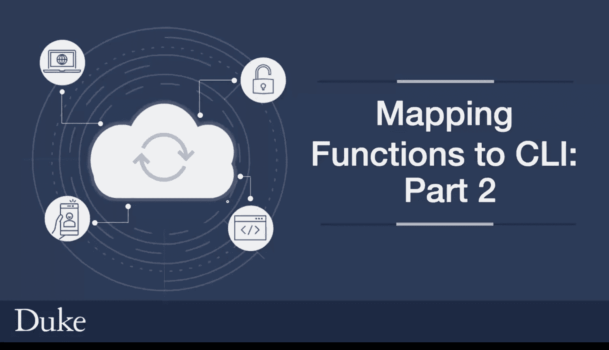
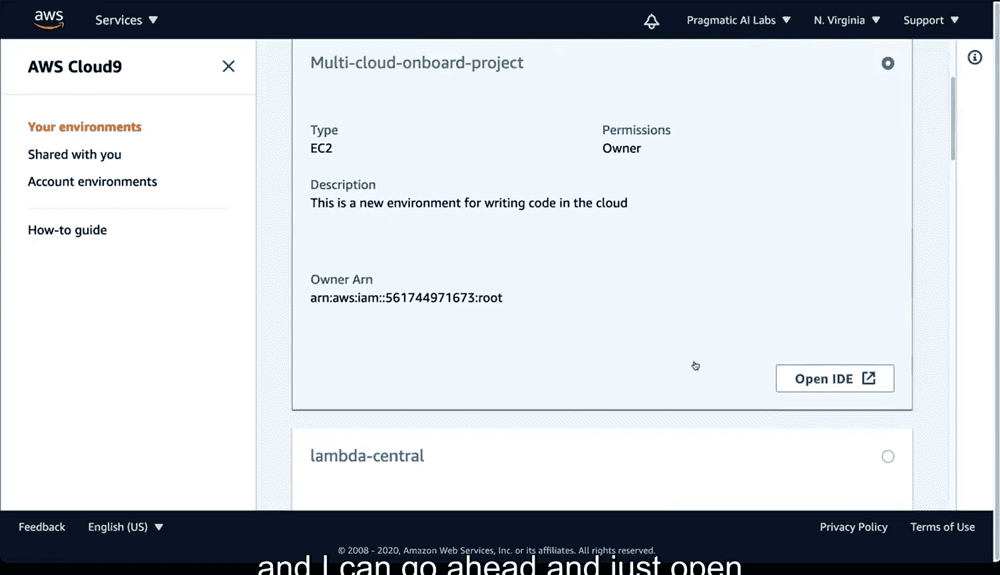
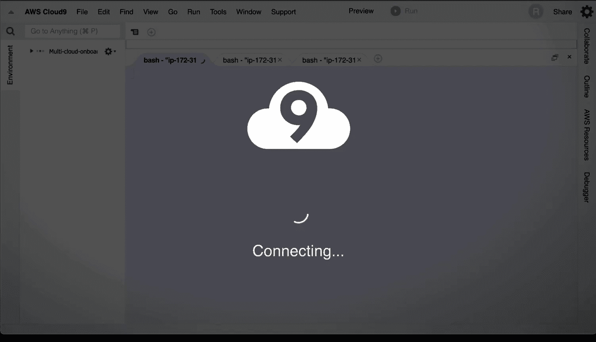
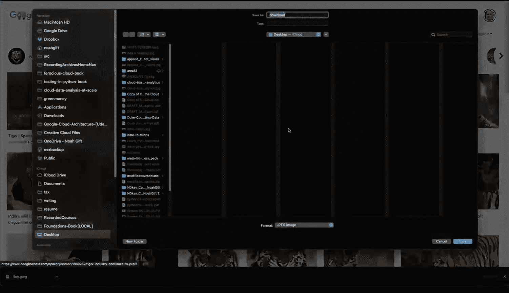
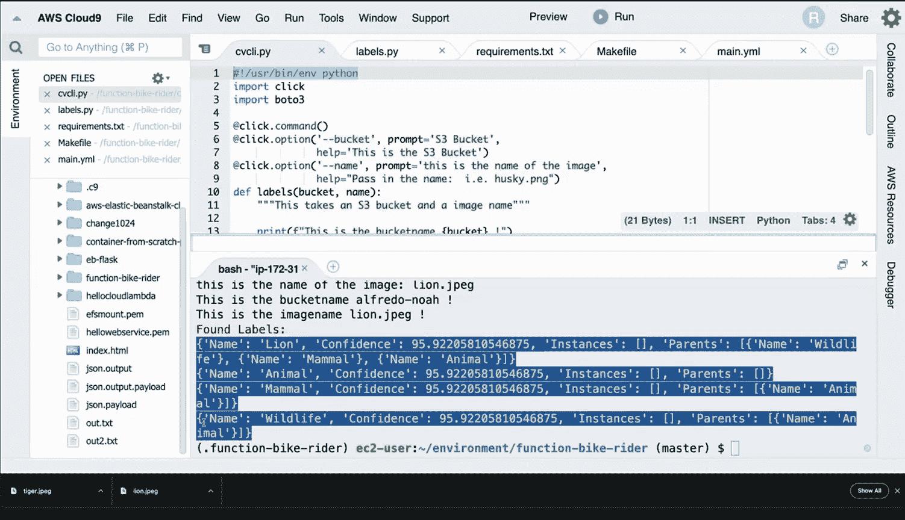
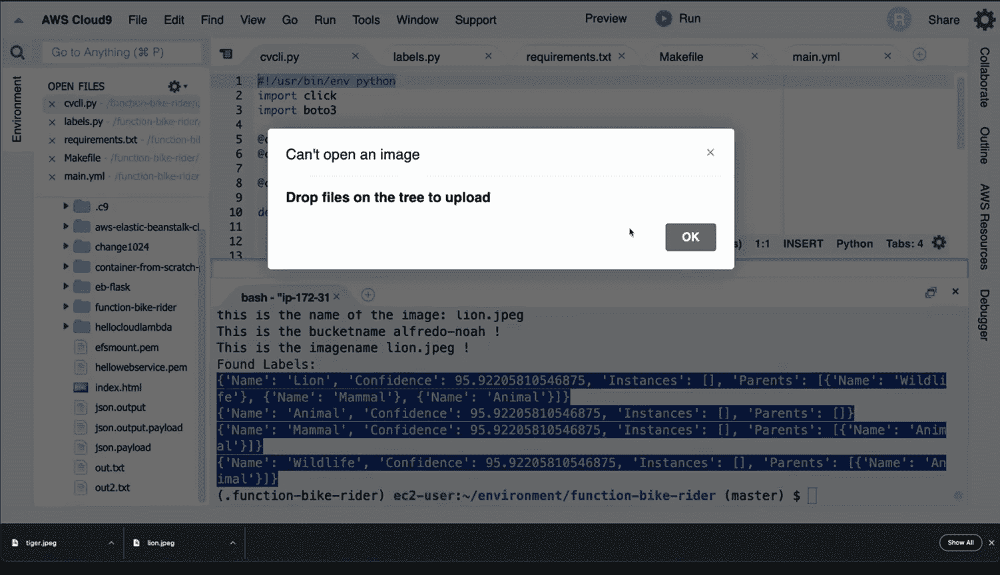
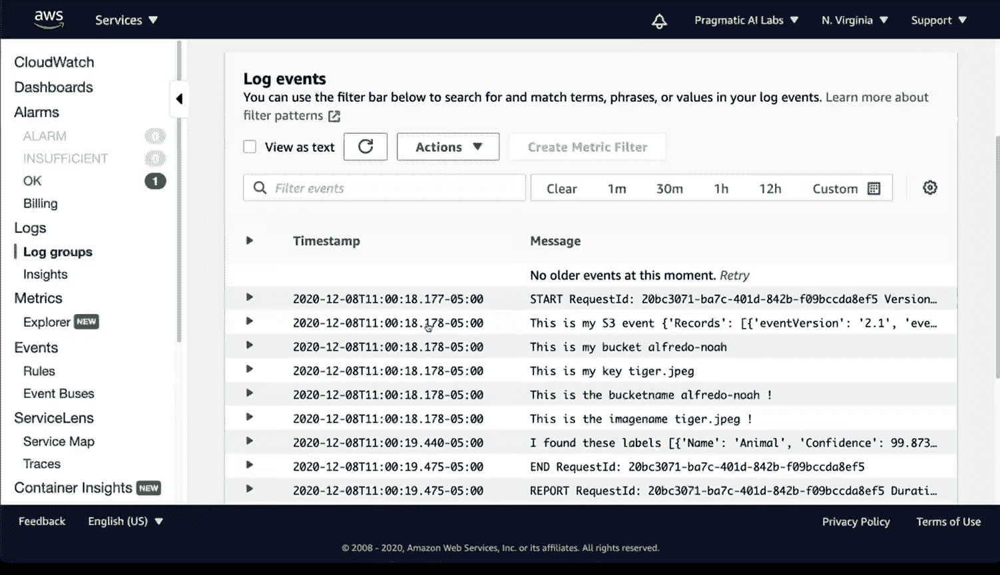

# 构建大规模云计算解决方案：3-4：函数映射到CLI（第二部分） 🛠️





在本节课中，我们将学习如何将一个计算机视觉功能封装成命令行工具，并进一步将其扩展为基于事件触发的自动化服务。我们将使用AWS的Rekognition服务来识别S3存储桶中图片的标签，并演示从CLI工具到Lambda函数的完整开发流程。




## 概述




上一节我们介绍了如何将简单的函数映射为命令行工具。本节中，我们将构建一个更实用的工具：一个基于计算机视觉的CLI工具，它能分析S3存储桶中的图片并识别其中的物体标签。随后，我们将把这个工具的核心逻辑迁移到AWS Lambda函数中，实现一个由S3上传事件自动触发的图片标签服务。

## 构建计算机视觉CLI工具

首先，我们来看一个名为“Comp vision CLI”的项目。这个工具允许我们传入一个Amazon S3存储桶的名称，并对该存储桶中的内容执行基于计算机视觉的分析。它特别包含一个**标签检测函数**。

为了测试这个功能，我们需要切换到AWS环境。我们将使用**Cloud9**，这是亚马逊提供的云端集成开发环境，可以让我们更便捷地连接AWS服务并进行API调用。

### 准备测试图片

我们需要一些图片来测试标签检测功能。我们可以从网络搜索并下载图片，例如“狮子”和“老虎”的图片。

以下是操作步骤：
1.  通过图片搜索找到“狮子”的图片并保存为 `lion.jpg`。
2.  同样地，找到“老虎”的图片并保存为 `tiger.jpg`。

### 体验AWS Rekognition服务

在构建自己的工具之前，我们可以先体验AWS的Rekognition服务。该服务提供了对象和场景检测功能。
*   将 `lion.jpg` 图片拖入Rekognition控制台，它会识别出标签，如“哺乳动物”、“野生动物”、“动物”、“狮子”。
*   对 `tiger.jpg` 进行同样的操作，会得到类似的结果。

这证实了存在一个预训练的计算机视觉模型可以完成标签检测。我们的目标是**将这个功能程序化、可操作化**。

### 在Cloud9中设置项目

接下来，我们在Cloud9环境中获取并设置CLI工具项目。

以下是操作步骤：
1.  在Cloud9中，通过 `git clone` 命令克隆项目仓库。
2.  进入项目目录，创建一个Python虚拟环境并激活它。
    ```bash
    python3 -m venv venv
    source venv/bin/activate
    ```
3.  项目中的核心逻辑位于一个 `labels` 函数中。为了独立测试，我们将其提取到一个单独的文件中，例如 `labels.py`。
4.  该函数需要 `boto3` 库来与AWS交互。我们通过 `pip install boto3` 或使用项目的 `requirements.txt` 文件来安装依赖。

### 配置S3存储桶并测试函数

我们需要一个S3存储桶来存放测试图片。

以下是操作步骤：
1.  在AWS S3控制台创建一个新存储桶，或使用一个现有的空存储桶（例如 `alfredo-noa`）。
2.  将下载的 `lion.jpg` 图片上传到这个存储桶中。
3.  在Python环境中测试 `labels` 函数。我们需要传入存储桶名称和图片文件名。
    ```python
    from labels import labels
    bucket = 'alfredo-noa'
    name = 'lion.jpg'
    results = labels(bucket, name)
    print(results)
    ```
4.  初次运行可能会遇到权限或路径错误。确保AWS凭证已正确配置，并且图片已成功上传。
5.  调整代码后，函数成功运行并返回了识别出的标签列表，例如 `[('Lion', 0.99), ('Mammal', 0.98), ...]`。

### 集成到Click CLI工具

核心函数测试成功后，我们将其集成回原始的Click命令行工具框架中。



以下是操作步骤：
1.  项目已经包含一个使用Click库构建的CLI入口点（例如 `cv_cli`）。
2.  运行CLI工具，传入存储桶名和图片名进行测试。
    ```bash
    cv-cli --bucket alfredo-noa --name lion.jpg
    ```
3.  工具成功输出识别到的标签，验证了CLI版本工作正常。
4.  我们还可以利用AWS CLI将本地图片快速上传到S3进行测试。
    ```bash
    aws s3 cp tiger.jpg s3://alfredo-noa/
    ```
5.  然后使用CLI工具分析新上传的图片。
    ```bash
    cv-cli --bucket alfredo-noa --name tiger.jpg
    ```
    工具成功识别出“老虎”等标签。



至此，我们完成了“构建独立功能 -> 测试 -> 集成到CLI工具”的模式。这为构建更复杂的应用打下了坚实基础。

## 从CLI工具到Lambda函数 🚀

CLI工具通常是一个更复杂系统的起点。一个自然的演进是创建一个由事件自动触发的服务，例如，当图片上传到S3时，自动触发标签检测。这可以通过**AWS Lambda**实现。

### Lambda函数核心概念

Lambda允许我们以函数即服务（FaaS）的方式运行代码，无需管理服务器。其核心模式与我们刚才编写的函数非常相似：
*   **输入**：一个事件（`event`）对象。
*   **处理**：函数体内的业务逻辑。
*   **输出**：一个返回值。

一个简单的Lambda函数示例如下：
```python
def lambda_handler(event, context):
    if event.get('name') == 'Marco':
        return 'Polo'
    return 'No'
```

### 构建计算机视觉Lambda函数

我们将计算机视觉标签检测的逻辑迁移到Lambda中。

以下是操作步骤：
1.  在AWS Lambda控制台创建一个新函数，例如 `computer-vision-tagger`，选择Python 3.8运行时。
2.  需要一个具有足够权限（如访问S3和Rekognition）的IAM执行角色。
3.  将之前测试过的 `labels` 函数逻辑，以及一个处理S3事件的主处理器（`lambda_handler`），复制到Lambda的代码编辑器中。
    ```python
    import boto3
    import json

    client = boto3.client('rekognition')

    def get_labels(bucket, key):
        response = client.detect_labels(
            Image={'S3Object': {'Bucket': bucket, 'Name': key}}
        )
        return response['Labels']

    def lambda_handler(event, context):
        for record in event['Records']:
            bucket = record['s3']['bucket']['name']
            key = record['s3']['object']['key']
            print(f"Bucket: {bucket}, Key: {key}")
            labels = get_labels(bucket, key)
            for label in labels:
                print(f"- {label['Name']} : {label['Confidence']:.2f}")
        return {'statusCode': 200}
    ```
4.  这个 `lambda_handler` 会遍历S3事件中的所有记录，对每个新增的图片文件调用标签检测函数，并将结果打印到日志中。

### 配置S3事件触发器

为了让Lambda在图片上传时自动执行，我们需要为其添加一个S3事件触发器。

以下是操作步骤：
1.  在Lambda函数的配置页面，点击“添加触发器”。
2.  选择“S3”作为触发器类型。
3.  选择之前使用的存储桶（`alfredo-noa`）。
4.  事件类型选择“所有对象创建事件”（或根据需求选择）。
5.  保存配置。

### 测试自动化流程

现在，整个自动化管道已经搭建完成。

以下是测试步骤：
1.  清空测试存储桶，确保从干净状态开始。
2.  将 `tiger.jpg` 图片上传到S3存储桶。
3.  上传动作会立即触发Lambda函数。转到Lambda控制台的“监控”标签页，查看“CloudWatch日志”。
4.  在日志中，可以看到函数被调用，并打印出了检测到的标签信息（如“Tiger: 99.2%”）。
5.  再次上传 `lion.jpg` 图片，日志中会立即出现对狮子图片的分析结果。

现在，我们拥有了一个完全自动化的系统。任何上传到指定S3存储桶的图片都会被自动分析并打上标签。这对于构建需要自动预处理图片的机器学习流水线非常有用。

## 总结



本节课中，我们一起学习了如何将一个计算机视觉功能逐步演化为一个完整的云解决方案。
1.  我们首先**构建并测试了一个核心Python函数**，用于调用AWS Rekognition服务。
2.  接着，我们将该函数**封装成一个命令行工具（CLI）**，使其易于交互和测试。
3.  最后，我们展示了如何将同样的核心逻辑**部署为AWS Lambda函数**，并通过配置S3事件触发器，实现了一个**全自动的图片标签服务**。


这种“功能 -> CLI -> 事件驱动服务”的开发模式，极大地降低了构建复杂云原生应用的认知负担，并且使代码易于测试、迭代和扩展。