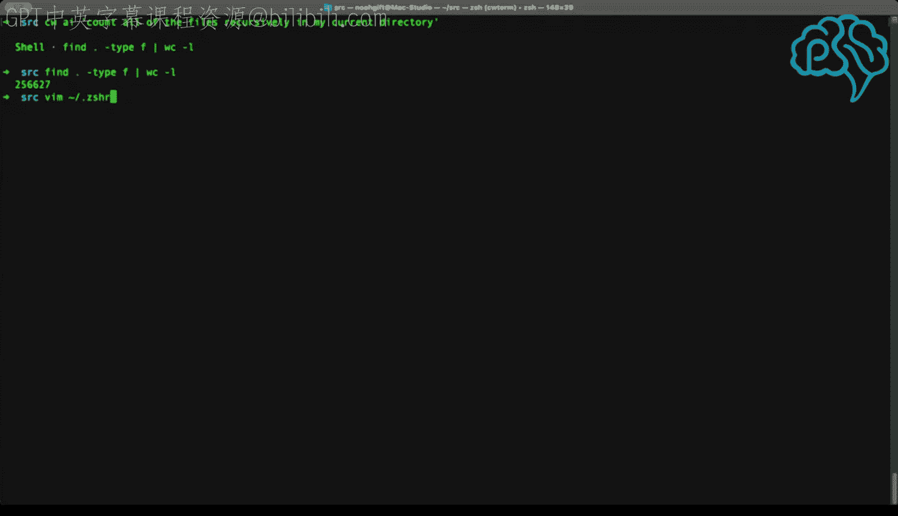
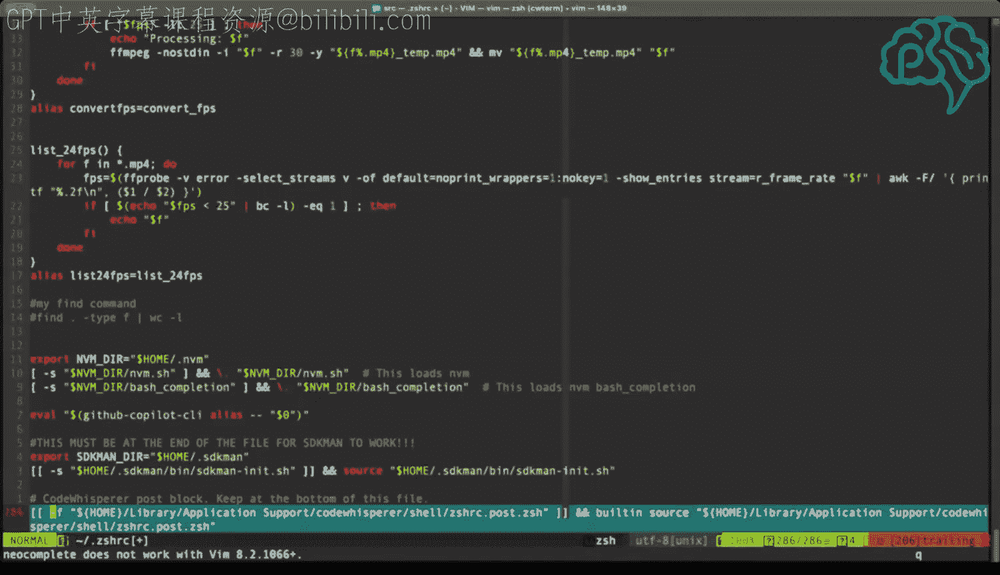
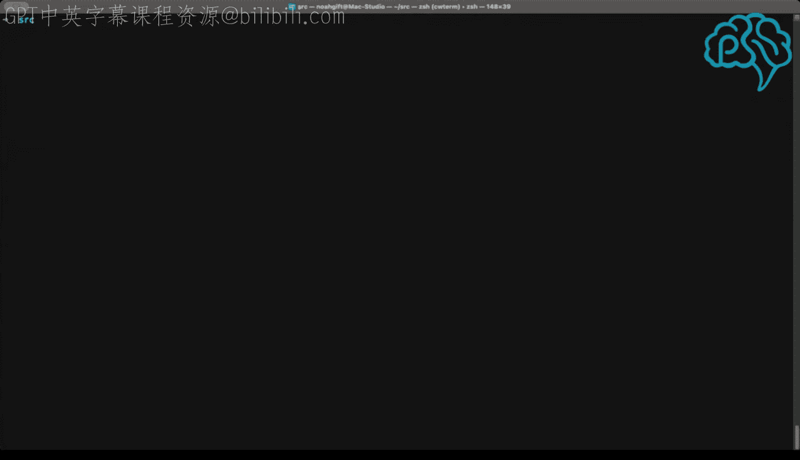

# 构建大规模云计算解决方案：3-4：AWS CodeWhisperer CLI 教程 🚀


在本节课中，我们将要学习如何在命令行界面（CLI）中使用 AWS CodeWhisperer。这是一个强大的工具，可以帮助你通过自然语言生成复杂的 Shell 命令，从而提高工作效率和命令行技能。

## 概述

AWS CodeWhisperer 不仅是一个代码助手，它还能直接在 Shell 环境中工作。你可以用简单的英语描述你想要执行的操作，它会为你生成相应的命令。这对于学习和快速完成日常任务非常有帮助。

## 在 Shell 中使用 CodeWhisperer

上一节我们介绍了 CodeWhisperer 的基本概念，本节中我们来看看它的具体使用方法。首先，你需要在你的 Shell 环境中激活 CodeWhisperer。激活后，你可以通过两种主要方式与它交互。

### 方式一：使用 `#` 提示符

在命令行中，输入 `#` 符号，然后直接输入你的问题或需求。

例如，你可以输入：
```
# 递归统计当前目录下的所有文件数量
```
按回车后，CodeWhisperer 会生成一个命令建议，例如 `find . -type f | wc -l`。你可以选择执行这个命令来查看结果。

### 方式二：使用 `cw ai` 命令

另一种方式是使用 `cw ai` 命令，后面跟上你的问题。这是一种更明确的调用方式。



例如：
```
cw ai 查找所有 CPU 使用率超过 10% 的进程
```
CodeWhisperer 会生成如 `ps aux | awk ‘$3 > 10 {print $0}’` 这样的命令供你执行。

## 将生成的命令转化为知识

CodeWhisperer 的强大之处不仅在于即时帮助，还在于它能帮助你学习。你可以将生成的常用命令保存为别名（alias）或函数，从而积累你自己的命令行工具库。



以下是创建别名的方法：
1.  打开你的 Shell 配置文件（例如 `~/.zshrc`）。
2.  添加一行，例如：`alias countfiles=‘find . -type f | wc -l’`。
3.  保存文件并执行 `source ~/.zshrc` 使别名生效。

这样，你以后只需要输入 `countfiles` 就能快速执行复杂的文件统计操作。

## 实际应用示例

让我们通过一个具体场景来巩固所学。假设你想监控系统资源。

你可以使用 CodeWhisperer 来生成命令：
```
# 显示当前内存使用量最高的5个进程
```
它可能会建议：`ps aux --sort=-%mem | head -6`

执行这个命令，你就能立即看到结果。你可以将这个命令保存为别名 `memtop`，方便以后使用。

## 总结



本节课中我们一起学习了如何在 Shell 环境中利用 AWS CodeWhisperer CLI。我们探讨了两种调用方式：使用 `#` 提示符和 `cw ai` 命令。更重要的是，我们学会了如何将工具生成的临时命令转化为持久的、可复用的知识（如别名），从而真正提升我们的命令行技能和生产效率。这是一个免费且强大的工具，强烈建议你安装并开始使用它来探索命令行的更多可能性。