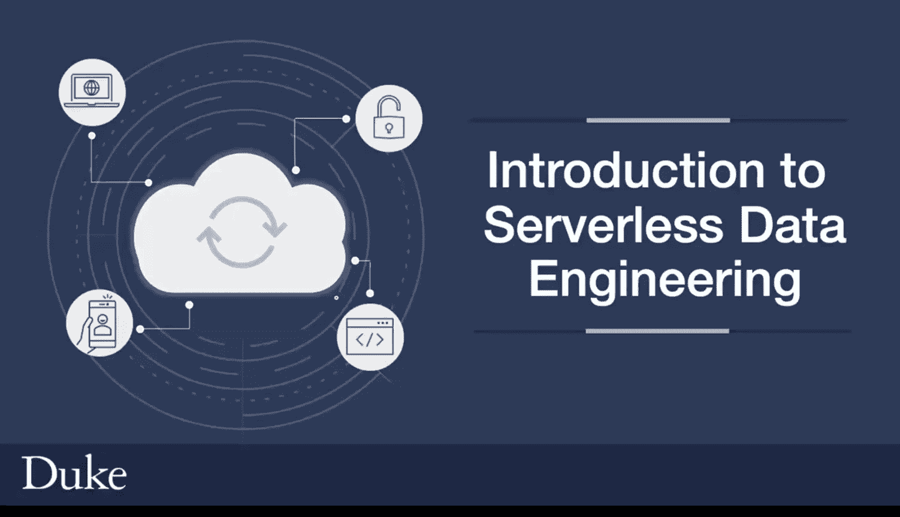
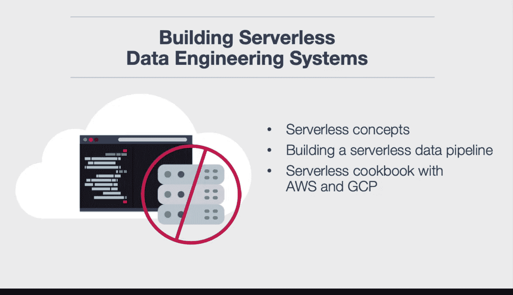
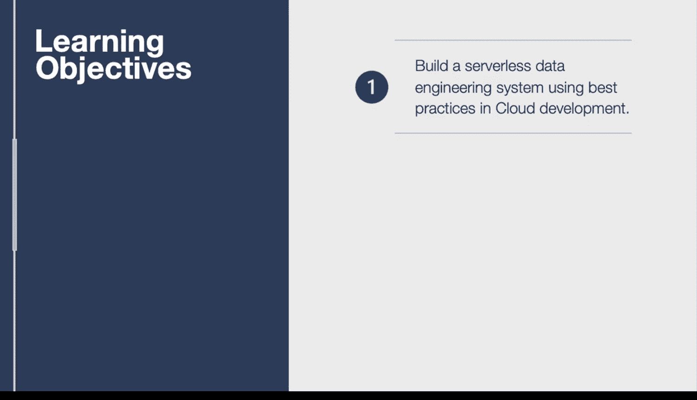

# 构建大规模云计算解决方案：3-2：无服务器数据工程导论 🚀

在本节课中，我们将学习如何构建一个无服务器数据工程系统。我们将首先探讨“无服务器”的真正含义，然后深入介绍相关的核心概念，例如AWS Lambda、Google Cloud Functions和Azure Functions。接着，我们将学习如何构建无服务器数据工程管道，例如一个从网站收集数据并进行自然语言处理的系统。最后，我们会提供一些针对AWS和GCP（Google Cloud Platform）的实用“食谱”或解决方案。本节课的核心目标是掌握构建无服务器数据工程系统的能力。

现在，让我们开始学习。

---

## 什么是无服务器？ 🤔

上一节我们概述了课程目标，本节中我们来看看“无服务器”这个概念。无服务器并不意味着没有服务器。它指的是一种云计算执行模型，云提供商动态管理服务器资源的分配。开发者无需关心服务器的配置、维护或扩展，只需专注于编写和部署代码。这种模式的核心是按需执行和按使用量付费。

## 无服务器核心概念 ⚙️

理解了无服务器的基本定义后，本节我们将深入其核心组件。目前市场上有多个主流云提供商提供的无服务器计算服务。

以下是主要的无服务器函数计算服务：
*   **AWS Lambda**： 亚马逊云科技提供的无服务器计算服务。
*   **Google Cloud Functions**： 谷歌云平台提供的无服务器执行环境。
*   **Azure Functions**： 微软Azure提供的无服务器计算服务。

这些服务允许你以函数的形式上传代码，由云平台在事件触发时自动运行，例如HTTP请求、文件上传到存储桶或数据库更改。

## 构建无服务器数据工程管道 🔄

在了解了核心服务之后，本节我们来看看如何利用它们构建实际的数据工程管道。无服务器架构非常适合构建由事件驱动的、可扩展的数据处理流程。

一个典型的例子是构建一个自然语言处理（NLP）管道。该管道可以自动从指定网站收集数据（例如通过定时触发器或消息队列触发），然后调用无服务器函数对数据进行处理和分析，最后将结果存储到数据库或数据仓库中。

## AWS与GCP实用方案 📚

为了将理论付诸实践，本节我们提供一些在AWS和GCP平台上构建无服务器数据工程的实用“食谱”或参考方案。

以下是针对两个平台的一些入门指导：
*   **AWS方案**： 可能包括使用Lambda函数响应S3存储桶的事件（如新文件上传），触发数据处理流程，并将结果写入Amazon DynamoDB或Redshift。
*   **GCP方案**： 可能涉及使用Cloud Functions响应Cloud Storage事件或Pub/Sub消息，进行数据转换后，将输出结果保存到BigQuery或Cloud Firestore中。

这些方案提供了具体的实现模式和代码片段，帮助你快速上手。

---

本节课中我们一起学习了无服务器数据工程的基础。我们从无服务器的定义出发，介绍了AWS Lambda、Google Cloud Functions等核心服务，探讨了如何构建事件驱动的数据管道，并概述了在AWS和GCP上的实践方案。掌握这些内容，你就具备了构建自动化、可扩展的无服务器数据工程系统的基础。