# 构建大规模云计算解决方案：3-4：流水线自动化 🚀

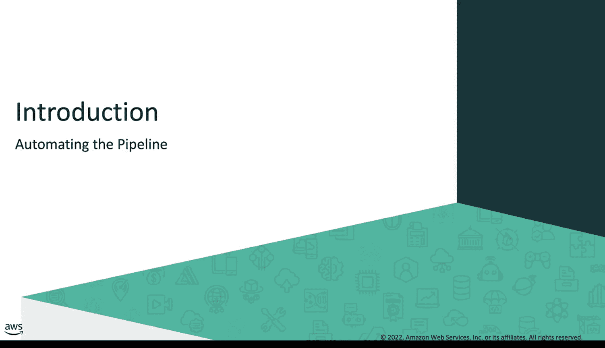

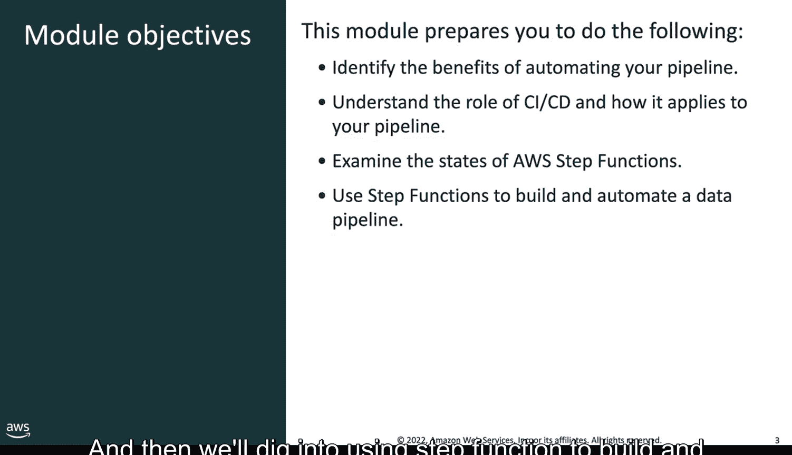

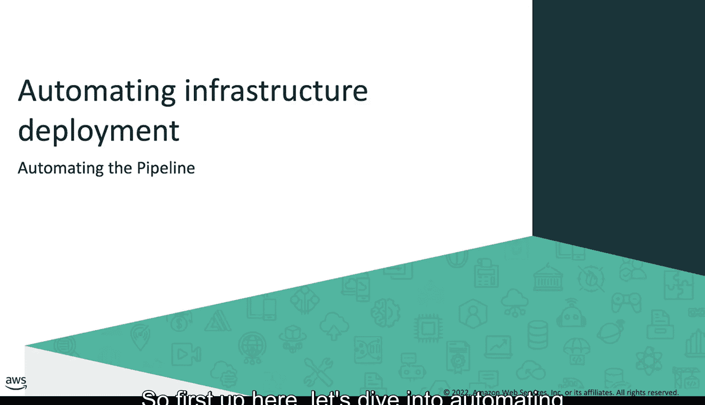

在本节课中，我们将要学习数据工程中流水线自动化的核心概念与实践。我们将探讨自动化的优势、持续集成与持续交付（CI/CD）的作用，并深入了解如何使用 AWS Step Functions 来构建和自动化数据流水线。

---

## 自动化基础设施部署 🏗️

上一节我们介绍了流水线自动化的整体概念，本节中我们来看看如何自动化基础设施部署，这是自动化的一个重要方面。

遵循标准最佳实践，您需要自动化您的环境。一个核心观点是：**如果它没有被自动化，那么它就是有问题的**。这包括资源的供应、停用和配置，以确保系统的稳定性、一致性和幂等性。

以下是两种模式的对比：

*   **手动模式**：过去，如果服务器崩溃，管理员会收到手动通知，然后该管理员必须手动启动一台新服务器。这是一个真正的问题，因为如果管理员正在休假怎么办？
*   **自动化模式**：使用 CloudWatch 自动检测崩溃。当检测到崩溃时，系统会通知管理员，并**同时**自动启动一台具有相同配置的新服务器。整个过程没有人工参与。

这里的关键在于**完全自动化**。AWS 提供了内置的监控和自动化工具。利用这些资源，您可以确保您的基础设施能够快速响应变化，自动检测不健康的资源并启动替代资源，甚至在资源变更时收到通知。手动步骤是一种反模式，应避免使用。通过自动化，您可以提高组织的稳定性、一致性和效率。

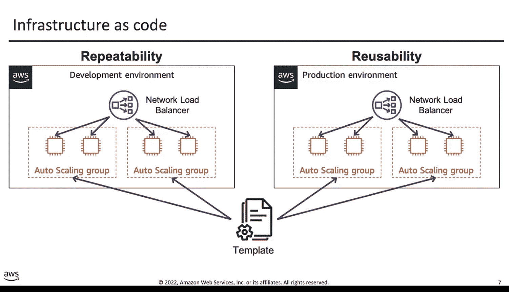

---

## 基础设施即代码 📜

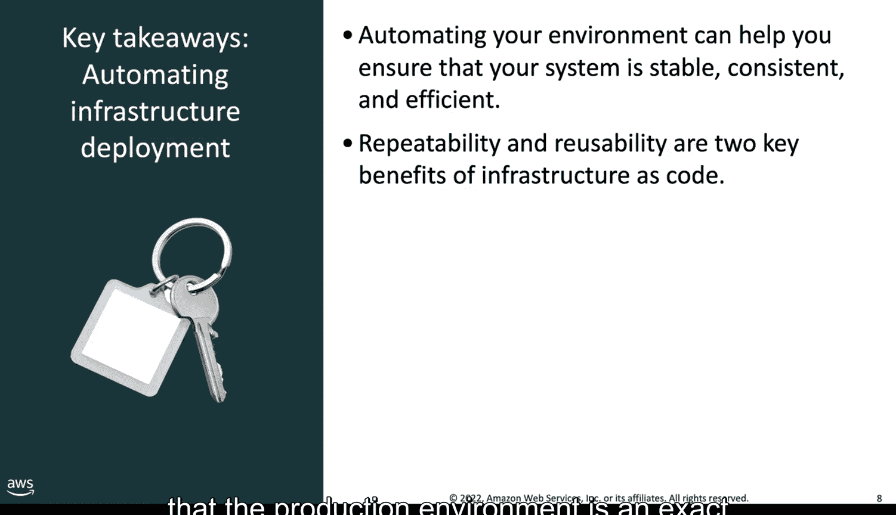

现在，让我们谈谈基础设施即代码，这是自动化的一个巨大组成部分。

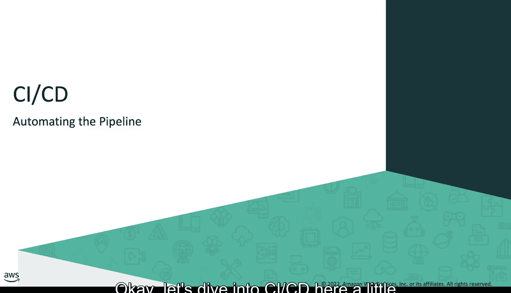

可重复性是您希望使用基础设施即代码的原因之一，因为它使您能够一遍又一遍地部署完全相同的环境副本。例如，您可以使用 CloudFormation 模板来部署开发环境，测试应用程序的扩展性。如果测试成功，您可以使用**完全相同的模板**（仅需少量更改，甚至可以根据环境变量触发）将经过充分测试的资源从开发环境启动到生产环境。这样，您就能将开发环境中的所有辛勤工作紧密地映射到生产环境中。

当您用代码构建基础设施时，您将在构建环境时获得**可重复性**和**可重用性**的好处。一个单一的模板可用于部署网络负载均衡器、自动扩展组、EC2实例等。这一个模板或模板组合可以反复构建这些复杂的环境。您只需做一次工作，但可以多次受益。

在 AWS 中，您可以创建依赖于条件的环境，并根据创建环境的上下文专门构建资源。您可以设计一个模板来使用不同的可用区，并启动到开发或生产环境。这种基础设施的可重复性和可重用性有助于您为数据分析和机器学习工作负载部署一致的基础设施包。因此，在现代云环境的数据工程中，拥有基础设施即代码至关重要。

**关键要点**：
*   您需要自动化您的环境，以确保其稳定、一致和高效。正如之前所说，如果它没有被自动化，那么它就是有问题的。
*   一致性对于运行需要相同处理方法的重复工作负载特别有益。
*   当您重复和重用时，**可重复性**和**可重用性**这两个好处将通过基础设施即代码发挥作用。
*   如果您使用这些模板来部署基础设施，您可以确保生产环境是开发环境的精确镜像。

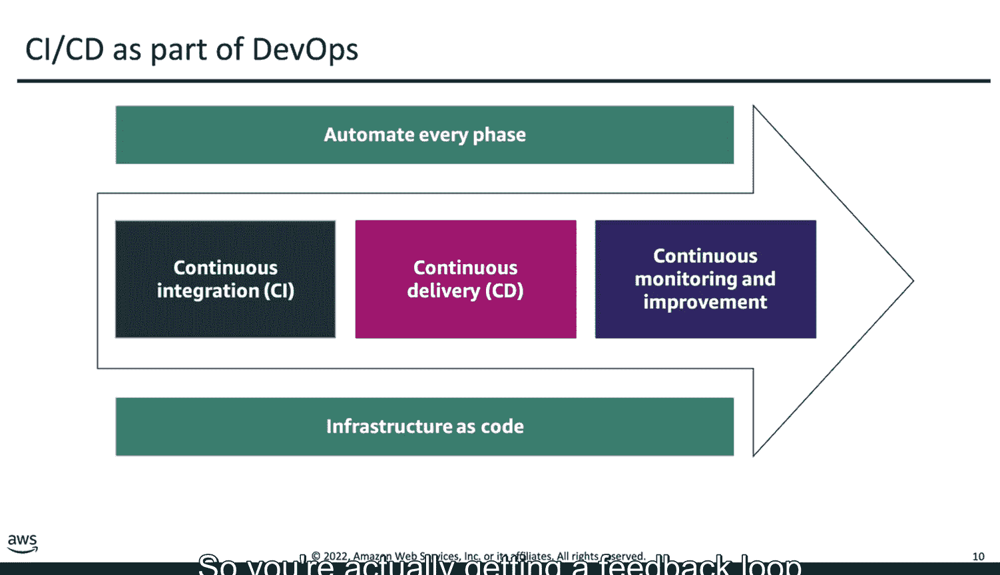

---

## 持续集成与持续交付（CI/CD） 🔄

接下来，让我们深入了解一下 CI/CD，因为这是 DevOps 的一部分。

其核心思想是自动化您工作的每个阶段：您有持续集成、持续交付、持续监控和改进，以及基础设施即代码。这些是 DevOps 的基础。

CI/CD 是哲学、实践和工具的结合。其核心是您希望快速行动，希望以比使用传统软件开发和基础设施管理的组织更快的速度演进和改进。这种速度将使组织能够更好地服务客户，并在市场中更有效地竞争。

以下是 CI/CD 的核心实践：

*   **持续集成**：这是一种软件开发实践，开发人员定期将代码合并到中央代码仓库。
*   **持续交付**：这是一种软件开发实践，代码变更会被自动构建、测试并准备发布到生产环境。

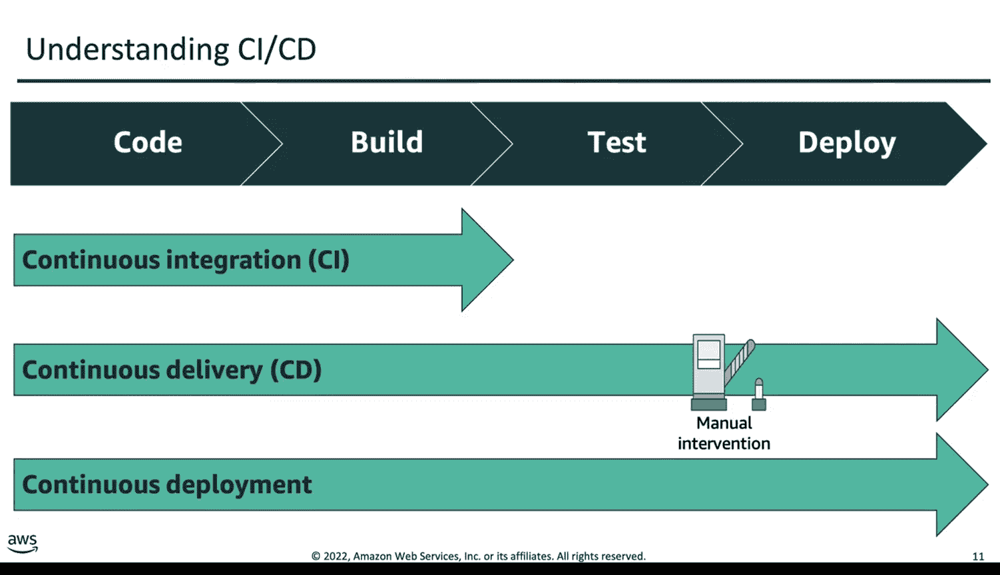

其理念是，每次您提交一段代码，您都在改进系统，因为您在实践代码的构建、测试和部署方面。随着时间的推移，这实际上是在强化您的系统。持续交付扩展了持续集成，因为您将所有的变更部署到测试环境和生产环境。当 CI 被正确实施时，开发人员拥有已经通过测试流程的、可部署的构建工件，这些代码可以以需要较少甚至零人工干预的方式部署。

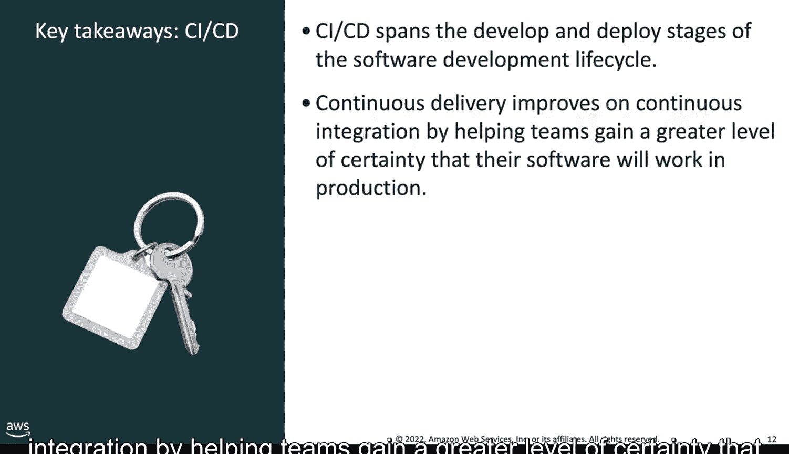

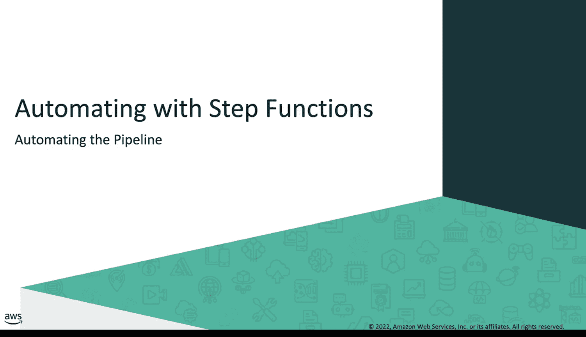

由于您拥有这种自动化，您还可以进行持续监控和改进，因为您实际上获得了一个帮助您持续改进的反馈循环。

**CI/CD 概念详解**：

*   **持续集成**：每次您进行更改时，都会通过自动化的构建和测试流程进行验证。过去，开发人员可能会在所谓的“黄金镜像”或“黄金项目”上工作数月，只有在功能完成后才将代码更改合并到主分支。这存在真正的问题，因为当您批量处理更改时，合并业务逻辑和测试逻辑可能会很困难。而通过持续集成，您每天可以进行多次更改，团队能够提高生产力，更快地开发功能。持续集成要求团队编写自动化测试以提高软件质量，并编写能减少验证新版本软件所需时间的测试。
*   **持续交付**：这扩展了持续集成，包括在类似生产的环境中进行测试。这很关键。您不仅在 CI 阶段获得了业务逻辑，而且在 CD 阶段，您实际上是在实践基础设施的配置。借助云，您能够将基础设施定义为代码。因此，每次部署时，您都在进行这种惊人的验证测试。实际上，速度是一种优势而非劣势。通过让代码在系统中流动，您本质上是在清理系统，测试边缘情况。持续交付可以通过某种手动干预一直延伸到生产部署，即代码被签入，当准备好发布时，有人只需“按下按钮”，它就会被交付到生产环境。
*   **持续部署**：这是向客户自动发布软件。这种自动化从代码签入一直延伸到生产环境，无需人工干预。持续部署将减少交付业务价值（例如新功能、更新等）所需的时间。开发团队可以非常快速地获得客户反馈，这种快速的反馈循环实际上会为您带来竞争优势，因为您能够快速迭代并向客户发布软件。

**关键要点**：
*   CI/CD 贯穿软件开发生命周期的开发和部署阶段。
*   持续交付通过帮助团队更确定软件能在生产环境中工作，从而改进了持续集成。

---

## 使用 Step Functions 实现自动化 ⚙️

上一节我们介绍了 CI/CD 的核心概念，本节中我们来看看如何使用 AWS Step Functions 来实现自动化。

Step Functions 可以通过可视化工作流来帮助您协调分布式应用程序和微服务的组件。它提供了一种可靠的方式来协调组件并逐步执行应用程序的功能。该服务具有图形界面，可以将不同的组件可视化为一系列步骤。Step Functions 会自动启动和跟踪每个步骤，甚至在出现错误时重试，从而确保应用程序按正确顺序和预期运行。

它还与更高级别的服务集成，例如 Amazon Athena（一项允许您使用 SQL 查询数据的服务）。您实际上可以使用 Step Functions 来启动和停止查询并获取查询结果。通过 Step Functions，您可以执行一次性或计划的数据查询，然后从 S3 接收结果。Athena 是无服务器的，因此您无需设置或管理基础设施，只需为您需要的查询付费。

**Step Functions 工作原理**：
通常，您将工作流定义为一**系列步骤**以及步骤之间的**转换**。一个工作流被称为一个**状态机**，而**状态**是状态机中的元素。状态机是一个对象，它有一组取决于对象先前条件以确定输出的操作条件。这意味着单个状态可以根据输入做出决策、执行操作，然后将该输出传递给其他状态。

**任务**完成状态机中的所有工作。一个任务通过使用一个活动或 Lambda 函数来执行工作，然后将这些参数传递给另一个服务的 API 操作。每个状态机都从一个输入开始，该状态转换输入并将其传递给下一个状态。通过 Step Functions 控制台，您可以可视化该状态机，并近乎实时地获取内部发生的情况信息。这对于像数据流水线这样可能非常复杂（因为有一连串的反应）的事物来说，是一个巨大的优势。

**Step Functions 界面**：
Workflow Studio 允许您像搭积木一样拖放组件。操作面板允许您查看不同的 AWS API，您还可以提供不同的流程状态，例如“尝试这个”或“尝试那个”，或按顺序执行。您可以从操作或流程面板中选择一个状态添加到工作流中，将其拖放到画布区域的工作流中。一条线将显示它将被放置在工作流中的位置。当您向工作流添加新状态时，其代码会自动生成。在工作流中，您可以拖放状态以将它们移动到不同的位置。如果工作流很复杂，您可能无法在画布面板中查看全部，但可以使用画布顶部的控件进行缩放，然后查看工作流图的不同部分。

**状态类型**：
每个状态都有不同的功能。以下是主要的状态类型：

*   **任务**：由状态机执行的单个工作单元。状态机中的所有工作都由使用活动或 Lambda 函数的任务完成。
*   **传递**：将输入传递给输出。这是可选的，您可以在输出中添加固定数据。
*   **选择**：为工作流添加分支逻辑。在检查器面板的配置选项卡中，您可以配置规则以确定工作流将转换到哪个状态。
*   **并行**：为工作流添加并行分支。
*   **等待**：暂停工作流一段时间，或直到指定的时间或日期。
*   **映射**：为输入数组的每个元素动态迭代步骤。例如，映射状态将为状态输入中数组的多个条目处理相同的步骤。
*   **成功**：以成功状态停止工作流。
*   **失败**：以失败状态停止工作流。

关于传递状态，它会在不做任何工作的情况下将输入传递给输出，这对于构建和调试状态机很有用，几乎就像一个打印语句。选择状态必须具有选择字段，其中值是非空数组，数组中的每个元素都是一个称为选择规则的对象。并行状态会在状态机中创建一个并行分支，导致 Step Functions 分支出去，这些分支并发开始。等待状态会使状态机延迟特定时间。映射状态可以为输入数组的每个元素运行一组步骤。成功状态和失败状态都是终端状态。

**与 Athena 集成**：
Step Functions 与 Athena 集成，以构建包含 Athena 查询和数据处理操作的工作流。这种集成是构建可重复、可扩展的数据处理流水线（作为更大应用程序的一部分）的好方法。您显然也可以从 CLI 调用这些功能。

一个常见示例是：原始数据（例如制表符分隔值 TSV）每日被摄取。随着信息被摄取，Glue Crawler 可以为原始数据目录提供更新。然后，您可以使用 Athena 的 UNLOAD 语句将数据转换为 Parquet 格式。转换后，您可以将 Parquet 文件的位置发送到 SNS 通知。然后，SNS 可以通知下游应用程序采取进一步操作。一个常见的例子是启动一个 Lambda 函数，将 Athena 转换后的数据上传到 Redshift。

---

## 总结 📝

在本节课中，我们一起学习了流水线自动化的核心内容。

我们首先探讨了自动化基础设施部署的重要性，强调了“如果它没有被自动化，那么它就是有问题的”这一原则，并介绍了基础设施即代码带来的可重复性和可重用性优势。

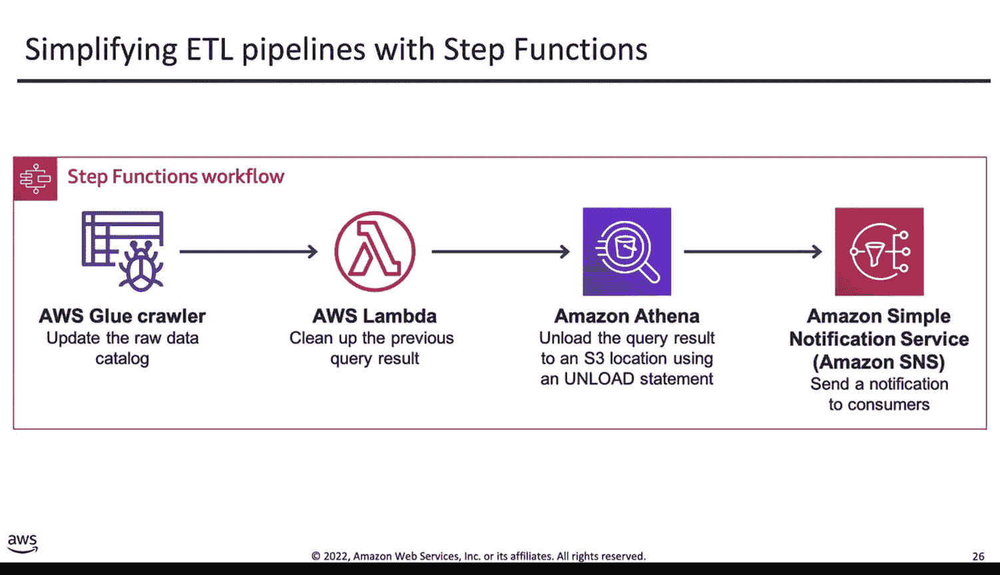

接着，我们深入了解了持续集成与持续交付（CI/CD），这是 DevOps 的核心实践。我们明确了 CI 是频繁集成代码并自动验证，而 CD 和持续部署则进一步自动化了测试、准备和发布流程，从而加快交付速度并获得快速反馈。

最后，我们重点学习了如何使用 AWS Step Functions 来构建和自动化复杂的数据流水线。我们了解到 Step Functions 通过可视化工作流来协调分布式组件，定义了状态机、状态和任务等核心概念，并介绍了各种状态类型（如任务、选择、并行、映射等）的功能。我们还看到了 Step Functions 如何与 Athena 等服务集成，以创建可重复、可扩展的数据处理管道。

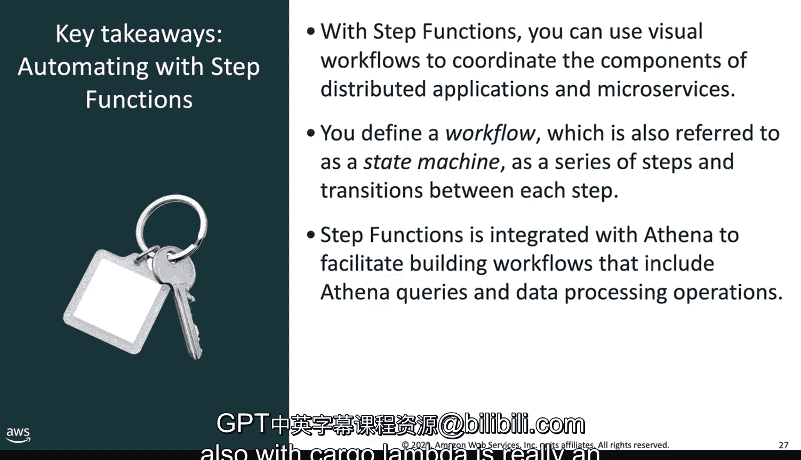

总而言之，结合基础设施即代码、CI/CD 实践以及像 Step Functions 这样的编排工具，是构建高效、可靠且易于维护的大规模云数据工程解决方案的关键。