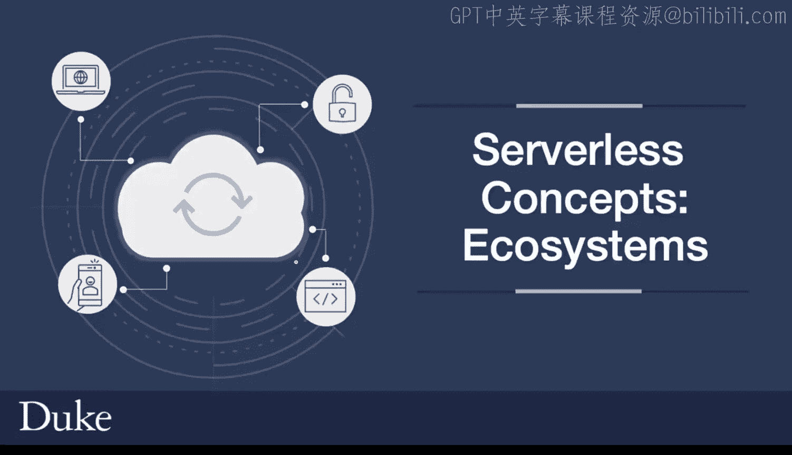
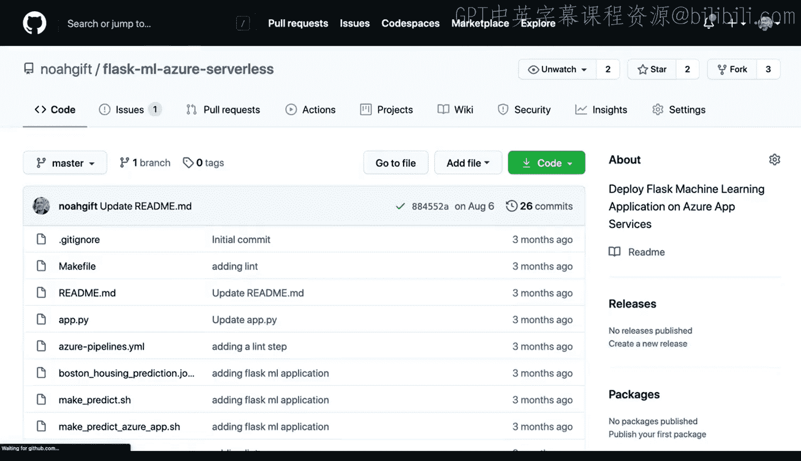
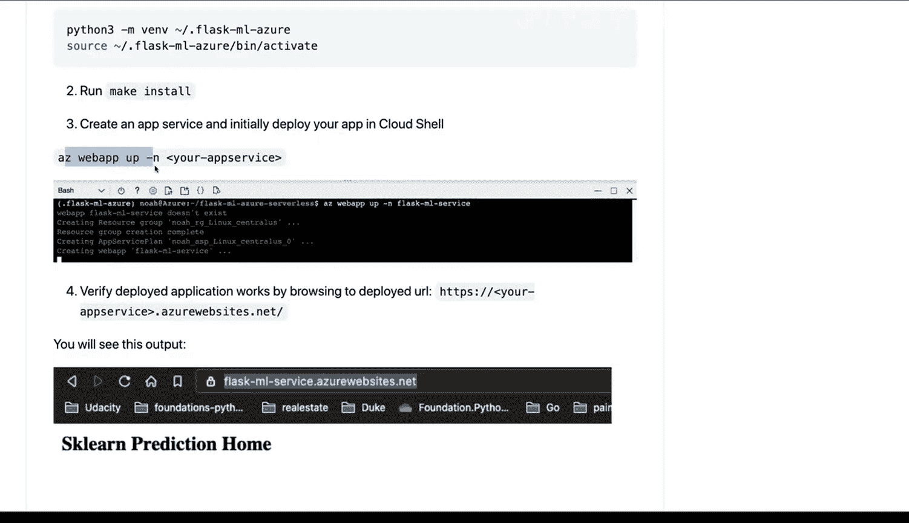
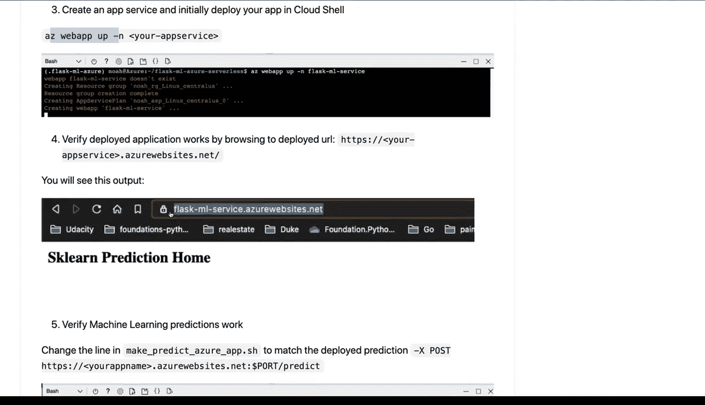
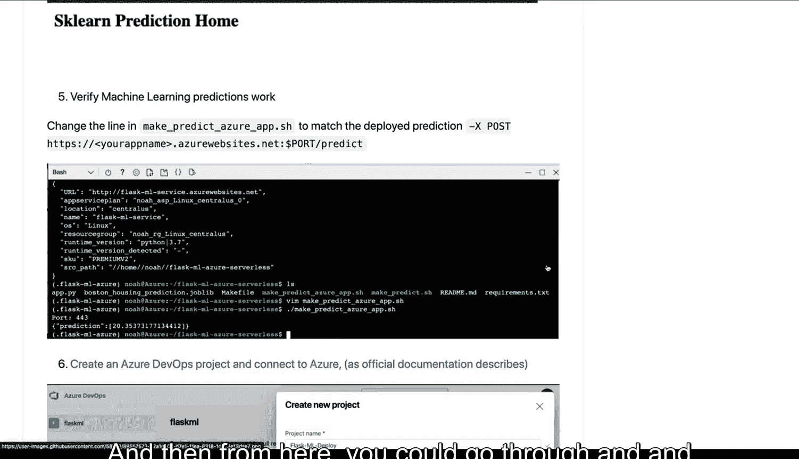
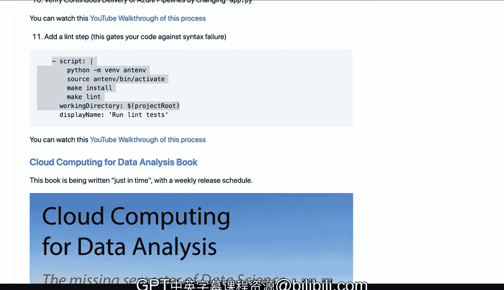

# 构建大规模云计算解决方案：3-4：无服务器概念：生态系统 🏗️

在本节课中，我们将学习无服务器计算的核心生态系统，主要聚焦于三大云服务提供商（AWS、GCP、Azure）提供的无服务器技术和服务。我们将了解它们的关键组件、工作原理以及如何利用这些服务构建应用。

无服务器生态系统本身拥有巨大的发展势头。目前，AWS 可能是该领域的领导者。接下来，我们将具体探讨在 AWS 平台上，你可以使用无服务器技术构建哪些内容。

我们知道 AWS Lambda 是构建服务的绝佳方式。此外，还有 Step Functions，它的作用是将不同的 Lambda 函数连接起来。本质上，你可以将一个 Lambda 函数的输出作为另一个 Lambda 函数的输入，并将这一系列操作封装在一个称为 Step Function 的单元中。这样，你就可以将许多不同的操作串联起来。以上是 AWS 无服务器领域的基本概况。

除了 Lambda 和 Step Functions，你还可以使用触发器。这可能是构建无服务器应用时最大的转变：你可以将一个 Lambda 函数连接到 AWS 中超过 25 种不同的事件源。具体能做什么呢？你可以用它来触发一个 Web 服务，也可以设置一个操作：当有文件上传到 S3 存储桶时，调用你的 Lambda 函数。你还可以用它来处理数据流。此外，定时器也是一个重要功能，你可以设定某个任务按特定时间间隔运行。总而言之，在 AWS 生态中，核心就是 Lambda、Step Functions 和触发器，它们构成了该生态系统的主要部分。

除了 AWS 原生服务，还有一个名为 **Chalice** 的库也值得关注。它本质上仍然基于 AWS Lambda，但由编写 AWS 主要 SDK（Boto）的团队开发。Chalice 使得实现我们刚刚讨论的某些功能变得更加容易。

以上是 AWS 生态系统。现在，让我们来谈谈 GCP 生态系统。

在 GCP 生态系统中，他们有一些有趣的技术。其中一项技术叫做 **Cloud Run**。它本质上是一个 Docker 容器，你可以将其转变为一个完整的服务。你可以构建一个容器，通过 Cloud Run 将其部署成一个 API 服务。这意味着你可以将任何 Docker 容器推送到他们的容器注册表，然后将其转化为服务。这样做的好处是，你可以对构建内容拥有高度控制权，因为你可以在 Dockerfile 中明确指定要安装的软件包以及希望执行的各种操作。总的来说，Cloud Run 是一个非常强大的开发平台。

GCP 也提供 **Cloud Functions**，其功能与 AWS 类似。你可以将一段 Python 代码部署上去，然后这段代码可以被各种事件触发，例如一个 Web 请求，或者一条通过 Pub/Sub 传入的消息。总的来说，GCP 和 AWS 在无服务器功能上基本是对等的。

接下来，我们快速了解一下 Azure 生态系统。Azure 也在做类似的事情，与 AWS 和 GCP 保持同步。Azure 同样提供 **Azure Functions** 用于构建函数。此外，他们还有一项服务叫做 **App Services**，这是一种平台即服务。例如，你可以将一个 Flask Web 应用部署到 App Services 上，而完全无需管理服务器。我这里有一个快速示例可以说明 App Services 是如何工作的。

这个示例很好地展示了为什么你可能希望在无服务器环境中使用像 Flask 这样的框架。我可以将这个项目连接到 GitHub，利用 Azure 的构建系统（Azure Pipelines）来监听代码变更事件。然后，平台即服务产品 Azure App Services 会监听这些变更，并自动部署我的更新。这样做的好处是，我永远不需要管理服务器、启动虚拟机或配置网络，所有这些都由这个高级生态系统来管理。

同样，在 Google 平台上也有对等服务，称为 **Google App Engine**；在 AWS 平台上，对应的服务是 **Elastic Beanstalk**。无论是平台即服务还是函数即服务，我认为都是未来发展的主要方向。

如果你想自己运行这个示例，可以按照步骤操作：首先创建一个项目，然后使用 `az webapp up` 命令来启动 App Service。初始启动后，它会托管一个网站。接着，你可以在 Azure Pipelines 中设置 DevOps 项目，以实现代码提交后的自动部署。最后，你还可以构建配置文件来定义构建任务，并可以添加额外的测试或代码检查步骤，以提高项目质量。