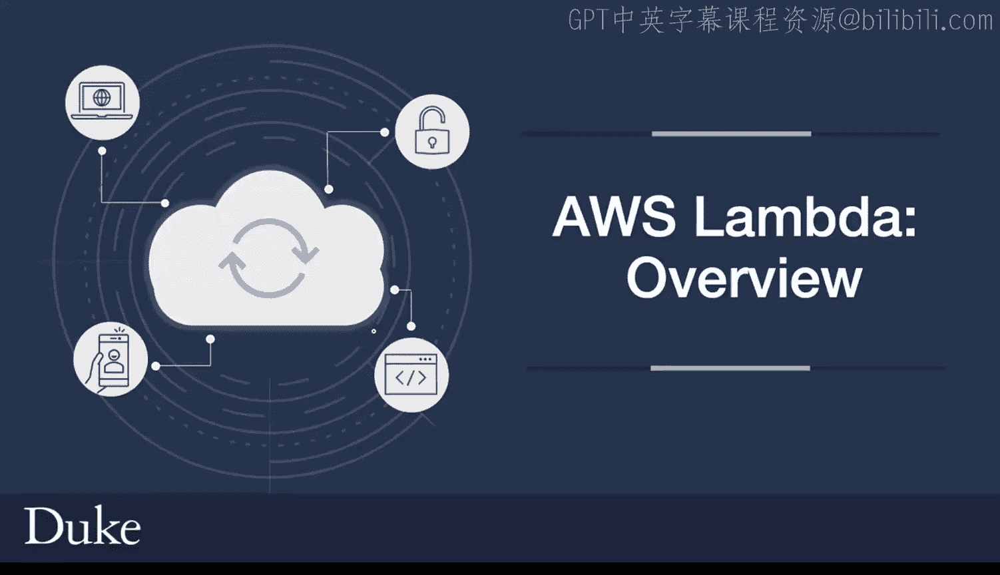

# 构建大规模云计算解决方案：3-4：AWS Lambda与SAM概览

在本节课中，我们将要学习AWS Lambda以及Serverless Application Model（SAM）的基本概念。AWS Lambda是一项无服务器计算服务，而SAM是一种用于简化Lambda应用部署的框架。我们将重点介绍它们如何协同工作，并了解在Python环境中进行本地开发和部署的基本流程。

## 什么是AWS Lambda与SAM？

上一节我们介绍了课程的整体目标，本节中我们来看看核心的服务与工具。

AWS Lambda是一项计算服务，它允许您运行代码而无需预置或管理服务器。您只需上传代码，Lambda会处理运行和扩展代码所需的一切工作。

Serverless Application Model（SAM）是一个开源框架，用于构建无服务器应用程序。它提供了一种简化的语法来定义函数、API、数据库和事件源映射。SAM可以被视为一种用于快速开发和部署AWS Lambda应用程序的框架。

## SAM的工作原理

了解了基本定义后，我们来看看SAM具体如何运作。

SAM将应用程序的所有组件打包到一组容器中。这种方式便于您在本地调用和运行应用程序，从而进行测试和调试。

以下是SAM的一些关键特性：
*   它类似于Web框架或快速开发框架。
*   它将所有资源打包并组织在一起。
*   它支持在本地环境中调用和测试Lambda函数。

## 课程实践环境

在深入技术细节之前，我们先明确本次实践课程的环境设置。

本次所有操作都将在Python的上下文中完成。请确保您已准备好Python开发环境。

本课程预计耗时约一小时。请您就坐，我们即将开始。

---

本节课中我们一起学习了AWS Lambda无服务器计算服务以及用于简化部署的SAM框架。我们了解了Lambda无需管理服务器的核心优势，以及SAM如何通过容器化打包和本地测试功能来加速开发流程。所有内容均围绕Python环境展开，为后续的动手实践奠定了基础。