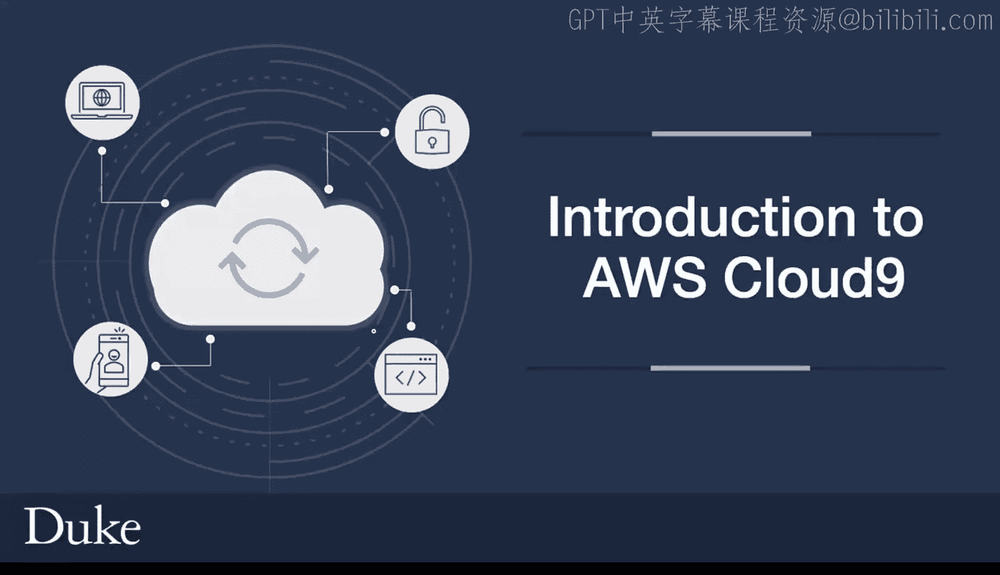
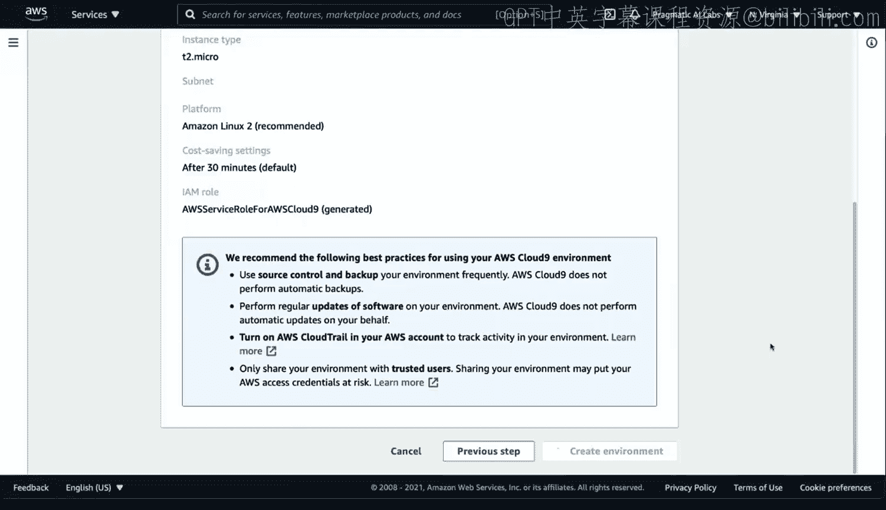
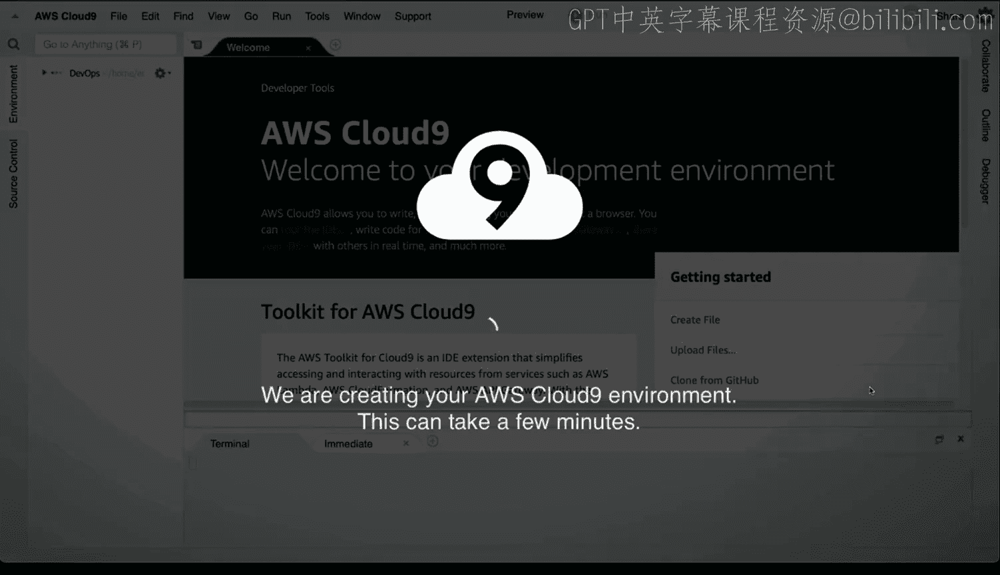
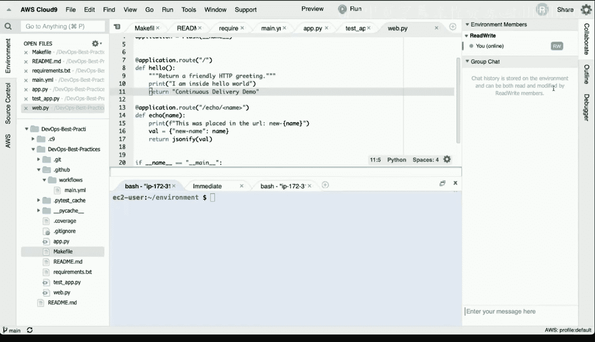
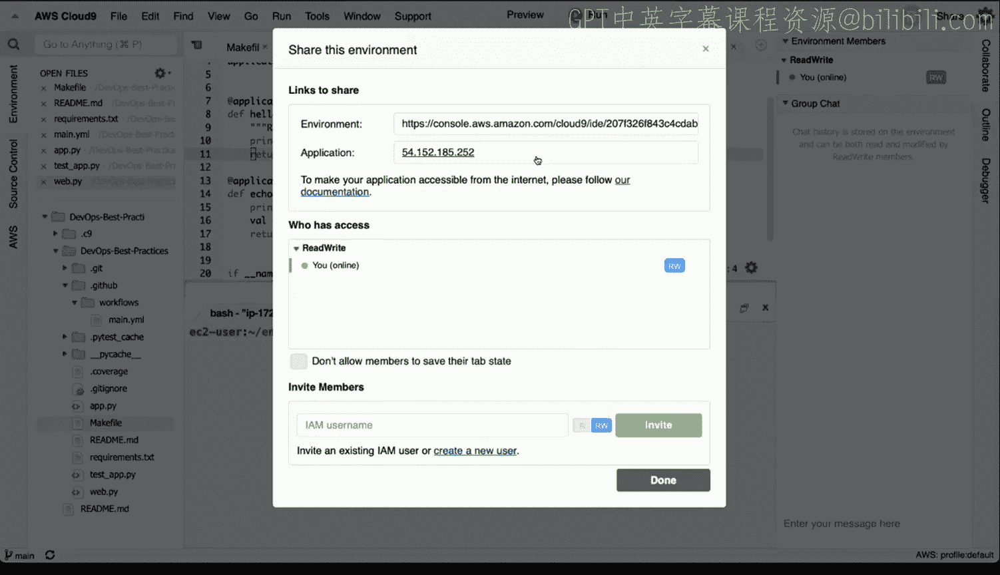
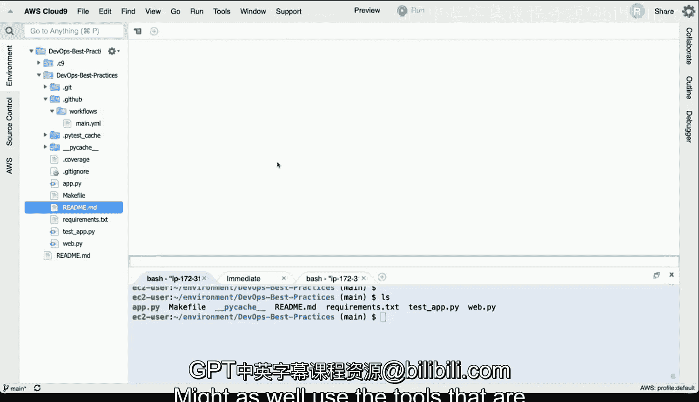

# 构建大规模云计算解决方案：3：AWS Cloud9 导论 🚀

在本节课中，我们将要学习 AWS Cloud9，一个基于云的集成开发环境。我们将了解它的核心功能、如何创建环境，以及它如何与 AWS 服务深度集成，从而为开发、调试和部署代码提供一个高效且与生产环境一致的平台。

---

## 什么是 AWS Cloud9？💡

AWS Cloud9 是一个基于云的集成开发环境，用于在 AWS 环境中编写、运行和调试代码。它是我最喜欢的开发环境之一，因为它能让我在一个非常接近代码实际运行环境的地方进行开发。

这正是这些基于云的工具的创新之处。

---

## 创建新环境 🛠️

上一节我们介绍了 AWS Cloud9 的基本概念，本节中我们来看看如何创建一个新的开发环境。

我将创建一个新环境，并将其命名为 “Devops”。添加描述是一个好习惯，因此这里写上：“用于 DevOps 项目”。

以下是创建环境时的关键步骤：
*   **默认设置**：默认配置是一组很好的选择。它会为你创建一个新的 EC2 实例。
*   **免费套餐**：它会提供一个符合免费套餐资格的虚拟机。
*   **操作系统**：它将设置 Amazon Linux 2，这是运行代码的推荐环境。其优势在于，当你部署一个 Flask Web 应用时，它通常也运行在 Amazon Linux 2 上，因此你获得了与生产环境的高度一致性。
*   **成本节省设置**：默认设置下，环境会自动休眠并保存你的工作，这是一种非常高效的代码开发方式。
*   **权限集成**：一个巧妙之处在于，默认情况下，它会使用你登录账户的权限。如果你以具有管理员角色的个人账户登录，那么它将允许你调用所有 AWS 服务。这非常强大，因为你可以从命令行查看 S3 中的存储桶、调用 AWS Lambda 函数、运行 SageMaker 等，实现了出色的服务集成。

关于实例类型，需要指出的一点是，如果你在这里选择其他实例，可以看到一些功能非常强大的机器。例如，128 GB 内存、32 核的实例，甚至可以选择裸机实例。当然，你需要为此付费，但如果你需要这些资源，可以在这个基于云的环境中使用它们。

我将保留默认设置，点击“下一步”，然后启动这个环境。通常，设置过程需要大约 30 秒或几分钟。

---

## 环境界面与核心功能 🖥️

环境启动后，你就可以开始编写代码了。接下来，我将切换到一个已经设置好的环境中，介绍其界面和核心功能。

以下是环境界面中需要了解的几个重要部分：
*   **协作功能**：在右侧，你可以邀请其他人加入你的项目。通过点击“分享”，你可以邀请另一个用户，他们可以与你进行结对编程。这对于远程协作的团队来说是一个极佳的功能。
*   **调试器**：我可以设置代码断点并进行访问。
*   **文件管理**：左侧是环境文件管理器，它显示所有打开的文件。如果我关闭这些文件，它们会从列表中消失。同时，它允许我进行导航，例如右键点击文件进行下载或预览。这是与 AWS 环境的深度集成。

---

## 终端与 AWS CLI 集成 💻

正如之前提到的，在终端中，如果我输入 `aws s3 help`，它会显示可以执行的不同 AWS 操作。

同样，如果我输入 `aws help`，它会列出与 AWS 环境交互的所有其他方式。

例如，对于 AWS S3，如果我输入 `aws s3 ls`，它会列出我账户中的所有存储桶。我不需要单独进行身份验证或任何特殊操作，这对我来说是一个非常棒的功能。

这里还需要指出的是，请注意“源代码控制”选项卡。你可以看到我已经设置了一个项目。我将进入该项目目录，执行 `ls` 命令。如果我输入 `git remote -v`，你会注意到我能够看到这是一个我正在拉取的远程代码仓库。

如果我在这里做一个很小的更改，比如编辑 `README.md` 文件，写上“进行一些更改”。请注意，我可以跟踪这些更改。它会在源代码控制中显示我做了修改。如果我点击这个源代码控制选项卡，它会让我查看差异对比。这个功能很棒，让我拥有了与桌面版源代码控制编辑器相似的工具。

---

## AWS 资源浏览器与服务集成 🔍

最后，如果我点击“AWS”选项卡，这个选项卡的一个优点是，我可以浏览 AWS 的所有其他功能，包括 S3。我可以查看可用的存储桶，浏览特定存储桶内的文件和内容，这非常强大，甚至可以直接下载文件。

我还可以访问 AWS Lambda。这是一个非常出色的功能：我可以通过点击来调用这些 Lambda 函数。例如，我右键点击一个名为“hello-world”的函数，选择“调用”，并可以指定使用一个示例事件负载（比如发送一个 Kinesis 负载）来调用它。这让我能与特定环境进行深度集成。我甚至可以发送一个自定义的 JSON 负载。

总而言之，AWS Cloud9 环境提供了出色的集成，让你能够非常高效地构建解决方案。在我看来，这是在 AWS 平台上进行开发的推荐方式，正所谓“工欲善其事，必先利其器”。

---

## 总结 📝

本节课中我们一起学习了 AWS Cloud9。我们了解了它是一个基于云的集成开发环境，能够提供与生产环境高度一致的开发体验。我们逐步演示了如何创建新环境，探索了其协作、调试和文件管理界面，并重点介绍了其与 AWS CLI 的无缝集成以及对 AWS 服务（如 S3 和 Lambda）的直接访问能力。这些特性使得 Cloud9 成为在 AWS 平台上进行高效开发的强大工具。