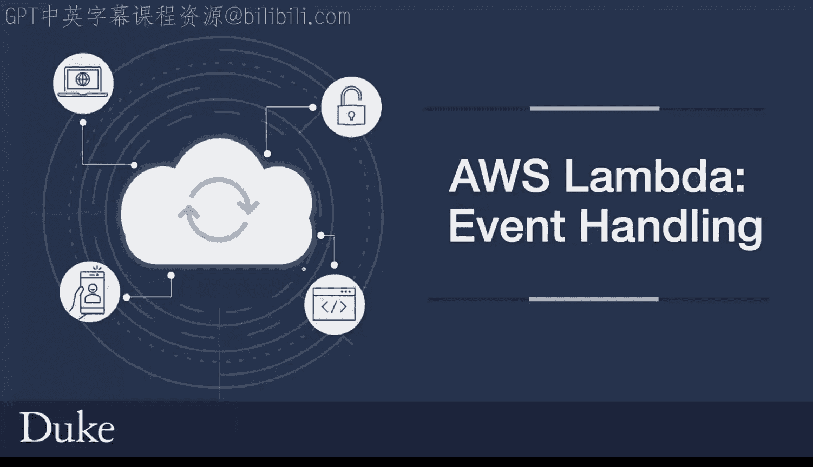
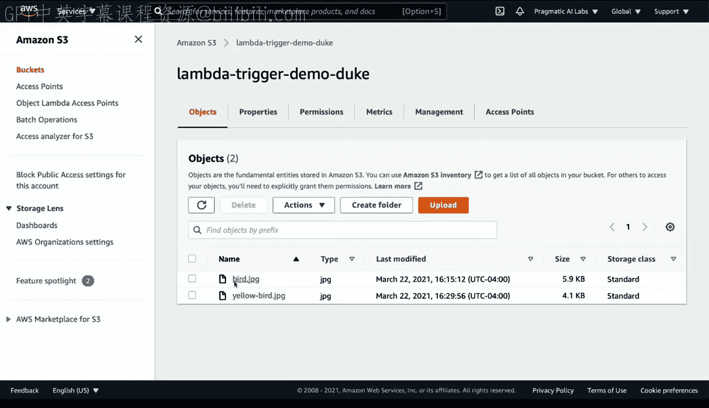
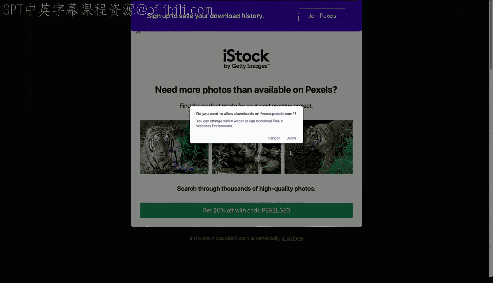
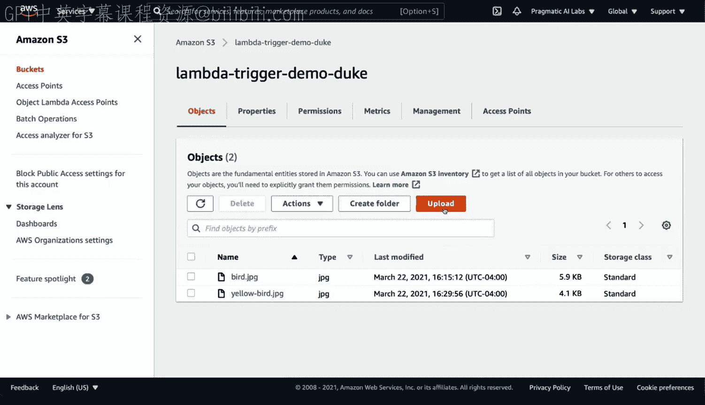
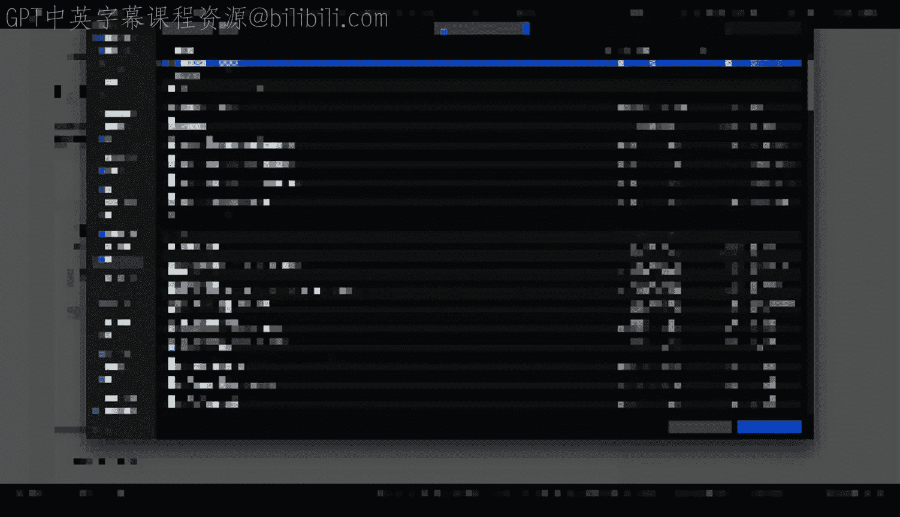
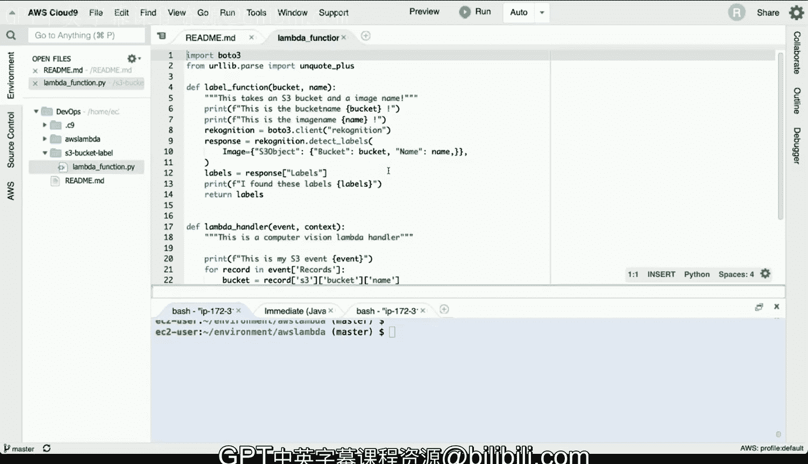

# 构建大规模云计算解决方案：3-4：AWS Lambda事件处理 🚀



在本节课中，我们将学习AWS Lambda如何通过事件触发器自动响应特定操作。我们将重点了解如何配置S3存储桶作为触发器，并构建一个自动识别上传图片内容的Lambda函数。

上一节我们介绍了Lambda函数的基本概念，本节中我们来看看如何让Lambda函数响应外部事件。

## 配置S3触发器

在AWS Lambda控制台中，可以为函数添加多种触发器。当前示例中已配置了API Gateway触发器。若要添加其他类型的触发器，例如S3触发器，可以执行以下操作。

以下是添加S3触发器的步骤：
1.  在Lambda函数配置页面的“设计器”部分，点击“添加触发器”。
2.  从触发器列表中选择“Amazon S3”。
3.  选择要监控的S3存储桶。
4.  选择要监控的事件类型，例如“所有对象创建事件”。
5.  可以配置前缀和后缀筛选，例如仅处理以`.jpg`结尾的图片文件。
6.  点击“添加”完成配置。

## 图像标签识别示例

接下来，我们将通过一个具体示例，演示如何使用S3触发器。该示例代码的功能是：当有图片上传到指定S3存储桶时，自动调用AWS Rekognition服务识别图片中的标签。

以下是Lambda函数的核心代码逻辑：
```python
import boto3
import json

rekognition = boto3.client('rekognition')
s3 = boto3.client('s3')

def lambda_handler(event, context):
    # 1. 从事件中获取桶名和文件名
    bucket = event['Records'][0]['s3']['bucket']['name']
    key = event['Records'][0]['s3']['object']['key']
    
    # 2. 调用Rekognition识别标签
    response = rekognition.detect_labels(
        Image={'S3Object': {'Bucket': bucket, 'Name': key}},
        MaxLabels=10
    )
    
    # 3. 处理并打印识别结果
    labels = [label['Name'] for label in response['Labels']]
    print(f"File: {key}")
    print(f"Labels: {labels}")
    
    # 4. （可选）可将结果写入数据库或其他存储
    return {
        'statusCode': 200,
        'body': json.dumps('Processing complete.')
    }
```
此函数监听S3存储桶的`对象创建`事件。一旦有图片上传，它便会被自动触发，执行图像标签识别。这是一个非常实用的模式，可应用于多种自动化处理场景。

## 实战演示





现在，让我们在控制台中查看一个已部署的示例Lambda函数，名为“S3 bucket label”。该函数已配置好S3触发器。




为了验证其工作，我们打开S3服务，找到名为“lambda-trigger-demo-duke”的存储桶。桶内已有一些测试图片。我们上传一张新的老虎图片进行测试。



图片上传完成后，我们可以通过CloudWatch日志来验证Lambda函数的执行结果。

以下是查看日志的步骤：
1.  在Lambda函数控制台，切换到“监控”选项卡。
2.  点击“查看CloudWatch中的日志”。
3.  在最新的日志流中，可以找到函数打印的识别结果。

日志中会显示类似以下内容，表明函数成功识别了图片中的物体：
```
File: tiger.jpg
Labels: ['Tiger', 'Wildlife', 'Animal', 'Mammal']
```
识别出的标签符合预期。在实际应用中，你可以将这些标签结果存入数据库或转发到其他服务。

## 架构与工作流

整个过程的架构可以概括为“无服务器图像标签触发器”。其工作流程如下图所示：



流程解析：
1.  用户将图像上传到S3存储桶。
2.  S3存储桶的`对象创建`事件触发Lambda函数。
3.  Lambda函数调用Amazon Rekognition API进行图像分析。
4.  识别出的标签可以被写入数据库、另一个S3存储桶或其他目标服务。

此外，利用AWS Cloud9集成开发环境，可以高效地管理Lambda函数代码。

以下是Cloud9的工作流优势：
*   **拉取代码**：在Cloud9中，可以右键点击Lambda函数并选择“导入”，将云端函数的代码下载到本地环境进行编辑。
*   **本地开发与测试**：可以在本地修改代码、运行测试。
*   **一键部署**：修改完成后，可以直接从Cloud9将代码部署回AWS Lambda。

这种无缝的“开发-测试-部署”循环，极大地提升了无服务器应用的开发效率。


本节课中我们一起学习了AWS Lambda事件处理的核心机制。我们了解了如何为Lambda函数配置S3触发器，并通过一个图像标签识别的实战示例，演示了事件驱动架构的完整工作流程。从代码编写、触发器配置、功能测试到利用Cloud9进行开发迭代，我们掌握了一套构建自动化、无服务器解决方案的有效方法。这种模式可以轻松扩展到文件处理、数据转换、实时通知等多种应用场景。