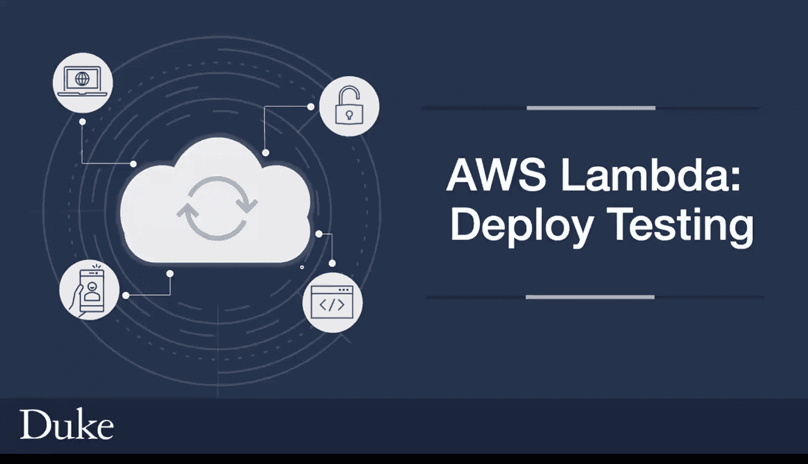
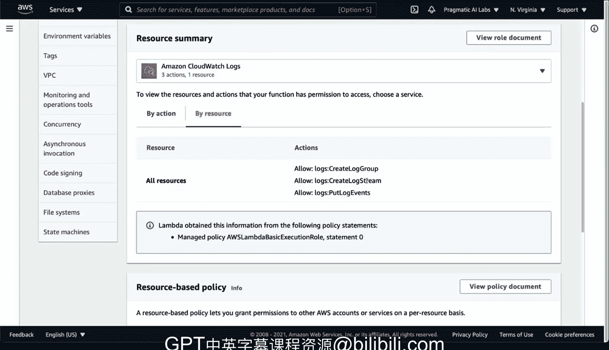

# 构建大规模云计算解决方案：3-4：AWS Lambda部署与测试 🚀

在本节课中，我们将学习如何对已构建的AWS Lambda函数进行本地测试，并了解在AWS云环境中如何监控其运行、查看日志以及配置安全权限。

---

上一节我们介绍了如何构建Lambda函数，本节中我们来看看如何对其进行测试和监控。

现在我们已经构建了一个Lambda函数，接下来我们将在本地调用它，并探讨几种不同的测试方法。

首先，我们可以使用 `sam local invoke` 命令。只要在正确的目录下，这个命令就能调用Lambda函数。请注意，我当前不在Lambda函数目录内，因此需要切换到该目录。

让我们切换到 `hello_world` 目录下的Lambda函数。现在，如果我输入 `sam local invoke`，它将能够查看模板文件，拉取一个容器，然后测试函数本身。请注意，这不会测试API网关。

如果我想测试API网关，可以运行 `sam local start-api` 命令。这个命令非常有用，因为它会在这里启动一个Web服务。然后，我可以访问 `127.0.0.1:3000/hello` 这个端点。

我将复制这个URL，打开一个新的终端窗口，然后运行 `curl` 命令。执行后，我们可以看到负载返回成功。在输出中，我们也能看到该应用程序收到了一个200状态码的请求。

以下是几种在本地进行测试的便捷方法，它们为本地开发提供了极大的便利。

现在，让我们停止这个本地API服务（使用 `Ctrl+C`），并查看其他几个方面。

---

上一部分我们完成了本地测试，接下来我们看看在AWS云环境中，如何通过API网关、CloudWatch日志和IAM安全设置来管理Lambda函数。

首先，如果我们访问AWS控制台中的这个函数，并查看“监控”选项卡，它为我们提供了此特定函数所有活动的高级概览。

我们可以执行的操作之一是点击“在CloudWatch中查看日志”。如果你在AWS中调用了该函数，它将允许你查看这些调用记录。这里我们可以看到所有已发生的调用。由于函数中没有打印语句，所以没有输出日志。但如果我们想为这个函数添加额外的信息，我们可以去修改代码。

另一个要查看的是API网关。如果我回到函数本身，注意“触发器”部分就是设置API网关的地方。AWS Lambda支持多种触发器，例如IoT、Kafka、CloudFront等，这些都可以接入AWS Lambda生态系统。在这个特定实例中，触发器是API网关。如果我点击它，它会显示这个“hello world”函数。

最后，我们将查看安全设置。这部分很重要，因为如果你希望此函数能够执行其他操作（例如调用AWS DynamoDB、S3或触发SQS），你必须在此处更改设置，授予该函数访问其他资源的权限。

以下是配置权限的关键位置和方式。

你可以通过指定操作（Action）或资源（Resource）来编辑这些权限。总的来说，了解你的函数具备哪些能力非常重要，这里展示了所有这些能力。因此，要构建更高级的应用程序，你需要添加不同的IAM角色。

---

本节课中我们一起学习了如何本地测试AWS Lambda函数，以及如何在AWS云平台上通过监控、日志和IAM权限来管理和保护我们的函数。掌握这些步骤对于开发和维护可靠的云应用至关重要。