# 构建大规模云计算解决方案：3-4：构建无服务器数据流水线 🚀

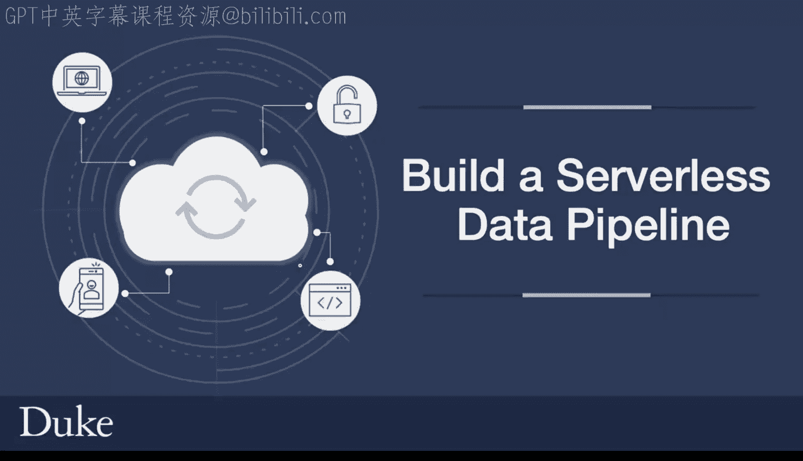

在本节课中，我们将学习如何构建一个完整的、基于事件驱动的无服务器数据流水线。我们将使用AWS的多个服务，包括Lambda、DynamoDB、SQS和S3，来实现一个从数据源读取、处理到存储的自动化流程。这个架构的核心思想是“响应事件”，从而实现高效、可扩展的数据处理。

## 概述 📋

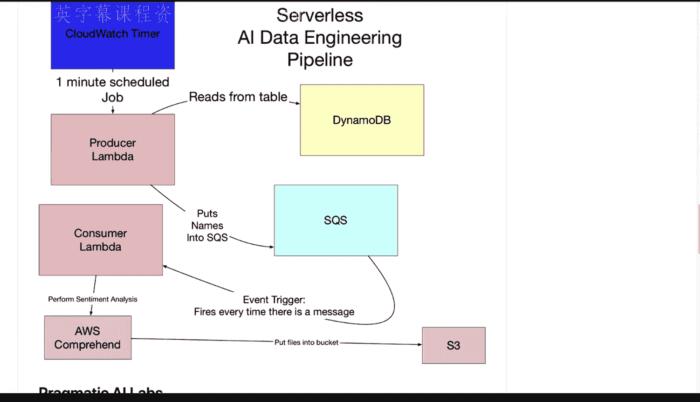


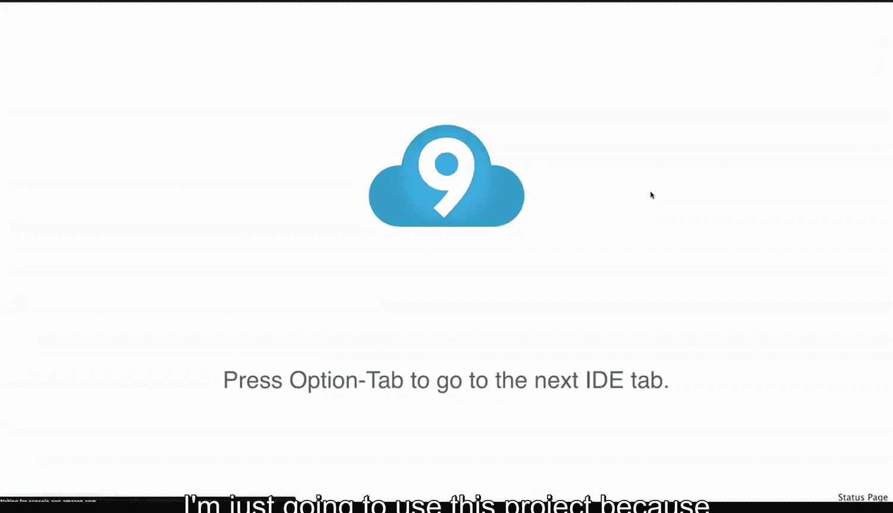

我们将构建的流水线包含以下核心组件：
1.  **一个定时触发器**：使用CloudWatch Events规则定期触发数据提取。
2.  **一个生产者Lambda函数**：从DynamoDB表中读取数据，并将其作为消息发送到SQS队列。
3.  **一个SQS队列**：作为消息缓冲区，可靠地传递数据。
4.  **一个消费者Lambda函数**：由SQS队列中的消息自动触发，对数据进行处理（例如，情感分析），并将结果存储到S3。

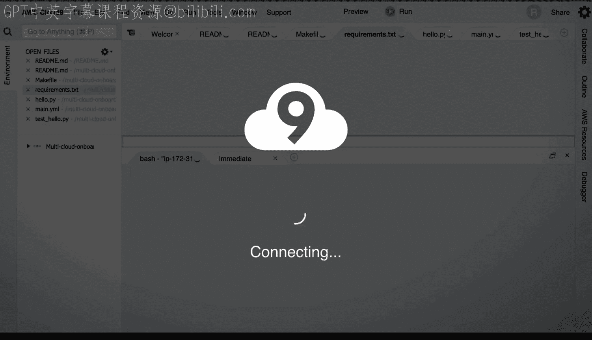

这个架构是无服务器的，意味着我们无需管理任何服务器，只需关注业务逻辑代码。

## 第一步：设置生产者Lambda函数 ⚙️

上一节我们介绍了整体架构，本节中我们来看看如何构建第一个核心组件——生产者Lambda函数。它的职责是从DynamoDB读取数据并发送到SQS队列。

首先，我们需要在AWS控制台中创建一个Lambda函数。

以下是创建Lambda函数的关键步骤：
*   **命名**：将函数命名为 `producer`。
*   **运行时**：选择 `Python 3.6`。
*   **权限角色**：为函数分配一个具有必要权限的IAM角色。为了快速原型开发，可以使用一个具有管理员权限的角色；在生产环境中，应遵循最小权限原则。

创建函数后，我们需要编写其代码。核心逻辑是使用Boto3库与AWS服务交互。

```python
import boto3
import json
import logging

# 初始化AWS服务客户端
dynamodb = boto3.resource('dynamodb')
sqs = boto3.resource('sqs')
logger = logging.getLogger()
logger.setLevel(logging.INFO)

def lambda_handler(event, context):
    """
    主处理函数。扫描DynamoDB表，并将每条记录作为消息发送到SQS队列。
    """
    # 1. 连接到DynamoDB表
    table = dynamodb.Table('Fang')
    # 2. 扫描表以获取所有数据（简单示例，生产环境应考虑分页）
    response = table.scan()
    items = response.get('Items', [])

    # 3. 连接到SQS队列
    queue = sqs.get_queue_by_name(QueueName='producer')

    # 4. 遍历数据项并发送到SQS
    for item in items:
        # 将数据项转换为JSON字符串作为消息体
        message_body = json.dumps(item)
        queue.send_message(MessageBody=message_body)
        logger.info(f"Sent message: {message_body}")

    return {
        'statusCode': 200,
        'body': json.dumps(f'Processed {len(items)} items.')
    }
```

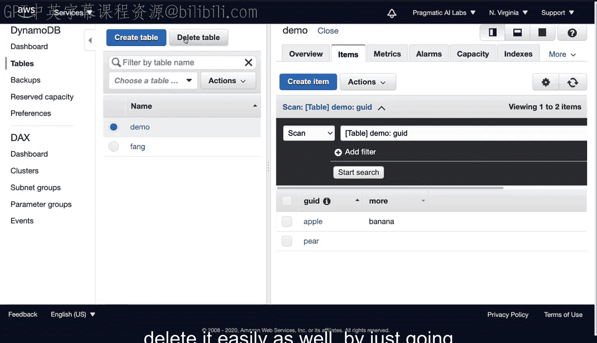

这段代码执行了以下操作：
1.  导入必要的库（`boto3`, `json`, `logging`）。
2.  初始化DynamoDB和SQS的客户端。
3.  在 `lambda_handler` 函数中：
    *   连接到名为 `Fang` 的DynamoDB表。
    *   执行扫描操作获取所有条目。
    *   连接到名为 `producer` 的SQS队列。
    *   遍历每个条目，将其转换为JSON格式并作为消息发送到队列。

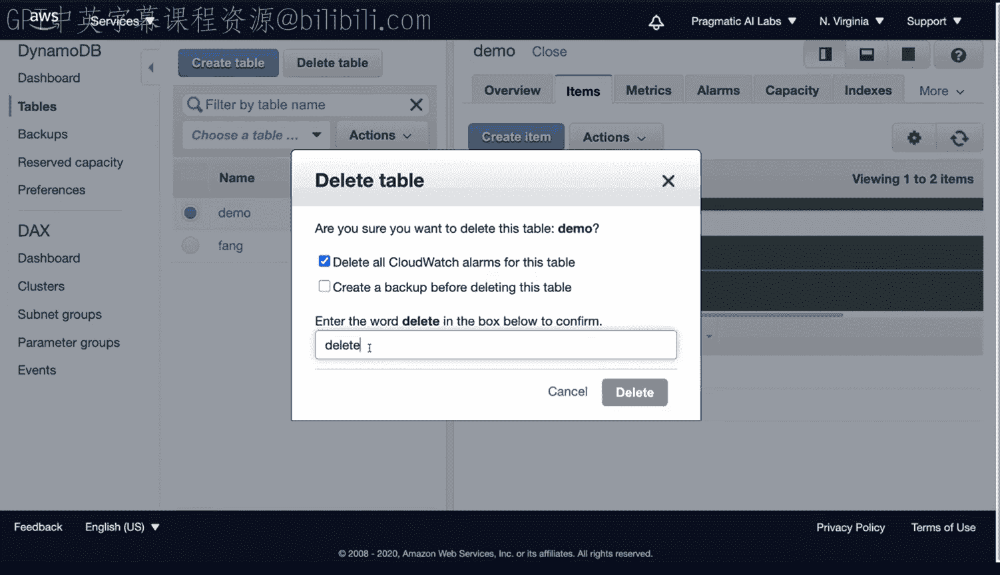

## 第二步：配置数据源与消息队列 🗃️

现在，我们的Lambda函数代码引用了两个AWS资源：DynamoDB表和SQS队列。接下来，我们需要创建它们。

### 创建DynamoDB表

DynamoDB是一个键值NoSQL数据库，使用起来非常简单。

以下是创建DynamoDB表的步骤：
1.  在AWS控制台导航到DynamoDB服务。
2.  点击“创建表”。
3.  输入表名（例如 `Fang`）。
4.  设置分区键（主键），例如一个名为 `id` 的属性，类型为字符串。
5.  保持其他设置为默认，点击“创建”。

创建后，你可以手动向表中添加一些示例数据，例如公司名称：`Amazon`, `Google`, `Microsoft`, `Netflix`。

### 创建SQS队列

SQS（简单队列服务）是一个全托管的消息队列服务。

以下是创建SQS队列的步骤：
1.  在AWS控制台导航到SQS服务。
2.  点击“创建队列”。
3.  选择队列类型。对于此示例，选择“标准队列”（它提供高吞吐量，消息顺序可能不严格）。如果是需要严格顺序的金融交易，则选择“FIFO队列”。
4.  输入队列名称（例如 `producer`）。
5.  保持其他配置为默认，点击“创建队列”。

创建队列后，你可以通过“发送和接收消息”面板手动发送测试消息，验证队列工作正常。

## 第三步：处理Lambda函数依赖包 📦

我们的Lambda代码依赖于第三方Python库（如 `python-json-logger`）。我们需要将这些依赖包与代码一起打包部署。

由于Lambda的运行环境是独立的，我们需要在本地创建包含依赖的部署包。以下是使用Cloud9环境的一种方法：

1.  在Cloud9中，导航到你的Lambda函数代码目录。
2.  创建一个 `requirements.txt` 文件，列出依赖：`python-json-logger`。
3.  在项目目录的上一级目录中，使用pip安装依赖到当前目录，以便Lambda可以找到它们：
    ```bash
    pip install -r requirements.txt -t .
    ```
4.  最后，在Cloud9中右键点击Lambda函数文件夹，选择“Deploy”将整个包部署到AWS Lambda。

这个过程确保了Lambda函数在运行时能够访问所有必需的库。

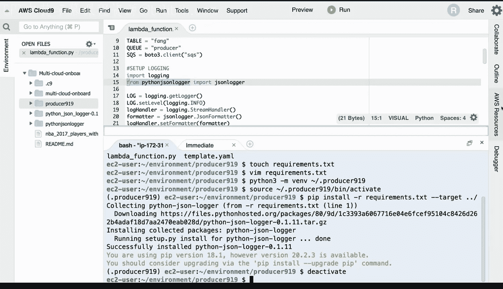

## 第四步：测试生产者流水线 🧪

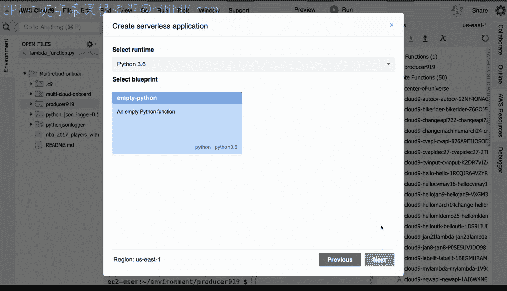

在部署了代码并创建好资源后，我们可以测试生产者部分。

1.  **手动触发测试**：在Lambda控制台，为你的 `producer` 函数创建一个新的测试事件（内容可以为空），然后执行测试。
2.  **验证结果**：测试执行后，前往SQS控制台的 `producer` 队列。点击“轮询消息”，你应该能看到从DynamoDB表发送过来的公司名称消息。

如果看到消息，说明从DynamoDB到SQS的路径已经打通。

## 第五步：添加定时触发器 ⏰

我们希望这个流水线能自动定期运行，而不是手动触发。这可以通过CloudWatch Events规则实现。

以下是添加定时触发器的步骤：
1.  在Lambda函数的“配置”选项卡中，点击“添加触发器”。
2.  选择触发器类型为“EventBridge (CloudWatch Events)”。
3.  创建新规则或使用现有规则。选择“计划表达式”。
4.  输入Cron表达式或速率表达式，例如 `rate(1 minute)` 表示每分钟运行一次（用于演示），或 `rate(1 day)` 表示每天运行一次（更符合生产场景）。
5.  点击“添加”。

添加后，Lambda函数将按照设定的频率自动执行，不断将DynamoDB中的数据推送到SQS队列。

## 第六步：构建消费者Lambda函数 🛠️

现在，数据已经源源不断地进入SQS队列。接下来，我们需要构建流水线的下半部分——消费者Lambda函数。它将处理队列中的消息。

我们创建一个新的Lambda函数，命名为 `consumer`。

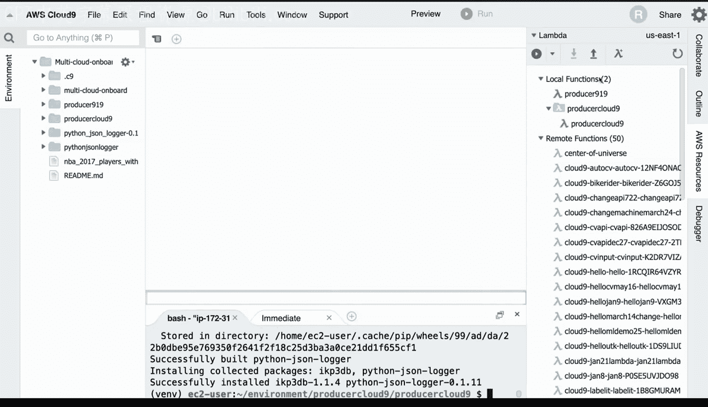

消费者函数的代码逻辑更复杂一些，它需要：
1.  从SQS接收消息。
2.  根据消息内容（公司名）调用外部API（如维基百科）获取信息。
3.  使用AWS Comprehend服务进行情感分析。
4.  将分析结果保存到S3。

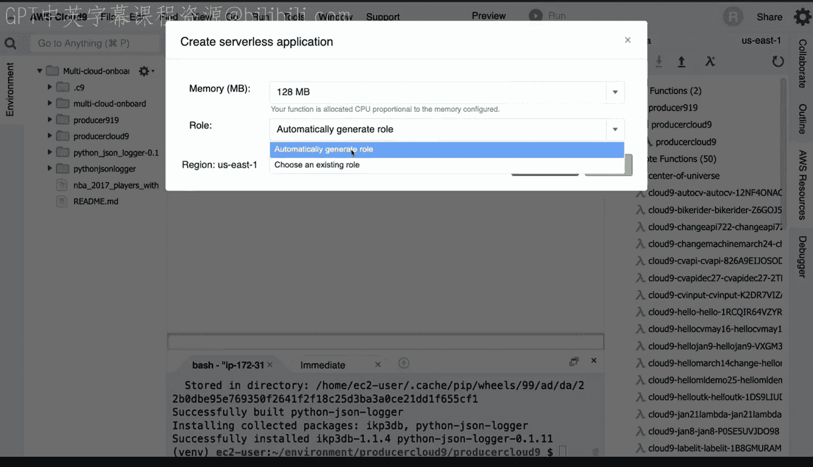

以下是消费者函数代码的核心框架：

```python
import boto3
import json
import wikipedia
import pandas as pd
from botocore.exceptions import ClientError

sqs = boto3.client('sqs')
s3 = boto3.client('s3')
comprehend = boto3.client('comprehend')

def lambda_handler(event, context):
    # 1. 从SQS事件中获取消息
    for record in event['Records']:
        message_body = json.loads(record['body'])
        company_name = message_body.get('id') # 假设消息体包含公司名

        # 2. 获取数据（例如从维基百科）
        try:
            page_summary = wikipedia.summary(company_name, sentences=2)
        except:
            page_summary = "No summary found."

        # 3. 使用Comprehend进行情感分析
        sentiment_response = comprehend.detect_sentiment(
            Text=page_summary,
            LanguageCode='en'
        )
        sentiment = sentiment_response['Sentiment']

        # 4. 组织结果并保存到S3
        result_data = {
            'company': company_name,
            'summary': page_summary,
            'sentiment': sentiment
        }
        # 将结果转换为CSV或JSON格式
        file_name = f"{company_name}_sentiment.csv"
        # 使用pandas或直接写入字符串
        df = pd.DataFrame([result_data])
        csv_buffer = df.to_csv(index=False)

        s3.put_object(
            Bucket='fang-sentiment-bucket', # 你的S3桶名
            Key=file_name,
            Body=csv_buffer
        )

        # 5. 处理成功后，从SQS队列中删除消息，避免重复处理
        receipt_handle = record['receiptHandle']
        sqs.delete_message(
            QueueUrl='你的SQS队列URL',
            ReceiptHandle=receipt_handle
        )

    return {'statusCode': 200}
```

与生产者函数类似，消费者函数也可能有外部依赖（如 `wikipedia`, `pandas`）。你需要按照**第三步**的方法，创建一个包含 `wikipedia`、`pandas` 和 `python-json-logger` 的 `requirements.txt` 文件，并打包部署。

## 第七步：连接消费者与SQS队列 🔗

消费者函数需要由SQS队列中的消息来触发。

以下是配置SQS触发器的步骤：
1.  在 `consumer` Lambda函数的“配置”选项卡中，点击“添加触发器”。
2.  选择“SQS”作为触发器类型。
3.  选择你在第二步中创建的 `producer` 队列。
4.  配置批处理大小（例如，每次触发处理1条消息）。对于需要逐条精细处理的场景，设置为1。
5.  点击“添加”。

一旦配置完成，每当有消息进入 `producer` 队列，`consumer` 函数就会被自动调用。你可以观察到SQS队列中的消息被快速处理并消失，同时S3桶中会生成以公司名命名的、包含情感分析结果的文件。

## 第八步：监控与验证 👀

无服务器架构的监控至关重要。你可以通过以下方式验证流水线是否正常工作：

1.  **CloudWatch日志**：每个Lambda函数都会自动将日志输出到CloudWatch Logs。在Lambda控制台的“监控”选项卡下，点击“查看CloudWatch日志”，可以查看函数每次执行的详细日志，包括错误信息。
2.  **S3桶**：直接前往S3服务，查看指定的存储桶（如 `fang-sentiment-bucket`）。你应该能看到以公司名命名的CSV文件，下载并打开可以查看情感分析的具体结果。
3.  **SQS队列**：在SQS控制台查看队列的“可用消息数”。在流水线稳定运行后，这个数字应该保持在很低的水平，因为消息会被快速消费。

## 第九步：清理资源 🧹

完成实验或演示后，务必清理所有创建的AWS资源，以避免产生不必要的费用。

以下是需要清理的资源列表：
*   **Lambda函数**：删除 `producer` 和 `consumer` 函数。
*   **CloudWatch Events规则**：删除为生产者函数创建的定时触发器规则。
*   **SQS队列**：删除 `producer` 队列。
*   **DynamoDB表**：删除 `Fang` 表。
*   **S3存储桶**：清空并删除 `fang-sentiment-bucket` 桶。
*   **IAM角色**（可选）：如果你创建了专用的IAM角色，也可以将其删除。

养成“创建即规划清理”的习惯，是使用云计算服务的最佳实践之一。

## 总结 🎉

在本节课中，我们一起构建了一个完整的无服务器数据流水线。我们：

1.  **设计了事件驱动架构**：使用CloudWatch定时触发工作流。
2.  **实现了数据提取**：编写生产者Lambda函数，从DynamoDB读取数据并发送至SQS队列。
3.  **配置了消息缓冲**：创建SQS队列，作为生产者和消费者之间可靠、可扩展的桥梁。
4.  **完成了数据处理与存储**：编写消费者Lambda函数，处理SQS消息，调用Comprehend进行情感分析，并将结果存入S3。
5.  **处理了依赖管理**：学习了如何为Lambda函数打包Python依赖库。
6.  **进行了监控与验证**：利用CloudWatch日志和S3对象验证了流水线结果。
7.  **实践了资源清理**：删除了所有实验资源，避免了额外费用。

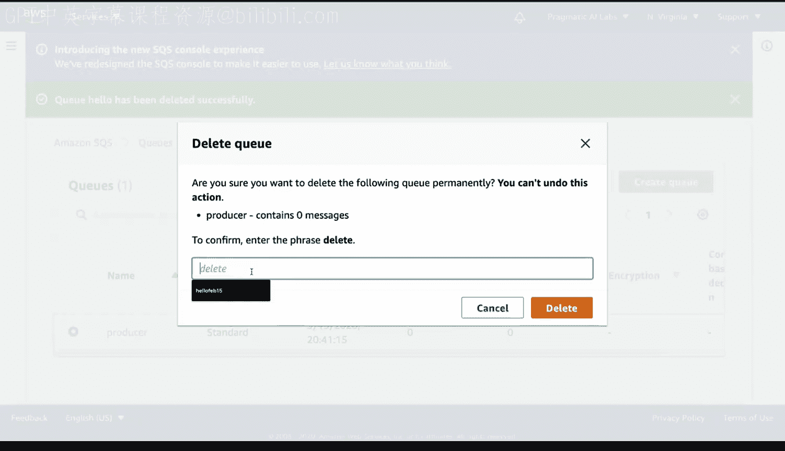

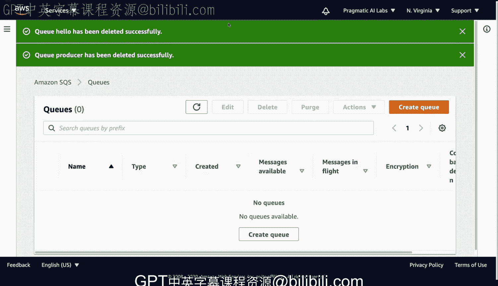

这个流水线是一个强大的模板，你可以轻松地替换其中的组件。例如，将DynamoDB换成RDS，将Comprehend换成自定义的机器学习模型，或者将S3换成数据仓库如Redshift，以适应各种不同的数据处理场景。无服务器架构让你能够专注于业务逻辑，而无需担心基础设施的管理。