# 构建大规模云计算解决方案：3：GCP无服务器实践指南 🚀

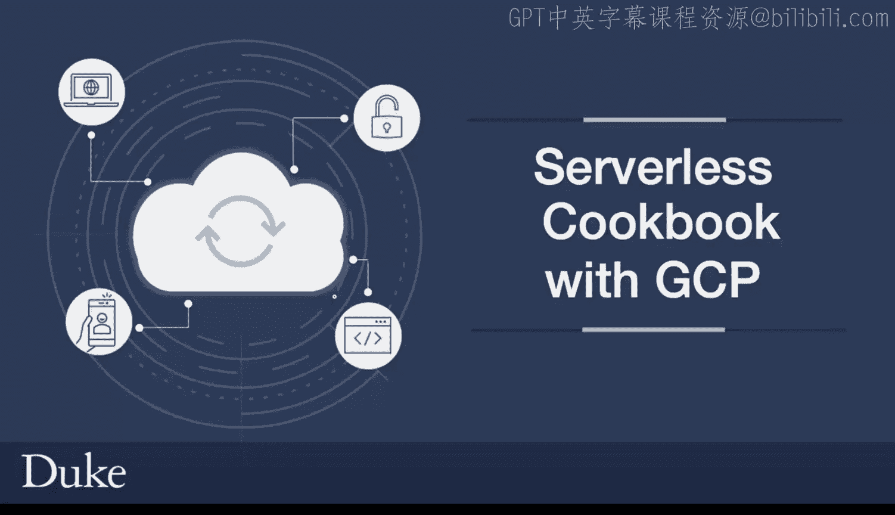

在本节课中，我们将学习如何在Google Cloud Platform上创建、部署和测试一个无服务器函数。我们将通过一个简单的“找零机”函数和一个更复杂的“维基百科翻译”函数来演示GCP云函数的核心工作流程。

## 概述

上一节我们介绍了无服务器计算的基本概念。本节中，我们将动手实践，在GCP平台上创建一个云函数。我们将从创建一个简单的函数开始，然后逐步探索其测试、调用和集成方法。

## 创建云函数

首先，我们需要登录GCP控制台并创建一个新的云函数。

以下是创建“找零机”函数的步骤：

1.  在GCP控制台的搜索栏中输入“Cloud Functions”并进入该服务。
2.  点击“创建函数”按钮。
3.  为函数命名，例如 `deops-change-machine`。
4.  选择要部署的区域。
5.  设置触发器为“HTTP”，并允许“未通过身份验证的调用”。
6.  点击“保存”并进入下一步。

## 配置函数代码

在配置阶段，我们需要选择运行时并编写函数逻辑。

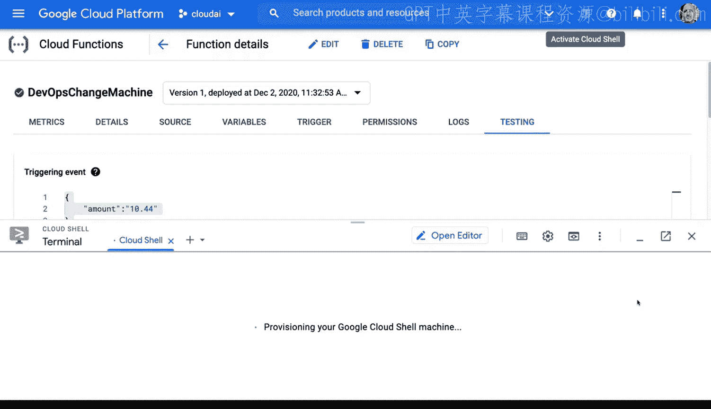

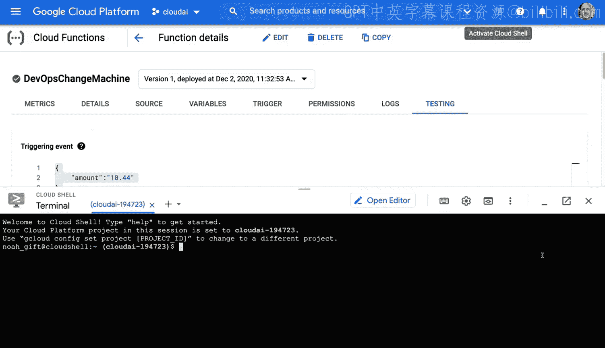

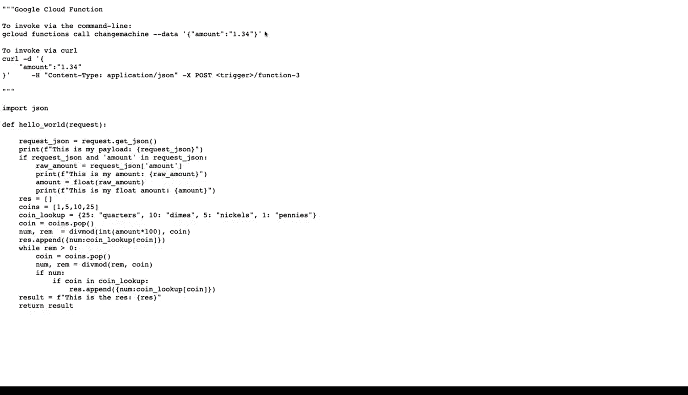

我们选择Python 3.8作为运行时环境。GCP提供了一个“Hello World”模板，但我们将替换为自己的代码。核心函数接收一个包含`amount`字段的JSON载荷（例如`$1.34`），并计算并返回正确的零钱组合。

函数的入口点必须与代码中的函数名匹配。在本例中，我们将入口点设置为`hello_world`。一个方便的特性是，我们可以直接在界面中指定需要安装的Python依赖包。

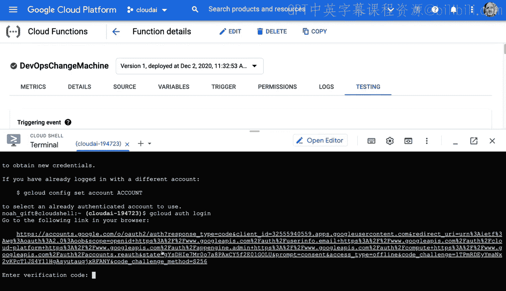


配置完成后，点击“部署”按钮将函数发布到生产环境。

## 测试云函数

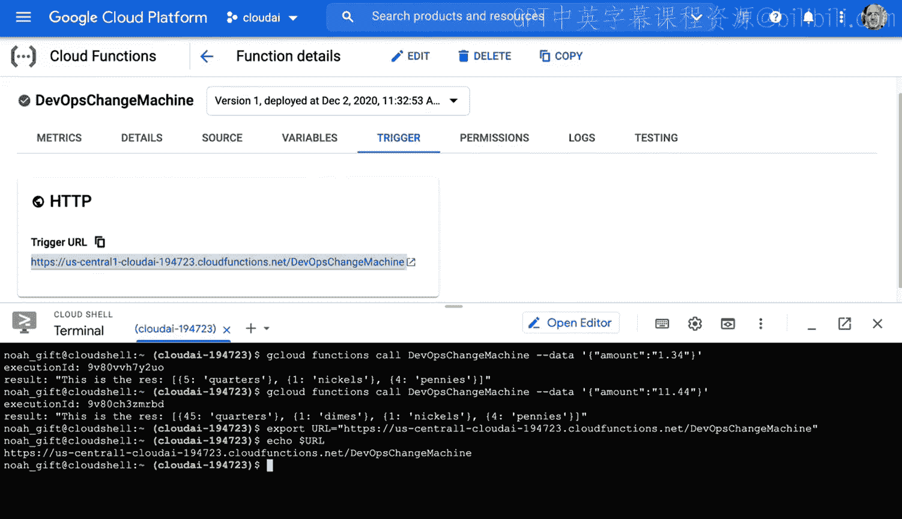

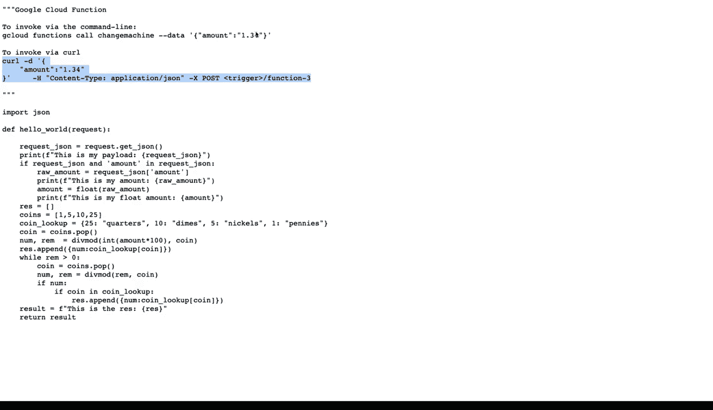

部署完成后，我们可以在GCP控制台内直接测试函数。

在函数的“测试”标签页中，我们可以构造测试载荷。例如，输入以下JSON：
```json
{
  "amount": "$1.34"
}
```
点击“测试”按钮后，页面下方会显示函数的执行结果，即计算出的零钱组合。我们可以修改`amount`的值（如`$10.44`）并再次测试，观察返回结果的变化。

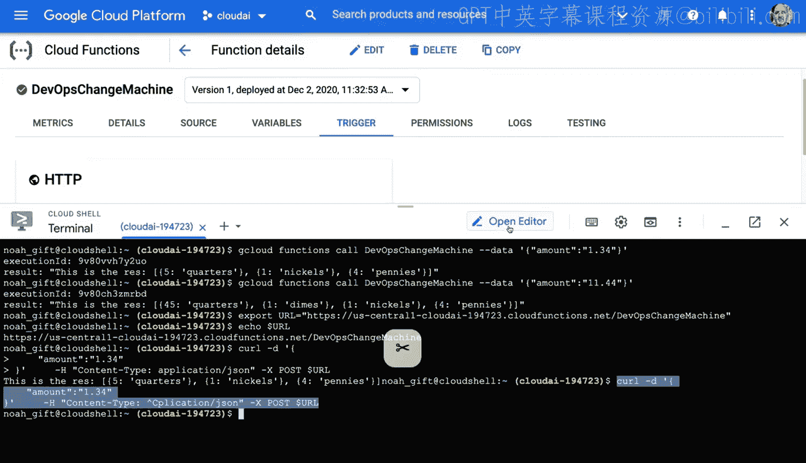

## 通过命令行调用函数

除了在控制台测试，GCP Cloud Shell 允许我们通过命令行工具调用函数，这为集成测试和自动化脚本提供了便利。

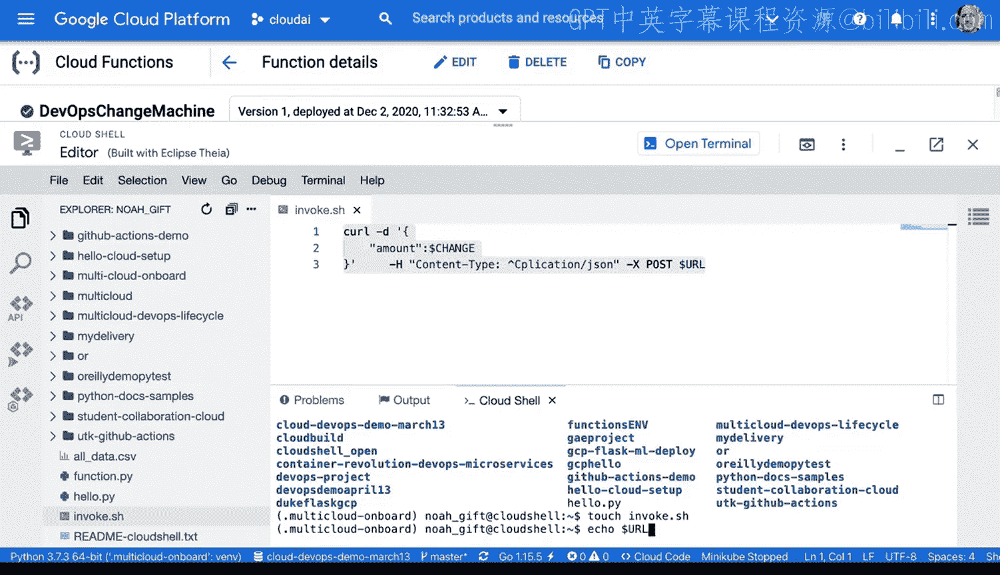

我们可以使用 `gcloud functions call` 命令来调用函数。首先需要在Cloud Shell中完成身份验证。认证通过后，执行类似以下的命令：
```bash
gcloud functions call deops-change-machine --data '{"amount":"$1.34"}'
```
命令执行后，会在终端中返回函数的计算结果。这种方式可以方便地多次运行和调整测试。

## 通过HTTP触发器调用函数

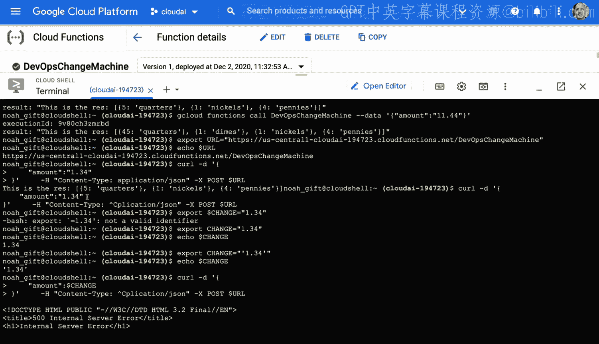

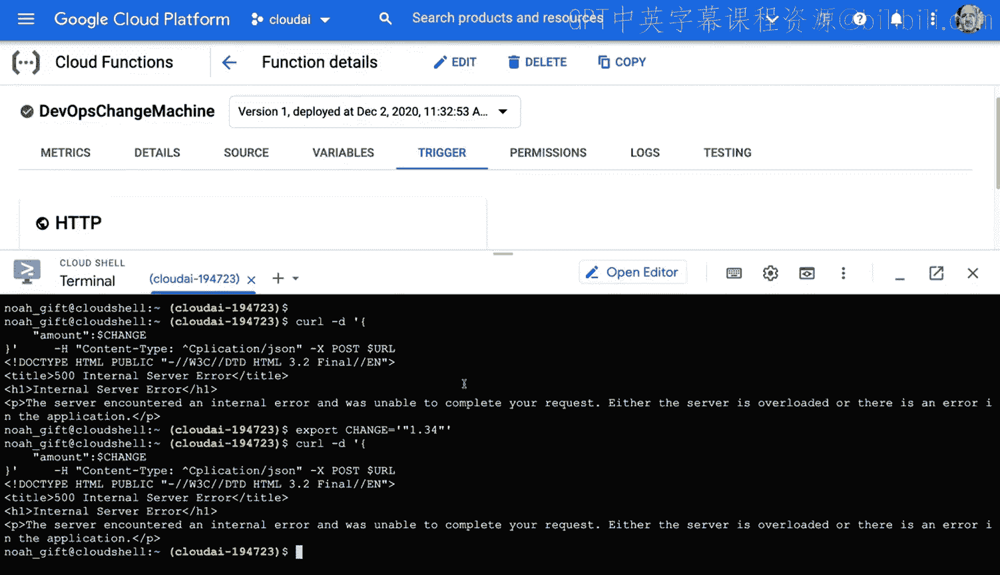

由于我们的函数设置了HTTP触发器，它本质上也是一个Web服务。我们可以在浏览器或使用`curl`命令通过其公开的URL来调用它。

在函数详情页可以找到触发器的URL。我们可以将该URL导出为环境变量，然后使用`curl`命令进行调用：
```bash
export URL="你的函数触发器URL"
curl -X POST $URL -H "Content-Type:application/json" -d '{"amount":"$1.34"}'
```
为了更方便地测试不同金额，我们可以编写一个简单的Shell脚本（如`invoke.sh`）来封装这个调用逻辑。

## 探索复杂函数示例

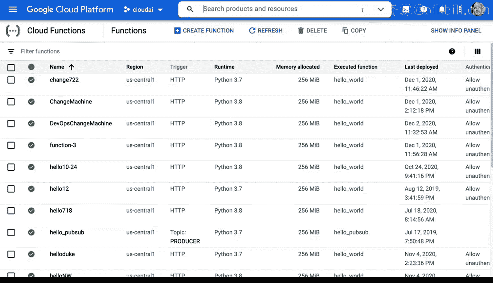

为了展示云函数处理更复杂任务的能力，我们来看另一个“维基百科翻译”函数的例子。

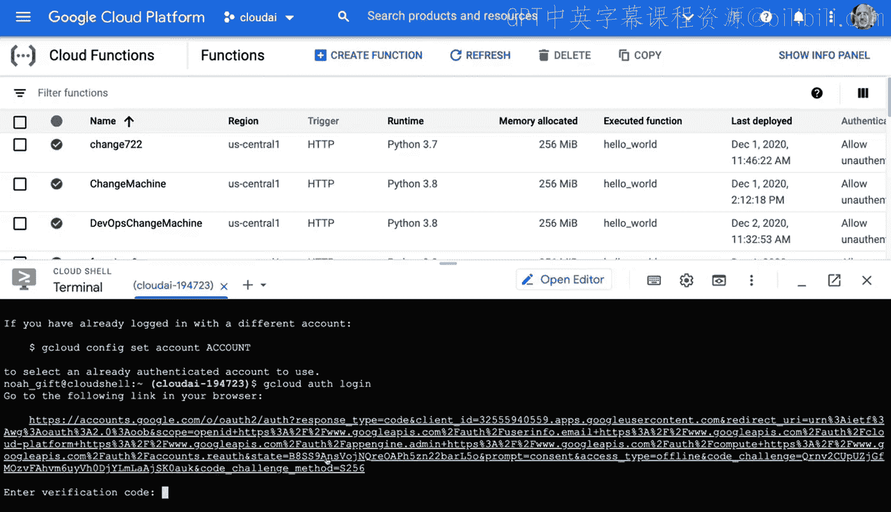


这个函数安装了`wikipedia`和`google-cloud-translate`库。它的逻辑是：接收一个实体名称和目标语言参数，从维基百科获取该实体的摘要，然后使用谷歌翻译API将其翻译成目标语言。

我们可以通过命令行调用它，例如请求将“Google”页面的内容翻译成西班牙语：
```bash
gcloud functions call [函数名] --data '{"entity":"Google", "language":"es"}'
```
同样，我们可以尝试更改实体（如“Amazon”）和目标语言（如意大利语`it`），来测试函数的不同输出。

## 总结

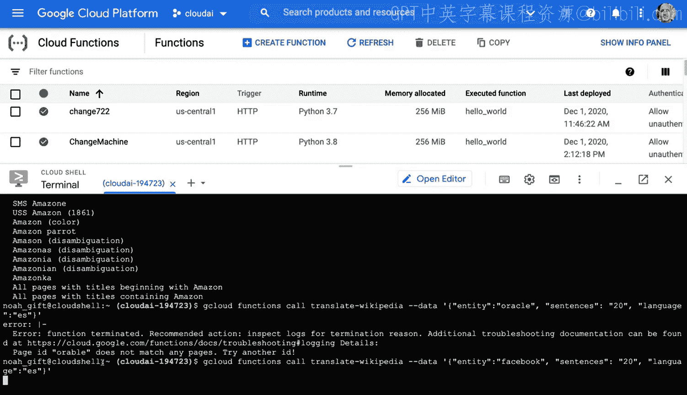


本节课中我们一起学习了GCP云函数的实践操作。我们从创建一个简单的“找零机”函数开始，逐步完成了部署、控制台测试、命令行调用以及通过HTTP URL触发函数的全过程。最后，我们还分析了一个更复杂的“维基百科翻译”函数，展示了无服务器函数处理多样化任务的能力。这些实践演示了如何利用GCP的无服务器架构快速构建和集成可扩展的应用程序逻辑。