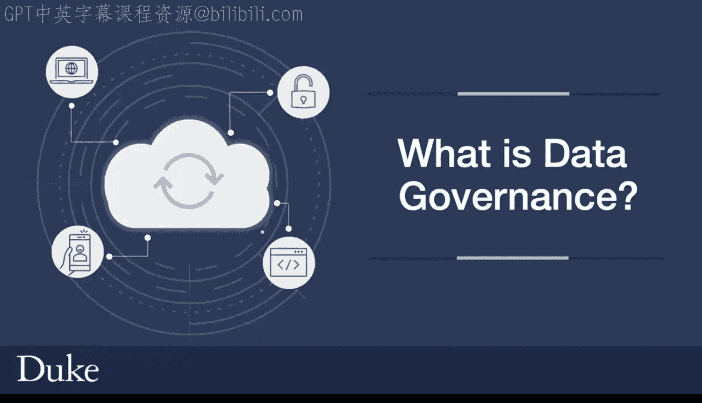

# 构建大规模云计算解决方案：3-4：什么是数据治理 📊

在本节课中，我们将要学习数据治理的核心概念。数据治理是确保数据安全、合规和有效管理的关键框架，对于任何依赖数据的组织都至关重要。

---

上一节我们介绍了数据工程与机器学习的基础，本节中我们来看看数据治理的具体内涵。数据治理是2020年及以后最流行的术语之一。其流行原因在于，云安全对公司的健康发展至关重要。例如，如果你是一家信用卡交易公司，拥有1亿用户，而所有这些用户的数据都被泄露，这可能导致整个公司倒闭，对组织构成生存威胁。

因此，数据治理的核心是系统性地思考谁应该有权访问数据，以及可能出现的最坏情况。这包括评估数据在静态存储时是否加密，以及在传输过程中是否加密。这些都是处理数据治理时的关键考量因素。

数据治理在实践中非常重要。事实上，在许多组织中，会专门设立数据治理官的职位来负责相关事务。

以下是数据治理涉及的一些核心检查项：

*   **访问控制**：定义并管理谁可以访问哪些数据。
*   **数据加密**：确保数据在静态存储（`encrypted at rest`）和传输过程中（`encrypted in transit`）都经过加密。
*   **风险评估**：持续识别和评估数据安全方面的最坏场景（`worst case scenarios`）。
*   **合规与策略**：制定并执行与数据相关的政策和规程，以满足法规要求。

---

本节课中我们一起学习了数据治理的基本定义及其重要性。数据治理不仅仅是技术问题，更是涉及组织安全、风险管理和合规性的战略框架。理解并实施有效的数据治理措施，是保护企业数字资产、维持业务连续性的基础。