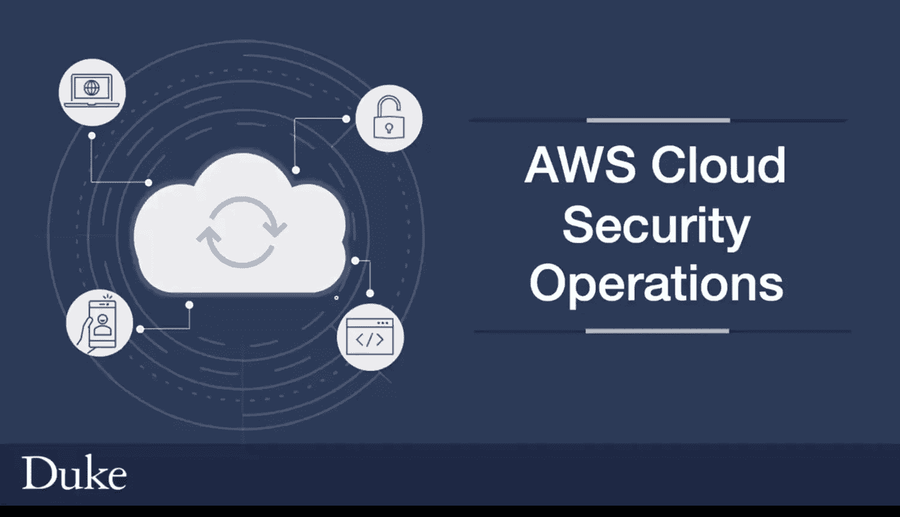
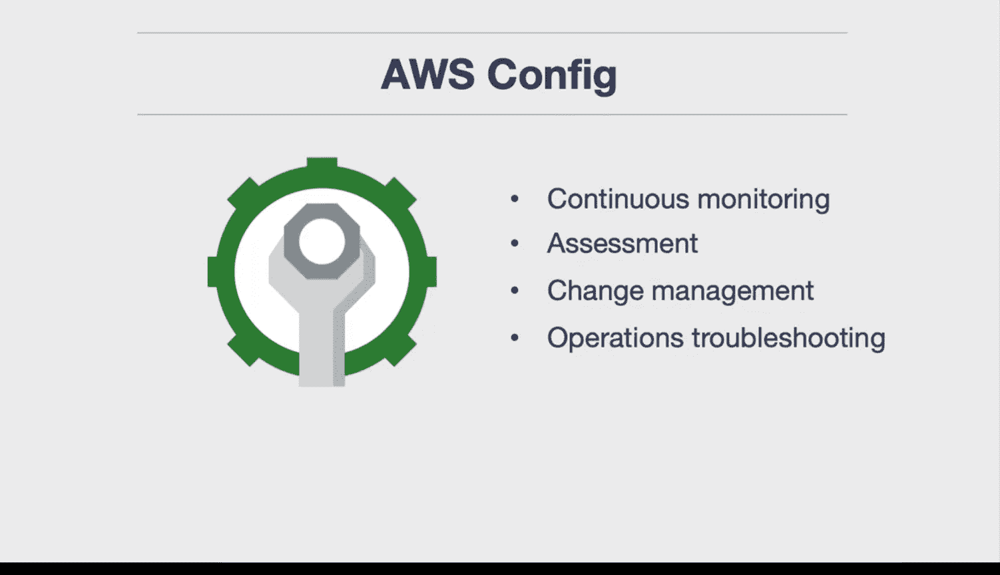

# 构建大规模云计算解决方案：3-4：AWS云安全运维

在本节课中，我们将学习AWS提供的三个核心安全与运维工具：Trusted Advisor、CloudTrail和AWS Config。这些工具能帮助你优化成本、监控活动、审计变更，从而构建更安全、可靠且高效的云环境。

## 🔍 Trusted Advisor：你的云端顾问

上一节我们介绍了基础的安全概念，本节中我们来看看AWS Trusted Advisor。这是一个自动化的系统，它会扫描你的AWS环境并提供一系列检查建议，帮助你遵循最佳实践。

Trusted Advisor主要从以下几个维度提供优化建议：

以下是Trusted Advisor的核心检查类别：

*   **成本优化**：识别可节省成本的资源。例如，它会告诉你是否有闲置的实例在运行，或者你是否可以购买预留实例来降低费用。
*   **性能**：提供提升服务性能的提示。例如，检查服务限制、确保配置了预置吞吐量，或识别使用率过高的实例。
*   **安全**：检查安全配置漏洞。这是一个非常重要的功能，例如，它会发现你是否在机器上开放了不必要的端口。
*   **容错能力**：评估系统架构的健壮性。它会检查你是否正确设计了系统，例如是否启用了自动扩展、健康检查和多可用区部署。
*   **服务限制**：监控服务使用量是否接近上限。例如，如果你已使用超过80%的某项服务限额，它会发出警告，提醒你联系支持团队提高限额，以免影响业务。

## 📜 CloudTrail：云端活动审计日志

了解了如何通过Trusted Advisor进行主动优化后，我们来看看如何进行被动的监控与审计。CloudTrail是一个非常强大但常被低估的服务。

它的核心功能是记录你AWS账户中发生的**所有API调用和操作**，生成详细的日志。当怀疑系统存在安全漏洞或遭到入侵时，CloudTrail应是你的首要调查对象。例如，如果一台机器或一个账户被入侵，你可以立即查看日志，发现异常行为，如攻击者尝试调用API、提升权限或删除管理账户。

CloudTrail提供了一个完整的审计线索，能准确告诉你**发生了什么、谁做的、以及发生的时间**，包含用户名和时间戳。这是你必须持续关注的最有价值的安防工具之一。

以下是CloudTrail的主要优势：

*   **提供用户与资源活动记录**：追踪所有API调用。
*   **助力合规性**：在需要审计的环境中，证明监控始终开启。
*   **支持分析与故障排除**：通过日志分析问题根源。
*   **实现安全自动化**：可基于日志事件触发自动响应。

## ⚙️ AWS Config：资源配置与变更管理

在掌握了活动审计之后，我们需要一个工具来管理资源本身的配置状态。AWS Config是一项全托管服务，用于评估、审计和监控AWS资源的配置。

它主要提供以下功能：

以下是AWS Config的核心能力：

*   **持续监控**：持续记录资源配置的变更。
*   **配置评估**：根据你定义的规则评估资源配置是否符合要求。
*   **变更管理**：跟踪配置的历史变更。
*   **运维故障排除**：帮助诊断因配置变更引发的问题。

具体来说，AWS Config能为你提供**资源清单、配置历史记录和配置变更通知**。这让你能够清晰审计系统中发生的变化，这些变化涵盖安全分析、资源追踪和故障排除。通过它，你可以管理变更：跟踪资源配置、通过SNS接收变更通知、访问配置历史（例如，谁在何时修改了IP地址）。

需要注意的是，AWS Config会保存所有使用过的配置历史，你可以评估这些变更，确保它们符合你的预期。

## 📝 总结

本节课中我们一起学习了AWS的三个关键安全与运维工具。**Trusted Advisor** 像一个主动的顾问，从成本、性能、安全等多方面提供优化建议。**CloudTrail** 是无所不知的审计员，记录所有活动，是安全事件调查的基石。**AWS Config** 则是配置管理员，持续跟踪资源状态和历史变更。

安全是AWS或任何云环境中最容易被忽视的方面之一。AWS提供了许多强大的工具，充分利用这些工具并遵循最佳实践至关重要。这样做可以避免将公司数据暴露给恶意攻击者，确保你的云环境安全可靠。