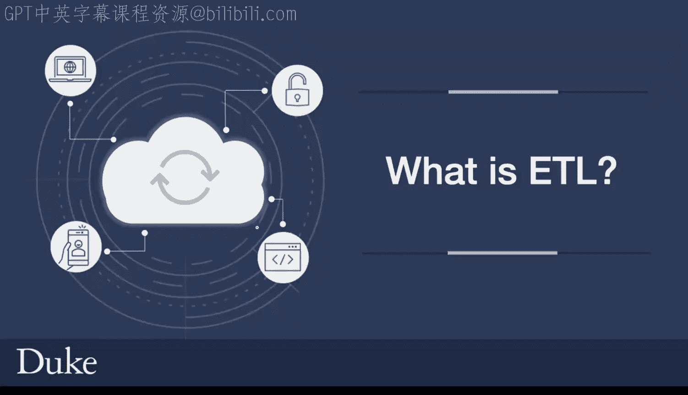

# 构建大规模云计算解决方案（数据工程、机器学习）：3-4课：什么是ETL 🧩

在本节课中，我们将要学习数据工程中的一个核心概念：ETL。我们将了解ETL的含义、它在数据处理流程中的重要性，以及它包含的三个关键步骤。



## 概述

ETL代表**提取（Extract）、转换（Transform）、加载（Load）**。它是数据工程流水线中的一项常见操作。

## 为什么需要ETL？

很多情况下，从数据源获取的数据并非最整洁的格式。因此，我们需要对数据进行处理。

以下是需要进行ETL操作的几个主要原因：

*   **提取数据**：从原始数据源获取数据。
*   **解压缩或转换格式**：数据可能被压缩，或者需要从一种格式（如CSV）转换为另一种格式（如Parquet）。
*   **清理数据**：需要处理损坏的值或缺失的值。
*   **转换与整合**：将不同来源的数据进行转换并整合在一起。

## ETL的核心步骤

上一节我们介绍了为什么需要ETL，本节中我们来看看ETL具体包含哪三个步骤。

ETL流程可以概括为以下三个核心阶段：

1.  **提取（Extract）**
    此阶段涉及从各种源头（如数据库、API、日志文件）读取原始数据。代码示例如下：
    ```python
    # 示例：从CSV文件提取数据
    raw_data = pd.read_csv('source_data.csv')
    ```

2.  **转换（Transform）**
    此阶段是数据处理的核心，目的是将原始数据清洗、整理成可用的格式。常见的转换操作包括：
    *   清洗数据（处理缺失值、异常值）。
    *   转换数据格式或结构。
    *   聚合或计算新的指标。
    转换过程可以用以下公式表示：
    **`清洁数据 = 清洗(原始数据) + 转换(原始数据) + 聚合(原始数据)`**

3.  **加载（Load）**
    最后，将处理好的数据写入目标系统，例如数据仓库、业务智能数据库或另一个应用程序中。
    ```python
    # 示例：将处理后的数据加载到数据库
    cleaned_data.to_sql('target_table', con=database_connection)
    ```

## 总结


本节课中我们一起学习了ETL的概念。我们了解到，ETL是**提取、转换、加载**的缩写，是构建数据流水线时必须考虑的关键流程。绝大多数数据工程操作都涉及这三个步骤，目的是将原始、杂乱的数据转化为整洁、可用的数据，并加载到目标系统（如业务智能数据库）中，以支持后续的分析与决策。