# 构建大规模云计算解决方案：3-4：在AWS Glue中使用Amazon Athena


在本节课中，我们将学习如何结合使用AWS Glue和Amazon Athena来构建一个无服务器的数据查询与分析管道。我们将从在Glue中爬取S3数据开始，然后使用Athena对数据进行查询和转换。

---

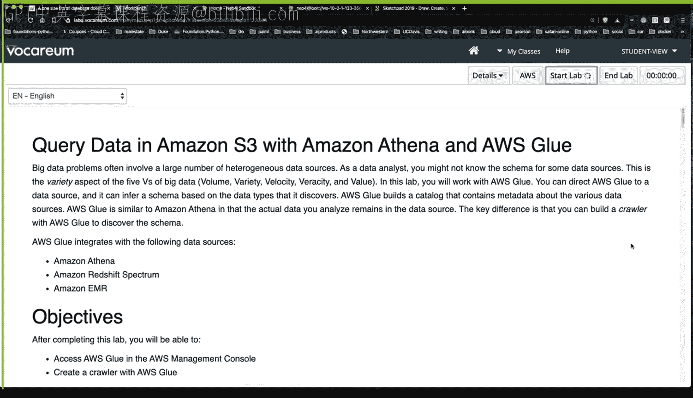

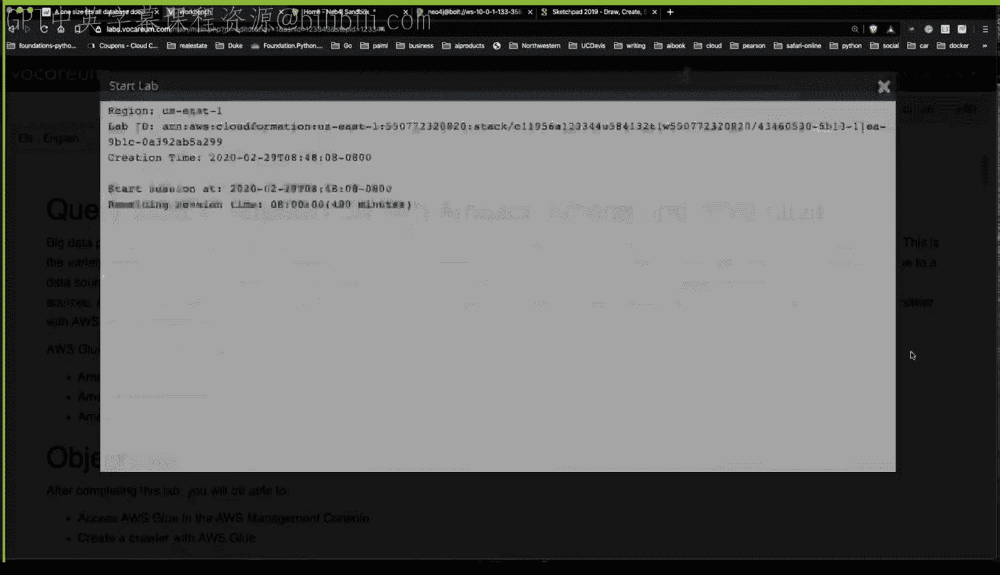

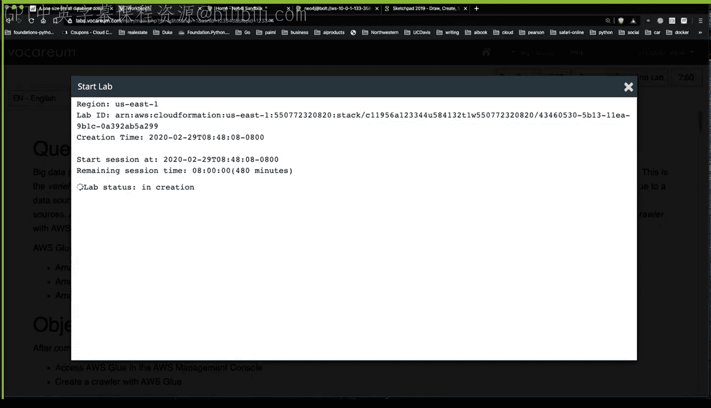

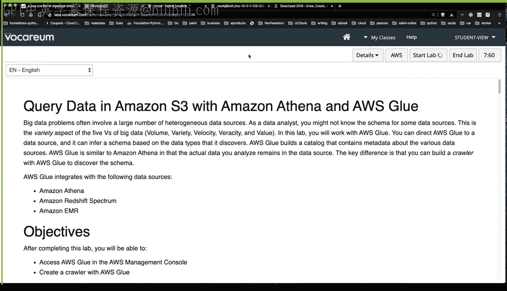

## 概述

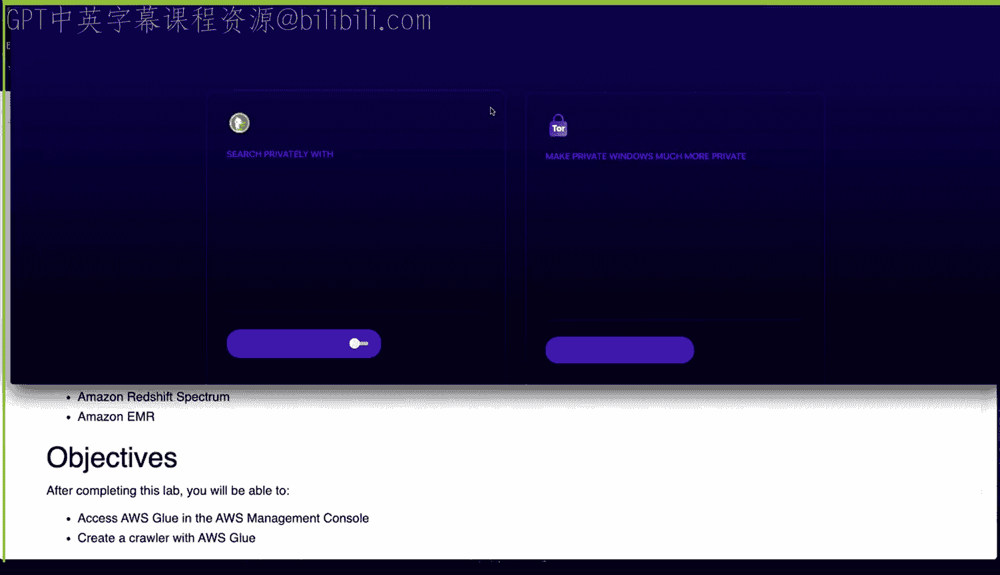


我们将通过一个模拟数据分析师处理干旱救济数据的场景，演示如何利用AWS的无服务器ETL工具Glue来发现和编目存储在Amazon S3中的数据，然后使用交互式查询服务Athena对这些数据进行SQL查询和筛选。整个过程无需管理任何基础设施。

---

## 第一步：启动AWS Glue爬虫

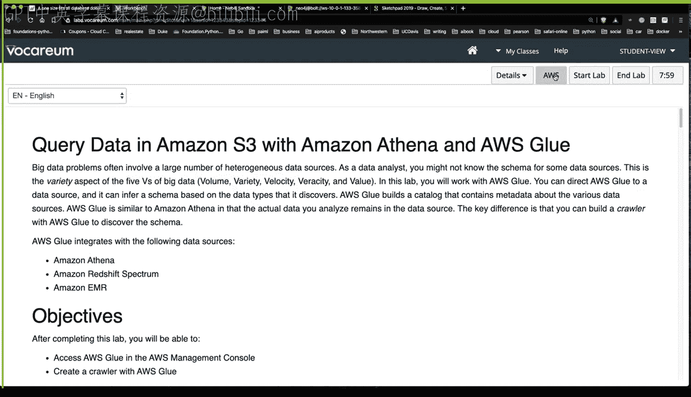

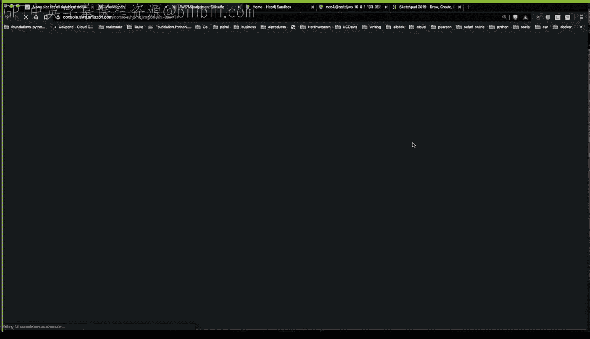

上一节我们介绍了本实验的目标和工具。本节中，我们来看看如何启动AWS Glue爬虫来发现S3中的数据。

首先，我们需要在AWS控制台中导航到Glue服务。Glue是一个完全托管的无服务器ETL系统，可以与Athena、Redshift和EMR集成。

以下是启动爬虫的步骤：

1.  在Glue控制台，选择“添加表使用爬虫”。
2.  为爬虫命名，例如 `weather`。
3.  在“指定爬网数据源”步骤，选择“数据存储”为Amazon S3，并指定包含NOAA天气数据的S3路径。
4.  在“配置安全性”步骤，选择一个现有的IAM角色，该角色已具备访问S3的权限。
5.  在“计划”步骤，选择“按需运行”，以便手动触发此次爬网任务。
6.  在“输出”步骤，添加一个新的数据库，命名为 `weather_data`。这个数据库将作为Glue数据目录的一部分，存储爬虫发现的元数据。
7.  完成配置后，选择“立即运行爬虫”。

爬虫将开始扫描指定的S3路径，自动推断数据的结构、列名和数据类型，并将这些元信息存储在Glue数据目录中。

---

## 第二步：检查并编辑数据模式

上一节我们使用爬虫发现了数据的元信息。本节中，我们来看看Glue发现了什么，并学习如何编辑数据模式以使其更清晰。

爬虫完成后，我们可以在Glue控制台的“表”部分查看生成的表。系统会自动识别出列及其数据类型。

为了使列名更具可读性，我们可以编辑表的模式。

以下是编辑模式的步骤：

1.  在 `weather_data` 数据库中找到对应的表（例如一个CSV格式的表）。
2.  选择该表，然后选择“编辑模式”。
3.  将自动生成的列名（如 `col0`, `col1`）更改为有意义的名称，例如：
    *   `col0` -> `station`
    *   `col1` -> `date`
    *   `col2` -> `type`
    *   `col3` -> `observation`
    *   以此类推...
4.  更改完成后，保存模式。

通过这个步骤，我们为后续的查询和分析准备了清晰的数据结构。

---

## 第三步：在Amazon Athena中查询数据

上一节我们整理好了数据的模式。本节中，我们来看看如何使用Amazon Athena直接查询Glue数据目录中的数据。

Athena是一个无服务器的交互式查询服务，允许我们使用标准SQL分析S3中的数据。它直接与Glue数据目录集成。

首先，我们需要设置Athena的查询结果存储位置。

以下是设置和运行查询的步骤：

1.  在Athena控制台，首次使用时需要设置一个S3桶来存储查询结果。点击“设置”并粘贴一个S3桶的ARN（例如：`arn:aws:s3:::your-query-results-bucket`）。
2.  在查询编辑器中，从数据库下拉列表中选择 `weather_data`。
3.  在表列表中，找到我们编辑过的表，点击其右侧的“...”菜单，选择“预览表”。这将自动生成一个 `SELECT * FROM table LIMIT 10;` 查询。
4.  运行该查询。Athena将扫描S3中的数据并返回前10行结果。

此时，我们已经成功地将S3中的原始数据通过Glue编目，并使用Athena进行了查询，而无需移动数据或配置集群。

---

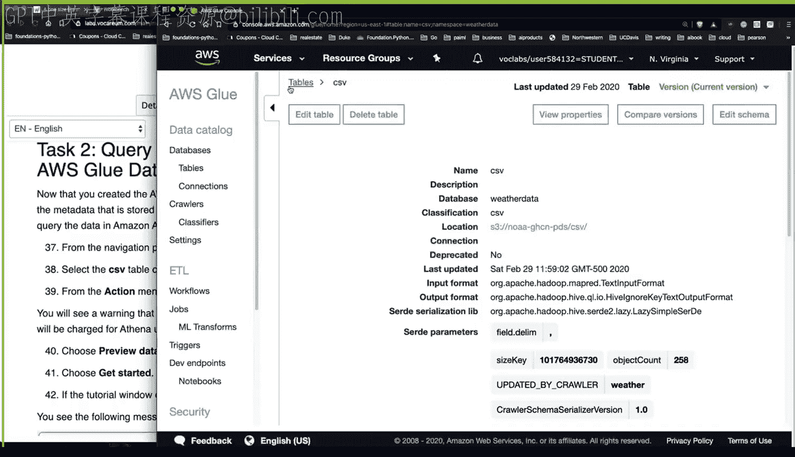

## 第四步：使用Athena转换和存储数据

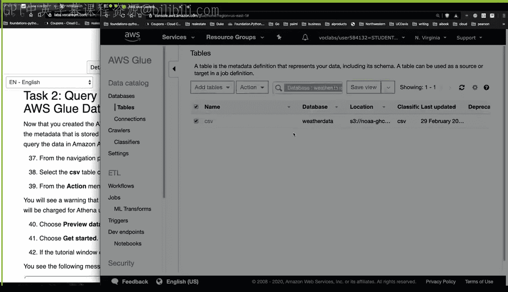

上一节我们学会了基础查询。本节中，我们来看看如何使用Athena执行更复杂的操作，即筛选数据并将结果存储到新的位置。

假设我们只需要1950年之后的数据。我们可以使用CTAS（Create Table As Select）语句来创建一个新表，并将筛选后的数据以列式格式（如Parquet）存储到另一个S3桶中，以优化后续查询性能。

以下是执行此操作的步骤：

1.  首先，在S3中创建一个新桶（例如 `uncc-demo-march1`），用于存放结果。
2.  在Athena查询编辑器中，运行一个类似以下的SQL语句。请将 `your-new-bucket-name` 替换为你刚创建的桶名。

```sql
CREATE TABLE `weather_data`.`post_1950`
WITH (
    format = 'PARQUET',
    external_location = 's3://your-new-bucket-name/post_1950/'
) AS
SELECT *
FROM “weather_data”.“csv”
WHERE CAST(SUBSTR(“date”, 1, 4) AS INTEGER) BETWEEN 1950 AND 2015;
```

3.  运行此查询。Athena会在后台处理整个数据集，应用WHERE子句进行过滤，并将结果以Parquet格式写入你指定的S3路径，同时在Glue目录中注册一个新表 `post_1950`。

这个操作展示了如何利用Athena的处理能力进行数据转换，而无需编写复杂的提取脚本。

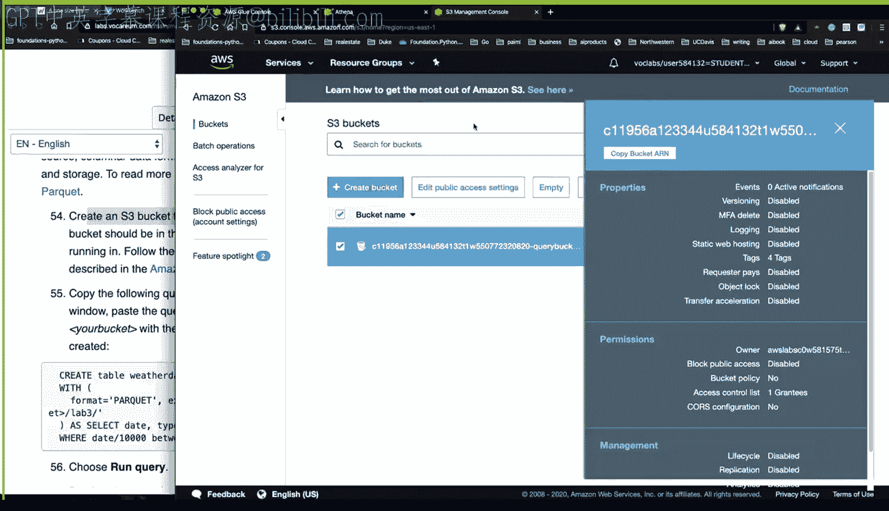

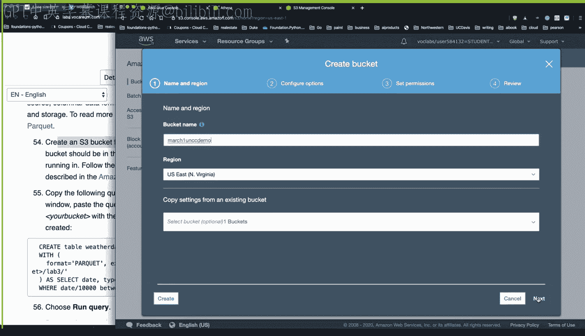

---

## 第五步：查询新创建的数据集

上一节我们创建了一个包含筛选数据的新表。本节中，我们最后来验证一下结果，并对新数据集运行查询。

现在，我们可以像查询原始表一样查询这个新的 `post_1950` 表。

以下是验证和进一步查询的步骤：

1.  在Athena的数据库/表列表中，找到新创建的 `post_1950` 表。
2.  可以运行一个预览查询来查看数据是否已按年份正确筛选。
3.  你可以运行更复杂的分析查询。例如，计算不同观测类型的数量：

```sql
SELECT type, COUNT(*) as count
FROM “weather_data”.“post_1950”
GROUP BY type
ORDER BY count DESC;
```

4.  运行查询后，结果会显示在下方。你还可以在之前配置的S3结果桶中找到每次查询的详细结果文件。

通过以上步骤，我们建立了一个从数据发现、编目、转换到分析的无服务器工作流。

---

## 总结

本节课中我们一起学习了如何构建一个基于AWS无服务器服务的数据分析管道。

1.  我们使用 **AWS Glue 爬虫** 自动发现了存储在Amazon S3中数据的结构和模式，并将其元数据编录在Glue数据目录中。
2.  我们学会了在Glue中 **编辑数据模式**，使字段名称更易于理解。
3.  我们使用 **Amazon Athena** 直接对编录在S3中的数据执行SQL查询，无需移动数据。
4.  我们利用Athena的 **CTAS功能** 过滤了原始数据（例如选择1950年后的记录），并将优化后的结果集存储到新的S3位置，同时创建了新的数据表。
5.  最后，我们对新生成的数据集执行了 **分析查询**，验证了整个流程。

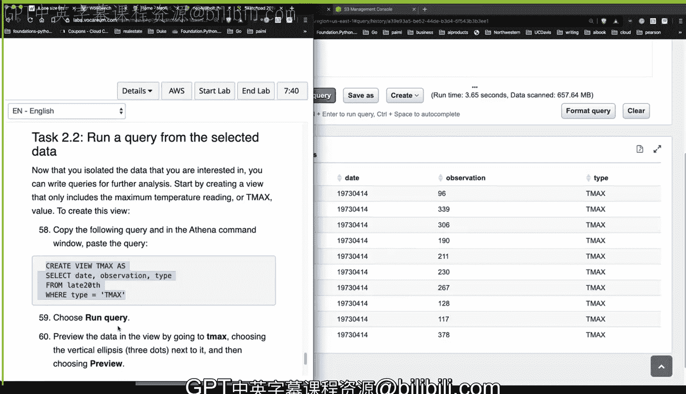

这个流程的核心优势在于其**无服务器**特性：你无需预置或管理任何服务器、集群或基础设施，只需为扫描的数据量和执行的查询量付费。它让数据分析师和工程师能够快速处理海量数据，专注于业务逻辑而非运维。