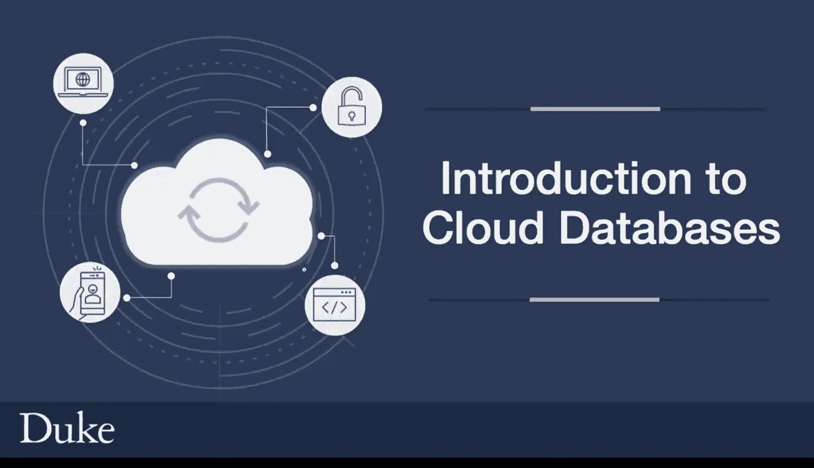
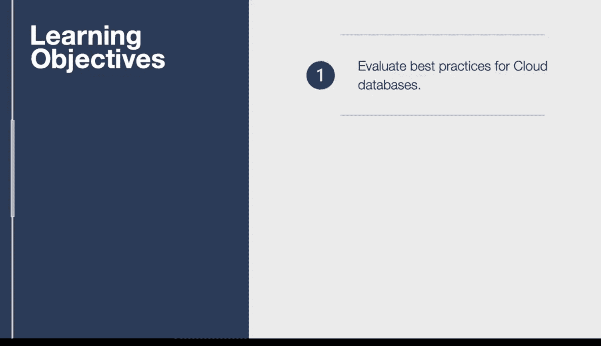

# 云数据库导论：04-02：云数据库导论 🗄️

在本节课中，我们将学习云数据库的核心概念。我们将探讨“一刀切”方案在云环境中并不适用，并了解针对不同问题场景的多种数据库解决方案。课程将涵盖Google BigQuery、AWS Aurora Serverless、AWS DynamoDB（键值数据库）以及AWS Redshift（数据仓库）等具体服务。

## 学习目标 🎯

我们将学习如何评估云数据库的最佳实践。这是本课的核心学习目标。现在，让我们开始学习。



---

## 核心概念：没有“万能”的数据库 🔄

上一节我们明确了学习目标，本节中我们来看看云数据库的一个核心理念。

在云计算领域，不存在一个能解决所有问题的“万能”数据库。不同的应用场景和数据需求，需要不同的数据库解决方案。

以下是几种常见的云数据库类型及其适用场景：

*   **关系型数据库**：适用于需要复杂查询和事务一致性（ACID）的场景，如财务系统。
*   **键值数据库**：适用于需要极低延迟和高吞吐量的简单查询场景，如用户会话存储、购物车。
*   **数据仓库**：适用于大规模数据分析与商业智能（BI）场景，如历史数据报表分析。

---

## 具体云数据库服务介绍 🛠️

了解了“没有万能数据库”的理念后，我们来看看几种主流的云数据库服务。

### Google BigQuery

BigQuery是一个完全托管、无服务器的企业级数据仓库。它允许您使用SQL语句对海量数据集进行超快速的分析查询。

一个简单的查询示例如下：
```sql
SELECT name, COUNT(*) as count
FROM `bigquery-public-data.usa_names.usa_1910_current`
WHERE year = 2020
GROUP BY name
ORDER BY count DESC
LIMIT 10;
```

### AWS Aurora Serverless

Aurora Serverless是Amazon Aurora的一个按需自动扩展配置版本。它是一个与MySQL和PostgreSQL兼容的关系数据库，可根据应用程序的需求自动启动、关闭以及扩展或缩减容量。

其核心优势在于**自动扩缩容**，您无需管理数据库实例。当应用负载增加时，它会自动增加计算资源；当负载降低时，它会自动减少资源以节省成本。

### AWS DynamoDB

DynamoDB是一个快速、灵活的NoSQL数据库服务，适用于任何规模的、需要个位数毫秒级延迟的应用。它是一个键值（和文档）数据库。

其数据模型基于**主键**来存储和检索数据。例如，一个存储用户信息的项可能如下结构：
```json
{
  "UserID": "12345", // 分区键
  "UserName": "John Doe",
  "Email": "john@example.com"
}
```

### AWS Redshift

Redshift是一个快速、完全托管的数据仓库，使用标准SQL和现有BI工具分析所有数据。它针对大规模数据集（从几百GB到PB级）的复杂分析查询进行了优化。



它通常用于运行复杂的**联机分析处理（OLAP）** 查询，其性能通过大规模并行处理（MPP）架构和列式存储来实现。

---


## 总结 📝

本节课中我们一起学习了云数据库的基础知识。我们认识到，在云环境中选择数据库时，需要根据具体的应用需求（如事务处理、高速读写或复杂分析）来匹配合适的数据库类型。我们介绍了Google BigQuery、AWS Aurora Serverless、AWS DynamoDB和AWS Redshift这几种服务，它们分别代表了数据仓库、关系型数据库、键值数据库等不同类别，是构建大规模云解决方案时的重要工具。