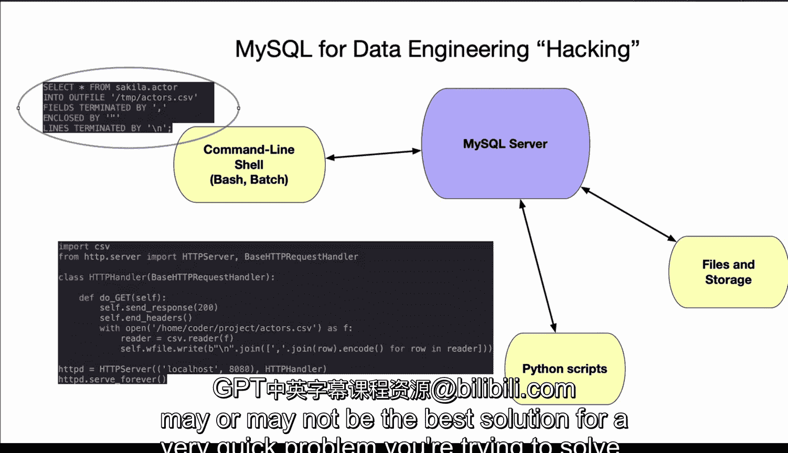

# 构建大规模云计算解决方案：3-4：MySQL 快速交互技巧概览


在本节课中，我们将学习几种不依赖复杂图形界面或特定SDK，仅使用基础命令行工具与MySQL数据库进行快速交互和数据处理的“黑客式”方法。这些技巧在需要快速搭建原型或处理临时任务时非常有用。

上一节我们介绍了MySQL的基本概念，本节中我们来看看如何利用系统自带的工具链进行高效的数据操作。

## 核心概念：快速数据导出与处理

MySQL提供了一种直接的方式，允许我们将查询结果快速导出到磁盘文件，进而使用Linux或Python等标准工具进行处理，而无需安装额外的第三方库。

### 将查询结果导出为CSV文件

你可以执行一个特定的数据库查询，并将结果直接导出为一个CSV格式的文件。其基本命令格式如下：

```sql
SELECT ... INTO OUTFILE '/path/to/file.csv'
FIELDS TERMINATED BY ',' OPTIONALLY ENCLOSED BY '"'
LINES TERMINATED BY '\n'
FROM your_table;
```

或者使用命令行工具 `mysql` 配合 `-e` 执行查询并重定向输出：

```bash
mysql -u username -p -e "SELECT * FROM your_database.your_table" > output.csv
```

一旦数据被保存为CSV文件，你就可以使用诸如 `grep`、`awk`、`sort` 等Linux命令，或者Python的标准库对其进行快速分析和处理。

### 利用Python标准库构建简易Web服务

Python的标准库功能强大，内置了构建Web服务所需的模块。这意味着你无需安装任何第三方框架（如Flask或Django）即可快速搭建一个数据接口。

以下是实现此流程的步骤：

1.  首先，使用上述方法将数据库查询结果导出为CSV文件。
2.  然后，编写一个简单的Python脚本，使用 `http.server` 或 `socketserver` 模块启动一个Web服务。
3.  该服务脚本读取本地的CSV文件，并在接收到HTTP请求时返回文件内容或处理后的数据。
4.  最后，使用 `curl` 命令或浏览器访问该服务的URL来获取数据。

这种方法非常适合黑客马拉松、实验室快速原型验证等需要极速搭建数据接口的场景。

### 使用 `mysqldump` 导出与处理整个数据库

另一种强大的方式是使用 `mysqldump` 工具导出整个数据库的结构和数据，生成一个包含SQL语句的文本文件。

```bash
mysqldump -u username -p your_database > database_dump.sql
```

得到这个SQL文件后，你可以利用Linux的文本处理工具（如 `grep`、`sed`、`awk`）来解析和提取其中的特定数据片段，进行快速的数据探查或转换。

## 方法总结与适用场景

以下是这些快速交互方法的要点总结：

*   **核心优势**：避免陷入复杂的包管理和依赖安装，利用现有工具快速解决问题。
*   **适用场景**：适用于快速原型验证、临时数据分析、环境受限（如特定虚拟机或容器）或需要轻量级解决方案的场合。
*   **工具链**：主要依赖操作系统自带的命令行工具（`mysql`, `mysqldump`, `grep`, `sed`, `awk`）和Python标准库。
*   **演进路径**：建议先从这些基础方法开始，验证想法的可行性。当需求变得复杂，需要更强大的事务支持、并发处理或数据管道时，再考虑引入更专业的工业级工具和框架。



本节课中我们一起学习了如何绕过复杂的图形界面和SDK，使用命令行和脚本工具与MySQL进行快速、灵活的数据交互。我们掌握了将数据导出为CSV文件、利用Python标准库构建简易Web服务以及使用 `mysqldump` 配合文本工具处理数据的方法。这些技巧是数据工程师工具箱中的重要组成部分，能帮助我们在需要快速响应和验证想法时提高效率。