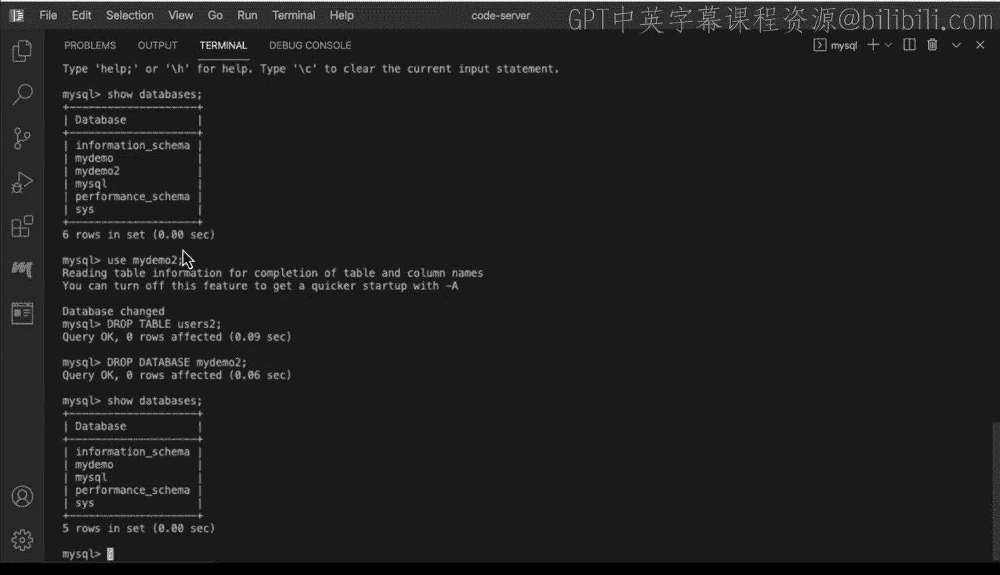

# 构建大规模云计算解决方案：3-4：数据库归档与删除


在本节课中，我们将学习MySQL数据库的备份、数据迁移以及清理操作。这些是数据库管理中的核心技能，能确保数据安全并在进行重大变更前做好准备。

## 数据库备份 🛡️

在进行任何可能影响数据库的重大操作之前，备份是至关重要的第一步。以下是使用 `mysqldump` 命令进行完整备份的步骤。

首先，我们通过终端执行备份命令。该命令会将指定数据库的结构和数据导出到一个文件中。

```
mysqldump -u root -p my_demo > backup_my_demo.sql
```

命令执行后，系统会提示输入root用户的密码。输入正确密码后，备份过程开始。

作为系统管理员，备份后立即验证备份文件的有效性是一个好习惯。我们可以检查文件大小以确保其不为空。

```
du -h backup_my_demo.sql
```

如果文件大小显示为2K（而非0），则表明备份可能成功。为了进一步确认内容，我们可以查看文件的开头部分，避免因数据库过大而输出过多内容。

```
head -n 100 backup_my_demo.sql
```

查看输出，我们可以看到类似 `DROP TABLE IF EXISTS` 和 `CREATE TABLE` 的SQL语句，这证实了我们已获得数据库结构和数据的完整备份。掌握这种备份技术非常有用。

## 数据迁移与归档 📂

上一节我们介绍了如何备份数据库，本节中我们来看看如何在数据库之间迁移或归档数据。首先，我们需要连接到MySQL服务器。

```
mysql -u root -p
```

输入密码后，我们便进入了MySQL命令行界面。我们可以先列出所有数据库，确认目标数据库存在。

```
SHOW DATABASES;
```

列表中应包含 `my_demo` 数据库以及其他默认数据库。接下来，我们将创建一个新数据库用于接收数据。

```
CREATE DATABASE my_demo_2;
```

创建成功后，切换到新数据库。

```
USE my_demo_2;
```

现在，我们可以在新数据库中创建一张表，并将旧数据库的数据直接导入。这是一种从现有数据库中选择性抽取数据或进行归档的便捷技巧。

```
CREATE TABLE users_2 AS SELECT * FROM my_demo.users;
```

执行后，数据便被复制到新表 `users_2` 中。我们可以退出并重新连接，以验证两个数据库都已存在。

```
SHOW DATABASES;
```

此操作展示了在数据库间传输信息的简便性。

## 数据清理与删除 🗑️

在完成数据迁移或实验后，我们可能需要清理创建的资源。以下是删除表和数据库的方法。首先，确保我们位于正确的数据库中。

```
USE my_demo_2;
```

然后，删除之前创建的表。

```
DROP TABLE users_2;
```

最后，我们可以删除整个实验用的数据库。**请注意，这是一个非常危险的操作，会永久删除数据。**

```
DROP DATABASE my_demo_2;
```

执行后，再次列出数据库，会发现 `my_demo_2` 已不存在。这也正是我们在最初进行备份的原因——它允许我们安全地进行此类操作，并在需要时恢复。



本节课中我们一起学习了MySQL数据库管理的三个关键操作：使用 `mysqldump` 进行备份、通过 `CREATE TABLE ... AS SELECT ...` 在数据库间迁移数据，以及使用 `DROP` 命令清理表和数据库。始终记得在进行重大变更前备份数据，这是保障数据安全的核心原则。