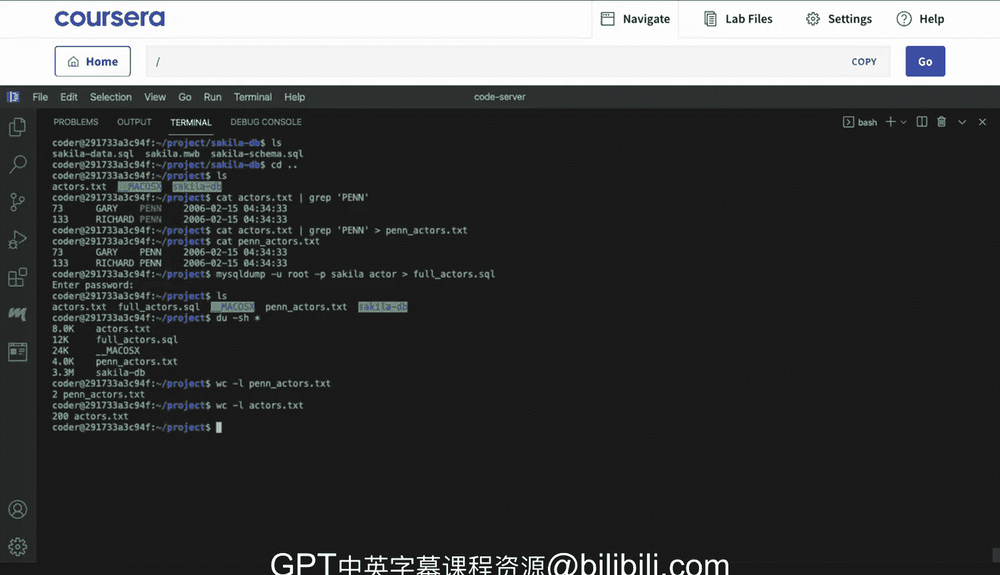

# 数据工程与云计算：第3-4课：基于MySQL的Bash流水线


## 概述
在本节课中，我们将学习如何结合使用MySQL数据库与Bash Shell，以构建高效的数据流水线。这种方法能让数据工程师在不依赖特定编程语言的情况下，灵活地查询、导出和处理数据。

---

## 连接数据库与基础查询
首先，我们需要连接到MySQL数据库并查看可用的数据。

输入以下命令以root用户身份登录MySQL：
```bash
mysql -u root -p
```

登录后，使用以下命令查看所有数据库：
```sql
SHOW DATABASES;
```
可以看到一个名为 `actor_film` 的数据库，我们将使用它。

接下来，我们可以运行一个简单的查询。例如，从 `actor` 表中选取前5条记录：
```sql
SELECT * FROM actor LIMIT 5;
```
查询成功执行，显示了不同的演员信息。

---

## 将查询结果导出到文件
为了进一步处理数据，我们可以将查询结果导出到磁盘上的一个文件中。

将之前的查询修改为导出命令：
```sql
SELECT * FROM actor INTO OUTFILE '/path/to/codeder.project/actors.txt';
```
此命令将 `actor` 表的所有内容导出到指定路径的 `actors.txt` 文件中。

导出完成后，退出MySQL：
```bash
exit
```

---

## 在Bash中处理导出的数据
现在，我们可以在Bash Shell中对导出的数据文件进行操作。

首先，切换到文件所在目录：
```bash
cd /path/to/codeder.project
```

使用 `cat` 命令查看文件内容，并结合 `grep` 进行筛选。例如，查找姓氏为“Penn”的演员：
```bash
cat actors.txt | grep Penn
```
结果显示有两条记录：Gary Penn 和 Richard Penn。

我们可以将筛选结果保存到新文件中：
```bash
cat actors.txt | grep Penn > penn_actors.txt
```
现在，`penn_actors.txt` 文件只包含姓氏为“Penn”的演员数据。这个新文件可以后续被导入到MySQL的新表中，或用于其他操作。

通过这种方式，我们可以在SQL中操作数据，导出到文件，然后在Bash中进行进一步处理，无需深入Python或Ruby等语言。

---

## 不登录MySQL直接导出数据
除了在MySQL内部操作，我们还可以不登录MySQL，直接使用命令行工具导出数据。

使用 `mysqldump` 命令导出整个 `actor` 表：
```bash
mysqldump -u root -p sequila actor > full_actors.sql
```
输入密码后，`actor` 表的结构和数据将被导出到 `full_actors.sql` 文件中。

现在，比较一下我们创建的不同文件大小：
- `actors.txt`：8KB（从SELECT INTO OUTFILE导出）
- `full_actors.sql`：12KB（从mysqldump导出）
- `penn_actors.txt`：4KB（筛选后的子集）

这展示了我们以多种方式对数据进行子集划分的能力。

---

## 使用Bash工具进行数据分析
我们还可以使用其他Bash工具对数据文件进行快速分析。

例如，使用 `wc -l` 命令统计文件行数：
- 统计 `penn_actors.txt` 的行数：
  ```bash
  wc -l penn_actors.txt
  ```
  输出结果为2，表示有2行数据（即2位演员）。
- 统计 `actors.txt` 的行数：
  ```bash
  wc -l actors.txt
  ```
  输出结果为200，表示有200行数据（即200位演员）。

这种方法展示了Shell工具与数据库操作之间的强大协同效应，使我们能够快速执行数据子集划分和基本分析，而无需依赖更复杂的编程环境。

---

## 总结
本节课中，我们一起学习了如何构建基于MySQL和Bash的数据流水线。我们掌握了：
1.  连接MySQL并执行基础查询。
2.  使用 `INTO OUTFILE` 将查询结果导出到文件。
3.  在Bash Shell中使用 `grep`、`cat`、重定向等命令处理数据文件。
4.  使用 `mysqldump` 不登录MySQL直接导出表数据。
5.  利用 `wc` 等工具对数据文件进行快速分析。



这种结合SQL声明式查询和Bash灵活文本处理的方法，为数据工程师提供了一种轻量、高效的数据操作范式。