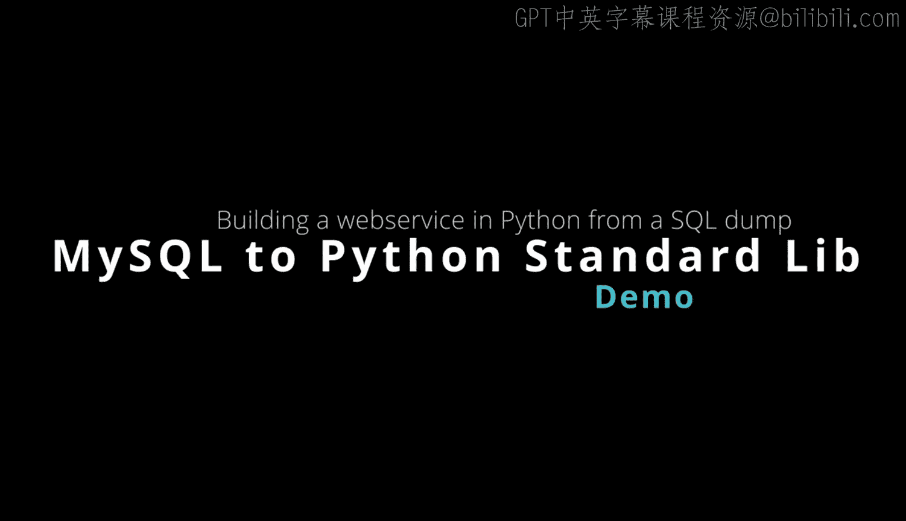
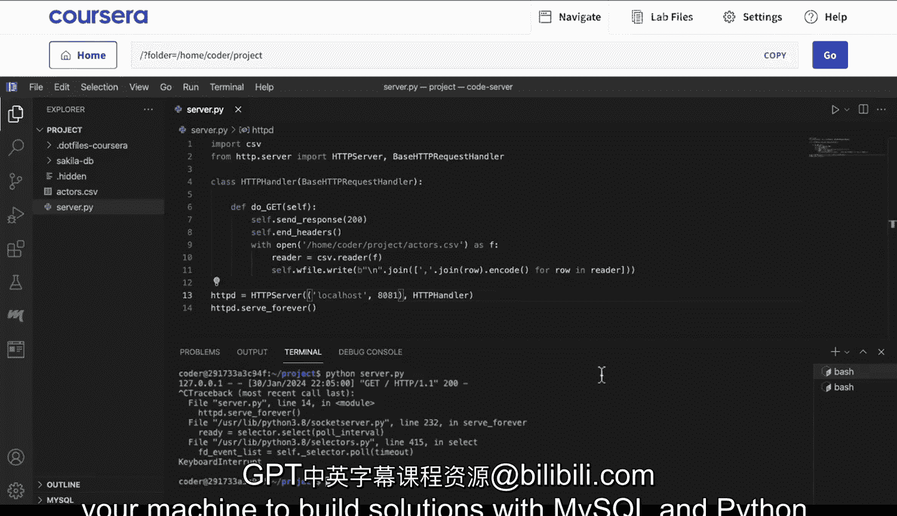
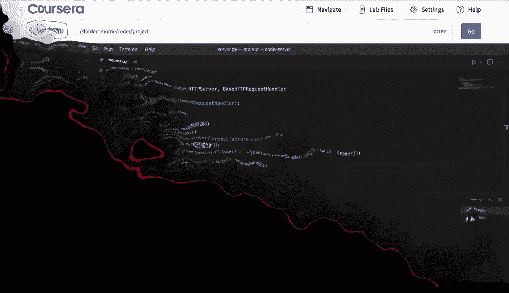

# 构建大规模云计算解决方案：3-4：使用Python标准库构建MySQL数据Web服务器



在本节课中，我们将学习如何从MySQL数据库中提取数据，并使用Python的标准库快速构建一个简单的Web服务器来提供这些数据。整个过程将涉及SQL查询、数据导出和基础的Web服务开发。

---

上一节我们介绍了数据处理的基本流程，本节中我们来看看如何将数据库中的数据快速转换为可通过网络访问的API。

首先，我们需要连接到MySQL数据库并导出所需的数据。

以下是连接到数据库并查看数据的步骤：
1.  在终端中输入 `mysql -U root -p` 以root用户身份登录MySQL。
2.  输入 `show databases;` 命令查看所有数据库。
3.  使用 `use sequila;` 命令切换到名为 `sequila` 的数据库。
4.  输入 `show tables;` 命令查看该数据库中的所有表。

现在，我们已经定位到包含电影数据的数据库和表。

接下来，我们将执行一个SQL查询，将 `actor` 表中的数据清洗并导出为CSV格式文件。

以下是具体的SQL命令：
```sql
SELECT * FROM actor INTO OUTFILE '/tmp/actors.csv'
FIELDS TERMINATED BY ',' ENCLOSED BY '"'
LINES TERMINATED BY '\n';
```
这条命令会将 `actor` 表的所有内容导出到 `/tmp/actors.csv` 文件，字段用逗号分隔，文本用双引号包裹，每行以换行符结束。

执行完毕后，输入 `exit;` 命令退出MySQL。

---

上一节我们成功从MySQL导出了数据文件，本节中我们来看看如何使用Python读取这个文件并创建一个Web服务器。

我们首先确认CSV文件已生成。在终端中，可以使用 `head /tmp/actors.csv` 命令查看文件的前几行内容。

为了构建Web服务，我们需要创建一个Python脚本。打开代码编辑器，新建一个名为 `server.py` 的文件。

以下是 `server.py` 文件的完整代码：
```python
import csv
from http.server import HTTPServer, BaseHTTPRequestHandler

class SimpleHandler(BaseHTTPRequestHandler):
    def do_GET(self):
        # 设置响应头，表明返回的是JSON格式数据
        self.send_response(200)
        self.send_header('Content-type', 'application/json')
        self.end_headers()

        data = []
        # 读取CSV文件内容
        with open('/tmp/actors.csv', 'r') as file:
            csv_reader = csv.DictReader(file)
            for row in csv_reader:
                data.append(row)

        # 将数据列表转换为JSON字符串并发送
        import json
        response = json.dumps(data)
        self.wfile.write(response.encode())

# 在8081端口启动服务器
server = HTTPServer(('localhost', 8081), SimpleHandler)
print("Server started on http://localhost:8081")
server.serve_forever()
```
这段代码的核心是定义了一个 `SimpleHandler` 类，它继承自 `BaseHTTPRequestHandler`。当收到GET请求时，它会打开我们导出的CSV文件，使用 `csv.DictReader` 将每一行解析为字典，并收集到一个列表中。最后，使用 `json` 模块将列表转换为JSON格式的字符串，并通过HTTP响应返回。

保存文件后，在终端中运行 `python server.py` 启动服务器。如果默认的8080端口被占用，代码中已设置为使用8081端口。

服务器启动后，我们可以测试它。打开另一个终端窗口，使用 `curl` 命令向服务器发送请求。

以下是测试命令：
```bash
curl http://localhost:8081
```
执行该命令后，终端将显示出从 `actors.csv` 文件读取并转换的JSON格式演员数据。

---

本节课中我们一起学习了如何整合多种工具快速构建一个数据服务原型。我们首先使用SQL从MySQL中查询并导出清洗过的数据到CSV文件。然后，仅利用Python的标准库（`csv`、`http.server`、`json`）就创建了一个能够提供JSON API的简易Web服务器。





这个过程展示了使用系统已有工具（Bash、SQL、Python标准库）进行快速原型开发的强大能力。在构建快速、轻量的解决方案时，充分利用这些基础工具往往比依赖复杂的三方库更高效。