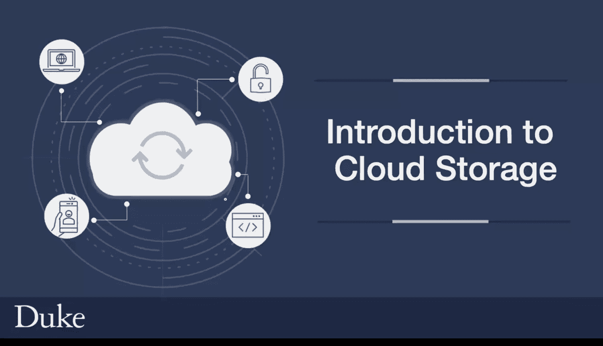
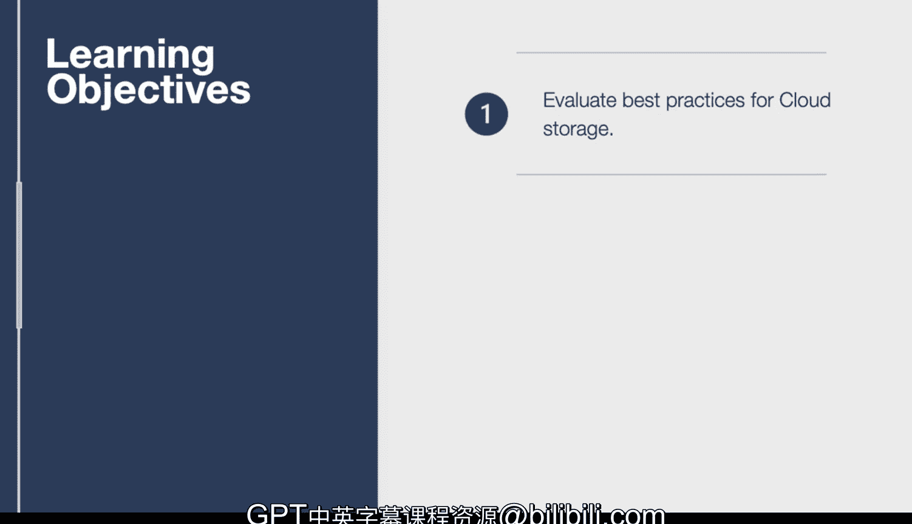

# 构建大规模云计算解决方案：3-4课：云存储导论 🗂️

在本节课中，我们将学习云存储的基础知识。我们将探讨什么是云存储、为何要使用它，并介绍几种基本的云存储技术。最后，我们将重点了解亚马逊AWS的S3服务，这是一个常用于构建数据湖的对象存储系统。我们的学习目标是评估云存储的最佳实践。

---



## 什么是云存储？ ☁️

云存储是一种通过互联网提供数据存储服务的模型。它允许用户将数据保存在远程的服务器上，而非本地设备。这种模式提供了按需扩展、高可用性和易于访问等优势。

---

## 为何使用云存储？ 🤔

使用云存储有多个原因。它消除了维护物理硬件的需求。它提供了几乎无限的存储空间，并能根据需求灵活扩展。此外，云存储服务通常内置了数据冗余和备份功能，提高了数据的安全性和可靠性。

---

## 云存储技术简介 🛠️

上一节我们介绍了云存储的概念和优势，本节中我们来看看几种核心的云存储技术。主要有三种类型：对象存储、块存储和网络文件存储。

以下是这三种存储类型的简要说明：

*   **对象存储**：将数据（如图片、视频、文档）作为带有元数据的独立对象进行管理。访问通过唯一的标识符（如URL或键）实现。其核心访问模式可表示为 **`GET/PUT object by key`**。
*   **块存储**：将数据分割成固定大小的“块”，并像硬盘驱动器一样提供给计算实例。它适用于需要低延迟和高性能的数据库或文件系统。
*   **网络文件存储**：提供基于标准文件协议（如NFS或SMB）的共享文件系统。多个计算实例可以同时访问相同的文件集。

---

## 亚马逊S3：对象存储实践 🪣

了解了基本的存储类型后，我们聚焦于实践中广泛使用的对象存储服务——亚马逊S3。Amazon S3是一个高度可扩展、耐用且安全的对象存储服务，常被用作数据湖的基础。

S3的核心概念是**桶**和**对象**。桶是用于存储对象的容器，每个对象由一个键（文件名）和数据本身组成。

以下是一个使用AWS CLI上传文件到S3的简单示例代码：

```bash
# 将本地文件上传到指定的S3存储桶
aws s3 cp ./my-local-file.txt s3://my-example-bucket/path/to/file.txt
```



---


## 总结 📝

本节课中我们一起学习了云存储的基础知识。我们首先定义了云存储并探讨了其使用价值。接着，我们介绍了对象存储、块存储和网络文件存储这三种基本技术。最后，我们以亚马逊S3为例，深入了解了对象存储系统的实际应用，它是构建大规模数据解决方案（如数据湖）的关键组件。掌握这些概念是评估和选择云存储最佳实践的第一步。