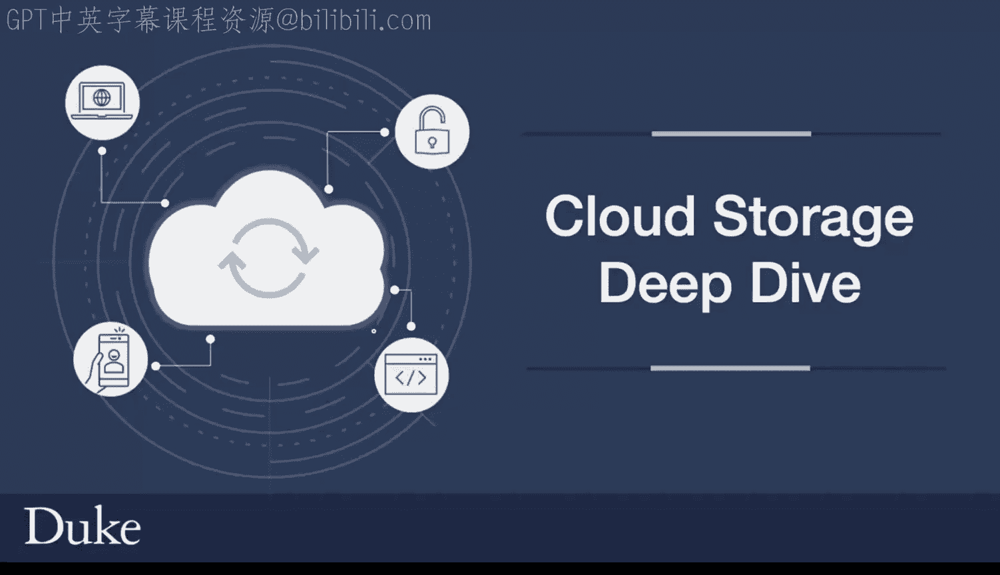
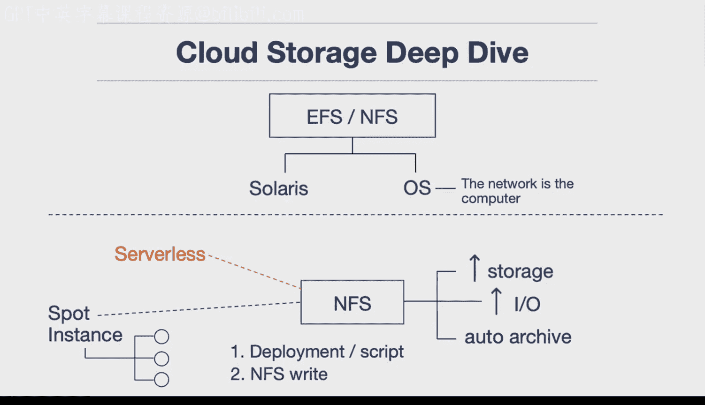
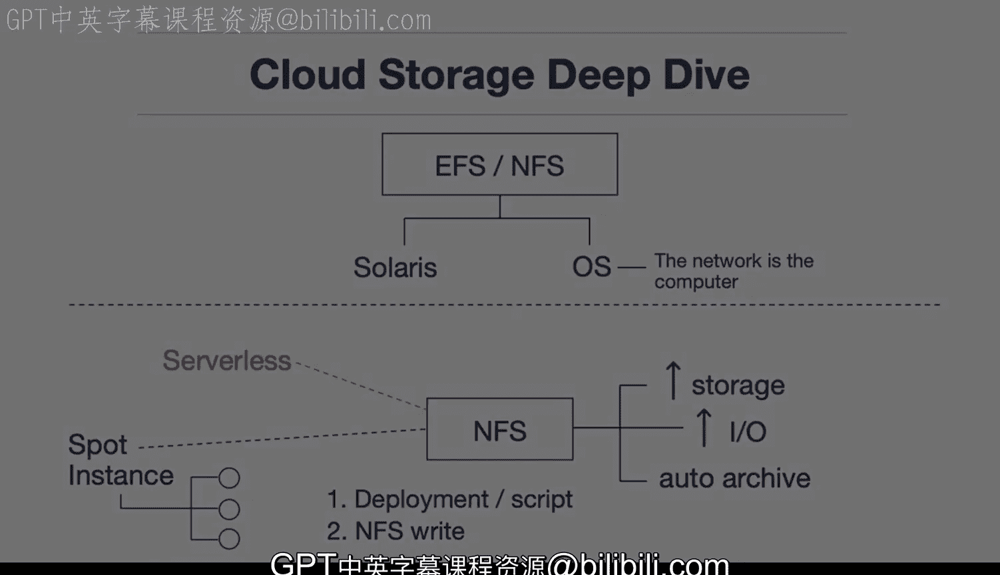

# 构建大规模云计算解决方案：3-4：云存储深度解析 🗄️

在本节课中，我们将要学习云存储的核心概念、主要服务类型以及一个特别有用的网络文件系统。云存储是现代云计算解决方案的基石，它提供了近乎无限的扩展能力和极高的可靠性。

## 概述

云存储是一个引人入胜的话题，因为使用云服务提供商时，你可以获得强大的能力。理解云存储的首要方式是“无限”这个概念。这意味着你拥有近乎无限的CPU、近乎无限的磁盘和近乎无限的存储空间。因此，通过使用云服务，你可以构建非常复杂的解决方案。

## 数据湖：云服务的核心组件

对于所有云服务公司来说，核心组件很可能是他们的数据湖。在数据湖中，你可以构建例如机器学习流水线。我们可以在数据湖内部构建一个ML流水线。我们也可以仅为数据工程构建存储。如果你要构建一个商业分析流水线，同样可以做到。你还可以进行网站托管。数据湖的另一个用途是托管静态网站，例如使用像Hugo这样的静态托管技术。

所有这些都可以自动完成。这些流水线可以建立起来，因为资源会根据请求自动伸缩。因此，它非常灵活，你可以将其视为始终存在的资源，并用它构建许多不同的服务。云存储的另一个优点是，以AWS为例，它具有11个9的可靠性。这意味着在实践中，每年的停机时间大约只有10毫秒。由于高度的冗余性，这里的信息几乎总是可用的。

还有一些其他值得指出的优点。大多数云提供商还提供不同的定价方案。在定价方面，你会发现，如果你想要存储不经常访问的数据，你可以为某些存储类型支付更少的费用。这就像将个人物品存放在某个地方的存储容器中，因为你不会频繁访问它，所以费用更低。数据也是如此，你可以将其放入不同的存储层级中。你甚至可以将数据归档。以AWS为例，他们有一项名为Glacier的服务，你可以用来归档数据。

因此，构建复杂系统、全球可用的社交网络、机器学习公司或AI公司的真正方法，是首先从数据湖开始，并在此基础上构建这些能力。

## 云存储的主要服务类型

接下来，我将讨论云存储中可用的一些服务类型，即有哪些产品。AWS是一个很好的例子，他们可能拥有最丰富的产品线。

他们提供对象存储。这是数据湖的支柱。在对象存储方面，你可以存入文件、图片等内容。例如文件、图片、视频。

他们提供的另一项服务是数据库，并且有多种不同类型的数据库。起初这可能令人困惑，但拥有如此多不同数据库的好处在于，你可以为项目选择多个数据库。例如，你可以选择传统的关系型数据库。或者你可以选择一个键值数据库。DynamoDB就是一个很好的键值数据库示例，稍后我将展示使用DynamoDB构建应用是多么有用。

另一个选择可以是图数据库，许多问题非常适合用图数据库解决。例如，社交网络分析在图数据库中效果很好。还有搜索引擎，AWS上有Elasticsearch。因此，数据库产品种类繁多，在许多情况下，你可以在一个特定项目中同时选择并使用其中的几种。

他们还提供机器学习平台。这些平台设计用于位于数据湖之上，并对资产进行版本控制。它们会对模型本身以及所使用的数据进行版本控制，这样你就可以检测到诸如数据漂移等现象。

此外，在存储服务方面，你还可以使用这些ETL系统。ETL代表提取、转换和加载。这意味着你可以构建某种流水线来执行公司内的操作。这是一个常见的工作流程。如果你要为公司的商业分析或数据工程方面构建一些东西，自动清洗数据并将其转换为有用的格式是常见做法。特别是在AWS平台上，他们有Quicksight，这是一个与ETL产品配合使用的可视化工具。他们还有Glue，这是一个自动化的ETL流水线。此外，还有一个名为Athena的工具，它可以查询由Glue创建的目录。例如，它可以进入Amazon S3，跟踪其中的所有内容，然后你可以通过Athena编写SQL查询来访问这些数据。

因此，云中不仅有低层级的原语，还有大量不同的服务可用。我想另外两个重要的方面是服务器本身的存储类型。以EC2为例，在EC2上，主要有几种存储类型。

一种叫做EBS。EBS代表弹性块存储。使用弹性块存储，你可以指定所需的IOPS数量。其有用之处在于，你可以通过专门挂载一个卷并指定，例如，你希望每秒有10，000次IOPS，来进行高性能计算。与笔记本电脑或工作站具有固定磁盘IO能力不同，使用他们的块存储系统，你几乎可以获得无限的磁盘IO能力。然而，块存储系统不能被第二个虚拟机访问。

因此，可用的另一个解决方案是EFS。EFS的有用之处在于，你可以在多台机器上挂载这个共享网络文件系统。这些多台机器可以做一些事情，比如使用一个共同的源代码来分发工作，也可以在作业之间共享数据，它还可以根据大小扩展磁盘。因此，在云服务中，我认为EFS是更有趣的一个，让我简要深入探讨一下，并谈谈你可以与弹性文件系统一起使用的特定工作流程。

## 弹性文件系统及其工作流程

弹性文件系统本质上是NFS这个词的重新命名。NFS，即网络文件系统，已经存在很长时间了。我相信它是由Sun公司创建的，该公司过去有一个名为Solaris的操作系统。当时的标语，我相信是“网络就是计算机”。

这个概念的巧妙之处在于，使用像网络操作系统这样的东西，你可以执行一些非常强大的工作流程。一个例子是，你可以拥有这个网络文件系统，它的存储可以自动增长。它还可以自动变得更快，因为随着你增加更多存储，它会增加磁盘来适应。此外，它可以自动归档不经常使用的文件。这样你支付的费用就更少。因此，它具有这些非常先进的功能。

这意味着在工作流程方面，例如，如果你在AWS上启动一个Spot实例，你可以实际进行集中挂载。假设这些是Spot实例，你可以有很多个。一个集群，也许你可以启动1，000个Spot实例来做一些工作，然后它们都有相同的挂载点。因为它们有相同的挂载点，这大大简化了许多事情。它简化了软件的部署，实际上几乎不需要部署，因为你只需要在这里挂载一个脚本目录。然后在该脚本目录内，你可以运行任何你需要做的事情，比如计算机视觉任务、机器学习任务或其他操作。你可以自动完成这些，因为代码始终可用。同样，当作业完成时，数据也可以写入这个网络文件系统。

这非常有用，因为不需要启动像大数据系统这样的其他进程。所有功能都隐含在这个系统中。因此，EFS或者说网络文件系统，确实是云工作流程中越来越普遍的一个有用特性。特别是，除了Spot实例之外，现在还有一个新的工作流程。你还可以告诉无服务器机器，我相信这是AWS上的一个新组件，它们也可以挂载相同的文件存储系统。这样做的帮助在于，你可以让这些无状态函数将其数据透明地写入弹性文件系统。

## 总结

本节课中，我们一起学习了云存储的核心概念。我们了解到云存储提供了近乎无限的资源扩展能力，并以数据湖作为构建复杂解决方案的基础。我们探讨了主要的云存储服务类型，包括对象存储、多种数据库、机器学习平台和ETL系统。最后，我们深入了解了弹性文件系统，它作为一个共享的网络文件系统，能够简化多机器集群的代码部署和数据共享，是云工作流程中一个强大且日益重要的工具。掌握这些知识，是设计和实施大规模、可靠且高效的云计算解决方案的关键第一步。