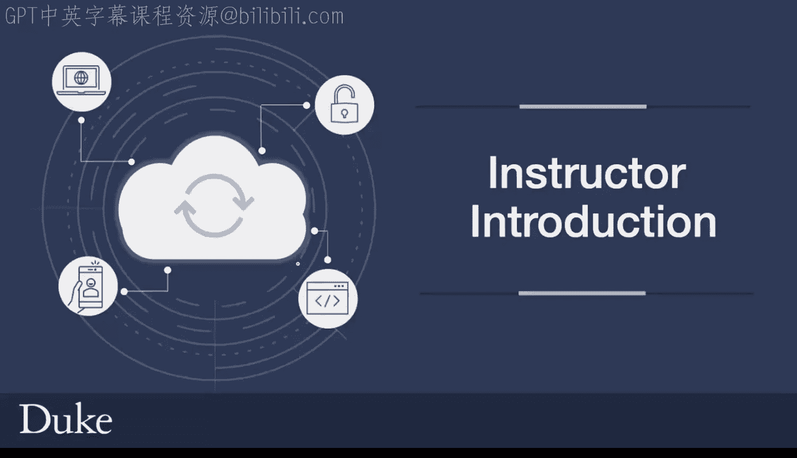

# 构建大规模云计算解决方案：01：讲师介绍

在本节课中，我们将认识本课程的讲师，了解他的学术背景、行业经验以及专业成就，这有助于我们理解课程内容的知识来源和权威性。

大家好，我是 Noah Gi，我将担任本课程的讲师。

我在世界多所顶尖大学任教，包括杜克大学数据科学项目和西北大学数据科学项目。我也曾在加州大学伯克利分校和加州大学戴维斯分校授课。

我的著书经验包括一本畅销书，名为 **《Python for DevOps》**。此外，我还著有 **《Pragmatic AI and Cloud Computing for Data》** 和 **《Practical MLOps》**。这些书籍中的许多已被翻译成中文。

我的行业经验涵盖游戏、电影、软件即服务（SaaS）、机器学习与工程领域。我曾多次在预算内按时交付产品。

如果你在过去20年里真正涉足软件行业，你会知道自动化是当前的一个关键重点。这正是我职业生涯中投入大量精力的领域。我认为，如果流程没有实现自动化，它就是有缺陷的。我的大量经验涉及构建持续集成服务器、进行测试、执行负载测试以及建立安全机制，以确保公司能够按时交付产品。

近年来我获得的一些荣誉包括 **AWS 机器学习英雄** 称号。我也曾参与 AWS、GCP 和 Azure 的教育机构合作项目，并为包括 Udacity、Coursera、O‘Reilly 和 Datacamp 在内的顶级内容平台制作了许多课程。同时，我还是 **Python 软件基金会研究员**。

因此，你将在优秀的指导下学习。我期待与你分享我的知识。让我们开始吧。

本节课中，我们一起认识了讲师 Noah Gi，了解了他深厚的学术背景、丰富的行业实践经验以及在自动化、云计算和机器学习领域的专业成就，这为我们后续学习构建大规模云计算解决方案奠定了信任基础。