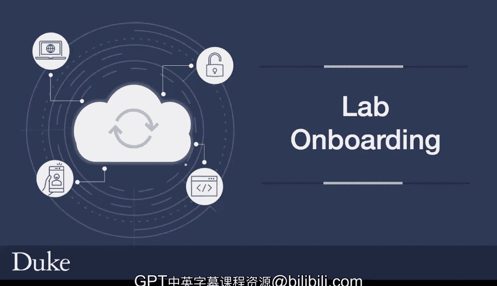
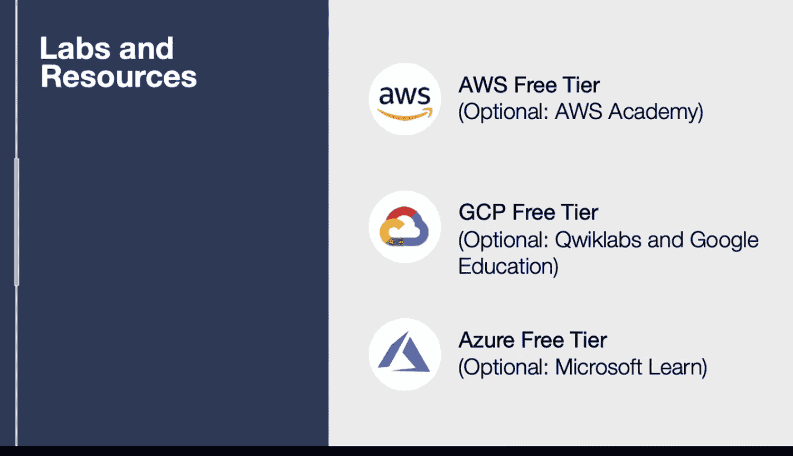

# 构建大规模云计算解决方案：03_01_03：实验入门 🧪

在本节课中，我们将介绍本课程会用到的实验平台和免费资源。你将了解如何利用AWS、GCP和Azure的免费方案来完成所有课程任务，并获取额外的教育支持资源。

---

## 课程实验与资源概览

本课程提供了基于AWS、GCP和Azure的实验。这些云平台均提供免费套餐，足以支持你完成所有课程内容。

上一节我们介绍了课程的整体结构，本节中我们来看看具体有哪些实验资源可供使用。

---

## AWS 实验资源

AWS平台提供免费套餐。使用该套餐，你基本可以完成本课程的所有需求。

以下是关于AWS资源的详细信息：
*   你可以使用 **AWS免费套餐**。
*   如果你是教育机构中**AWS Academy**的成员，还可以访问许多免费的实验。这些实验非常有帮助，并能为你考取AWS认证做准备。
*   我本人教学也使用这些实验。

---

## GCP 实验资源

GCP平台提供慷慨的免费套餐。使用免费套餐，你可以完成整个课程的所有作业。

以下是关于GCP资源的详细信息：
*   你可以使用 **GCP免费套餐**。
*   你还可以访问可选的**Quicklabs**。
*   如果你是学生，可以使用**Google教育**计划。你可以向Google教育申请一些Quicklab积分，并通过这种方式进行试运行。

---

## Azure 实验资源

Azure平台同样提供非常慷慨的免费套餐。作为学生，你可以访问该套餐。

以下是关于Azure资源的详细信息：
*   你可以使用 **Azure免费套餐**。
*   如果你想自行完成一些实验，可以访问**Microsoft Learn**平台。

---

## 总结

总而言之，本课程涵盖的所有内容，都可以通过使用AWS、GCP和Azure的免费功能免费完成。此外，如果你是像杜克大学这样的教育机构的一员，还可以访问其他专门为教育环境设计的实验资源。