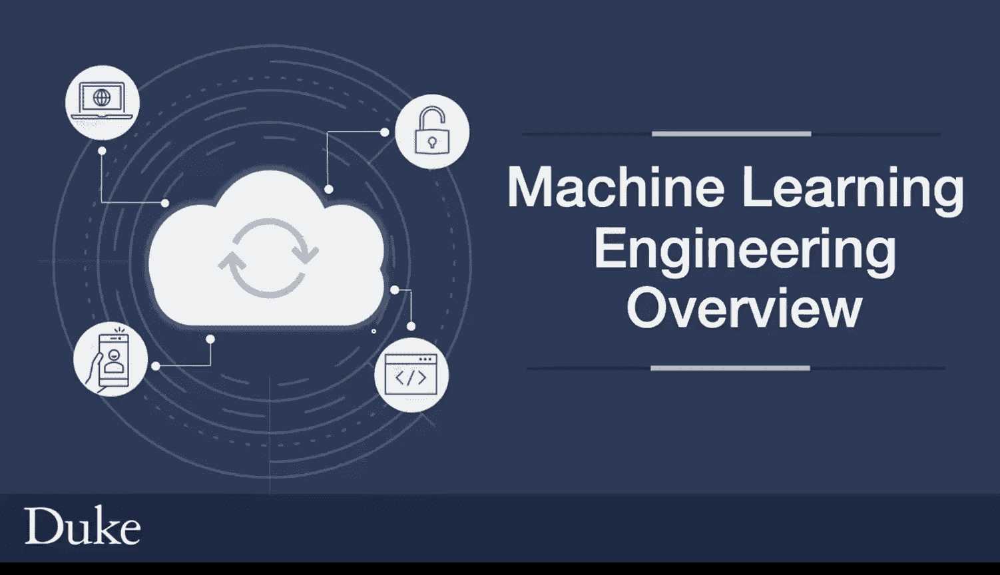

# 构建大规模云计算解决方案（数据工程、机器学习）：3-4课：机器学习工程概述

在本节课中，我们将要学习什么是机器学习工程，以及它在将机器学习应用投入生产环境中的关键作用。

## 什么是机器学习工程？🤔

机器学习工程是当今一个重要的主题。机器学习工程指的是将机器学习应用部署到生产环境中的能力，并确保其能够提供准确的预测、可以维护该应用，并且具备部署多个机器学习应用的能力。

因此，构建机器学习应用的整个过程实际上涉及多个不同的组成部分。

## 与DevOps的渊源 🔄

上一节我们介绍了机器学习工程的定义，本节中我们来看看它的方法论来源。机器学习工程的许多流程继承自DevOps。DevOps是一种使用最佳实践（如微服务和持续交付）以可重复的方式将事物操作化的过程。这些相同的概念被引入到机器学习工程中。

所以，当你听到“机器学习工程师”这个词时，这位工程师所做的工作是：他们将某个事物（如模型）转变为一种可以**被重复且成功地部署**的模式，以便你可以在生产环境中使用该应用。

以下是几个具体的应用场景示例：
*   自动驾驶汽车。
*   能够通过端到端流程检测野生动物保护区中野生动物的卫星。

这就是机器学习工程师所做的事情。你也可以联想到其他行业，比如汽车工程师、航空工程师，每种工程师都在其特定领域内解决问题。

## 本节总结 📝

本节课中我们一起学习了机器学习工程。它是一个非常有趣的主题，因为它是当前最热门的职位之一。在接下来的章节中，我们将深入探讨机器学习工程的各个方面。