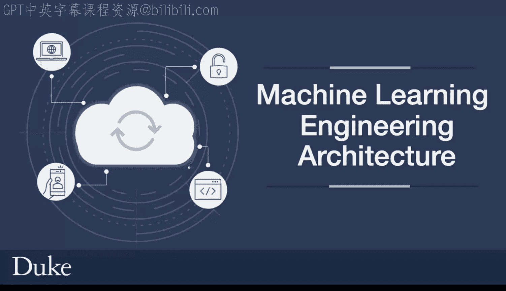
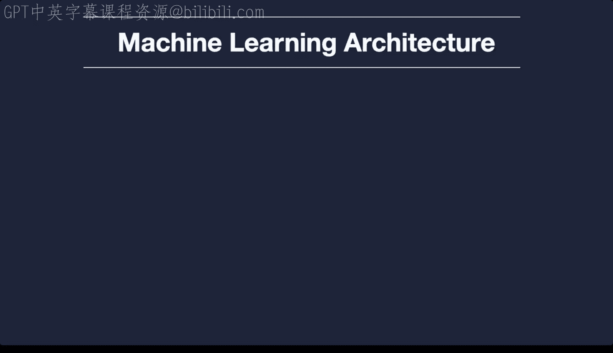

# 机器学习工程架构：07_01_03：典型机器学习架构解析



在本节课中，我们将学习一个典型的机器学习系统在生产环境中的完整架构。我们将拆解其核心组件，理解数据如何流动，以及如何构建一个动态、可维护的系统。

## 概述

一个典型的机器学习架构围绕一个**微服务**展开，该服务接收请求、进行预测，并依赖于数据基础设施和监控系统来保持其有效性和可靠性。我们将逐一剖析这些组件及其相互作用。

## 微服务：预测的核心

上一节我们概述了架构，本节中我们来看看其核心——机器学习微服务。所有预测请求都通过这个服务处理。

微服务通常包含三个关键子组件：

1.  **Web应用代码**：这是一个轻量级的Web框架，用于暴露API接口。例如，可以使用Python的Flask框架，代码量通常在50到100行之间。其核心功能是接收请求并调用模型。
    ```python
    # 示例：Flask API端点
    from flask import Flask, request, jsonify
    import model  # 导入训练好的模型

    app = Flask(__name__)

    @app.route('/predict', methods=['POST'])
    def predict():
        data = request.get_json()  # 接收JSON格式的输入数据
        prediction = model.predict(data)  # 使用模型进行预测
        return jsonify({'prediction': prediction})
    ```

2.  **机器学习模型**：训练好的模型文件会直接嵌入或包含在微服务项目中。最佳实践是对模型进行版本控制，以便追踪和回滚。

3.  **容器技术**：为了确保环境一致性，微服务通常被封装在容器中。这可以是：
    *   **无服务器容器**：由云服务商直接管理运行环境。
    *   **Docker容器**：使用Dockerfile定义所有运行时依赖。

## 部署与持续交付流程

了解了微服务的静态结构后，我们来看看如何动态地部署和更新它。这个过程与持续集成/持续交付（CI/CD）紧密相关。

整个系统通过一个自动化流程进行部署和更新：
*   **应用代码**和**模型**作为一体被检入源代码控制系统（如Git）。
*   新的提交会自动触发构建和部署流程，将更新后的微服务发布到生产环境。

## 数据基础设施与反馈循环

部署流程并非单向的。一个健壮的系统需要一个反馈循环来应对数据的变化。这就是数据湖和监控机制发挥作用的地方。

数据从**数据湖**流入系统。数据湖的一个关键作用是帮助检测**数据漂移**。数据漂移是指生产环境中的数据分布与训练模型时使用的数据分布发生了显著变化。

系统会持续监控当前数据与历史数据的差异。如果漂移超过设定的阈值（例如25%），监控系统会自动触发模型的重训练流程。

公式可以简化为：
**触发重训练条件：** `当前数据分布与训练数据分布的差异 > 设定阈值`

这个过程形成了一个动态的反馈循环：数据变化触发模型更新，模型更新通过CI/CD流程重新部署，从而让系统能够自适应环境变化。这是现代机器学习系统中最重要的组成部分之一。

## 生产环境监控

最后一个常被忽视但至关重要的组件是生产监控。一个投入生产的系统必须配备监控仪表板和健康告警。

以下是监控仪表板通常包含的关键指标列表：

*   **服务性能指标**：如API的响应延迟、吞吐量、错误率。
*   **模型性能指标**：如预测结果的准确性、精确率、召回率（需要标注数据反馈）。
*   **业务指标**：如预测结果对业务目标的影响。

这个仪表板不是可选项，而是生产环境的必备要素。它让工程师能够实时了解系统状态，确保服务成功运行。

## 总结




本节课中我们一起学习了一个典型机器学习生产架构的全貌。我们拆解了其核心——由Web代码、模型和容器构成的**微服务**；探讨了基于CI/CD和源代码控制的**自动化部署流程**；重点讲解了通过**数据湖**监测**数据漂移**并触发模型重训练的**动态反馈循环**；最后强调了配备性能与精度指标的**生产监控仪表板**的重要性。记住，一个成功的机器学习系统是这些组件协同工作的结果，它应该是简单、自动化和可观测的。