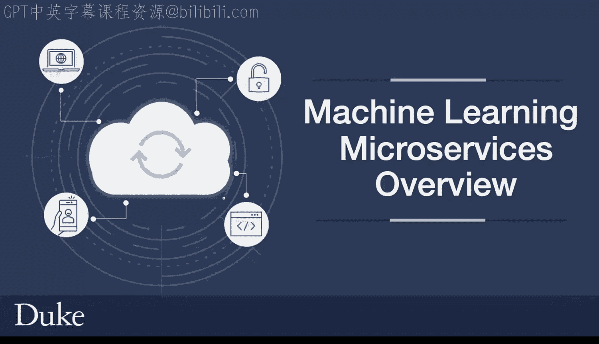

# 构建大规模云计算解决方案：3-4：机器学习微服务概述 🧠

在本节课中，我们将要学习什么是机器学习微服务，以及它如何与DevOps原则相结合，以驱动现代机器学习工程的发展。

---

## 什么是机器学习微服务？

微服务是DevOps领域的一个新趋势。它允许你将应用程序的某个特定功能独立出来，使其变得非常简洁，然后将其部署到生产环境中。

微服务的一个巨大优势在于，调试一个非常具体的服务内部发生的问题要容易得多。

---

## 微服务示例

为了更清晰地理解，我们来看一个具体的例子。

假设你正在做一个关于美国职业棒球大联盟球员身高和体重的预测。这可以成为一个非常具体的微服务。它只做这一件事：输入身高，它预测体重；输入体重，它预测身高。

---

## 微服务与DevOps的融合

正是这类具体的概念，推动了微服务在机器学习和DevOps领域的广泛采用。

DevOps的原则本身也非常支持微服务。DevOps的一个核心特征是**持续交付**的理念。这意味着你总是能够将新做出的更改部署到生产就绪环境中。

同时，应用程序代码也与基础设施代码紧密相连。

---

## 微服务的意义

这些对微服务的改进，实质上是对过去构建单体应用程序方式的摒弃。正是这种转变，在驱动着机器学习工程的发展，特别是那些采用微服务架构的机器学习工程。

---

## 总结

本节课中，我们一起学习了机器学习微服务的核心概念。我们了解到，微服务通过将特定功能模块化、独立化，使得开发、调试和部署变得更加高效。它与DevOps的持续交付等原则紧密结合，共同构成了现代可扩展机器学习解决方案的工程基础。