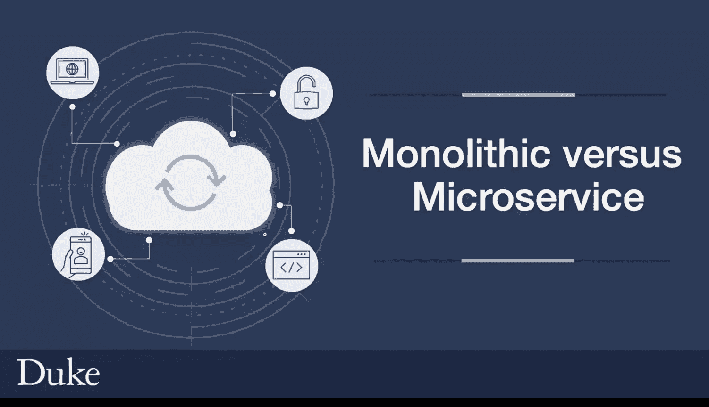
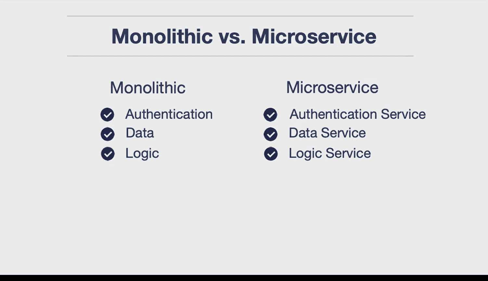

# 构建大规模云计算解决方案：3-4：单体架构与微服务对比 🏗️

在本节课中，我们将要学习单体架构与微服务架构的核心区别，理解它们各自的特点以及为何微服务架构在现代云计算和机器学习应用中变得如此流行。

## 概述

软件架构决定了应用程序的构建和组织方式。传统上，许多应用采用单体架构，而现代云原生应用则倾向于微服务架构。理解这两种模式的差异，对于设计可扩展、易维护的系统至关重要。

## 什么是单体架构？ 🧱

在早期，开发者通常会构建一个包含所有功能模块的单一应用程序，这种架构被称为**单体应用**。

一个典型的单体应用包含以下所有部分：
*   **认证模块**：负责处理用户登录账户等身份验证逻辑。
*   **数据模块**：负责连接数据库（例如通过对象关系映射器ORM），进行数据存取。
*   **业务逻辑模块**：负责处理请求，例如根据客户请求从数据库查询产品记录。

所有这些应用组件都集中在一个特定的单体代码库中。这个代码库可能非常庞大，例如包含**20,000行代码**。

然而，这种架构带来了维护和复杂性问题。例如，如果认证系统出现问题，开发者必须检查整个庞大的应用程序来进行调试。

## 什么是微服务架构？ 🔗

为了解决单体架构的问题，行业提出了**微服务**的概念。微服务架构的强大之处在于，它将每个组件都构建为独立的服务实体。

以下是微服务架构的关键特点：
*   **独立的服务**：每个核心功能都是一个独立的服务。
*   **认证服务**：专门处理用户登录等身份验证事宜。
*   **数据服务**：专门负责与数据库交互，执行查询并获取记录，它本身不依赖认证服务。
*   **逻辑服务**：这可以是提供报告的后端、其他业务逻辑、商业智能或机器学习模型等。每个功能都是一个独立的服务。

微服务架构的核心思想是：应用程序的每个进程都作为一个独立的组件运行，这些组件即服务。服务之间通过轻量级的API操作进行通信，每个服务只执行单一功能，并且可以支持多个不同的应用程序。

## 核心优势对比 ⚖️

与单体架构相比，微服务架构能显著提升开发效率和系统韧性。

微服务架构的主要优势包括：
*   **开发更快速**：提供了更快的代码开发和自动化构建方式。
*   **整体速度更快**：能够快速启动项目。
*   **易于排错与恢复**：能够快速发现错误并从中恢复。

这种架构特别适合机器学习等需要快速迭代和独立部署组件的场景。

## 总结

本节课我们一起学习了单体架构与微服务架构的核心区别。单体架构将所有功能集成在一个应用中，虽然简单但难以维护和扩展。微服务架构则将应用拆分为多个独立、专注的服务，通过API通信，从而实现了更快的开发速度、更好的错误隔离以及更强的可扩展性，尤其适用于现代云计算和机器学习项目。