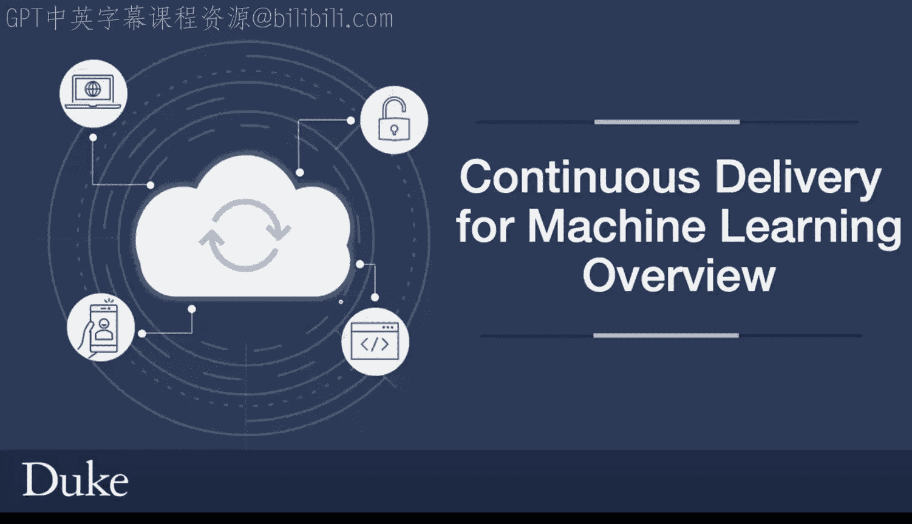

# 机器学习持续交付：01：机器学习持续交付概述

在本节课中，我们将要学习什么是机器学习持续交付，并了解它与传统软件持续交付的关键区别，特别是数据在其中的核心作用。

## 什么是机器学习持续交付？

机器学习持续交付是指能够将你的软件以可部署状态交付的能力。这本身就是持续交付的定义。同时，它还需要将实现机器学习预测功能的代码一并交付。

这意味着在机器学习场景下，有一些特殊事项需要考虑。

## 机器学习持续交付的特殊考量

以下是进行机器学习持续交付时需要特别关注的一些独特组成部分。

*   **数据版本管理**：当你训练一个模型时，你需要知道模型是用哪个版本的数据进行训练的。这涉及到数据漂移的问题。
*   **模型变更监控**：需要判断底层模型是否发生了足够大的变化，以至于需要部署一个新版本的模型。

在进行机器学习持续交付时，这些独特的部分确实需要引起重视。特别是底层数据，它可能是考虑机器学习持续交付时最核心的组件之一。

## 总结

本节课中，我们一起学习了机器学习持续交付的基本概念。我们了解到，它不仅仅是代码的持续交付，还必须包含对训练数据和模型版本的管理。其中，底层数据的管理是确保机器学习系统能够可靠、持续地交付预测能力的关键。