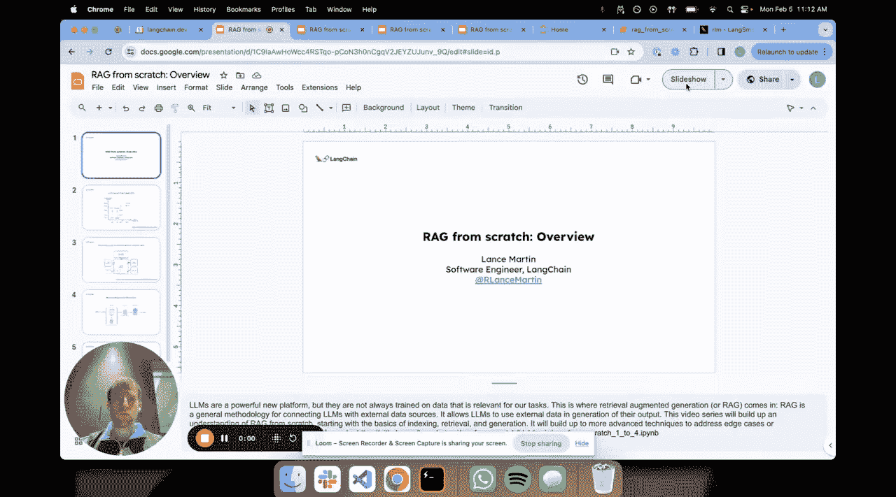
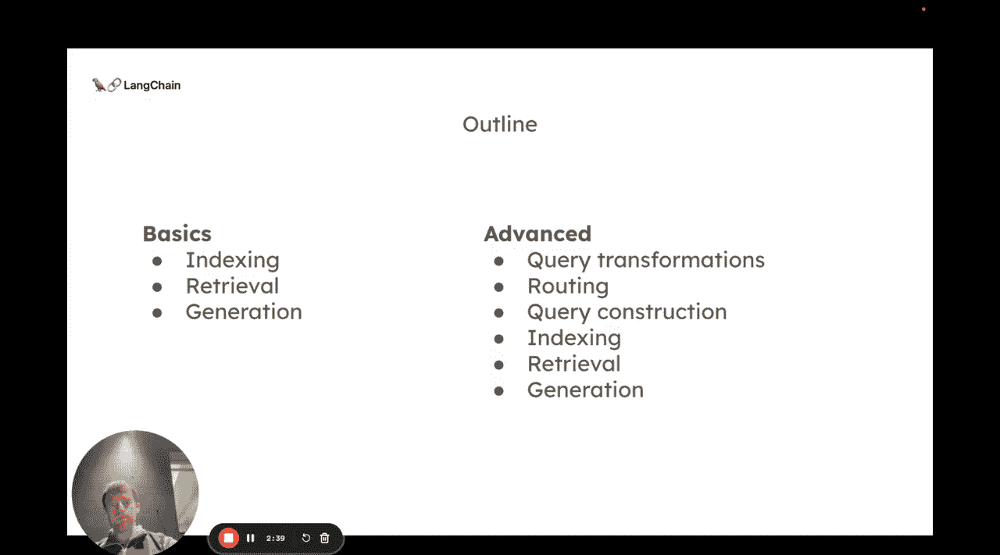
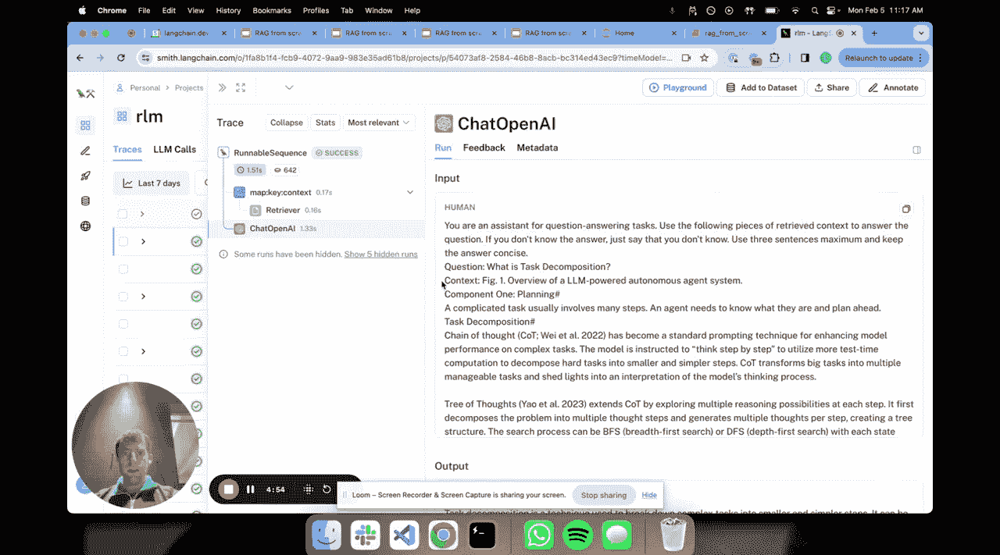
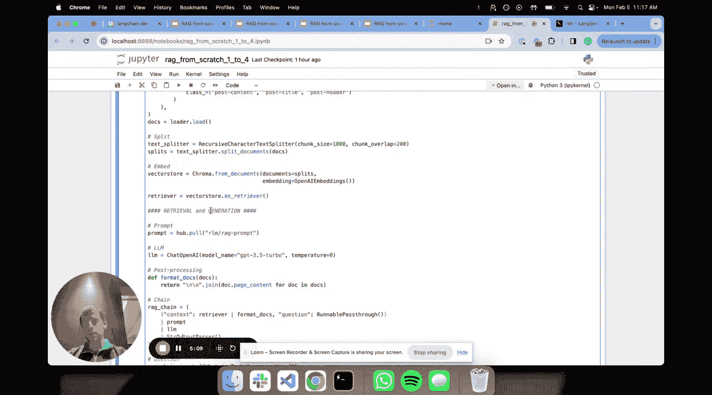

# LangChain【中英⚡使用 LangChain 从零开始构建 RAG 系统｜RAG From Scratch】 p01 P1 From Scratch： Part 1 (Overview) -BV1FgfMYLEve_p1-

Hi， this is Lance from Langshing and we're starting a new series called RaG from Scratch that's going to walk through some of the basic principles for RaG and kind of build up to advanced topics。

So one of the main motivations for RAG is simply that LLMs haven't seen all of the data that you may care about。

So like private data or very recent data would not be included in the pre training runs for these OLMs。

And you can see here on the graph on the X axis that the number of tokens that they're portraytrained on。

 which is， of course， very large， but of course， it's still always going to be limited relative to private data that you care about or。

 for example， recent data。But there's another interesting consideration is that LLMs have context windows that are actually getting increasingly large。

 so you know going from like thousands of tokens to many thousands of tokens。

 which represents dozens of pages up to hundreds of pages。

We can fit information into them from external sources。

And a way to think about this is LMs are kind of a kernel of a new kind of operating system。

And connecting them to external data is kind of a very central capability in the development of this kind of new emergent operating system。

So retrieval augment to generation or RAG is a very popular kind of general paradigm for doing this。

 which typically involves three stages。So the first stage is indexing some external documents such that they can be easily retrieved based on an input query。

 so for example， we ask a question， we retrieve documents that are relevant to that question。

 we feed those documents into an LLM in the final generation stage to produce an answer that's grounded in those retrieved documents。

Now we're starting from scratch。But we're going to kind of build up to this broader view of Ra。

 you can see here， there's a lot of interesting methods and tricks that kind of fan out from those three basic components of indexing retrieval and generation。

And。Future videos are actually going to walk through those in detail。

 we're going to tryread to heat each video pretty short like five minutes。

 but we're going to spend a lot of time on some of those more advanced topics。First。

 over the next three videos， I'll just be laying out the very basic kind of ideas behind indexing retrieval and generation。

 and then we'll kind of build beyond that。Into those more advanced themes。

And now I want to show just a quick code walkthrough because we want to make these videos also a little bit interactive。

So right here and this repo will be shared public。I have a notebook open and I've just basically installed a few packages。

And I've set a few environment variables for my Lsmith keys。

 which I personally do recommend it's really useful for tracing observability。

Particularly when you're building rag pipelines。So what I'm going to show here is the code for our RA quick start。

 which is linked here。And I'm going to run this， but I'm then going to kind of walk through everything that's going on。

 So actually， if we think back to our diagram， all we're doing here is we're loading documents。

In this case， I'm loading a blog post。We're then splitting them and we'll talk about that in future short videos on like why splitting is important。

 but just for now， recognize we're splitting them or setting a chunk size of a thousand characters。

 so we're splitting up our documents every split。Is embedded and indexed。Into this vector store。

 so we say he picked open eye beddings using Chromas or vector St runs locally。

And now we'd find this retriever。We then have to find a prompt for rag。We can find our LLM。

We've done some minor document processing。 We set up this chain。

Which will basically take our input question。Run our retriever to F relevant documents。

Put the retrieved documents and our question into our prompt。Pass it La。

Formmat the output is a string， and we can see here's our output。Now we can open up Langsmith。

 and we can actually see。How this ran。 So here was our question， and here's our output。

And we can actually look。Here's our retriever。 Here's our retrieved documents。So that's pretty nice。

And ultimately， here was the prompt that we actually passed into the LLM。

 you're an assistant for QA tasks， use the following pieces of retrieved content to answer the question。

Here's our question。And then here's all the content。

This we retrieved， and that res in our answer。So this just gives a very general overview of how RAG works and in future short videos we're going to break down each of these pieces in a lot more detail。

 thanks。

