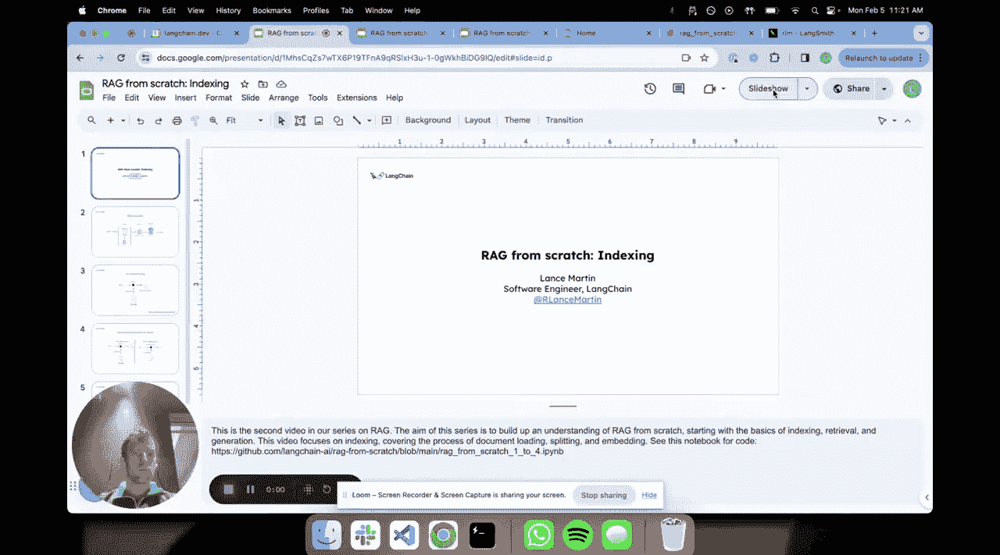
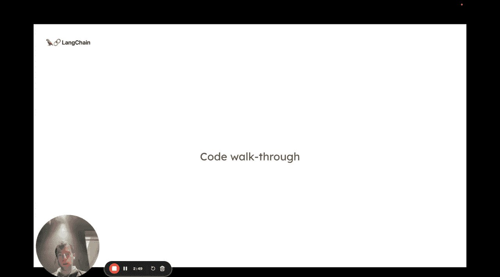
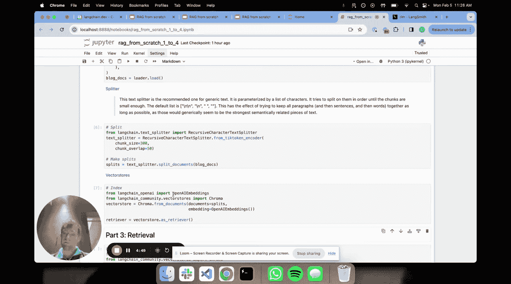

# LangChain【中英⚡使用 LangChain 从零开始构建 RAG 系统｜RAG From Scratch】 p02 P2 From Scratch： Part 2 (Indexing) -BV1FgfMYLEve_p2-

this is Lance from Langsh with the second video in our series rack from scratchch。

 focused on indexing。So in the past video， you saw the main kind of overall components of rag pipelines。

 indexing， retrieval and generation。And here we're going to kind of deep dive on indexing。

 and like just a quick overview of it。So the first aspect of indexing is we have some external documents。

That we actually want to load and put into what we're trying to call retriever。And the goal。

 this retriever is simply given an imp question， I want to fish out documents that are relateded to my question in some way。

Now， the way to establish that relationship or relevance or similarity is typically done using some kind of numerical representation of documents。

And the reason is that it's very easy to compare vectors， for example。

 with numbers relative to just reform formed text。And so a lot of approaches have been developed over the years to take text documents and compress them down into a numerical representation。

That then can be very easily searched。Now。There's a few ways to do that。

 so Google and others came up with many interesting statistical methods where you take a document。

 you look at the frequency of words， and you build what they call sparse vectors such that the vector locations are a large vocabulary of possible words。

Each value represents the number of occurrences of that particular word。

 and it's sparse because there's， of course， many zeroes。

 It's a very large vocabulary relative to what's present in the document。

And there's very good search methods over this type of numerical representation。Now。

 a bit more recently， embedding methods that are machine learned so you take a document and you build a compressed fixed length representation of that document。

Have been developed with correspondingly very strong search methods over embeddings。嗯。

So the intuition here。Is that we take documents。And we typically split them because embedding models actually have limited context windows。

 So， you know， on the order of maybe 5，12 tokens， up to 8000 tokens or beyond。

 but they're not infinitely large。 The documents are split。

 and each document is compressed into a vector， and that vector captures a semantic meaning of the document itself。

 The vectors are indexed。Questions can be embedded in exactly same way。

And then a numerical kind of comparison in some form， you。

 using very different types of methods can be performed on these vectors to fish out relevant documents relative to my question。

And let's just do a quick code walkthrough on some of these points。So。I have my notebook here。

I've installed here。Now I've set a few API keys for Langsmith， which are very useful for tracing。

 which we'll see shortly。Um， previously， I walked through this this kind of quick start that just showed overall how to lay out these rag pipelines。

And here what I'll do is I'll deep dive a little bit more on indexing。

 and I'm going to take a question in a document。 And first。

 I'm just going to compute the number of tokens in， for example， the question。

 And this is interesting because embedding models and nos more generally operate on tokens。

 And so it's kind of nice to understand how large the documents are。 I'm trying to feed in。

 In this case， it's obviously a very small In this case， question。

Now I'm going to specify open eye embeddings。I specify an embedding model here。

 and I just say embed embed query， I can pass my question my document， and what you can see here is。

That runs。And this is mapped to now a vector of length 1536。

 and that fixed length vector representation will be computed for both documents and really for any documents。

 so you're always kind of computing this fixed length vector that encodes the semantics of the text that you've passed。

Now I can do things like cosine similarity to compare them。And as we'll see here。I can。

Load some documents， this is just like we saw previously， I can split them。And I can index them here。

Just like we did before， but we can see under the hood。

 really what we're doing is we're taking each split。

We're embedding it using open ionbeddings into this kind of this vector representation。

 and then that's stored with a link to the ro document itself in our vector store。And next。

 we'll see how to actually do retrieval using this vector store。

