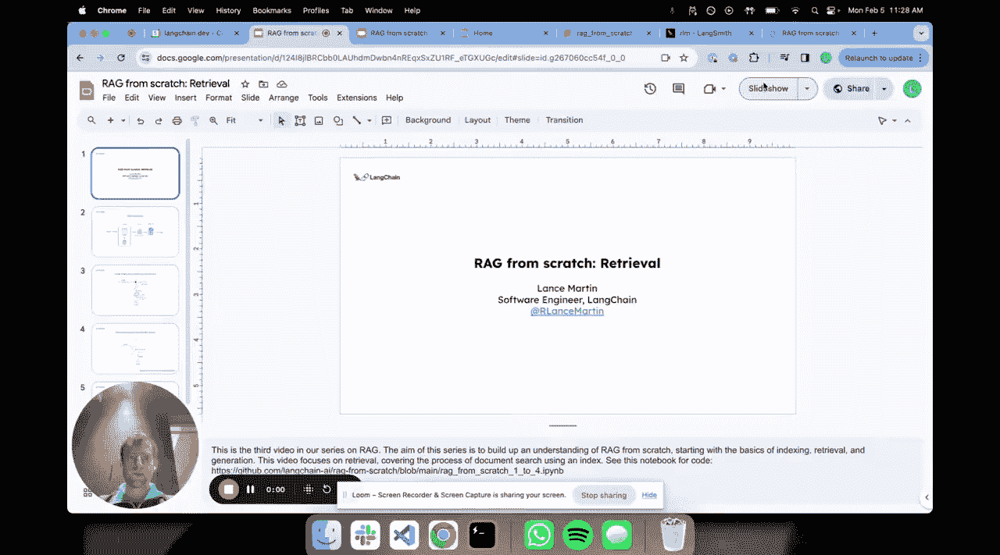
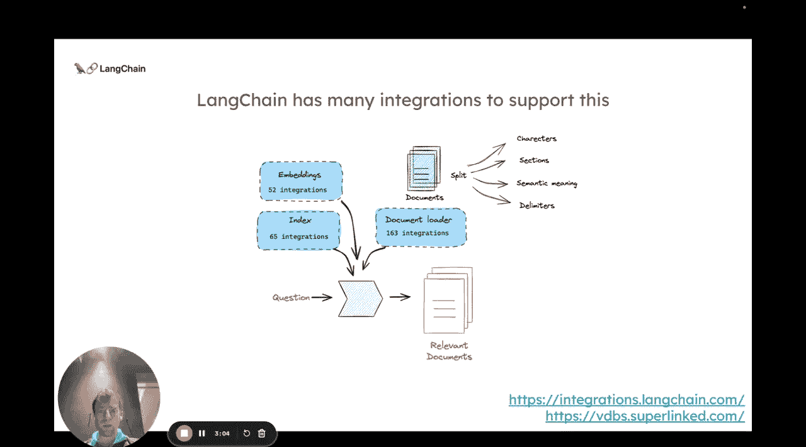
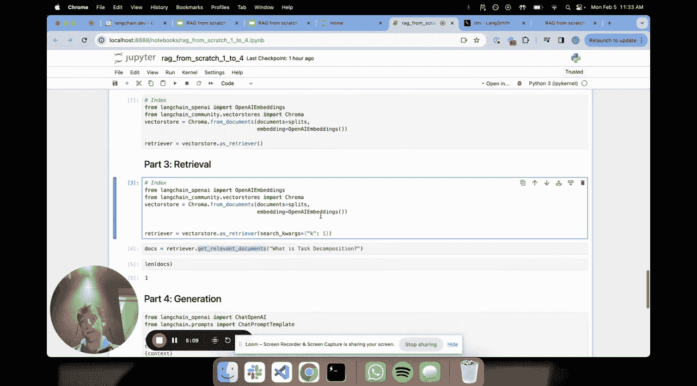

# LangChain【中英⚡使用 LangChain 从零开始构建 RAG 系统｜RAG From Scratch】 p03 P3 From Scratch： Part 3 (Retrieval) -BV1FgfMYLEve_p3-

Hi， this is Lance from Langchain， and this is the third video in our series raggged from scratch。

Building up a lot of the motivations for RaG from the very basic components。

So we're going to be talking about retrieval today in the last two short videos。

 I outlined indexing and gave kind of an overview of this flow。

 which starts with indexing our documents， retrieval documents relevant to our question。

 and then generation of answers based on the retrieved documents。

And so we saw that the indexing process basically makes documents easy to retrieve。

And it goes through a flow that basically looks like you take our documents。

 You split them in some way into these smaller chunks that can be easily embedded。

Those embeddings are then numerical representations of those documents that are easily searchable。

And they're stored in an index。When given a question that's also embedded。

The index performs a similarity search。And return split their irrelevant to the question。Now。

 if we dig a little bit more under the hood， we can think about it like this。

If we take a document and embed it， let's imagine that embedding just had three dimensions。

 so you know each document is projected into some point in this 3D space。Now。

 the point is that the location in space is determined by the semantic meaning or content in that document。

So to follow that， then documents in similar locations in space contain similar semantic information。

 and this very simple idea is really the cornerstone for a lot of search and retrieval methods that you'll see with modern vector stores。

So in particular we take our documents， we embed them into this in this case， a toy 3D space。

We take our question， do the same。We can then do a search like a local neighborhood search you can think about in this 3D space around our question to say。

Hey， what documents are nearby？And these nearby neighbors are then retrieved because they have similar semantics relative to our question。

And that's really what's going on here。 So， again， we took our documents。 We split them。

 We embed them。 And now they exist in this high dimensional space。 We've taken our question。

 embedded it， projected in that same space。 And we just do a search around the question for nearby documents and grab ones that are close。

 And we can pick some number。 We can say we want one or two or three or n documents close to my question in this embedding space。

And there's a lot of really interesting methods that implement this very effectively。

 I link one here。And we have a lot of really nice integrations to play with this general idea。

 so many different embedding models， many different indexes。

 lots of document loaders and lots of splits that can be kind of recombined to test different ways of doing this kind of indexing or retrieval。

So now I'll show a bit of a code walkthrough。So， here we defined。

We kind had walked through this previously。 This is our note book。 We've installed a few packages。

 We've set a few environment variables， using Langsmith。And we showed this previously。

 this just an overview showing how to run rag like kind of end to end。In the last short talk。

 we went through indexing。And what I'm going to do very simply is。

I'm just going to reload our documents。So now I have our documents。I'm going to resplit them。

And we saw before how we can build our index。Now here， let's actually do the same thing。

 but in the slides we actually showed kind of that notion of search in that 3D space。

And a nice parameter to think about in building your retriever is k。

 so K tells you the number of nearby neighbors to fetch when you do that retrieval process and we talked about you in that 3D space do I want one nearby neighbor or two or three so here we can specify k equals1。

For example， now we're building our index， so we're taking every split， embedding it， storing it。Now。

 it's nice as I ask a question， what is tasky composition is related to the blog post。

And I'm going to run get relevant and documents， so I run that and now how many documents do I get back I get one as expected based upon K equals1。

 so this retrieved document should be relatedlay to my question。Now I can go to Langsmith。

And we can open it up and we can look at our retriever。And we can see here is our question。

 here's the one document we got back and okay， so that makes sense。

 this document pertains the task decomposition in particular and it kind of lays out a number of different approaches that can be used to do that this all kind of makes sense and this shows kind of in practice how you can implement this kind of KNN or K nearest neighbor search really easily just using a few lines of code and next we're going to talk about generation。

Thanks。