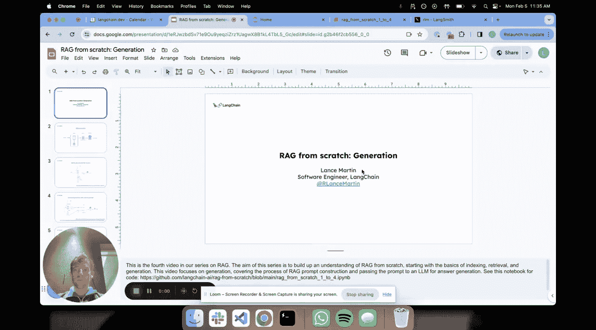
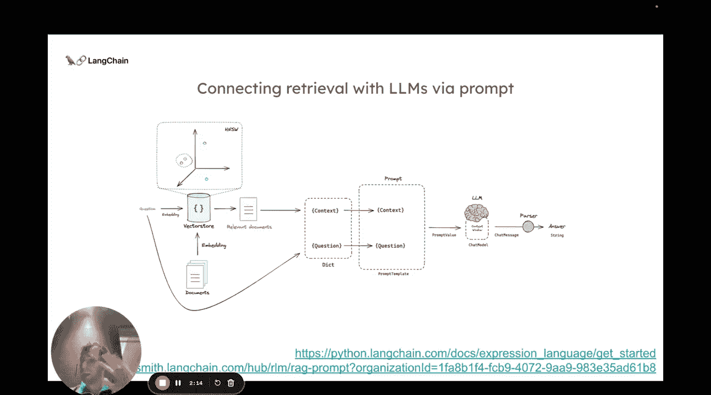
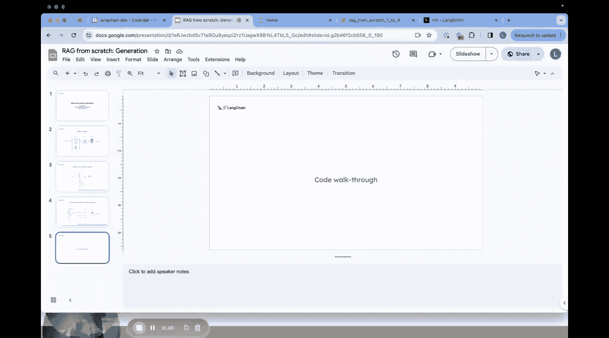
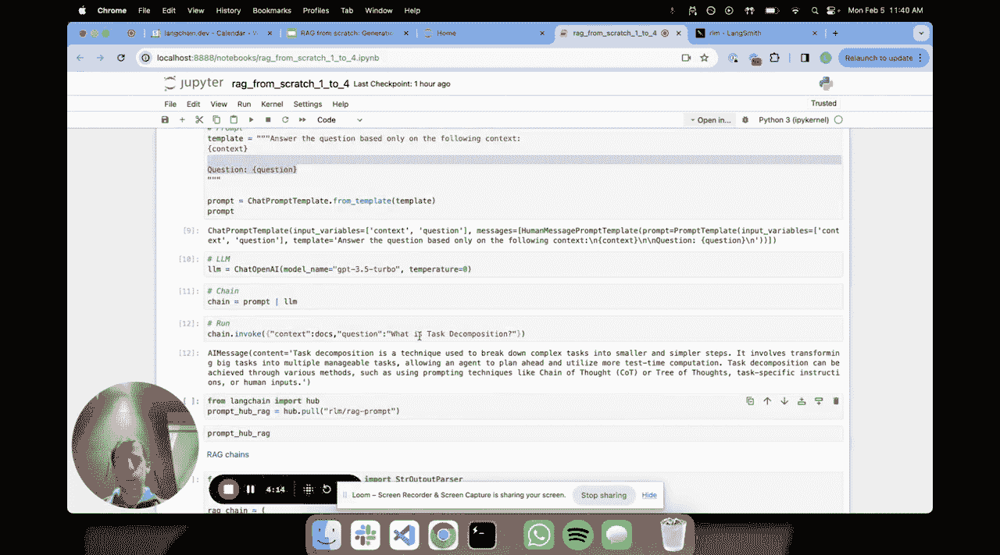
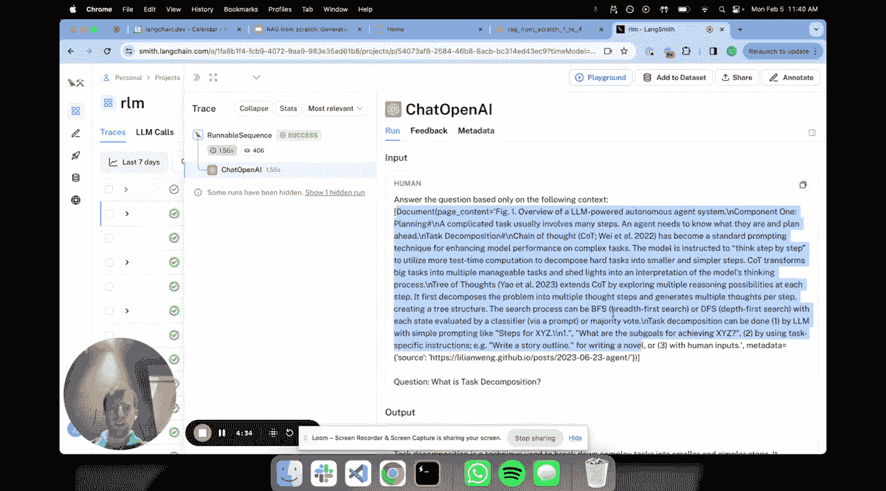
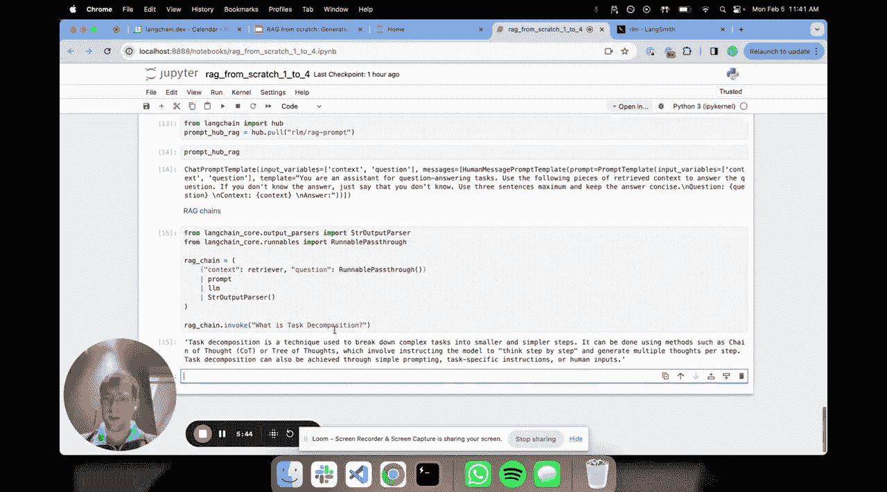
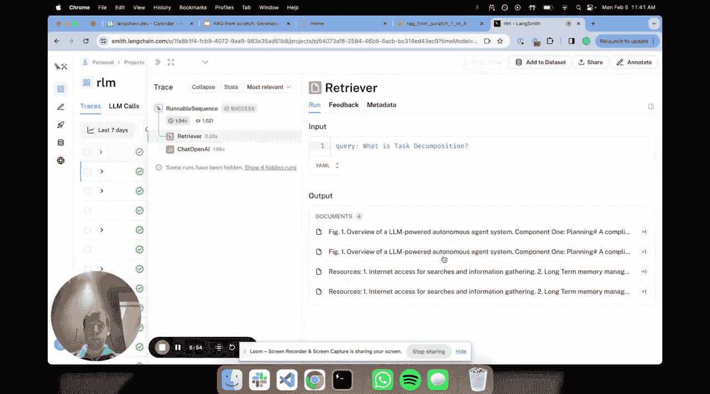
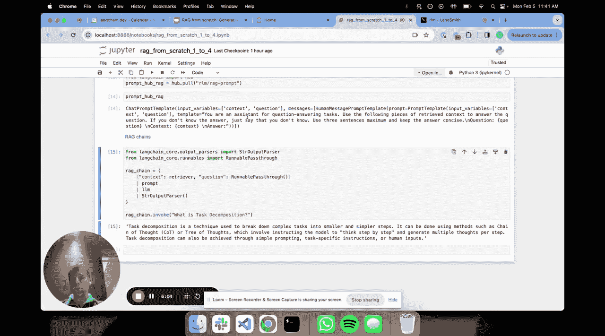
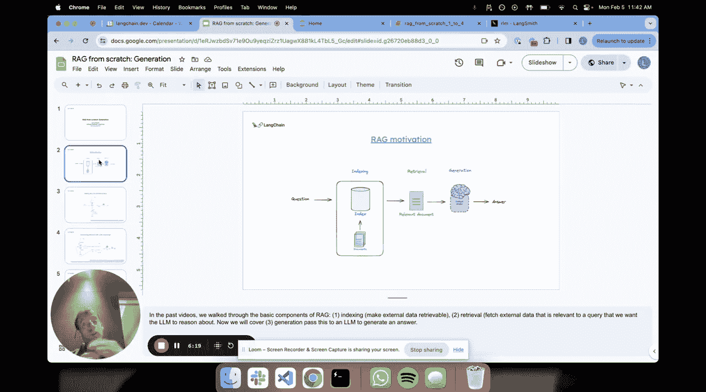

# LangChain【中英⚡使用 LangChain 从零开始构建 RAG 系统｜RAG From Scratch】 p04 P4 From Scratch： Part 4 (Generation) -BV1FgfMYLEve_p4-

。Hey， this is Lance from Langshang and this is the fourth short video in our rag from Sc series that's going to be focused on generation。

Now in the past few videos， we walked through the general flow for kind of basic rag。

Starting with indexing， fall by retrieval。Then， generation。

Of an answer based upon the documents that we retrieved that are relevant to our question。

 this is kind of the very basic flow。Now。An important consideration in generation is really what's happening。

I we're taking the documents who retrieve and we're stuffing them into the LLM context window。

So if we kind of walk back through the process， we take documents。

 we split them for convenience or embedding。We then embed each split。

And we store that in a vector store as this kind of easily searchable numerical representation or vector。

And we take a question， embed it。To produce a similar kind of numerical representation。

 we can then search， for example， using something like K andN in this kind of high dimensional space for documents that are similar to our question based on their proximity or location in this space。

 in this case， you can see 3D is a toy kind of toy example。

Now we've recovered relevant splits to our question。

 we pack those into the context window and we produce our answer。

Now this introduces the notion of a prompt so the prompt is kind of you can do we have a placeholder that has。

 for example， you know in our case， keys， so those keys can be like context and question so they basically are like buckets that we're going to take those retrieved documents and slot them in。

 we're going to take our question and also slotted in。And if you kind of walk through this flow。

 you can kind of see that we can build like a dictionary from our retrieve documents and from our question。

And then we can basically populate our prompt template with the valuess from the dict。

And then becomes a prompt value， which can be passed to LLM。

 like a chat model resulting in chat messages， which we then parse into a string and get our answer。

 so that's like the basic workflow that we're going to see。

And let's just walk through that and code very quickly to kind of give you like a hands on intuition。

So we had our notebook we walked through previously， install a few packages。

 I'm setting a few likesmith environment variables。

 we'll see it's nice for kind of observing and debugging our traces。Previously。

 we did this quick start， we're going to skip that over。U。

And what I will do is I'm going to build our retriever， so again。

 I'm going to take documents and load them。And then I'm going to split them here。

 we've kind of done this previously， so I'll go through this kind of quickly and then we're going to embed them and store them in our index。

 So now we have this retriever object here。Now I'm going to jumped down here。

 now here's where it's kind of fun。 This is the generation did。

And you can see here I'm defining something new， this is a prompt template。

And my prompt template is something really simple。 It's just going to say answer the following question based on this context。

 It's going to have this context variable and a question。 So now I'm building my prompt。 So great。

 now I have this prompt。 Let's define an LLM。 I'll choose 3，5。

Now this introduce the notion of a chain。So in L chain。

 we have an expression language called LCEL La chain expression language。

 which lets you really easily compose things like prompts， LMs， parsers。

 retrieveeverrs and other things。But the very simple kind of you know example here is just let's just take our prompt which we defined right here and connect it to an LLm which you defined right here into this chain So there's our chain now all we're doing is we're invoking that chain so every la chain expression language chain has a few common methods like invoke batstream。

In this case， we just invoke it with a diic。So context in question that maps to the expected keys here。

In our template。And so if we run invo， what we see is it's just going to execute that chain and we get our answer。

Now， if we zoom over to Langsmith， we should see that it's been populated， so yeah。

 we see a very simple runnable sequence。

Here was our document。And here's our output， and here is our prompt answer the following question base in the context。

 Heres the document we passed in， here is the question， and then we get our answer。

So that's pretty nice。Now there's a lot of other options for rag prompts。

 I'll pull one in from our prompt tub。 This one's like kind of a popular prompt。

 So just like has a little bit more detail。 But you know。

 it's the main the main intuition is the same。 You're passing in documents you're asking the alum to reason about the documents。

 given a question， produce an answer。And now here I'm going to find a rag chain。

 which will automatically do the retrieval for us。 And all I have to do is specify。

 here's my retriever， which you defined before。Here is our question which we invoke with。

The question gets passed through to the key question in our diic。

And it automatically will trigger the retriever， which will return documents which get passed into her context。

 So it's exactly what we did up here， except before we did this manually。And now。

This is all kind of automated for us， we pass that dick。

 which is auto populated into our prompt LM Al to parser， now to invoke it。

And that should all just run and great， we get an answer and we can look at the trace。

And we can see everything that happened so we can see our retriever was run。

These documents were retrieved。They get passed into our all M。And we get our final answer。

So this kind of the end of our overview where we talked about。

 I'll go back to the slides here quickly， we talked about indexing， retrieval now generation。

And follow up， short videos will kind of dig into some of the more complex or detailed themes that address some limitations that can arise in this very simple pipeline。

Thanks。😊。