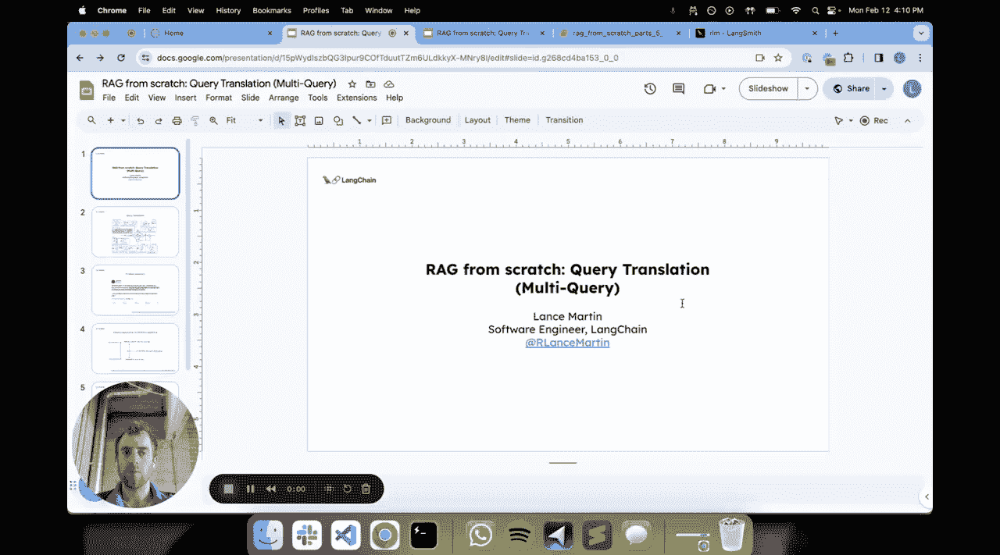
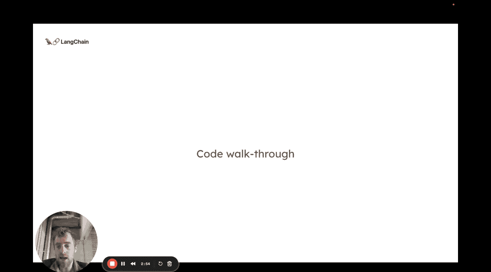
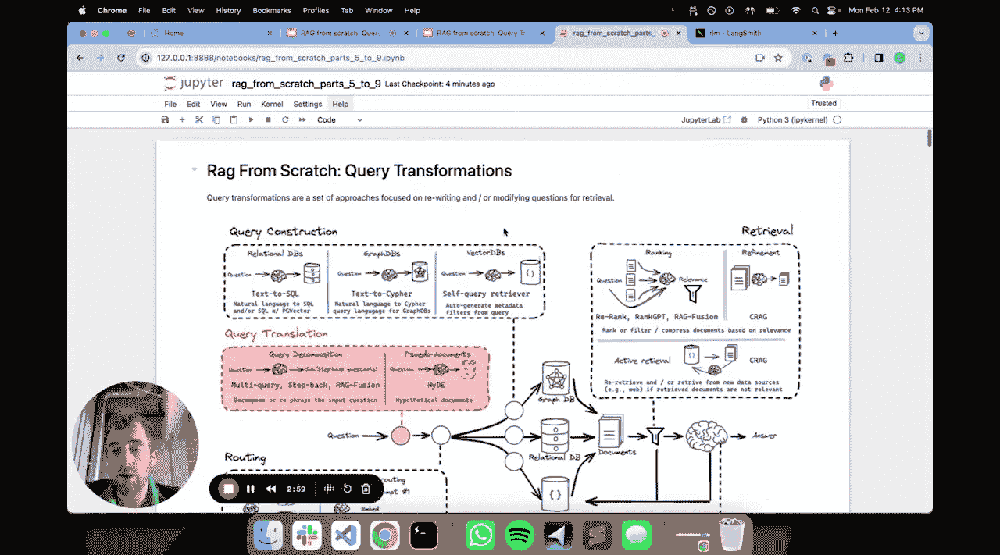
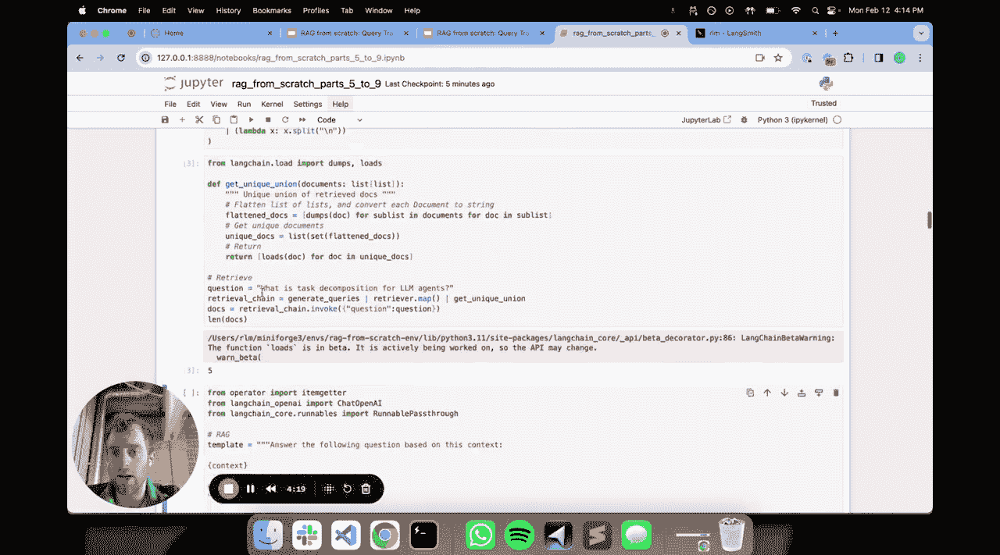
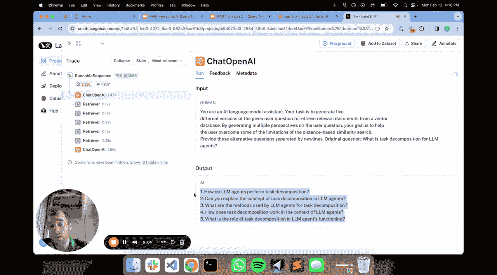

# LangChain【中英⚡使用 LangChain 从零开始构建 RAG 系统｜RAG From Scratch】 p05 P5 from scratch： Part 5 (Query Translation -- Multi Query) -BV1FgfMYLEve_p5-

It nice from learning chain。Over the next few videos。

 we're going to be talking about query translation and in this first video we're going to cover the topic of multi queryry。

So queer translation sits kind of at the first stage。Of an advanced rag pipeline。

And the goal of career translation is really to take an input user question。

And to translate in some way in order to improve retrieval。

So the problem statement is pretty intuitive。User queries can be ambiguous。

And if the query is poorly written because we're typically doing some kind of semantic similarity search between the query and our documents。

If the queer is poorly written or illd， we won't retrieve the proper documents from our index。

So there's a few approaches to attack this problem。

And you can kind of grve them in a few different ways。

 so here's one way I like to think about it a few approaches has involve query rewriting so taking a query and reframing it like writing it from a different perspective and that's what we're going to talk about a little bit here in depth using approaches like multi queryry or RA fu which we'll talk about in the next video。

You can also do things like take a question and break it down to make it less abstract。

 like into sub questions and there's a bunch of interesting papers focused on that。

 like least to most from Google。You can also take the opposite approach to take a question to make it more abstract and there's actually an approach we're going to talk about later in a future video called stepback prompting that focuses on like kind of higher level question from the input。

So the intuition， though， for this multiqueer approach is we're taking a question and we're going to break it down into a few differently worded questions from different perspectives。

And the intuition here is simply that。It is possible that the way a question is initially worded。

Once embedded。It is not well aligned or in close proximity in this highdimenal embedding space to a document that we want to retrieve and that's actually related so the thinking is that by kind of rewriting in a few different ways。

 you actually increase the likelihood of actually retrieving the document that you really want to because of nuances in the way that documents and questions are embedded this kind of more shotgun approach of taking a question fanning it out into a few different perspectives and may improve and increase the reliability of retrieval that's like the intuition really and of course we can combine this with retrieval so we can take our kind of fanned out questions do retrieval on each one and combine them in some way and perform ragg so that's kind of the overview and now let's let's go over to our code So this is a notebook and we're going to share all this。

嗯。We're just installing a few packages， we're setting our Lsmith API keys which we'll see why that's quite useful here shortly。

 there's our diagram now first I'm going to index this blog post on agents I'm going to split it well I'm going to load it I'm going to split it and then I'm going to index it in Chromema locally so this is a vector story we've done this previously so I have my index defined。

So here's where I'm defining my prompt。For multi query， which is ur era assistantent。

 your task is to basically reframe this question into a few different sub questionss。

So there's our prompt right here， we'll pass that to an LLM。

 parse it into a string and then split the string by new lines and so we'll get a list of questions out of this chain。

 that's really what we're doing here。Now all we're doing is here's a sample input question。

 there's our generate queries change we defined， we're going to take that list and then simply apply each question to a retriever。

So we'll do retrieval per question and this little function here is just going to take the unique union documents across all those retrievals so let's run this and see what happens so we're going to run this。

And we're going to get some set of questions or of documents back。

So let's go to Laangssmith now we can actually see what happened under the hood。

 so here's the key point。We ran our initial chain to generate a set of reframed questions from our input and here is that prompt and here is that set of questions that we generated Now what happened is for every one of those questions we did an independent retrieval that's what we're showing here so that's kind of the first step which is great。

Now I can go back to that notebook and we can show this working end to end。

 so now we're going to take that retrieval chain， we'll pass it into a context of our final rag prompt。

 we'll also pass through the question， we'll pass that to our rag prompt here， pass it to an LM。

 and then par the output and then let's hack let's kind of see how that works。So again， that's okay。

 there it is。So let's actually go into Langsif and see what happened under the hood so this was our final change。

 so this is great。We took her input question， we broke it down to these like five rephrasse questions for every one of those we did a retrieval。

 that's all great。We then took the unique union of documents and you can see in our final LLM prompt answer the contact following question based on the context。

 this is the final set of unique documents that we retrieved from all of our sub questionsions。

Here's our initial question there's our answer so that kind of shows you I can set this up really easily how you can use Langsmith to kind of investigate what's going on and in particular use Langsmith to investigate those intermediate questions that you generate in that like kind of question generation phase and in a future talks we're going to go through some of these other methods that we kind of introduce at the start of this one thank you。

