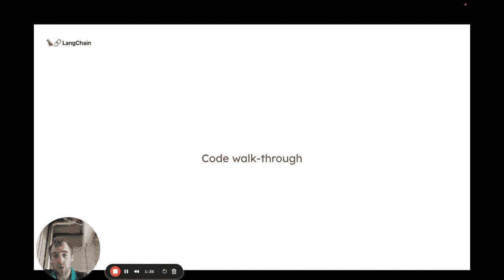
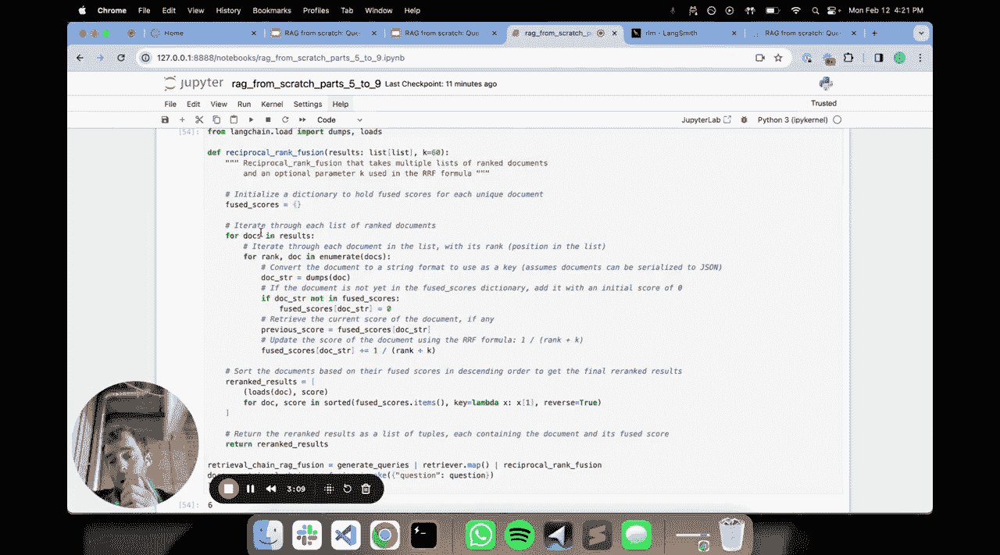
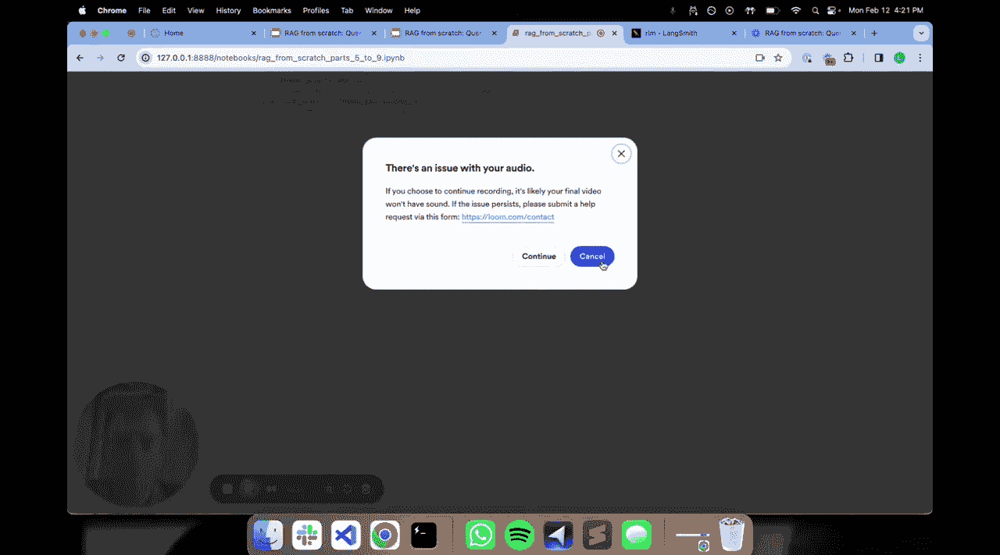
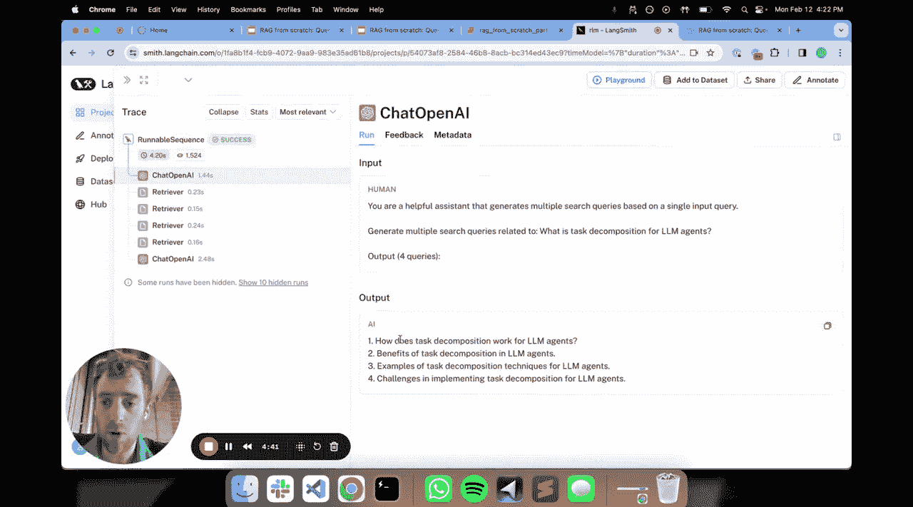

# LangChain【中英⚡使用 LangChain 从零开始构建 RAG 系统｜RAG From Scratch】 p06 P6 from scratch： Part 6 (Query Translation -- Fusion) -BV1FgfMYLEve_p6-

last L chain， this is a second video of our deep Dove on query translation in our Ragham Sc series focused on a method called ragg fusion。

So as we kind of show before，queer translation you can think of as at the first stage in an advanced RAG pipeline。

 we're taking an input user question and we're translating in some way in order to improve retrieval。

Now。We showed this general mapping of approaches previously。So again。

 you have kind of like rewriting so you can take a question like kind of break it down into differently worded or different different perspectives of the same question so that's kind of rewriting there's sub questions where you take a question。

 break it down into smaller problems， solve each one independently and then there's step backward take a question and kind of go more abstract where you kind of ask a higher level question as a precondition to answer the user question so those are the approaches and we're going to dig into one of the particular approaches for rewriting called rat fusion。

Now this is really similar to what we just saw with multi queryry。

 the difference being we actually apply a kind of a clever rank ranking step of our retrieved documents。

 which you call reciprocal rank fusion， let's really the only difference the input stage of taking a question breaking it out into a few kind of differently worded questions retrieval on each one is all the same and we're going to see that in the code here shortly。

 so let's just hop over there and then look at this。

So again， heres a notebook that we introduced previously。Here's the packages we've installed。

 we've set a few API keys for a Lsmith， which we'll see why is's quite useful。

And you can kind of go down here to our rack user section。

And the first thing you'll note is what our prompt is。

 so it looks really similar to the prompt we just saw with multi queryry and simply your helpful assistant that generates multiple search queries based upon a user input and here's the question output for queries So let's define our prompt。

And here is our queer generation chain again this looks a lot like we just saw， we take our prompt。

 plum that into an LLM， and then basically parsse by new lines and that'll basically split out these questions into a list。

 that's all it's going to happen here， so that's cool。Now here's where the novelty comes in。

Each time we do retrieval。From one of those questions。

 we're going to get back a list of documents from our retriever。And so we do it over that。

 we generate four questions here based on our prompt。

 we do it over four questions with like a list of lists， basically。

Now reciprocal rank fusion is really well suited for this exact problem。

 we want to take this list to list and build a single consolidated list and really all that's going on is it's looking at the documents in each list and kind of aggregating them into a final output ranking and that's really an intuition around what's happening here。

。So， let's go ahead and。So what's？So let's go ahead and look at that in some detail。

So we can see we run。Retrieval。That's great now let's go over to Langsmith and have a look at what's going on here。

So we can see。That here is our prompt to your helpful assistant that generates multiple search queries based on single input。

 and here is our search queries， and then here are our four retrievals。So that's really good。

 so we know that all is working。嗯。And then those retrievals simply went into this rank function。

And are correspondingly ranked to a final list of six unique ranked documents。

 that's really all we did。So let's actually put that all together into a full rag chain that's going to run retrieval。

Return that final list of ranked documents。And pass it to our context。Pass through our question。

 send that to a ragg prompt， pass it to an LM， parse it to an output。

 and let's run all that together and see that working。Oh。Cool， so there's our final answer。

Now let's have a look in Langsmith， we can see here was our four questions， here's our retrievals。

 and then our final rag prompt plumbed through the final list of ranked six questions。

 which we can see laid out here and our final answer。

So this can be really convenient particularly if we're operating across like maybe different vector stores or we want to do like retrieval across a large number of kind of differently word questions this reciprocal rank fusion step is really nice for example。

 if we wanted to only take the top three documents or something it can be really nice to build that consolidated ranking across all these independent retrievals then pass that to the limb for the final generation so that's really the intuition about what's happening here nice。

