# LangChain【中英⚡使用 LangChain 从零开始构建 RAG 系统｜RAG From Scratch】 p07 P7 from scratch： Part 7 (Query Translation -- Decomposition) -BV1FgfMYLEve_p7-

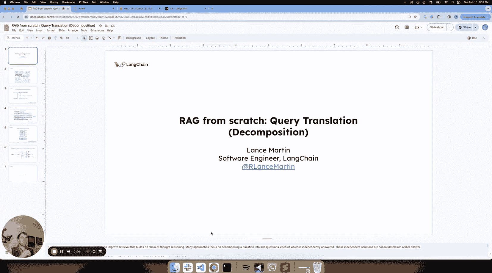

Hi this is Lns from Langchain， this is our third video focused on query translation in the Rag from Sc series。

 and we're going to be talking about decomposition。

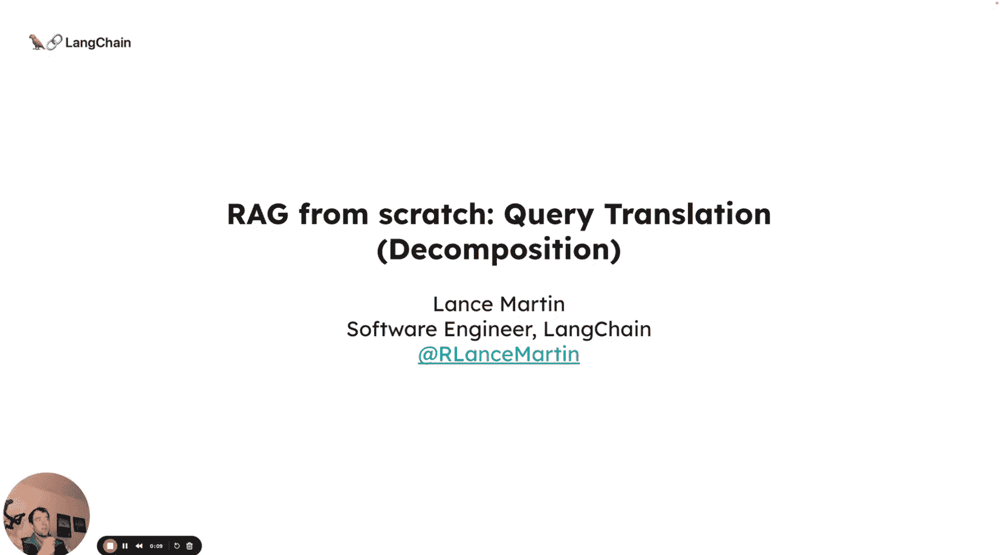

Soqueer translation in general is a set of approaches that sits kind of towards the front of this overall rag pipeline。

 and the objective is to modify or rewrite or otherwise decompose an input question from a user in order to improve retrieval。

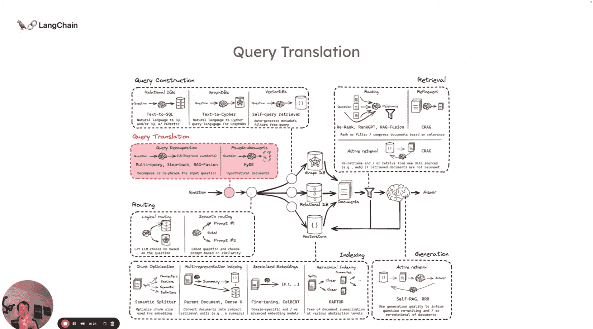

So we can't talk through some of these approaches previously。

 in particular various ways to do query writing like ragg fusion and multi queryry。

There's a separate set of techniques that become pretty popular and are really interesting for certain problems。

 which you might call like breaking down or decomposing an input question into set of sub questions。

嗯。

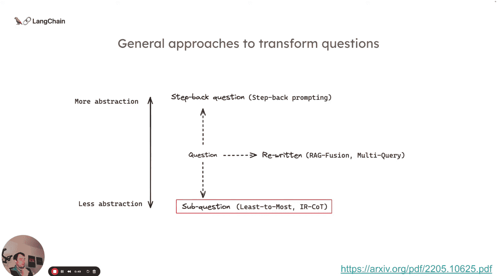

So some of the papers here that are pretty cool are， for example， this work from Google。

And the objective really is first to take an input question and decompose it into a set of sub problems。

 so this particular example from the paper was the problem of last letter concatenation。

And so it took the input question。Of three words， think machine learning and broke it down into three sub problems。

 think think machine， think machine learning as the third subproblem。

 And then you can see in this bottom panel it solves each one individually。 So it shows， for example。

 in green solving the problem think machine where you cancatenate the last letter of K with the last letter of machine or less letter of think K lesser of machine E you concatenate those to K E。

 and then for the overall problem taking that solution。And then。

And basically building on it to get the overall solution of KEG so that's kind of one concept of decomposing to sub problems。

 solving them sequentially。

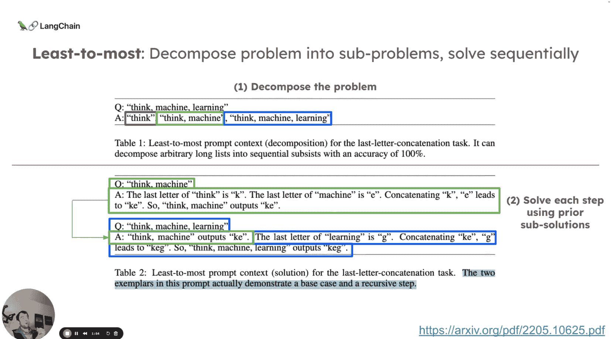

Now， a related work called ICOT or Interlea retrieval combines retrieval with chain of thought reasoning。

And so you can kind of put these together into one approach which you can think of as kind of dynamically retrieval to solve a set of sub problems。

 kind of that retrieval kind of interleaving with chain of thought as noted in the second paper and a set of decomposed question based on your initial question from the first work from Google so really the idea here is we're taking one sub question we're answering it。

 we're taking that answer and using it to help answer the second sub question and so forth。

So let's actually just walk through this in code to show how those might work。

So this is the notebookple we've been working with from some of the other videos。

 you can see we already have a retriever defined up here at the top。And what we're going to do is。

We're first going to find a prompt。That's basically going to say given an input question。

 let's break it down to a set of sub problems or sub questions which can be solved individually。

So we can do that and this blog post is focused on agents。

 so let's ask a question about what are the main components of an LLM powered autonomous aging system？

So let's run this。And see。What the decomposed questions are so you can see the decomposed questions are what does L and technology and how it work。

 what does different components， and then how the chos interact。

 So it's kind of a sane way to kind of break down this problem into a few sub problems which you might attack individually。

Now here's where we define a prompt that very simply is going to take our question。

 we'll take any prior questions we've answered， and we'll take our retrieval and basically just combine them。

😡，And we can define this very simple chain。Actually。

 let's go back and make sure retriever is defined up at the top。So now we are building our retriever。

Good， we have that now。So we can go back down here and let's run this。So， now。We are running。

And what's happening is we're trying to solve each of these questions individually。

Using retrieval and using any prior question answers。So okay， very good， looks like that's been done。

 and we can see here's our answer。

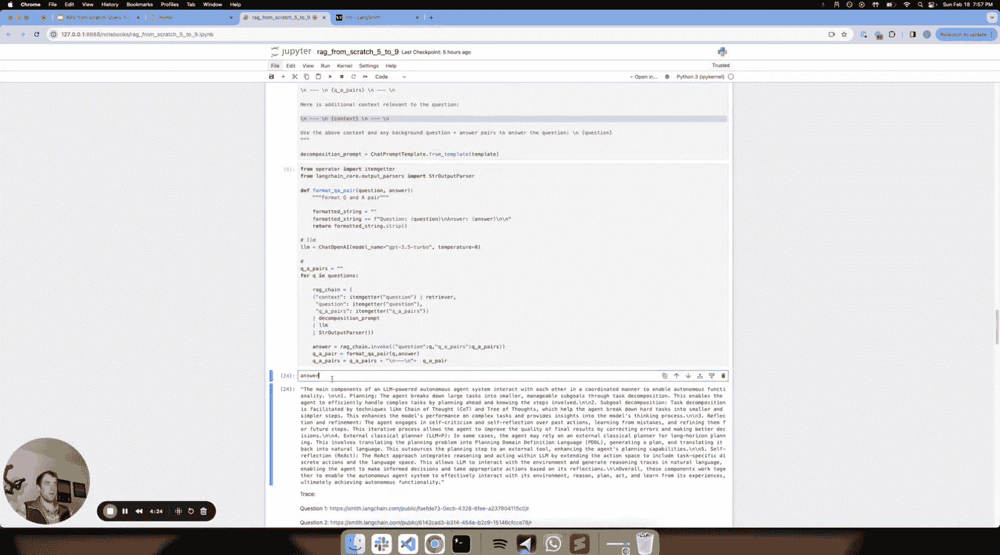

Now let's go over to Langith and actually see what happened under the hood so here's what's kind of interesting and helpful to see for the first question。

 so here's our first one it looks like it just does retrieval。Which is we expect。

 and then use that to answer this initial question。Now。

 for the second question should be a little bit more interesting because if you look at our prompt。

 heres our question。 Now， here is our background available question answer pair。

 So this was the answer question answer pair from the first question。

 which we add to our prompt and then here's the retrieval for this particular question。

 So we're kind of building up the solution because we're pending the question answer pair from question1。

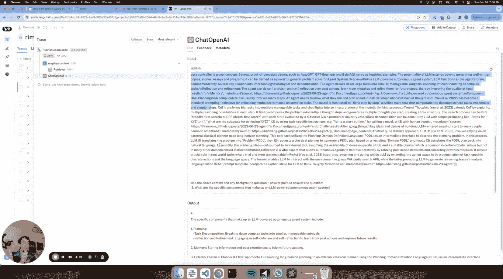

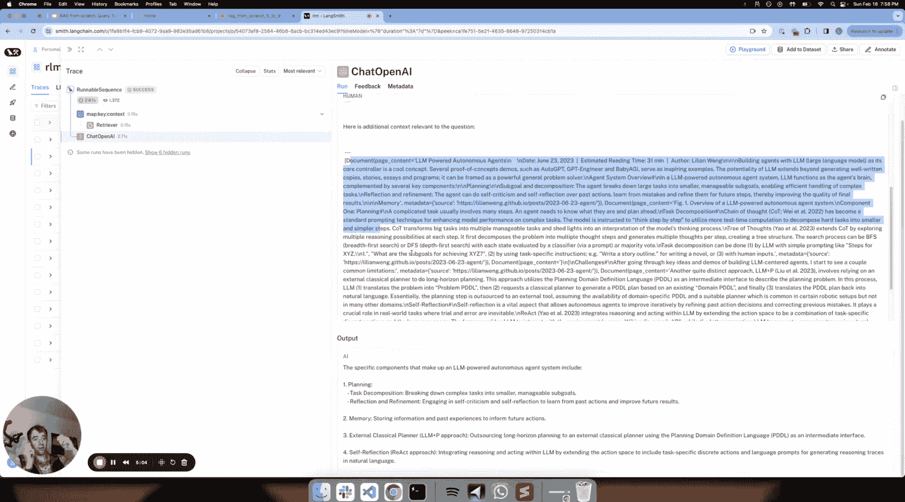

And then likewise， with question three， it should combine all of that so we can look at here。

 here's our question。Here's question one， here's question two， great。

 now here's additional retrieval related to this particular question and we get our final answer。

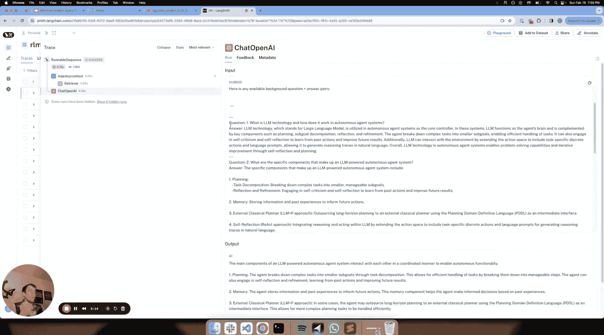

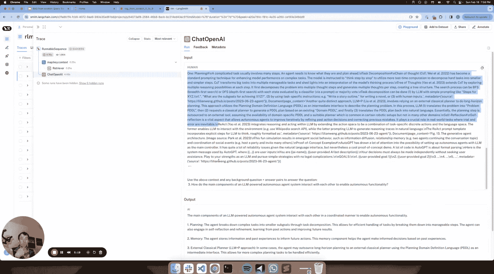

So that's like a really nice way you can kind of build up solutions using this kind of interleaved retrieval and concateing prior to question answer pairs。

I do want to mention very briefly that we can also take a different approach or we can just answer these all individually and then just concatenate all those answers to produce a final answer。

 and I'll show that really quickly here。 It's like a little bit less interesting maybe because you're not using answers from each question to inform the next one。

 you're just answering them all in parallel。 This might be better for cases where it's not really like a sub question decomposition。

 but maybe it's like a set of。Se of several independent questions whose answers don't depend on each other。

That might be relevant for some problems。U， and we can go ahead and run okay， so this ran as well。

 we can look at our trace。

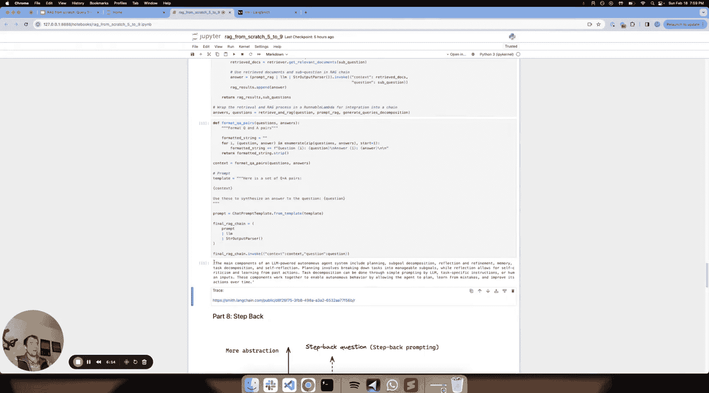

And in this case， yeah， we can see that this actually just kind of concatenates all of our QA pairs。

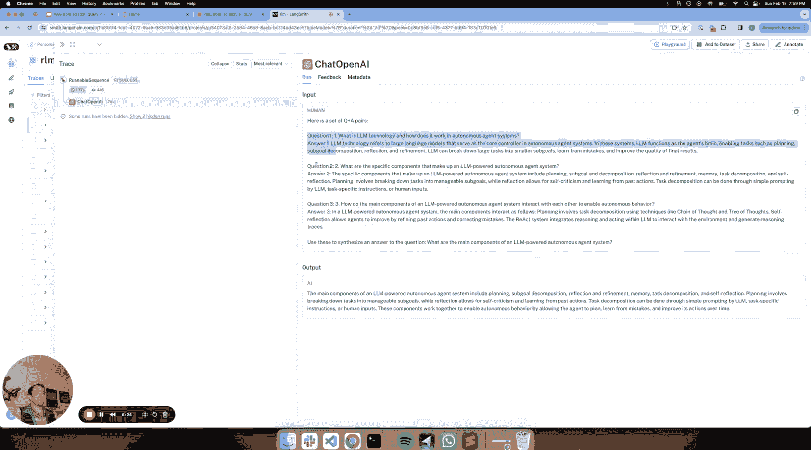

To produce the final answer。So this gives you a sense for how you can use query decomposition employing ideas from two different papers that are pretty cool。

 thanks。

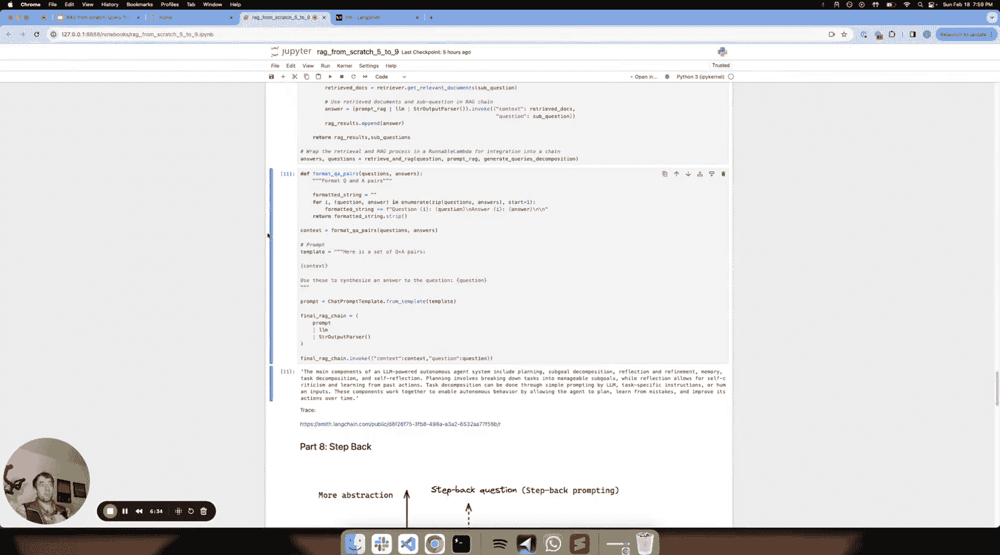