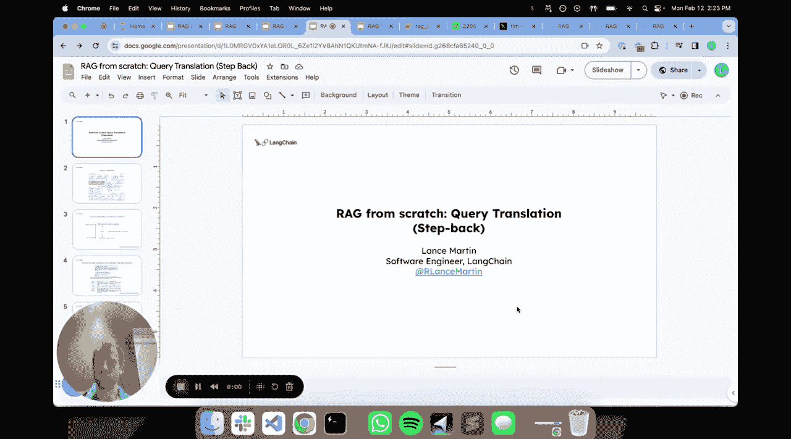
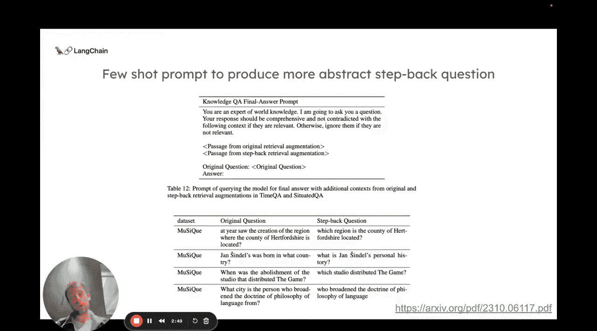
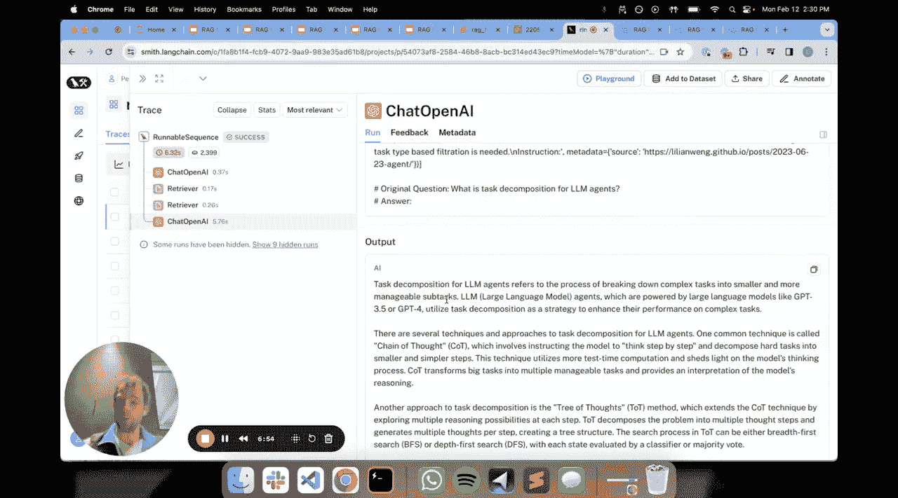

# LangChain【中英⚡使用 LangChain 从零开始构建 RAG 系统｜RAG From Scratch】 p08 P8 from scratch： Part 8 (Query Translation -- Step Back) -BV1FgfMYLEve_p8-

是。Is the lunchch from L chain？This is the fourth video in our deep dive on queer translation in the Ragged from Scrach series。

 and we're going to be focused on step back prompting。So queer translation。

 as we said in some of the prior videos， kind of sits at the kind of first stage of kind of a rag pipeline or flow。

And the main aim is to take an input question and to translate it or modify in such a way that it improves retrieval。

Now we talk through a few different ways to approach this problem。

So one general approach involves rewriting a question and we talked about two ways to do that。

 ragG fusion， multi queryery， and again， this is really about taking a question and modifying it to capture a few different perspectives。

 which may improve the referral process。Now another approach is to take a question and kind of make it less abstract。

 like break it down into sub questionsions and then solve each of those independently。

 so that's what we saw with like least the most prompting and a bunch of other variants kind of in that vein of subproblem solving and then cons solvinging those solutions into a final answer。

Now a different approach presented by again， Google as well is step back prompting。

 so step back prompting tend the opposite approach where it tries to ask a more abstract question。

So the paper talks a lot about。mUsing few shot prompting。

To produce what they call these step back or more abstract questions。

 And the way it does it is it provides a number of examples of step back questions given your original questions。

 So like this is like this is， for example， they're like for prompt template your expert or knowledge。

 I ask you a question your response should be comprehensive not contradicted with the following And this is kind of where you provide your like original and then step back。

 So here's like some example questions。 So like like。

At your saw the creation of the region where the country is located which region of the country is the county of Herkshire related Janelles born in what country what is Janenelle's personal history so that's going be a more intuitive example so it's like you ask a very specific question about like the country someone's born the more abstract question is like just give me the general history of this individual without worrying about that particular more specific question。

So let's actually just walk through how this can be done in practice so again here's kind of like a diagram of the various approaches from less abstraction to more abstraction now here is where we're formulating our prompt using a few of the few shot examples from the paper。

So again like input yeah something about like the police for formlful arrests and what members of the police do so like it basically gives the model a few examples we basically formulate this into a prompt that's really all that's going on here again we repeat this overall prompt which we saw from the paper your next world knowledge your test is to step back and paraphrase a question generally more a generic step back question which is easier to answer here's some examples so it's like a very intuitive prompt so okay let's start with the question what is task composition for LLM agents。

And we're going to say generate stepback question okay so this is pretty intuitive right what is a process of task composition so like not worrying as much about agents but what is that process of task composition in general and then hopefully that can be independently retrieved we can independently retrieved documents related to the step back question and in addition retrievetd documents related to the actual question and combine those to produce kind of final answer so that's really all it's going on and here's a response template where we're plumbing in the step back context and our question context and so we're going to do here is we're going to take our input question and perform retrieval on that we're also going to generate our step back question and perform retrieval on that we're going to plum those into the prompt as here's our here's our basically our prompt keys。

 normal question step back question and our overall question。Again， we formulate those as at。

 we plum those into our response prompt， and then we go ahead and attempt to answer our overall question。

 so we're going to run that。That's running。And okay。

 we have our answer now I want to hop over to Langsmith。

And attempt to show you kind of what that looked like under the hood。So let's see。

 let's like go into each of these steps。 So here was our prompt right， your next world knowledge。

 your test to step back and verify as a question。So here was our few shot prompts and this was our step back question。

 so what is the process of task composition。Good from the input， what is s composition for LM agents。

 we perform retrieval on both。 What is prot composition。And what a as an for LLM agents。

 we perform both retrievals， we then populate our prompt。

With both original question answer and then here's the context retrieve from both the question and the step back question here's our final answer so again this is kind of a nice technique probably depends on a lot of the types of like the type of domain you want to perform retrieval on。

 but in some domains where for example， there's a lot of kind of conceptual knowledge that underpins questions you expect users to ask this step back approach could be really convenient to automatically formulate higher level question to for example。

 try to improve retrieval， I can imagine if you're working with kind of textbooks or like technical documentation where you have independent chapters focused on more highleve kind of like concepts and then other chapters on like more detailed like implementations this kind of like step back approach and independent retrieval could be really helpful。

Thanks。