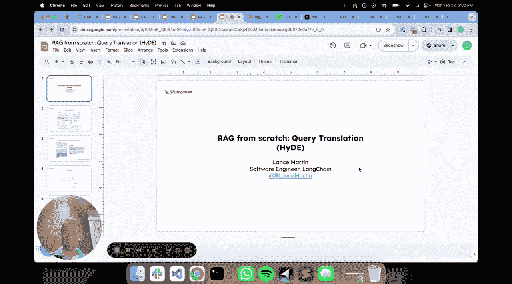
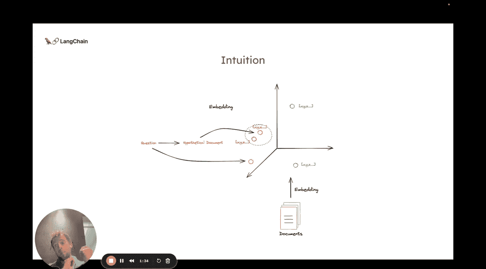
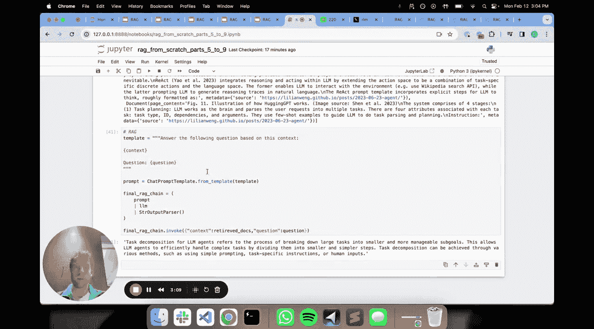
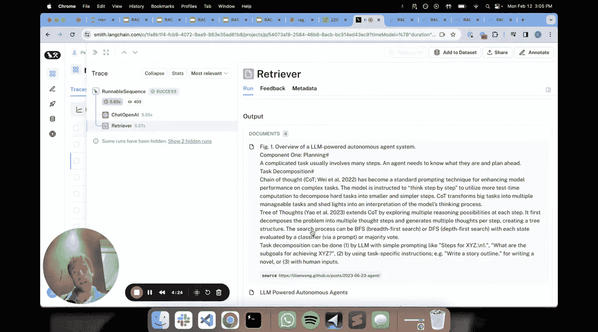
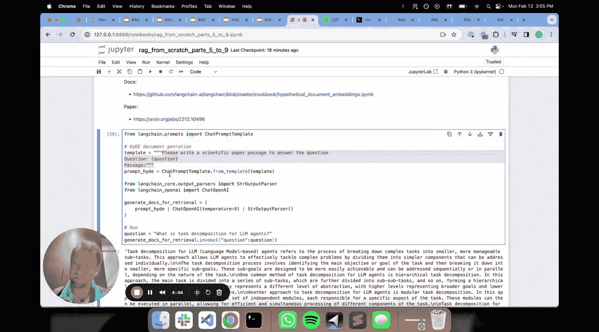

# LangChain【中英⚡使用 LangChain 从零开始构建 RAG 系统｜RAG From Scratch】 p09 P9 from scratch： Part 9 (Query Translation -- HyDE) -BV1FgfMYLEve_p9-

This is Lance from Lang Ching， this is the fifth video focused on queer translation in our right from Sc series。

 and're going to be talking about a technique called Hde。So again。

 queer translation sits kind of at the front of the overall rag flow。

 and the objective is to take an input question and translate it in some way that improves retrieval。

Now H is an interesting approach that takes advantage of a very simple idea。

The basic rag flow takes a question and embeds it， takes a document and embeds it。

 and looks for similarity between an embedded document and embedded question。

But questions and documents are very different text objects。

 so documents can be like very large chunks taken from dense publications or other sources。

 whereas questions are short， kind of terse， potentially ill worded from users and the intuition behind hide is take questions and map them into document space using a hypothetical document or by generating a hypothetical document。

That's the basic intuition。And the idea kind of shown here visually is that in principle for certain cases。

 a hypothetical document is closer to a desired document you actually want to retrieve in this know high dimensional embedding space than the sparse raw input question itself。

 so again it's just kind of means of translating raw questions into these hypothetical documents that are then better suited for retrieval。

So let's actually do a code walkthrough to see how this works。

And it's actually pretty easy to implement， which is really nice。

So first we're just starting with a prompt and we're using the same notebook that we've used for prior videos we have a blog post on agents already indexed so what we're going to do is define a prompt to generate a hypothetical documents in this case we'll say write a paper passage to answer a given question so let's just run this and see what happens again we're taking our prompt piping it to open AI chatGT and then using string uppa parser and so here's a hypothetical document section related to our question and this is derived a course Is kind of embedded kind of world knowledge which is a same place to generate hypothetical documents now let's now take that hypothetical document and basically we're going to pipe that into a retriever so this means we're going to fetch documents from our index related to this hypothetical document that's been embedded and you can see we get a few a few retrieved chunks。

Are related to this hypothetical document， that's all we've done。

And then let's take the final step where we take those retrieved documents here， which we defined。😊。

And our question， and we're going to pipe that into this rag prompt。

And then we're going to run our kind of rag chain right here， which you've seen before。

And we get our answer， so that's really it。

We can go to Langsmith and we can actually look at what happened。 So here， for example。

 this was our final。Rrag prompt answer the following question based on this context and here is the retrieve document that we passed in so that part's kind of straightforward we can also look at okay。

 this is our retrieval okay， now this is this is actually what we we generated a hypothetical document here。

嗯。😊，Okay， so this is our hypothetical document。So we've run chatt open AI。

 we generated this passage was our hypothetical document， and then we've run retrieval。Here。

 so this is basically showing hypothetical document generation followed by retrieval so again。

Here was our passage which we passed in and then here's our retrieved documents from ther which are related to the passage content。

 So again， in this particular index case， it's possible that the input question was sufficient to retrieve these documents in fact。

 given prior examples， I know that some of these same documents are indeed retrieve just from the raw question but in other context that may not be the case so folks have reported nice performance using HD for certain domains and the really convenient thing is that you can take this document generation prompt you can tune this arbitrarily for your domain of interest so it's absolutely worth experimenting with' it's a neat approach that can overcome some of the challenges with retrieval thanks very much。

