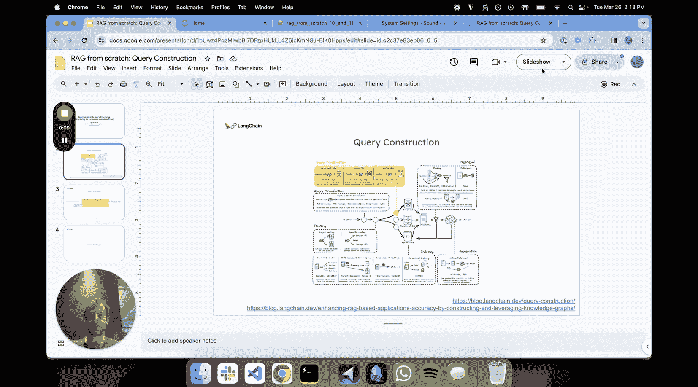
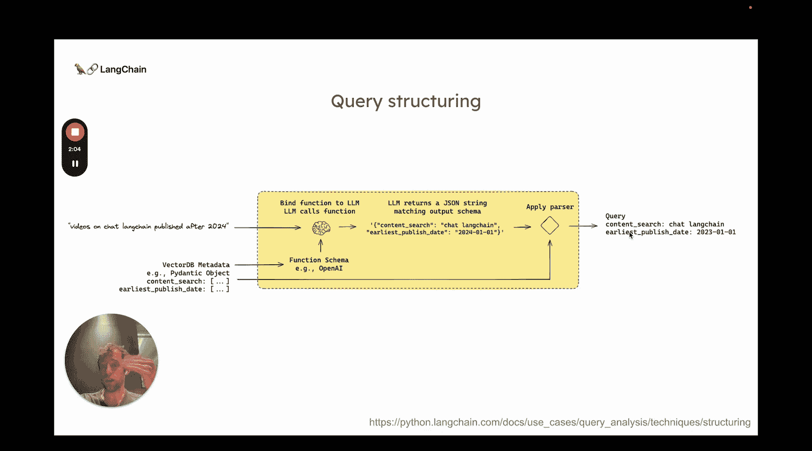
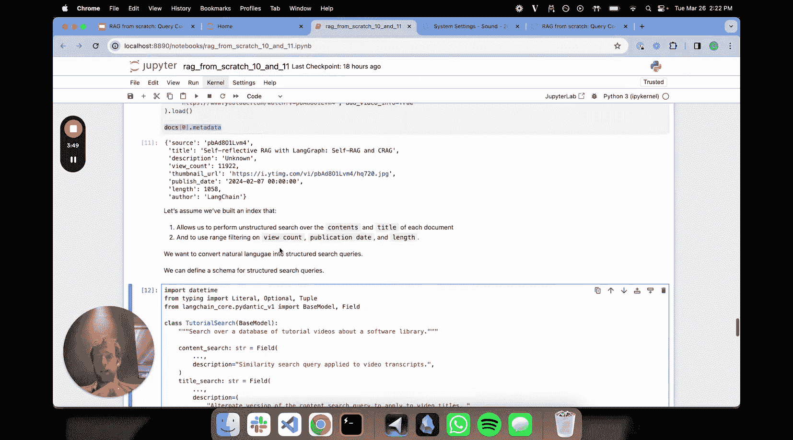
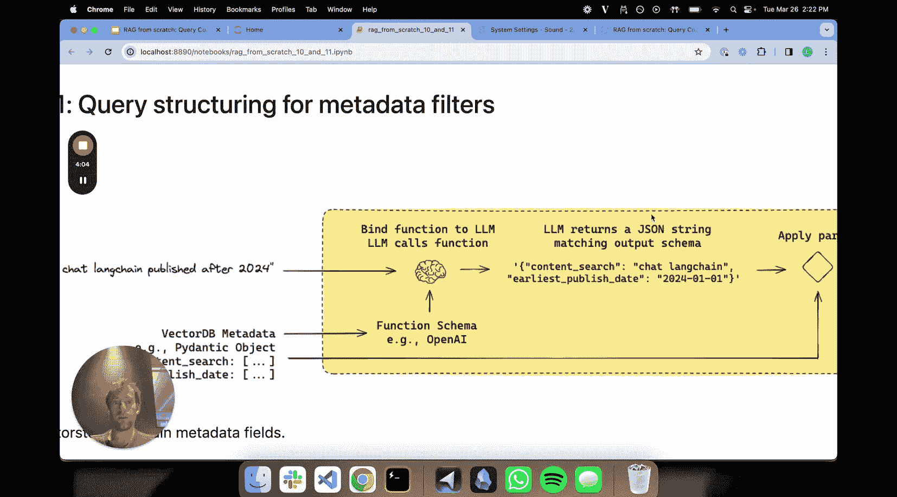
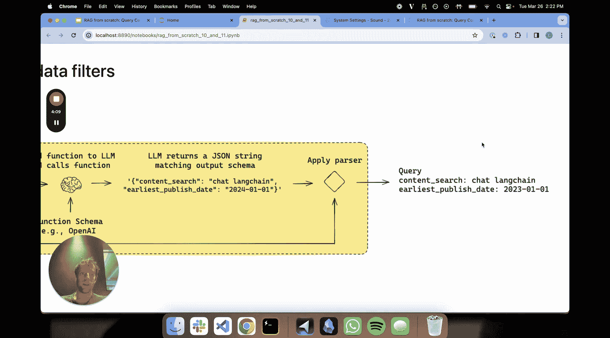
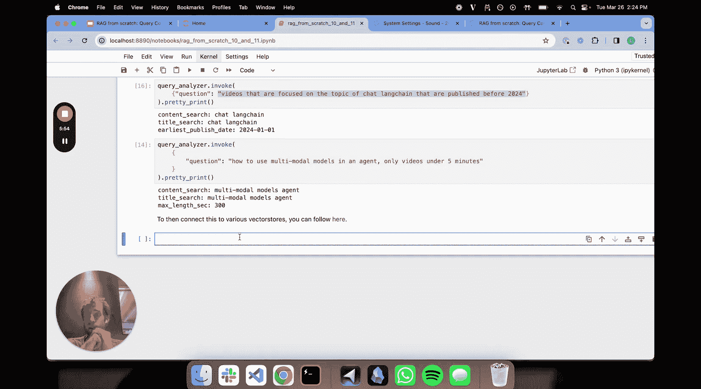

# LangChain【中英⚡使用 LangChain 从零开始构建 RAG 系统｜RAG From Scratch】 p11 P12 from scratch： Part 11 (Query Structuring) -BV1FgfMYLEve_p11-

This is Laancesom Langshne， this is the 11th part of our RA from Scrach video series focused on query construction。

So we've previously talked through queer translation which is the process of taking a question and converting it or translating it into a question that's better optimized for retrieval。

 then we talked about routing， which is the process of taking that question routing it to the right source be it a given vector store。

 GraDB or SQLDB for example， now we're going to talk about the process of queer construction。

 which is basically taking natural language and converting it into particular domain physical language for one of these sources。

 now we're going to talk specifically about the process of going from natural language to metada filters for vector stores。

The problem statement is basically this let's imagine an index of L chain video transcripts you might want to ask a question give me you know find me videos on chat La chain published after 2024 for example。

 the process of query structuring basically converts this natural language question into a structured query that can be applied to the metadata filters on your vector store so most vector sources will have some kind of metadata filters that can do kind of structure querying on top of the chunks that are indexed so for example this type of query will retrieve all chunks that talk about the topic of chat L chain publish after the date 2024 that's kind of the problem statement and to do this we're going to use function calling in this case you can use for example open AI or other providers to do that and what we're going to do is at a high level take the metadata fields that are present in our vector。

storeore and provide them to the model as kind of information and the model then can take those and produce queries that adhere to the schema provided and then we can parse those out to a structured object like a pantic object which again which can then be used in search so that's kind of problem statement unless let's actually walk through code。

😊。

So here's our notebook which we've kind of gone through previously and I'll just show you as an example。

 let's take an example YouTube video and let's look at the metadata that you get with the transcript so you can see you get stuff like description。

 URL， yeah， publish date， link things like that。😊，Now let's say we had an index that had basically that had a number of different metadata fields and filters that allowed us to do range filtering on like view count publication date。

 the video length or unstructured search on contents and title So those are kind of like imagine we had an index that had those kind of filters available to us what we can do is capture that information about the available filters in an object So we're calling that this tutorial search object kind of encapsulates that information about the available searches that we can do and so we basically enumerated here content search and title search are semantic searches that can be done over those fields。

😊，And then these filters then are various types of structure searches we can do on like the length。

 the view count and so forth， and so we can just kind of build that object。

Now we can set this up really easily with a basic of simple prompt that says you know you're an expert convert bring natural language into database queries。

 you have access to the database tutorial videos， given a question。

 return a database query optimized for retrieval so that's kind of it Now here's the key point though when you call this LM with structured output you're binding this pedantic object which contains all the information about our index to the LLM which is exactly what we talked about previously。

 it's really this process right here， you're taking this object you're converting it to a function schemechema for example。

 openaiI， you're binding that to your model， and then you're going to be able to get structured object out versus JSON string from a natural language question which can then be parsed into a pedantic object which you get out so that's really the flow and it's taking advantage of function calling as we said。

So if we go back down。We set up our query analyzer chain right here。

 Now let's try to run that just on a purely semantic input。 So drag from scratch。

 let's run that and you can see this just does like a content search and a title search。

 that's exactly what we would expect。 Now， if we pass a question that includes like a date filter。

 let's just see if that will work。And。There we go， so you kind of still get that semantic search。

 but you also get search over， for example， published date earliest and latest published date kind of as you would expect let's try another one here So video focused on the topic of chat La chain they published before 2024 this is just kind of rewrite of this question and slightly different way using a different date filter and then you can see we can get we get content search title search and then we can get kind of a date search So this is a very general strategy that can be applied kind of broadly to different kinds of querying you want to do it's really the process of going from an unstructured input to a structured query object out following an arbitrary schema that you provide and so as noted really this whole thing we created here。

 this tutorial search is based upon the specifics of our vector store of interest and if you want to learn more about this I linked to some documentation here that talks a lot about different types integrations we have with different vectors。

TProviders to do exactly this。 So it's a very useful trick。

 It allows you to do kind of query say metadata filter filtering on the fly from a natural language question。

 It's a very convenient trick that works with many different vector Dbss。

 So encourage you to play with it， thanks。😊。

