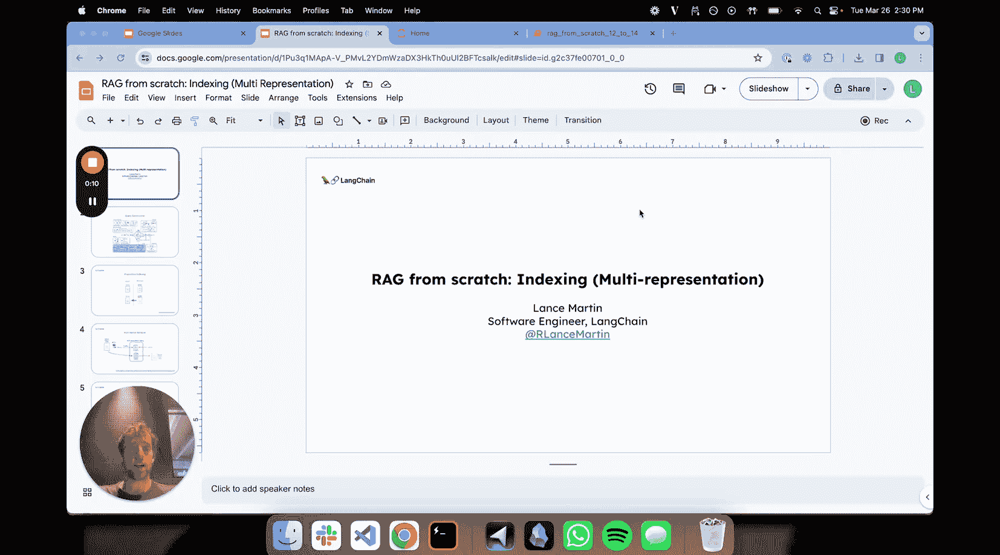
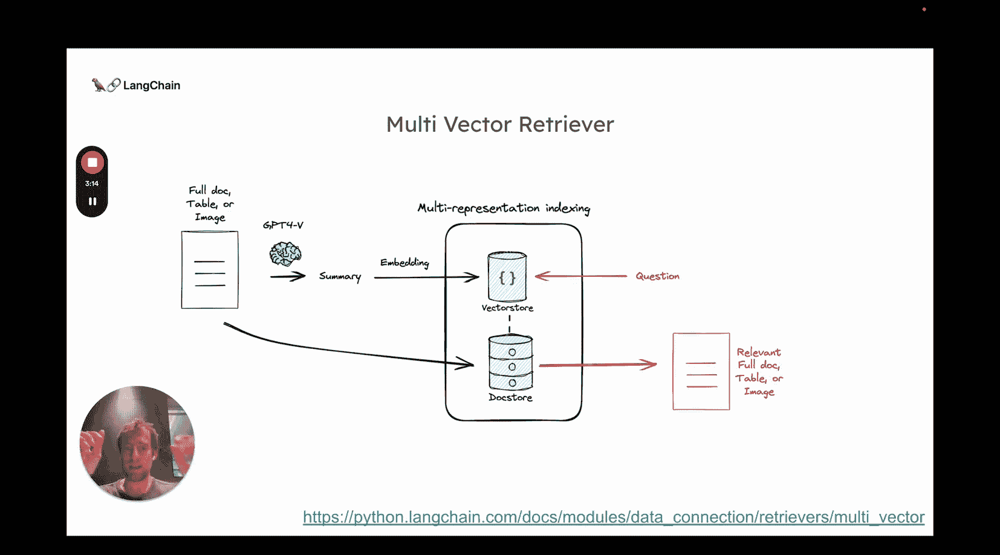
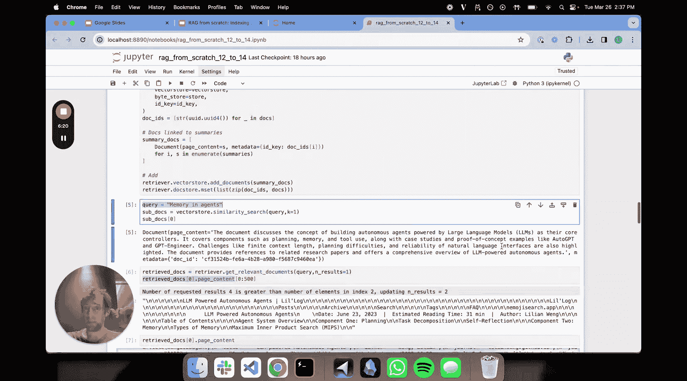

# LangChain【中英⚡使用 LangChain 从零开始构建 RAG 系统｜RAG From Scratch】 p12 P13 from scratch： Part 12 (Multi-Representation Indexing) -BV1FgfMYLEve_p12-

H this is Lenz from Langcha， I'm going to talk about indexing and mu representation indexing in particular for the 12th part of our RA from scratch series here。

So we previously talked about a few different major areas。

 we talk about query translation which takes a question and translates it in some way to optimize for retrieval。

 we talked about routing， which is the process of taking a question。

 routing it to the right data source， be it a vector store。

 Gra DB SQL DB we talk about  queryer construction。

 we dug into basically queer construction for vector stores。

 but of course there's also text SQL text to cipher， So now we're going to talk about indexing a bit。

In particular， we're to talk about indexing techniques for vector stores。

And I want to highlight one particular method today called multi representation indexing。

So the high level idea here is derived a bit from a paper called Pro indexing。

Which kind of makes a simple observation。You can think about decoupling raw documents。

And the unit to use for retrieval。So in the typical case， you take a document。

 you split it up in some way to index it， and then you embed the split directly。

This paper talks about actually taking a document， splitting it in some way。

 but then using an LLM to produce what they call a proposition。

 which you can think of as like kind of a distillation of that split so it's kind of using an LLM to modify that split in some way to distill it or make it like a CRISPR like summary so to speak。

 that's better optimized for retrieval， so that's kind of one highlight one piece of intuition。

So we've actually taken that idea and we've kind of built on them a bit in kind of a really nice way that I think is very well suited actually for long contextt LLMs So the idea is pretty simple。

 you take a document and you you actually distill it or create a proposition like they show in the prior paper I kind of typically think of this as just produce a summary of the document and you embed that summary so that summary is meant to be optimized for retrieval so Mike contain a bunch of keywords from the document or like the big ideas。

Such that when you embed the summary， you embed a question， you do search。

 you basically can find that document based upon this highly optimized summary for retrieval。

 so that's kind of represented here in your vector store， but here's the catch。

You independently store the raw document in a do store。

And when you when you basically retrieve the summary in the vector store。

 you return the full document for the LLM to perform generation。

 And this is a nice trick because at generation time。 Now， with long context LLM。 for example。

 the LLM can handle that entire document。 You don't need to worry about splitting it or anything。

 you just simply use this summary to like to create a really nice representation for fishing out that full dock。

 use that full dock in generation， there might be a lot of reasons you want to do that。

 you want to make sure that LM has the full context。 I should answer the question。

 So that's the big idea that's a nice trick， unless's walk through some code here。

So we have a notebook all set up just like before we've done some P installs set to API keys here for Lsmith kind of here's a diagram now let me show an example let's just load two different blog posts one is about agents。

 one is about you know human data quality and what we're going to do is let's create a summary of each of those so this is kind of the first step of that process where we're going from like the raw documents to summaries let's just have a look and make sure those ran so okay cool so the first doc discusses know building autonomous agents the second doc contains the importance of high- quality human data and training okay so that's pretty nice we have our summaries now we're going to go through process that's pretty simple。

😊，First， we define a vector store that's going to index those summaries。

Then we're going to define what we call like our documents storage you're going to store the full documents Okay so this multive retriever kind of just pulls those two things together。

 we basically add our doc store we add this byte store is basically the full document store。

 the vector store is our vector store and now this ID is what we're going to use to reference between the chunks or the summaries and the full documents that's really it。

So now for every document we'll define a new doc ID and then we're basically going to like take our summary documents and we're going to extract for each of our summaries。

 we're going to get the associated doc ID so there we go。😊，So let's go ahead and do that。

So we have our summary docs， which we add to the vector store， we have our full documents。

 our doc IDs and the full raw documents which are added to our Doc store。

And then let's just do a query of vector like a similarity search on our vector store。

 so memory and agents， and we can see okay， so we can extract， you know。

 from the summaries we can get， for example， the summary that pertains to agents。

 that's a good thing。Now let's go ahead and run a query。

 get relevant than documents on our retrieverier， which basically combines the summaries which we use for retrieval。

Then the doc store， which we use to get the full dock back。 So we're going to apply our query。

We're going to basically run this and here's the key point。

 we've gotten back the entire article and we can actually， if you want to look at the whole thing。

 we can just go ahead and do this。Here we go， so this is the entire article that we get back。

From that search。 So it's pretty nice trick。 again。

 we  queryried with just memory and agents and we can kind of go back to our diagram here。

 We queried for memory and agents。 It searched our summaries。

 It found the summary relatedlay to memory and agents It uses that doc I to reference between the vector store and the dock store。

 It fishes out the right full dock returns us the full document In this case， the full webp page。

 That's really it。 simple idea， nice way to go from basically like nice。

 simple proposition style or summary style indexing to full document retrieval， which is very useful。

 especially with long context LMs。 Thank you。😊。

