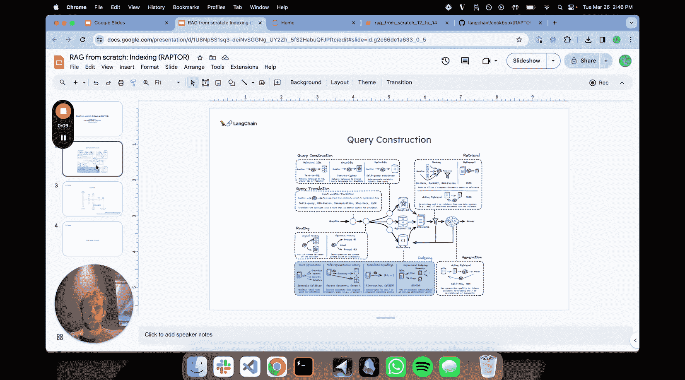
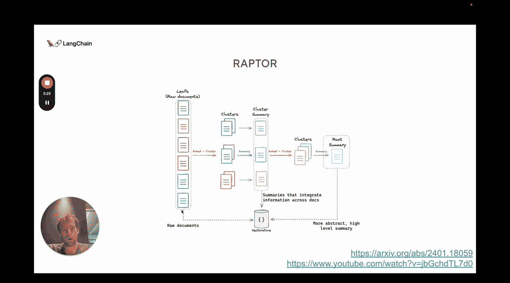
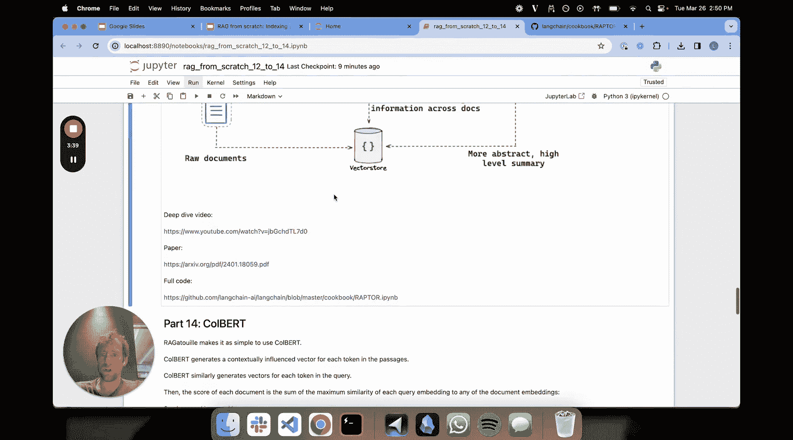
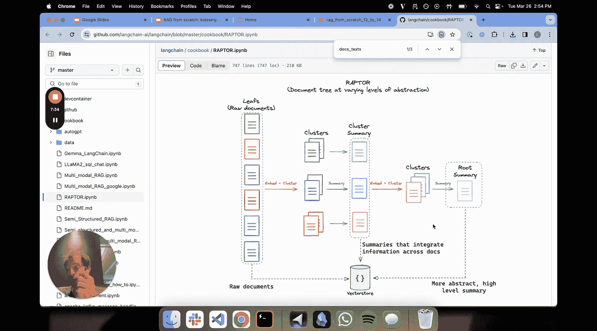

# LangChain【中英⚡使用 LangChain 从零开始构建 RAG 系统｜RAG From Scratch】 p13 P14 From Scratch： Part 13 (RAPTOR) -BV1FgfMYLEve_p13-

Hi， this is Lanance from Langch。This is the 13th part of our rag from Scratch series focused on a technique called Rator。

So Rapttor sits within kind of an array of different indexing techniques that can be applied on vector stores we just talked about multi representation indexing I probably a link to a video that's very good talking about the different means of chunking。

 so I encourage you to look at that。

And we're going to talk today about a technique called Rapttor。

 which you can kind of think about as a technique for hierarchical indexing。

So the high level intuition is this。Some questions require very detailed information from a corpus to answer。

 like pertain to a single document or single chunk。 So like we can call those low level questions。

Some questions require consolidation across kind broad swath of a document。

 just across like many documents or many chunks within a document。

 and you can call those like higher level questions。

And so there's kind of this challenge in retrieval and that typically we you do like Ka near's neighbors retrieval like we've been talking about。

 you're fishing out some number of chunks， but what if you have a question that requires information across like five。

6 you know or number of different chunks which may exceed the K parameter in your retrieval。

 So again we typically do retrieval you might set a K parameter of three。

 which means you're retrieving three chunks from your vector store and maybe you have a very high level question that could benefit from information across more than three。

So this technique called Rapttor is basically a way to build a hierarchical index of document summaries。

 and the intuition is this， you start with a set of documents as your leafs here on the left。

 you cluster them。And then you summarize each cluster。😡。

So each cluster of similar documents will consult information from across your context， which is。

 you know your context could be a bunch of different splits or it could even be across a bunch of different documents。

 you're basically capturing similar ones and you're consulting the information across them in a summary。

And here's the interesting thing， you do that recursively until either you hit like a limit or you end up with a one single cluster。

 that's a kind of very high level summary of all of your documents。And what the paper shows is that。

If you basically just collapse all these and index them together as a big pool。

 you end up with a really nice array of chunks that span the abstraction hierarchy like you have a bunch of chunks from individual documents that are just like more detailed chunks pertaining to that single document but you also have chunks from these summaries or I would say like maybe not chunks but in this case the summaries like a distillation。

 So raw chunks on the left that represent your leaves are kind of like the raw forming information。

 either raw chunks or raw documents and then you have these higherleve summaries which are all indexed together。

 So if you have higher level questions they should basically be more similar in semantic search。

 for example， to these higherle summary chunks if you have lower level questions then they'll retrieve these more lowerlel chunks and so you have better semantic coverage across like the abstraction hierarchy of question types that's the intuition they do a bunch of nice studies to show that this works pretty well。

I actually did a deep dive video just on this， which I linked below。

 I did want to cover it briefly just at a very high level。

So let's actually just do kind of a code walkthrough and I've added it to this rack from Scratch course notebook。

 but I link over to my deep dive video as well as the paper and the full code notebook。

 which is already checked in is discussed at more length in the Deep dive。

The technique is a little bit detailed， so I only want to give you very high levels kind of overview here。

 and you can look at the deep dive video if you want to go in more depth Again。

 we talk through this abstraction hierarchy。I applied this to a large set of Lang chain documents。

 so this is me loading basically all of our Lang chain expression language docs。

 so this is on the order of 30 documents you can see I do a histogram here of the token counts per document。

 some are pretty big， most are fairly small less than 4000 tokens and what I did is I indexed all of them。

Individually， so the all those raw documents you can kind of imagine are here on the left。And then。

 I do。I do embedding， I do clustering， summarization。

 and I do that recursively until I end up with in this case。

 I believe I only set like three levels of recursion。And then I save them all my doctor store。

 so that's like the high level idea I'm applying this raptor technique to a whole bunch of line chain documents that have fairly large number of tokens so I do that and yeah I use actually I use both clo as well as open AI here this talks through the clustering method which that they use which is pretty interesting。

 you can kind of dig into that in your own if you're really interested。

 this is a lot of their code which I cite accordingly。

 this is basically implementing the clustering method that they use。😊，嗯。

And this is just simply the document embedding stage。

 this is like basically embedding and clustering。That's really it。Some text formatting。

 summarizing of the clusters right here， and then this is just running that whole process recursively。

 that's really it。This is tree building so basically I have the the raw docs let's just go back and look at doc text so this should be all my rawd documents so that's right you can see it here Doc text is basically just the text in all those lanching documents that I pulled。

嗯。And so I run this process on them。Right here。😊，So this is that recursive embedding cluster basically runs and produces that tree here's the results this is me just going through the results and basically adding the result text to this list of texts Okay so here's what I do this leaf text is all the raw documents and I'm appending to that all the summaries that's all it's going on and then I'm indexing them all together that's the key point。

Ragcha。And there you have it， that's really all you do。So anyway。

 I encourage you to look at this in depth， it's a pretty interesting technique。

 it works well with long contexts， so for example， one of the arguments I made is that it's kind of a nice approach to consult information across like a span of large documents。

Like in this particular case， my individual documents were language chain expression language docs each each being somewhere in the order of you know in this case like you know most of them are less than 4000 tokens。

 some pretty big but I index them all I cluster them without any splits embed them cluster them build this tree and go from there and it all works because we now have LMs that can go out to you know10 200。

000 up to million tokens in context so you can actually just do this process for big swaths of documents in place without any without any splitting it's a pretty nice approach so I encourage you to think about look at it。

 watch the deep that video if really want to go deeper on this。

